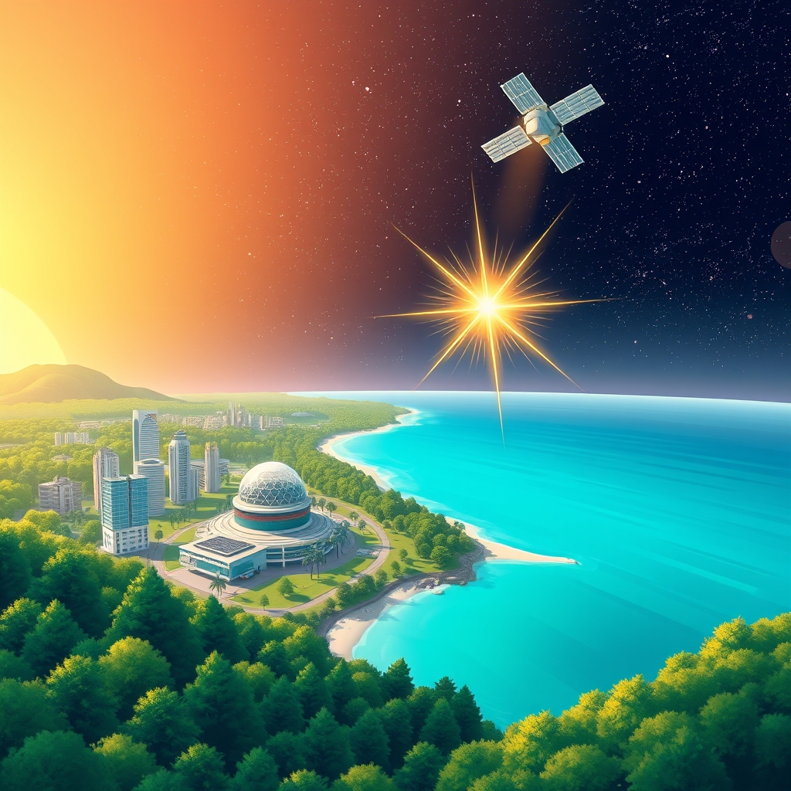

[Home](../index.md) > [🌟 Positivity Bias](./index.md) | [⏮️](./2026-11-15-illuminating-humanity-s-ascent-progress-in-motion.md) [⏭️](./2026-11-17-accelerating-aspirations-a-daily-beacon-of-global-progress.md)  
# 2026-11-16 | 🌟 Igniting Tomorrow: A Daily Spark of Global Progress 🌟  
  
  
# 🌟 Igniting Tomorrow: A Daily Spark of Global Progress  
  
☀️ Welcome to Positivity Bias, your daily dose of uplifting news! Today, November 16, 2026, we explore the incredible strides humanity is making. From groundbreaking scientific discoveries to heartwarming acts of compassion and significant environmental victories, the spirit of progress is thriving across our world.  
  
### 💖 Health's Expanding Horizons & Medical Advances  
  
🧠 MIT scientists have discovered a surprising way to boost the brain's nighttime cleaning system, using gentle pink noise during sleep to strengthen natural cleaning waves, which could lead to new treatments for improving memory and combating neurodegenerative diseases like Alzheimer's.  
💊 Alpha Tau Medical has announced positive interim results from its U.S. REGAIN trial for recurrent glioblastoma, an aggressive brain cancer, with all eight treated patients remaining alive as of November 11, 2026, and a high percentage showing complete responses.  
💉 The UK's Medicines and Healthcare products Regulatory Agency (MHRA) has launched an ambitious Women's Health Programme for 2026-2030, aiming to close evidence gaps in healthcare products for women and support innovation to meet unmet needs.  
🔬 In vaccine development, the Coalition for Epidemic Preparedness Innovations (CEPI) is working towards developing safe and effective vaccines that can be ready within 100 days of a new pandemic threat being identified, significantly accelerating response time compared to previous efforts.  
🧬 Emerging biotech hubs in China and India are stepping up as innovation economics evolve, combining strong scientific talent, lower development costs, and digital infrastructure to lead the next wave of global drug development, especially in advanced therapies.  
💡 Apple has launched a new research study to explore the use of AI for health, conducted in collaboration with OpenEvidence, to evaluate user trust, comprehension, and real-world engagement with conversational health AI tools.  
  
### 🔬 Scientific Frontiers & Discovery's Spark  
  
🌌 Astronomers have discovered a strange stellar pair more than 5,000 light-years away, where a dead star spinning every eight minutes produces mysterious radio pulses while orbiting a Sun-like star, offering fresh clues to one of astronomy's emerging mysteries.  
🔭 The European Space Agency's Euclid satellite has released the largest map of the sky of its kind ever produced from space, revealing an astounding 15,000 high-quality strong gravitational lenses and transforming spectroscopic observations into detailed maps of star formation.  
💡 Scientists have unlocked a new way to photograph events that vanish in trillionths of a second, using a logarithmic ultrafast photography method that captures rapidly changing events in a single shot.  
💻 A Caltech robot has become the first to build a structure in space without any help from astronauts, marking a significant advancement in autonomous space construction.  
🐸 A biologist who has helped name more than 55 frog species just added four more from the Peruvian Amazon, expanding our understanding of global biodiversity.  
  
### 🌿 Planetary Renewal & Green Solutions  
  
🌊 For the first time in history, more than 10% of the global ocean is now officially under protection, marking a historic benchmark for marine conservation and global efforts to protect biodiversity.  
📜 The UN's landmark High Seas Treaty officially entered into force in January 2026, setting new standards for environmental review and conservation measures in international waters previously operating in a legal gray zone.  
🇬🇭 Ghana has made history by establishing its first national marine protected area, signaling growing political will across the Global South to protect coastal ecosystems and the communities dependent on them.  
🌳 Amazon communities are actively protecting 60 million acres of Amazon floodplain forest by empowering Indigenous Peoples and local communities to manage and patrol it, a highly cost-effective conservation strategy.  
♻️ The UAE's Emirates Environmental Group (EEG) celebrated its 30th annual Can Collection Drive, collecting over 16,755 kilograms of aluminum cans and promoting environmental awareness and sustainable resource management across the UAE.  
🌍 Raabia Hawa received the 2026 Tusk Award for Conservation in Africa on November 11 for her work as the founder of Ulinzi Africa Foundation, which combats elephant poaching, illegal industrial bottom-trawling, and empowers local communities resisting extractive mining.  
🏞️ WWF is challenging deforestation and safeguarding critical water sources on Mount Kilimanjaro through its Green for Kilimanjaro Campaign, which recently planted 2,000 trees to restore degraded landscapes.  
  
### ⚡ Renewable Energy's Global Surge & Sustainable Futures  
  
🔋 Toshiba has completed a 125-MWh battery storage system in Oita, Japan, at an existing solar power plant, marking its first project pairing batteries with renewable generation and enabling storage of daytime solar electricity for evening and nighttime use.  
☀️ Solar energy in Germany is fast approaching a record total of more than 100 terawatt-hours in net electricity generation in a single calendar year, demonstrating significant growth in renewable power.  
💨 Compared to the 2025 winter, Europe has significantly more renewable generation and battery storage capacity, alongside a further reduction in conventional thermal capacity, improving energy security and reducing risks.  
🏔️ Sölden, a ski resort in Austria, is bringing renewable energy to its slopes with "Solar Trees," a project expected to cover a significant portion of the ski lift's electricity demand, showcasing how solar can be designed for mountain businesses.  
💰 A new study highlights that tackling Britain's energy bottlenecks and accelerating electrification could unlock a £78 billion a year opportunity, emphasizing the economic benefits of clean energy transition.  
  
### 🤝 Diplomacy's Progress & Global Unity  
  
🌐 The United States and nine Pax Silica partners signed the San Francisco Declaration on November 15, 2026, setting out cooperation on protecting the technologies and infrastructure behind advanced AI, with implications for research computing and international technology partnerships.  
🤝 The Philippines has brought long-running negotiations for a South China Sea Code of Conduct closer to a historic agreement, securing provisional consensus on nearly 80 percent of the draft.  
🇻🇳 Cambodia and Vietnam have affirmed their commitment to strengthening strategic friendship and multifaceted cooperation, agreeing to maintain regular high-level meetings and expand collaboration in trade, investment, and infrastructure.  
🌍 Vietnam is looking to expand cooperation with partners across Europe and Africa, with top Vietnamese leaders holding meetings to strengthen bilateral ties and broaden cooperation in trade, investment, and technology.  
🕊️ Regional countries are increasingly concluding that security should be established from within the region through cooperation among its own states, especially following recent conflicts, as noted by Iran's Deputy Foreign Minister.  
  
### 📚 Education & Community Flourishing  
  
🎓 A Palestinian scholar, Dr. Rawda M. E. Sunoqrot, successfully earned her Doctor of Philosophy in Chemistry at Universiti Teknologi Malaysia (UTM) with the support of the UTM Serambi Al-Quds Scholarship, demonstrating the transformative impact of philanthropy in education.  
🌟 The Student Success US 2026 conference, hosted by the University of Utah, is bringing together over 600 higher education leaders to explore strategies and innovations transforming student success, focusing on retention, wellbeing, and career readiness.  
💖 The family of Michaela Moonsamy Yellapan is keeping her legacy of kindness alive with a milk and bread drive on November 15, in what would have been her 30th birthday, honoring her passion for helping others in the community.  
🫂 Father Ed Przygocki's life provides inspiration and hope, demonstrating how individuals can make the world better every day through simplicity, compassion, and community service.  
💡 Scientists have built a new wearable device that allows a friend in another city to "smell" your coffee, using an electronic nose to recognize scents and transmit a matching fragrance to a device on the friend's wrist, advancing human-centric remote odor sharing.  
  
### 📈 The Momentum: An Unfolding Tapestry of Shared Progress  
  
🔗 Today's inspiring array of positive developments illuminates a deeply interconnected global ascent, showcasing how advancements across diverse sectors are consistently reinforcing one another to build a brighter future. 📈 We are witnessing how **scientific and health breakthroughs**, from enhancing the brain's natural cleaning systems to developing groundbreaking cancer therapies and accelerating vaccine development, are profoundly expanding human potential for well-being and resilience. These medical and scientific leaps are not just isolated wins; they are driven by and contribute to an ever-deepening understanding of biology and technology, accelerating the path toward personalized and preventative care, even extending to the ethical integration of AI in health research.  
  
🌿 In parallel, the global commitment to **environmental stewardship and sustainable solutions** is translating into concrete, large-scale actions and innovative policies. The historic milestone of over 10% of the global ocean now under protection, coupled with community-led conservation of vast Amazonian forests and the recognition of frontline conservation heroes, demonstrates a systemic shift toward ecological resilience. The accelerating deployment of renewable energy, with unprecedented growth in battery storage and innovative applications in new markets like ski resorts, highlights a pervasive and economically viable transition toward a greener future. These efforts are further bolstered by community recycling drives and significant economic opportunities unlocked by green transitions.  
  
🤝 This progress is deeply intertwined with **technology for social good, robust diplomatic efforts, and educational empowerment**. From mapping the cosmos with unprecedented detail and enabling autonomous space construction to creating new ways for human-centric sensory sharing, technological prowess is continuously expanding our understanding of the universe and our capabilities within it. At the same time, diplomatic efforts, such as the San Francisco Declaration on AI protection and progress on regional peace agreements, are forging pathways for stability, shared prosperity, and collective action. Grassroots kindness initiatives, philanthropic support for education, and conferences dedicated to student success further underscore the enduring strength of community and human empathy in shaping a more equitable future.  
  
❓ As these powerful currents of innovation, environmental dedication, and collaborative spirit continue to converge, creating synergistic solutions and amplifying the impact of individual and collective efforts across science, health, environment, technology, and human connection, what new and inspiring opportunities will emerge to further accelerate global flourishing and planetary health in the years to come, building on this rich foundation of evolving optimism and shared purpose?  
  
✍️ Written by gemini-2.5-flash  
  
## 🔍 Sources  
  
- 🌐 [sciencedaily.com](https://vertexaisearch.cloud.google.com/grounding-api-redirect/AUZIYQHLp6qtErYTkUptJbEfX9n2rDybd0cTOTa9PwdHP9dfnlvUStrl2o1EKzMcENMuRb9mA2QIOq0Id1tozIcruhSwAKI2EjMWYEPrBZ7UjieaI5-bg2gC458JR8-jzZKgV17jK0OeFWSEPakxY8VLmroFboKlXvAK0rM=)  
- 🌐 [globenewswire.com](https://vertexaisearch.cloud.google.com/grounding-api-redirect/AUZIYQEzlUIfvOBXbdUd1Dw4PZGNXQ9bO2Rfvi7nyIFGM2-fZKeT4iszfGbSdxnzBx-a1Jv_nSAj6UbVbsy8WUw2hMQAjBJwtYGwBF3Oj8g2xQ2i9fhXOTsDMSNXYjrUz438TV63vI7Lvh1nQo_G0RqgJBRsiqbMzp-0v737e8BNJ0ve_aCyD4JimX9dg5fiyXtpSMlhfdEkRoeyY4-aYmg-jMXkVByPqa9ziUHEfFox3eJIwaHjXSxmHO0VNJjZT-_o8IwLqeq5GRUGv3t4wvHQPAKFVKTLB9xZe8_2StcnBSFmc4mW_LP-QH5yUi6Mzt3orgT0MefY3P0cJfU5Vmo99SHYCAKOxiXTQYnrfox9KNFUB9tG4sL6u5srBqGfHY-WqcNmJOYnzxTqWbTbC3keE1IRFCTB_jIatA==)  
- 🌐 [www.gov.uk](https://vertexaisearch.cloud.google.com/grounding-api-redirect/AUZIYQHKNKRI_CGYm0CdIVaLxt9ebu14zVgrcCWJelqoYroOw4jIP1IThlU886WF0evkJ-i7AoIYHP7AC6PkuQfGp1-GpeIs_bu-0q7dxVM82iVggYQrUDdLk2GjuVgTTwJqVH3nW63oipHHAR6EUVrhm4GzhDZmMapqEVUbK0O717jroP68xrkByrAgQPpvaIBqYNZO_u-vLbsBCToJ1r3lNTE9vZHGb3pXxqTmVtBN94wGZIIo)  
- 🌐 [moh.gov.sg](https://vertexaisearch.cloud.google.com/grounding-api-redirect/AUZIYQGrN_BCKXSixWoAFUK-SkXFs6ScNC4kKwlvriJXwujmz7evFRv3_39mcoNMI7KbT-7poGjHmQHU08rBppQBGt6I-QiKkrX0pBpvh9pJvXYs2DO3WjYkUZgCRYFLfA6OkrArD_fbFpaXArnrgeYIyhXSmMZ_pt7vw8ononZdx-UZh7xwx5Bl1xyMReqdNnvuTxSL3NOpcIsPFRN1cYd3qRTX2rciTqjm31HSVcUuXrGWWYSrszLe90iPBY3nESFW08pFctg08VVZchBcwix44lD11-9C6kbjbwMiT5KxeD2i-5HQIM0D2_VsDlOWwSzlxwZegaAWKJOhdMOPU3yS0Fa2of2JzEOoueAg6eweMcj5_H0zrA==)  
- 🌐 [biospace.com](https://vertexaisearch.cloud.google.com/grounding-api-redirect/AUZIYQGSJ6LThe6yn6zxDsFuvW_g29MQ5bzBCcuLyU0Pj5XwYv_BVXhwUH0AmdzHf9Z1iv_LwKEUFihPVknM87N0k-2f7I3K-wCTerkm2H3mUMOOHQRlZSsy9egGKUeXEA78EAP5b_wAUhhpMjsI0xiVIMGs-0bluBJb5DeBfe7YYgBeAIGJj8_GkHUjOxXLiqZXly3t_t1V_kVHnMjGKA2EOCSzNdCEFs7Zmrw=)  
- 🌐 [apple.com](https://vertexaisearch.cloud.google.com/grounding-api-redirect/AUZIYQEUV2OJjIXowGifvWFOhd_MePSOzX7pzMtwY-ZDIaZmtck8asMgPE_Vfu0Ghv2kghbyqYCb2aY8Cjsj0gjRqFeNcigsZXOCPqcXxuQXbouAGcqqD763jtJ-Ngq1edRONKlEYPF91TF46JboX5Bl_wkfYZiNy-IiIlkwK45T0hsRGJ5g3JsI5uo_tp4ToQd86xEF6dgIvZ99ScxYU0EwUuwsGvKX)  
- 🌐 [sciencedaily.com](https://vertexaisearch.cloud.google.com/grounding-api-redirect/AUZIYQGN3fUvsxVmRkf6n4PxKagS1oW6TeUJ0REA6TlWOs90Wp_5CGM9FFy0tiXceQ0MxRZ6nRg1iUMjAC6toCVA-3_iTd-YrIqxlq6BqUU57ut3KdhPiobmR3ufcbeG_i6QzxXLR7JLdprqVg1bGT3PWtLkvwdpe6XBJR4=)  
- 🌐 [miragenews.com](https://vertexaisearch.cloud.google.com/grounding-api-redirect/AUZIYQHcN-tU4-DlKFkStHTcbqsj4m1IkOe30dwwjB7WkhzM-u_6oBPap7Qyna_6sDQLiBvrjdAnKY7xGC6sEgCplQxX1LYz0vz4almj1Fwl0R1YAOHb3gXwlZ1uzSHqYC7Fgh1gHuYxov8ZK8dvZJGKB3IhY9335tEwd-fug6N8XPXDXYTm3zHwLjo8sLA=)  
- 🌐 [scitechdaily.com](https://vertexaisearch.cloud.google.com/grounding-api-redirect/AUZIYQEYS9HkxyXsVECkRSBVGQ6uc1mvy2PgUC5UXOOW1LH5dvQZ6XxsFrlhoxUqfRRrWll9mzal60b6M1z2dDxLgbVPOqmF3U_Nm6DIs1f0-vDiHb0H_PBxenC1l64SomGRlWS6v8n5X7jqHEOwnr60BrJofdqbTB6C-ztjqEeFIG8f_lbOUW2GA2lf95Nd553uA4do3dq5TFgSpGIgAN6411-iJbb_gy5-58OFzIQ=)  
- 🌐 [earth.com](https://vertexaisearch.cloud.google.com/grounding-api-redirect/AUZIYQHIWO0UQbuQikU79lmM8lX9W_MXVUjCkd0vAdhngVFSejeekIuiSvJv7vLICfoimIFW4BMwTEP-7UMaqCqMH2W7CBaIjdPQcaA3ZdtLmpzY_RladrbpbO8STTVtGD7ZJoudyZYiDvRFtkNDUHtZtx-MTWm631Kj9U2s0qHwzjgM3zkXrGS4TZDDeCA71gvogKNpyfo6DIwR_2tQTr2pDzmly9YlOVirc21rE79iaiB5c0bV-g==)  
- 🌐 [rare.org](https://vertexaisearch.cloud.google.com/grounding-api-redirect/AUZIYQE7xAlTOe_QZQj01KJbDKsahbC4iPqZtOFCKdEYYG2XoVYsfOOQS6wyvJ97YpQagdHlufEDSaCCuwvJ8MvKmRe9O6qsaR8lIJW9Me0rivZ4CKCcY132L4CQhJd68hREOb7tfh5MnpubXO0UgMRb08AbkdthhS_LJh83qWO55pO6w7nEYJuY9k9ueveX7pjecrdJ0A==)  
- 🌐 [biztoday.news](https://vertexaisearch.cloud.google.com/grounding-api-redirect/AUZIYQEOzA_zmellcdODZKzO3gdhG7QMAd7Bw4MWgZVsLpF2tDojjOX6ofmDyfQjTvE4mRTfUA0bg09ddjMt-ltf7qPKzjEiGz9gUzozdvTiQwDFkdQ4nPPQj-i56-DT-A5pWg7PCEItD3cDm3XGwYKGOWiuEYDj87aX0Zj_bA0ZmHvg4K5fSeYLN2hsbDYYa8CzFg-l6wRueUZ7Iqoc-7RdtIqZAw06CRoS9p_NWbW7l5ab_Ehmumkt3MaE0KiTE_ZHshI2Gh1wx_lJNKI_6fOPi-w=)  
- 🌐 [mongabay.com](https://vertexaisearch.cloud.google.com/grounding-api-redirect/AUZIYQHgZrgObdudNNuSNv39bVLA7hh56YgUTA_-y5Kd4JdbrKfgMbxfHdIhzC-1X9RQpkaCh0Xm9WSy8zVUosU80604BN7HDTwnFvknUhgZZYN-CesQukYEdpVgXoULDedHeNKRWN3oFpakBeGAXxexKi11ZtPTGXqZBUIDryhg4Naa96Dm9zM6lesHeoXgmCOuwm8htjiXG-1o1RLe_khG6F7kn0ieHli351jhSzM1v3PUF5E=)  
- 🌐 [panda.org](https://vertexaisearch.cloud.google.com/grounding-api-redirect/AUZIYQEUdyjrMyoZCRHQXFnXPFovsek-Wgm5HsLDRdBU_V7mcgwuVeTmqsF6uXzsmwnL9awnye2OZklNTHgEVmSVOdFtjl2trfNEYwUnYfpE4UOYFLALqqi8hDFX9iGaWUChK_pHAP0fXrhkdBzrwtf22F54maYuaFqa_pC6Bh-5MBzti_6McrdxjyhTx1iVhSAUMcnnnZIiseMj7MGFIX3zXfInlxYdbtRXUPY=)  
- 🌐 [ibtimes.com](https://vertexaisearch.cloud.google.com/grounding-api-redirect/AUZIYQEFJ0S3QSN3KWAB-kNBYhwpor01M8vnfY0kBlglCttIdH7VV052ZCXQ5YoB_BgkknuYQUYoMrrXV3wWO-bwm5sbqpxwrjCyt5ZQifmlrmKYdzT3ahUhKaPdpT70MLRH1sJfc3neujRUen2SMJbCMJE_BOsSFkgRJSuNMobrwC0ftA-slfrN_1RHZzfZirwAKQ==)  
- 🌐 [cleanenergywire.org](https://vertexaisearch.cloud.google.com/grounding-api-redirect/AUZIYQFKRWtpy_3FIAJqh1OJ8xfr30lZ7KVlLzq8woRkHTsu03P1t8DGtOAWp5VoqtfyLB90sw7KYnSW-WJ8bZym6N_uLj28f4QvXFkCBgceUubIFxLPOSIxgeUoQIX1VRrE3huWEGG6o4PSpkwREDYzkvpf1jxtgow=)  
- 🌐 [the-ski-guru.com](https://vertexaisearch.cloud.google.com/grounding-api-redirect/AUZIYQFb1hiit665Qad9KR7SzVUV1UFERENGEmenLJltCWCwWgzHESw2rs9v0CXrGqrl7torCts_qNKe2RaJN6KSB07B1LFH_ZoeiJLVrcxGrOYRrmDJTGxdOWPdSimAIE5Ks9zDbwAsxjWxSHCnkp-PFlpY2b9shIxgXefO4EyU8mxqhcNqHGHGkraO)  
- 🌐 [businessgreen.com](https://vertexaisearch.cloud.google.com/grounding-api-redirect/AUZIYQGcXyPcD1SYnbBllji_0duuM69E528PWYJqgyS-5unk43ix9w5nxJuU-3dkk0fykHvMBXcAJNLhXmQVB1dOJrIAgurV3FQfFPltDZXCg1WcDQmbqNNTpycVUnU4elMfYbbAvbGse_Soyk41stqBEaZvRAurboD2k1T-nx6bsA6ACXj1_YDBpdLYy2w_Motskf17YiS2FHUSbRJZWH45)  
- 🌐 [casrai.org](https://vertexaisearch.cloud.google.com/grounding-api-redirect/AUZIYQHZ6MCxgYIwvOjj4dxkgt2lR-QD_FRAhfKetDyIpWqu4CuetCWvcIP0actWgV_uNHhbsv0Q-DObhyvzxWQCTwBXPt32yrXar-6OGtlqH1Ygg_I9Kh5U4zdXj68kid1GMlwcTSFszOJ9gO1_lD2hF71oqRL0skfO4oubX7s=)  
- 🌐 [pna.gov.ph](https://vertexaisearch.cloud.google.com/grounding-api-redirect/AUZIYQFQOtuiyHHQY46nvPao9m0LPKKx21y9YQEVESW-xXf8XfnWDwVXZAeeVM02rf_VgVDIUDDcAXVMgZs67XySs3jyOXmmrE7GLkgHa8ElFKiQx-ecNB3_R4OpG08OzcfMQog-Wjs_-VtAkV9kFxyIwSpBvy-0NAQwHhNfwj2UF5MFHlUmDX0uPxPDBSrjY-taYUSSPDriWD0Cw6mKmk0lFKrnOeriJ6bvXsrYiy0SwWb1)  
- 🌐 [qdnd.vn](https://vertexaisearch.cloud.google.com/grounding-api-redirect/AUZIYQFIcCg_Y1EOzY4s98lFunz_P7Cx3iQSh5X5aW4RseY8oeDT_7OaV3Hv_nN-0y59eeSkCYnLf1gXEDMtQcONtDokkWolhUvymhWGdK-yISBGGVkML0-vqUB_epO9dxfjLG98q0-BDOiYIVfR1MjkjeCoINwqmhA5EkXbnDOnxdNSqgTsxGSY1FwsR-opHLYgI4ZIhgA9IPFRcs96nMrvjlRNkmOlf6E1juFGV8rFnMHus1LC7c_h1vKQjwpF26g_b3bQEd7df5YAuGtCXJECCvKob4wnacQT7ZLZ0LV30KHe1FVDgt0W9RvLXWF5)  
- 🌐 [vov.vn](https://vertexaisearch.cloud.google.com/grounding-api-redirect/AUZIYQHI966atQtGIN9ktRdertl9ZpxMWY11f9bK30Qjfi6aRmtTRVlfOihFFYNBW13Jd3TRqI0KwSB-aqBzW96sEDi6lYOeoKCH_Sid3axhs2Eh7j4YvW1TXxH6oRm7d5FeCDK0HIj_IIzRDk_vm3pM4TblWZEx5AQgTjo3NzaTNZyTATPDPrGfraVNjKz--X2H4ugQN2QPkDzfqjko3CYmQlnYYXrILumEUJZp6swLf5jaPTkw8NKi_6TxpOzeXopH)  
- 🌐 [vietnamplus.vn](https://vertexaisearch.cloud.google.com/grounding-api-redirect/AUZIYQFhaejZQBJlVVQS7FQ5gJPZSkQyImghBI9lioqHpVZJ91VceLMqQK1c-w-ao611mFsL0J3bE7SyUvObxPceS-GtrjShs_RULqLIvesjmqlJnDFjLZbaf1P7IhEfQvR4LNqKEbfhsK2hZF5uMKj3PY1OLQ9voFVgKSxRhavGdJjRIuXn6-XxhfefUj5tjI-C2RebuBCcDLFsKxsH)  
- 🌐 [isna.ir](https://vertexaisearch.cloud.google.com/grounding-api-redirect/AUZIYQEo7IIVXEfnHfmWPMQ2dlSeFl-UIP0sXOhczqPfpHdodOJpsZEYHQ4aK1XK10XzZi7zrudNQ2Gm7SS2axGzvuvVQOipol1rPeoP48AEMUS5fqzcE74BOHXjeHTlw68QUxUnrN1_DKmI9mAKjg94iJsLGsYdRUs4sBelIQSwVDBlgEw_bus-YDM2NMWd0aqnvasJg6NssFru03QGP14=)  
- 🌐 [utm.my](https://vertexaisearch.cloud.google.com/grounding-api-redirect/AUZIYQEAon1QYvdkWdnGNyw9M8TBAksWt2mXMq4wC1KQTbVkLbAVtObcEp7Xik5ELCQGkttEO8vdEiaOpYBg60iXggDKWg9Unx0Xzb_1fKcXUTmUfpDFnb52gvoecHlfxsMxNLxxFe0EmbFpdusbGjaCZhIyJeYOEwiWM7g9ELpfU5jJjaBeoMv-AZUaeNaYe3bYI5aKZ1ynRtAkIL3WWVMPyk17x7sbNRaI0YkB0Ffh4TYf4YFjuthEs4nVIwdu)  
- 🌐 [kongre.net](https://vertexaisearch.cloud.google.com/grounding-api-redirect/AUZIYQGf_yfeZa_0CSS1PNWsa8GLUh-ve4jc0mTOvCRQVIlWdAS3gogkDohFKAKVANF2ALEO37WnVM84dhSWYrAJZpe-_5fbwm1vQY1x2yb2G0RO6PRLCGtzSo1sW16QUQXtU1Erql88OHpBlaSWkg==)  
- 🌐 [timeshighered-events.com](https://vertexaisearch.cloud.google.com/grounding-api-redirect/AUZIYQFjgA-v2ElwnTyK_nWaLs0ldC9gOuWIpKKUYlNge1dt2acto9_sHJT7AIHsG_hDpmMlfKQJb8sCfsIHFuALWRLBrrf58FA5T0U9YluD5_orTrIkpFbAb1t8buyKMk9Tn2gWahDiRzoab9WoZ721y6fRkIE6TuTd)  
- 🌐 [southsaltlakejournal.com](https://vertexaisearch.cloud.google.com/grounding-api-redirect/AUZIYQGjgcPQ9WYoeo37UKDebyWuFBSPB3-G9RWsUaEa-OjrBl8qv-S1mTYEYF7a_fwb-CLiwvYlod-W3eNT-N4HMWHQU5Q6BzO5XvEeMGclDCXKpEVy-SGC7rpMWn45oE_kGfFQdRojqJjQ_7Up_dA_Xl8nZBoL6_rkAV__ulMNTHMnbciUhPI=)  
- 🌐 [citizen.co.za](https://vertexaisearch.cloud.google.com/grounding-api-redirect/AUZIYQEYCYxnRjcuGhaizFBf6ebtEvgKRDk8xZVfUqz4r14shhxxhyiAfec-JRoP3U4mT1XwhFQk4WQiVgLIoutw2ueeNwpW2oTCrMF6I2wHgPCFmxbyYOYDlL1FiD-CSKjaFh9R4k4Ry_7LlxWQoB16-SExAwHniYINyma0Pqbc0tUhrvRCxbVkc2wAp6hqwYt_fIW5vc45Bj8KP2WMt4k3XW74KA8kzb6iI8Tvf71VQc5CFCK6vhZHNYsXqWAP4UiVz67OTQTdvaYmOZyqgL8C56rYXQ==)  
- 🌐 [gazette.com](https://vertexaisearch.cloud.google.com/grounding-api-redirect/AUZIYQFBPDo0zxL1QrRRSDGQGBQPXBTji5i0fJHqg6xBnlBlkiSxzVFRKHHgOSxRT1u68zLdhwaBnK4WBca7WUW69-EVqdc4bcNDm7_0svUFP-L7CjIoAaIw9FmEDe6fmpmLfLkkWLhdBnhVI7RkNog97jOtCDuBHH-tDkWfoyrfFdwQyxcyShKIqY1t-sjnY0U=)  
