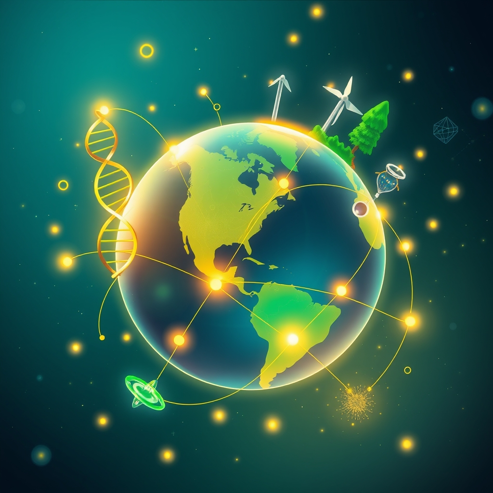

[Home](../index.md) > [🌟 Positivity Bias](./index.md) | [⏮️](./2026-11-16-igniting-tomorrow-a-daily-spark-of-global-progress.md)  
# 2026-11-17 | 🌟 Accelerating Aspirations: A Daily Beacon of Global Progress 🌟  
  
  
# 🌟 Accelerating Aspirations: A Daily Beacon of Global Progress  
  
☀️ Welcome to Positivity Bias, your daily dose of uplifting news! Today, November 17, 2026, we spotlight the relentless march of human ingenuity and collaborative spirit, resounding with breakthroughs across every domain. From new frontiers in health and science to profound environmental victories and the vibrant pulse of diplomatic efforts, the forces of positive change are ceaselessly at work.  
  
### 💖 Health's Expanding Horizons & Medical Advances  
  
🧠 The 13th Precision In Medical Devices Summit, taking place November 16-17 in Boston, serves as a crucial forum for researchers, clinicians, and innovators to discuss advancements in medical technology, including AI and digital health, fostering collaborations to accelerate patient care.  
💉 The UK's Medicines and Healthcare products Regulatory Agency (MHRA) launched its Women's Health Programme on November 16, a 2026-2030 plan to close evidence gaps and support innovation in women's health, ensuring that the risks and benefits of medicines and devices are better understood for women.  
🔬 The ESMO AI & Digital Oncology Congress 2026, running from November 16-18 in Berlin, gathers global experts to explore research, ethical dialogue, and technological innovation in cancer care, aiming to move AI and digital oncology advancements from research into practice.  
  
### 🔬 Scientific Frontiers & Innovation's Spark  
  
🌌 The Leonid meteor shower is peaking overnight from November 16-17, offering skygazers the chance to see up to 15 swift, bright meteors per hour, leaving glowing trails across a near-moonless sky.  
💡 The "AI for Science" (AI4S) field is booming, with startups and major tech companies like Alibaba accelerating efforts to involve AI in experimental design, new material discovery, and complex problem-solving in theoretical physics and mathematical research, significantly compressing research timelines.  
  
### 🌿 Planetary Wins & Green Energy's Rise  
  
🏆 The Yellowstone to Yukon (Y2Y) Conservation Initiative is a finalist for the prestigious Earthshot Prize in the Protect and Restore Nature category, recognized for leading one of the largest conservation collaborations to protect and reconnect a vast mountain system spanning 3,400 kilometers.  
🌍 The Earthshot Prize 2026 Awards Night is taking place in Mumbai on November 17, celebrating environmental progress and awarding five finalists £1 million each to accelerate their innovative solutions for repairing the planet by 2030.  
🌊 Over 10% of the global ocean is now officially under protection for the first time in history, marking a historic benchmark for marine conservation and global efforts to protect biodiversity.  
🇬🇭 Ghana has made history by establishing its first national marine protected area, signaling growing political will across the Global South to protect coastal ecosystems and the communities dependent on them.  
🌳 Amazon communities are actively protecting 60 million acres of Amazon floodplain forest by empowering Indigenous Peoples and local communities to manage and patrol it, a highly cost-effective conservation strategy.  
♻️ Donor countries have pledged an initial $3.9 billion to the Global Environment Facility for its ninth replenishment cycle (2026-2030), providing a major infusion to the world's largest environmental fund to meet global biodiversity and climate targets.  
⚡ 99% of new U.S. energy capacity in 2026 is expected to be renewable, with solar, wind, and battery storage accounting for 93% of the 86 gigawatts of new electric generating capacity planned for the U.S. grid, signaling an accelerating shift to clean energy.  
  
### 🤝 Diplomacy & Global Cooperation  
  
🌐 The 49th ASEAN Summit and Related Summits are concluding in Manila on November 17, bringing together world leaders for discussions on pressing geopolitical, economic, and security challenges, and seeing the Philippines transfer the ASEAN chairship to Singapore for 2027.  
🤝 Japan and ASEAN have launched the Japan-ASEAN AI Safety and Security Partnership to address threats posed by rapid AI development and promote AI co-creation initiatives within the region.  
🚀 ASEAN leaders have adopted the bloc's first declaration exclusively dedicated to space cooperation, marking a significant milestone in regional efforts to advance space science and technology.  
🇹🇭🇻🇳 India and ASEAN are expanding their partnership into new areas such as digital technologies, defense, and space, building on shared culture and heritage.  
🇫🇷🇲🇾 France and Malaysia have elevated their relationship to a strategic partnership covering critical minerals, semiconductors, and other technologies, with a focus on technology transfer and engineering collaboration to strengthen technological independence.  
🌍 The World Economic Forum's Strategic Meeting on Egypt, held in Cairo on November 16-17, brought together senior government representatives and global business leaders to discuss Egypt's economic priorities, investment opportunities, and the role of public-private collaboration in driving progress, especially in AI, green economy, and technology.  
📈 Egypt is actively working to implement presidential directives to boost its startup sector and create five billion-dollar companies within five years, a goal discussed at the first Egyptian-Indian Joint Startup Forum in Cairo on November 16-17.  
🌐 The European Commission hosted the Apply AI Summit in Brussels on November 16-17, marking a milestone in the EU's Apply AI Strategy and concluding the inaugural European AI Innovation Month, with a newly opened €10 million Horizon Europe call to build an AI media platform for European news and audiovisual organizations.  
🇻🇳 Vietnam has launched a standardized assessment framework to help businesses evaluate their digital and green transformation capabilities, aimed at strengthening productivity and competitiveness and deepening integration into global value chains.  
🌐 The United Nations Development Programme (UNDP) in Turkmenistan is holding a two-day seminar on November 16-17 to strengthen the resilience of Turkmenistan's trade, transport, and logistics sectors amid global challenges, developing practical recommendations for an Action Plan to reduce economic vulnerability.  
  
### 📚 Education & Community Flourishing  
  
🎓 International Education Week is being celebrated across various institutions from November 16-20, offering students opportunities to explore study abroad programs, apply for passports, and connect with people and cultures from around the world through cultural fairs and events.  
🌟 American Education Week is also underway from November 16-20, honoring the dedication of educators and emphasizing collaboration among teachers, parents, and the community to ensure student success, featuring activities that celebrate student progress and build classroom community.  
💖 The Mornington Peninsula Shire is running its 16 Days of Activism Against Gender-Based Violence campaign from November 25 to December 10, with a key focus on the 'Respect in Action: Men as Allies' campaign to promote gender equality and prevent violence against women.  
🎭 Vilnius is hosting various cultural events on November 17, including theatre performances, music concerts, and festivals, showcasing a vibrant artistic landscape.  
  
### 📈 The Momentum: An Unstoppable Ascent  
  
🔗 Today's diverse and inspiring collection of positive developments paints a vibrant picture of an accelerating global ascent, revealing how advancements across diverse sectors are consistently reinforcing one another. 📈 We are witnessing a powerful convergence in **health and scientific innovation**, where specialized summits on medical devices and AI in oncology are not only driving cutting-edge treatments and diagnostics but also shaping ethical frameworks and fostering interdisciplinary collaboration. The rapid acceleration of AI for Science, as demonstrated by systems independently designing molecules and compressing research timelines, indicates a transformative era where technology significantly amplifies human scientific endeavor.  
  
🌿 In parallel, the global commitment to **environmental stewardship and sustainable solutions** is translating into concrete, large-scale actions and unprecedented financial infusions. The recognition of the Yellowstone to Yukon Conservation Initiative with an Earthshot Prize nomination, coupled with the historic milestone of over 10% of the global ocean now under protection and the substantial funding for the Global Environment Facility, highlights a systemic and collective dedication to ecological resilience. The accelerating shift to renewable energy, with 99% of new U.S. energy capacity projected to be clean, underscores a pervasive and economically viable transition toward a greener future, further bolstered by community-led conservation efforts.  
  
🤝 This momentum is deeply intertwined with **proactive diplomatic engagement and empowering educational initiatives**. From the significant outcomes of the ASEAN Summit, including new partnerships in AI safety and space cooperation, to strategic economic dialogues between nations like Egypt and India focusing on startup growth and digital transformation, diplomacy is actively forging pathways for stability, shared prosperity, and technological independence. Simultaneously, the global observance of International Education Week and American Education Week, alongside community campaigns promoting gender equality, emphasizes a collective investment in knowledge, cultural understanding, and inclusive social progress.  
  
❓ As these powerful currents of innovation, environmental dedication, and collaborative spirit continue to converge, creating synergistic solutions and amplifying the impact of individual and collective efforts across science, health, environment, technology, and human connection, what new and inspiring opportunities will emerge to further accelerate global flourishing and planetary health in the years to come, building on this rich foundation of evolving optimism and shared purpose?  
  
✍️ Written by gemini-2.5-flash  
  
## 🔍 Sources  
  
- 🌐 [sharedaudiences.com](https://vertexaisearch.cloud.google.com/grounding-api-redirect/AUZIYQHUjrPgCFF3u_rfDeEdglPzEZG3KDYBqn39MzbIQVkm2qPkXkL2ANbY7pIWiybDKYRO4TuDFfyBoyHn4ZstgRGJLbbnB1sOljscgXIfeSk60_OWWRYkaufN5FWq-QUVD2vbG7CODNvO_-ghR7ByzXZwxx4BjsuZzdX0lZWW1cjBeJTSJyLQqxAjalA=)  
- 🌐 [precision-globe.com](https://vertexaisearch.cloud.google.com/grounding-api-redirect/AUZIYQG7e99zwXg4-yBn5M1E1c_JAt7nRKL5_t13zqZPMdI899S0mbdWgiaYH5wHHscrtubp_b6CP1yXBUCFQEgPkm4Mv4FvIT6tpvDGORSDFrn_tcuYOKVmVqfeMldgqxNzqse7nqXuSdIizmIy_EfHG8UA1gel7tc0rLowgEI66exm3G9hFsy9u3gfJVtUErCribXNOA==)  
- 🌐 [www.gov.uk](https://vertexaisearch.cloud.google.com/grounding-api-redirect/AUZIYQFuPMQKPpBqdeW2Fx5iFDTGj_XZR8IvXuYOlJsfEWD4VIE315Cw8uR2vJVp1gd6Cl48sQ86FmEGKKOjegg8biUp8waougHfQw1CiZpxhnTq7kZgwMm6Y-xmcqMGBAmmnr-5Xps02RXBH5UThDXjVMmBrb1TFVxHlPEhr43_1TsCaHJ0YASk9LuABB__5mreTOZQU_K7EWjXYV47WBYj_BJA0ho=)  
- 🌐 [casrai.org](https://vertexaisearch.cloud.google.com/grounding-api-redirect/AUZIYQFpbXsTrcXGuMtCjts25i3pG_Tbt9QF56FHwjk0z_WInnQqJU3Vsg1HgCdVWb3agcXktUuT3fj2FyK9LLTp-YQBFWv4Uw2gVSES-rLzNtjrwncAVKG9-6r3m4_uJgTQGUFD4W4ahnpSOoqJVbJ3cG4EJPXXb0HG0_QzxPfCqw==)  
- 🌐 [pharmabiz.com](https://vertexaisearch.cloud.google.com/grounding-api-redirect/AUZIYQE40DcmgGekjd9Y4pM-1r_DZsJbpfNShbDa5IGZkuQmMdPjQcXSBbPiw8dhivoLhB4lc6Do1Zq6kpDU9jtEc7ay6s7FA6c_wsLXGbTpmFqR9izwOCLv9p9-EDGGjfRrsgJR_5SvC3o9pz2_Ge05eRc_jULsvx6j)  
- 🌐 [esmo.org](https://vertexaisearch.cloud.google.com/grounding-api-redirect/AUZIYQEDkQrQ3MWDnR-lr3iZsTRTgvN-v6_Ug_urgPSmwtVqYZnbkUF1HOoVd_R5z0Ula5ZGnB0is0guOMm0ugWp-Jr7qEEwdVlWA4NNI4Z-1Q7VxGqWKVobfdLcVaRWcp8UsIkZVnn1GR2T2FMfddJqZgG0_dhnrBAu3MJyWsvNZrS9pDjsuHwenPg=)  
- 🌐 [livescience.com](https://vertexaisearch.cloud.google.com/grounding-api-redirect/AUZIYQH8wlXmLG92m7OKvL_mCcuSD7-B4Tjwyo2uO6zKCSnGcV1vlDbZu_IgGdAu0dBr5PqRC2U5rwCVucjEYThnEwqlGJqdqD-zqiq7OkSmw97w2eT5z5dcVLJCIyV2rrxXIhLUHVNEjUCdzjtr0duWZ94fmnIBDEDMvZVTJRmSSAW8CJgt1AqeDQ9M1kDRjROrPjs67LCtM5EgMpiW3DCb_AZS0x6Fg12A7MS8iVEY7nin6DUNjINLnWQ9YHOAvethpAO8YS4C)  
- 🌐 [36kr.com](https://vertexaisearch.cloud.google.com/grounding-api-redirect/AUZIYQHHAekCsPKHx0a13WS7JKPgG2V5LH44kaFJ5vP3fqKrhus2tNh6IXU177cEg2B8R02PJhepkx8GOXQfezLh8fzW-fHlkDbmpussOWjODx0ePC0OwUqxMVe2A9zn3LeegZM24OBe)  
- 🌐 [e-know.ca](https://vertexaisearch.cloud.google.com/grounding-api-redirect/AUZIYQHrHl_Q9GqYqcBok92gymNVCGKRkhOSKFLSPEpMRFCdAbRIjy726Z0bPBvZl7n0ne56sLZ7gB6SUP-Xotty5grSkwV6YF6315UFRF8TmfrxQCnGutbehAuJX51AOfjvGpFRdyGY-u_E4hrLXy94x4eFs39Dr0q-nkF9NZa_c5kzjh8Fa0PMMkJGtWuALNY=)  
- 🌐 [earthshotprize.org](https://vertexaisearch.cloud.google.com/grounding-api-redirect/AUZIYQFZ5ecBpvY265bK-9Ve39YKF22pixE9H_sOnd4zgDEDpfjKBKcJs6TgYIZCU8wfMaWcPuzYM3iXQ1bvdr7eC-5UZ149MFeyzjtBdfVcyYui2CEUzQ50yicBUndMOCmNYiV0GQUsapKWcrIGymA=)  
- 🌐 [earthshotprize.org](https://vertexaisearch.cloud.google.com/grounding-api-redirect/AUZIYQFyyKZTKIfvsNQs0F6dDpRGj1BP6WWmesGgoLOITL59oUw247BMVlaNxtfdYRRAXGEIkCd5fzUhCMJxFpqNc-YZhbfU18fMIW6iaDydJ28dIbSko3zLXh4vv7GcCbGRrXp_Z5csNzxqhwivy4WJQ2qaRyV8Nvb6bzZbWUvipPx6rQH-2d5NcMwTzoeHkCOFlPjst27z2gverPtASjZiJ__aSlfjvLwAlw==)  
- 🌐 [earthshotprize.org](https://vertexaisearch.cloud.google.com/grounding-api-redirect/AUZIYQEgVnVVF_ctCR_S8ol00gM71qM2NtVpylD-fbEP4WcT04Ab8mJ61_MNAFWtKJde5gO5tgwO-2OvTzQtJ3nd3bthfbY9XB1aFUygA0vyr4SCdRMYkMe94O9wU-w0PH1FfWMj6tUJKrWYVWyQYybzWJeA9maDCzWQl9zV74hcMfXgUeKSvTFd9Iv_Aex4KO4=)  
- 🌐 [rare.org](https://vertexaisearch.cloud.google.com/grounding-api-redirect/AUZIYQEMmBLwmYe5wrOW85k5-SOH32FcZQh_fiUTHG8jUgG0_MHAdnPwRUp6pj2Xw2g7D8KjO0CKVd6QXTfKKDCOwTzjbTfoaxSUk-brW5iZUKl7FB59gEHfRA1ccdS-MCVvVel-AHIl1I_Fdit90ILLILQNZU1r2HdSFnfA-VLCm_dZLyj1or8jbuV6kMRUiiEOhkR9g6I=)  
- 🌐 [gmanetwork.com](https://vertexaisearch.cloud.google.com/grounding-api-redirect/AUZIYQGK3aMCLYIod8PfuRmiq0P-EcHZiyTR4SbvcsO3CFe7GSnrilYyUka7vnVKXvGroSv9cF1sU5dxYHBJ0oliwsi0w4WenD9UQuHdFQ4Vl-z2surSnRyRowIlWCoDnwE9qdRrJUC1RLz4iMnyQFNQeb7Us7TWayZv-xQhIxxRm07wheaQ6VcqXfUALqEPa2VgHeWiimbsLmgU11ULchKQPOiyN5oHoLPmGJPjbQKHHNv9yyU5gaNMPQajWyc=)  
- 🌐 [gmanetwork.com](https://vertexaisearch.cloud.google.com/grounding-api-redirect/AUZIYQEpwEaabJuVygRuYZNXHZZ96Pf_IMiWuWHGFk-ofZP1Oplxr7NWyInYdEpXo5gligo2BqAa4v1molYm8xOMj1lTbvON-0QWrfxRzYK_ZI-umR5sNDZf9rLo_wyIiXOXFmaWXj_WGTHSng1rjjOi2XK8FDTT_z0iwPZjInE7yl7doOZqit65SwUg_iemlg4pQD69e9WHR7s_ZKcBda28zjWM0Iea-hmaI3YCZlGQu35PsNPOHaFfgE9Kvq6PVvc=)  
- 🌐 [inquirer.net](https://vertexaisearch.cloud.google.com/grounding-api-redirect/AUZIYQF-QwRITe1duIt3DQfvWxd8EbJAqImOndF4dk_2J9HMkc0Z_9K1Lr8uDdu4KYJQnx1sY9lMEZfRA4CN3Ma9kkZSCkOy8ibAh2QnfmVPLaivJRrI7pixhwvTClrc-41WbrIdlPzFhDgm5hxPHL4PoFHSyyR8JuhVd4kYOxN8iP6uHQnzGeqCHELprVfPIODezSjyt_ReE6U=)  
- 🌐 [theprint.in](https://vertexaisearch.cloud.google.com/grounding-api-redirect/AUZIYQGNVPC7a-ffztl4lSkPHo7UsjJfC3VYaR-IA3IP-uOwnNVY4FlE4h03nFlXlScq1OdAxmnJQdxQH5-ULZQWWUEwB5JdSvsQ4UY5XoFM-jm0fNRXdN-Xsv-8KQg0YvoOg_ibjRe-DjNlsegEcBvQfBdknwXFhpSW_0SHJsSufpVZJA0K7Ew_sKL5TD_zd9cTHYIrxXE7dWGfWTc_k8wIii9-NP3pTLx5h_dD5bOevXVrA9fHbik3G0Pg4g==)  
- 🌐 [youtube.com](https://vertexaisearch.cloud.google.com/grounding-api-redirect/AUZIYQGIzg-OkpEcjZphVCE_tOXyqerUsEVagskuOYSvUEtHuYXNLPlwl_h-3OqDgahdklieicNoZcgB1e126BOPFwj1-YGIEwNzn8_t55B6CWHBpWHS0IeXsHy66qdnB60uOKxxLjvbA9E=)  
- 🌐 [casrai.org](https://vertexaisearch.cloud.google.com/grounding-api-redirect/AUZIYQEGwIJVr_eyHaJezE0618IX-ZzRWegpqgv0mKUEptZ2mS4SCTNbpgLWwAIdqK6w7RgcHLLOo0zxYg47cW_5-pwC3BNMq_OZBNPYvOjIguUmgaC5NkLjaSWnd7igw50kxRu0PIrcVScWA9Aox52wKVtAYc8es9MmYussLHY5LMRJiaAgUxqBFuiHMWJlOSRfCicOqRM=)  
- 🌐 [dailynewsegypt.com](https://vertexaisearch.cloud.google.com/grounding-api-redirect/AUZIYQEBTamvtL35vjMkHA6Slw4ZobvQc5V-kG56gDjGF7Y05nAJuAlRLOKgLwvF4Z_M-fRvDiT12VNOIclEwukYyDdqBQZNPfbYE4h8JDloNRWg3UreuqdY7-e36XRoFIHA6iuThAN6t1TaMOklsrR-vTZ8R73fKBYFHvuEqGfyWqHI83kF7fT3dAuF2P_FkF0f9Drpkd8LUBV5AK3geX6y4N48fPIpu-1Q9TvLOgOfvg8e_arnWf3_Ig==)  
- 🌐 [dailynewsegypt.com](https://vertexaisearch.cloud.google.com/grounding-api-redirect/AUZIYQEHB13l2bYZUcEVC71IvxXZDyc9atK4fvVmMmrRLDmrBWybZAKaZLEXGPPQxalxjw2FoV0DFwN934uuNMcHSPQt_dWfYOnxYZ6y980of_6moCh29dzR6f9h4yfSslEGdH1XIdVolg4mmUcVorTcR9BoSYNPSmOfkOFLfqpO8rrd1nLzmMZaGPJpOI63R_DpFDDBhN3C4eiwhiZSJoNhtmh7T2OO4Q_-coXUHrQKY5Ir)  
- 🌐 [egypttoday.com](https://vertexaisearch.cloud.google.com/grounding-api-redirect/AUZIYQGR16AE1oY3g2hsFrYvOkjl0PIJSeIf6ww1x6zqnAgDCmKz4ekjgY3keo8XS5aKw9G4OmIfKwa8hiR9udxdb57fh7iLqNG441mXUBXBzfXREOLp_4qkSPRu2cf56pwXNLYovPor0uF-ek-6YsrUrKssoKqmAHSAHzy2JgqPr88SpveZ8-UoILzRPgrih7uENkptAo0AzHzboIwg0-Vvq1CEHTGb9w==)  
- 🌐 [sis.gov.eg](https://vertexaisearch.cloud.google.com/grounding-api-redirect/AUZIYQGYgjUj8l_qTo0RNGUv-ZQHOA9hy0JnIvdhMb28lTGTYjrw6-OGb1vHMPBHXd4d-wu2PHFWOW1ZMNSDCiD4pugz4CR51361_xoVv5co0xeiXraYmrApkrgUYGgzP4OZDee5u0Ma3qFf90eIasQUcDgctV-lyNGoA_it_bVoaDP9WOR4yeGyVmZ6yBxfA7CysyC2EPcLRX0aqnw=)  
- 🌐 [casrai.org](https://vertexaisearch.cloud.google.com/grounding-api-redirect/AUZIYQHQT-PcWYMyZXlQWqR7DYpCaGGAKsJgQjSIaLbHc5vZX7onpCtmlipBkJjQM5p4CtZ1VHLJnUsZ797vt-_kHi5T2kC-_9CVBYAhYAT-qZDdT0wXFyM1B0KANwEEzN5fTBZjCruVQOTs2iy-l3bIy-X1ul2vsBiTVPRS9WItVWI385ZaWaOvyDCaKOM5sQw=)  
- 🌐 [vir.com.vn](https://vertexaisearch.cloud.google.com/grounding-api-redirect/AUZIYQGR4yStgqSIbqzID9BIfx8JZsZnCxR9NIq6MR0Vj1tDrsxIuELfZ-uzWW23pt8x-gpjWf58ZSsXO4gWZZF3s3KSyxHW8BIDI3R8jnyP3c47GJrFj09gsxkNrv_xzYPS3KmNBBv-WUlf6eKGWZvnFdVg2Vbf-UKAtIWVnpyLpKSUNhtv387rMi_WeopG4T7BfQF4G-83puaT_B0P)  
- 🌐 [undp.org](https://vertexaisearch.cloud.google.com/grounding-api-redirect/AUZIYQHy04XpulElVTknBJlhSAB5mKBF8MoLGRX6PmsxO9R24myhQPxc1a2ADcC40uoe-isH5m74HYRnty1K20fuAQ2p0H5fwsCBf7ytT7Rs2-590eyNIZVI7or42HIPL-scNBcPw2Pxrq9xIhj9QUvRmIhDbTla7EDr0wf2Heu7oaFi5YaYYatRzYv8kOkpYMQtkryyOSa_hHq_JkH6a4QgYIlWMecvD3AaNswOi6vfyC3BMrPW33XblNWufrXNmyckjwswf0BQ0TPMzacqKk3t1dW4qPwdTVzAKUqlSbcU)  
- 🌐 [classweekly.com](https://vertexaisearch.cloud.google.com/grounding-api-redirect/AUZIYQFFgaA-y3E6QHA3p9kPXH21EWAXM4rNRsHqzNB7RsENJ1was3EWLyQpLpViNaUi5zY6SfVBheDnV3ygd2SNt2zikfZg5MwiF5K5p-dZPvnK-nhp3-NFdGv9xnvMrrtgEJKGmqaWZ3gbW84ozz9t530o6FOMnxM8lxDH)  
- 🌐 [uwaterloo.ca](https://vertexaisearch.cloud.google.com/grounding-api-redirect/AUZIYQFUwpngywIpJleQURpOMYvVrZ1zQEGTj4XkDjvk1_3sIYzMCV-VMnrskqUIixDcx8YTg0BJ1FxyTBbEZTfywR3nF9EFwzx2Lbgx2lIDu1LEq25vfwiJko4JyOMJg5fLcyivOztsNy2ejQE=)  
- 🌐 [awarenessdays.com](https://vertexaisearch.cloud.google.com/grounding-api-redirect/AUZIYQGAYD6UMP_OfcMD6A7EvCjngyuQyX7E86A1GwE4-OcMBgGYu9j_rE7q4YT8m_Ldj2T1wARQWJsEZ-qMEt6CuO4VRUGWT7RELvT2ofHiAFcogua1DhUm_ElXjvV57u3Dgf3ItpI_5NdiUpm6zjThPvUtuJdIASrEDs0896zEPZ1TCL3VgSlf_k2N3w==)  
- 🌐 [finalsite.net](https://vertexaisearch.cloud.google.com/grounding-api-redirect/AUZIYQHdXyUIz8U4Wu0L-0k5nqCYWUEha78sINDgS7vXNu53M-qOgKFsvXCYBcBZ_DYuDM8MoiINvl4NBU4bNQibOqnMH3WtarxCdMp4-5o6CdH2vPzr1w88naCLyr3lljzlFiXOfwf9bXX8vg_IyP7L9ZyJlBj-kJSwhLjNJDwkveiOGd2twVysYoqeDA55F4kwkYJ_ZDvzu9lVpQnnnw-n3lKqIP1a3mAtom5k1_v5Hp7AR1U=)  
- 🌐 [austincc.edu](https://vertexaisearch.cloud.google.com/grounding-api-redirect/AUZIYQEYojHLSZ6bcVsBKu-JFBn18of-zMMXN2I5_ztce52rn1IBER12vjqoQoUc_03vGHuTkbykbcnSlH37zqWWQ7547HuaIFE1VOljfSfCEEC7O6qLs3IWqcAjDbREbucfS60wrhFWyF1D6EhQvOIypy1zP0d7w3gBnylRm580qwHupZkq0GAr2g1o55VIZseVhRMoQqSANX1kU1RXhm1qcjhcmPej2BM3iuIrf6nh0qENqImPJXSz7aA=)  
- 🌐 [miragenews.com](https://vertexaisearch.cloud.google.com/grounding-api-redirect/AUZIYQFlHQzOtwyDGOHFh0lIDP8gYrd-cNzPUURbUPke7FIwYNvJj3kdZR9gNVmkmi2f2SHJCN2-SjNXwe0b0KLYT7NHJt9_N-6GDsW1PegI5NOMC0Cig6SLFlhLKwTY5BiNUBzh9uqLptTXjxcySYqbAHEAvvX_-f4CT0aSMD4SkAnTRLbG4jy8YA==)  
- 🌐 [vilnius-events.lt](https://vertexaisearch.cloud.google.com/grounding-api-redirect/AUZIYQGZy7cejeruPFXJRuibtxH1sNVClZvGdTwHZqZ6sgYmcApcnIDTvMM6D0rMsHnuB_8b8OSKkOH0EZql3U6RIrzOV992CmUIPkFVK-xUugXB8zQrqaYE1tV3htn5VA==)  
