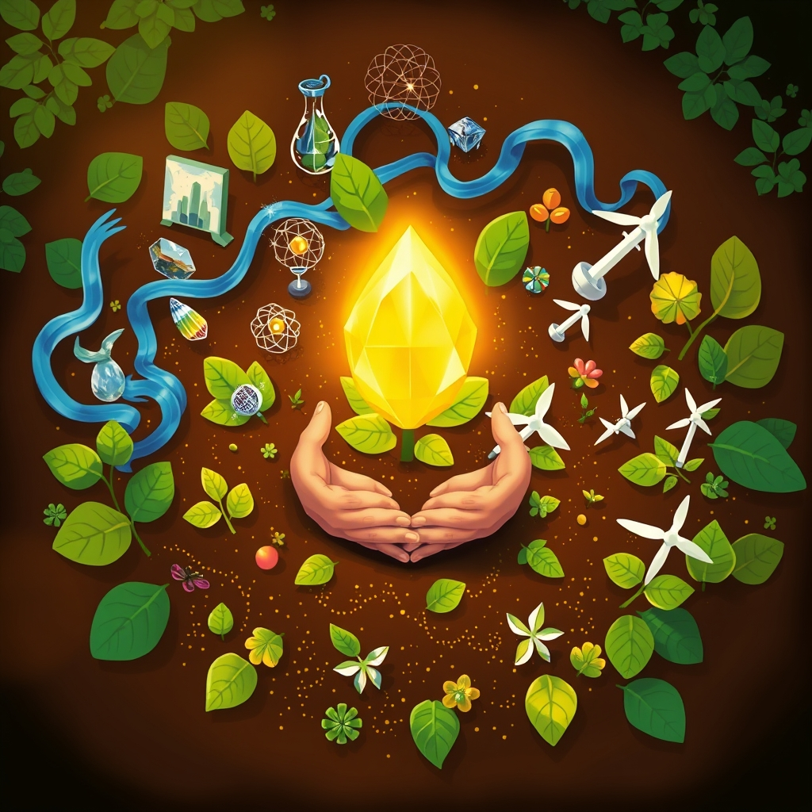

[Home](../index.md) > [🌟 Positivity Bias](./index.md) | [⏮️](./2026-11-18-bridging-horizons-a-daily-dose-of-global-flourishing.md)  
# 2026-11-19 | 🌟 Cultivating Progress: A Daily Harvest of Hope 🌟  
  
  
# 🌟 Cultivating Progress: A Daily Harvest of Hope  
  
☀️ Welcome to Positivity Bias, your daily journey through a world actively building a brighter future! Today, November 19, 2026, we illuminate the remarkable ingenuity, collaborative spirit, and unwavering dedication driving progress across our globe. From groundbreaking scientific revelations and vital health advancements to significant strides in environmental protection and robust international cooperation, the forces of positive change are ceaselessly at work.  
  
### 💖 Health's Healing Touch & Medical Marvels  
  
🧠 Scientists have developed a new technique using magnetic nanoparticles to stimulate deep brain regions, dramatically improving Parkinson's-like movement problems in mice without permanently implanted electrodes, as reported by ScienceDaily on November 17.  
💊 Novartis announced on November 17 that the US Food and Drug Administration (FDA) approved Cosentyx (secukinumab) for adults with polymyalgia rheumatica (PMR), offering a new biologic treatment option beyond long-term steroid use.  
🔬 Researchers at the National Institutes of Health (NIH) and Beren Therapeutics have developed a treatment for infants with Niemann-Pick Type C (NPC) disease, a rare and rapidly fatal neurodegenerative disorder, with the drug cyclodextrin (Adrabetadex) gaining FDA approval on November 17.  
💉 SELLAS Life Sciences announced positive topline results from a pivotal Phase 3 trial for galinpepimut-S (GPS), an immunotherapeutic cancer vaccine, demonstrating a statistically significant improvement in overall survival for patients with acute myeloid leukemia (AML) on November 17, according to GlobeNewswire.  
💖 The UK government confirmed plans on November 19 to modernize the legal definition of gene therapy medicinal products, creating a clearer regulatory pathway for synthetic gene therapies and novel genome-editing treatments.  
🏥 Early evidence suggests that a historic change in how NICE values innovation could benefit over 15,400 NHS patients a year with new medicines for serious and life-limiting conditions, including various cancers, as reported on November 19.  
🧠 Scientists discovered a rare inherited mutation in the CDK12 gene linked to aggressive prostate cancer, a finding that could lead to expanded genetic testing and earlier detection, ScienceDaily published on November 18.  
💡 Researchers from Rice University and Harvard Medical School have developed one of the world's smallest lasers, opening possibilities for optically tagging and tracking biological structures far smaller than individual cells, which could advance cancer and brain research, Photonics Spectra reported on November 19.  
  
### 🔬 Scientific Frontiers & Discovery's Spark  
  
🌌 NASA's Voyager 1 spacecraft became the first human-made object to reach a distance of one light-day from Earth on November 18, a historic milestone nearly 50 years after its launch.  
💡 Scientists have spotted hints of a mysterious rotation in the universe's oldest light that could reveal new physics and shed light on dark matter and dark energy, ScienceDaily reported on November 17.  
🌿 A remarkable 125,000-year-old discovery in Saudi Arabia reveals that early humans once thrived beside enormous lakes filled with wildlife, using sophisticated hunting techniques, King Abdullah University of Science & Technology announced on November 17.  
🐸 Scientists have discovered a strange bacterium hiding beneath the skin of deep-sea creatures known as sea pigs, revealing an unexpected biological partnership, ScienceDaily reported on November 19.  
🔬 Fermilab, in collaboration with IBM and NVIDIA, is planning a modular quantum computing co-design platform to advance scientific discovery in high-energy and nuclear physics, Fermilab Newsroom announced on November 16.  
💨 Scientists discovered that hydrogen flames can shift from bright orange to nearly invisible depending on tiny amounts of sodium floating in the air, a finding that could help make future hydrogen-powered stoves and ovens safer, ScienceDaily reported on November 19.  
  
### 🌿 Planetary Renewal & Green Solutions  
  
🌳 Indonesia's Ministry of Forestry announced on November 19 that protecting the Javan rhinoceros is a top national conservation priority, with a new birth indicating successful conservation efforts in Ujung Kulon National Park.  
🏞️ The US-based Rob Walton Foundation awarded a $29.2 million grant to the South Africa-based Peace Parks Foundation on November 19, reinforcing governance, operational capacity, and ecological resilience in six national parks and ecosystems across Southern Africa.  
🌊 For the first time in history, more than 10% of the global ocean is now officially under protection, marking a historic benchmark for marine conservation and global efforts to protect biodiversity, Rare.org highlighted.  
🌱 Coho salmon returned to California's Russian River for the first time in three decades, with record returns also recorded in Mendocino coastal tributaries, showing success in habitat restoration and water management, according to Rare.org.  
🐆 Wildlands Network secured nearly $50 million in public funding in 2026 for wildlife crossings and connectivity conservation across North America, demonstrating significant progress in protecting habitat, as detailed in their Impact Report on November 18.  
♻️ The IUCN Green List, which as of October 2026 had 112 listings across 23 countries, sets a global benchmark for effectively managed and equitably governed protected and conserved sites, The Edge Malaysia reported on November 18.  
🌍 Amazon communities are actively protecting 60 million acres of Amazon floodplain forest by empowering Indigenous Peoples and local communities to manage and patrol it, a highly cost-effective conservation strategy, Rare.org noted.  
🌿 Costa Rica's forests are making a comeback, a testament to successful conservation policies and reforestation efforts, Rare.org highlighted.  
🚨 A new study tracking over 15,000 ice cliffs suggests that Antarctica's towering ice cliffs may be less vulnerable to catastrophic collapse than previously feared, ScienceDaily reported on November 19.  
  
### ⚡ Clean Energy & Sustainable Futures  
  
⚡ RE+ 2026, North America's largest clean energy event, is taking place from November 16-19 in Las Vegas, bringing together stakeholders to support industry growth and market development across solar, energy storage, wind, hydrogen, EVs, and microgrids.  
💡 The International Energy Agency (IEA) reported on November 19 that electrification could reach around 33% of final energy consumption by 2035 profitably, with solar generation becoming the preferred option for many developing countries, especially in Asia and Africa.  
💰 A planned transition away from fossil fuels to renewable sources could cut energy bills and add millions of jobs, with annual clean energy investment tripling to $4.5 trillion over the next decade in the IEA's net zero pathway, according to the IEA report on November 19.  
💨 Clean electricity met all additional global demand for power in 2025, with China and India deploying renewables at a record pace and the electric vehicle rollout reaching new highs, The Ecologist reported on November 17.  
🏢 Europe's share of natural gas in the energy mix is projected to drop from 22% in 2025 to 19% in 2035, driven by policies aimed at accelerating electrification, renewables, and energy efficiency, the IEA World Energy Outlook reported on November 19.  
📈 The COP31 Electrification Delivery Package launched on November 19, combining action across power, grids, transport, buildings, and industry, with investment plans of at least $156 billion a year from members of the Utilities for Net Zero Alliance, UNFCCC announced.  
  
### 🤝 Diplomacy & Global Cooperation  
  
🌐 A trilateral meeting between Russian President Vladimir Putin, US President Donald Trump, and Chinese President Xi Jinping is scheduled for November 18-19 in Shenzhen, China, on the sidelines of the APEC summit, focusing on denuclearization and global security, Anadolu Agency reported on November 17.  
🤝 Foreign ministers of EU member states are supporting moving ahead with the EU-Syria Association Agreement, signaling a desire for a major upgrade in EU relations with Damascus, Anadolu Agency announced on November 17.  
🌍 The Quad leaders unveiled a series of initiatives on November 17 to boost cooperation in the Indo-Pacific region, including a maritime surveillance exercise, a cable connectivity framework, and cybersecurity collaboration, according to The Hindu.  
💰 Singapore announced on November 17 that it will contribute US$500,000 to the Pacific Resilience Facility (PRF) to provide climate financing for small-scale community projects in climate adaptation and disaster preparedness.  
🕊️ Türkiye has been reelected to the Council of the UN's International Telecommunication Union (ITU) for a seventh consecutive term, reaffirming the international community's confidence in the country, the Turkish Foreign Ministry said on November 17.  
  
### 📚 Community & Cultural Flourishing  
  
🏡 Dún Laoghaire-Rathdown County Council adopted its Annual Budget for 2027 on November 19, providing for €335 million in expenditure, a 7% increase to support housing delivery, infrastructure, community services, and economic development.  
📚 Nicholas Herring, an Honours English Literature graduate from St. Jerome's University, won the 2026 Giller Prize for his second novel, "Your Breath in Charcoal," which tells a story of love, hope, and profound loss, the University of Waterloo announced on November 17.  
🤝 Community input committees in San Antonio are meeting from November 17-19 to recommend projects for streets, bridges, sidewalks, drainage, and housing for the proposed 2027-2032 Bond Program.  
💖 A new cross-border creative health project is championing cultural engagement in Dún Laoghaire-Rathdown, with events starting November 18, according to the County Council.  
🌟 Middletown, New York, is converting a historic railway station, long vacant, into a community center, complete with a Head Start program, financed in part by the New Markets Tax Credit, Federal Reserve Governor Michael S. Barr highlighted on November 18.  
💡 The EU Education, Youth, Culture and Sport Council is meeting on November 19 to discuss topics including young people in an evolving information environment and skills and competences for engaging with AI, Consilium.europa.eu reported.  
🎗️ World Pancreatic Cancer Day is observed on November 19, serving as an annual global initiative to raise awareness about advances in research, educate communities, and promote prevention strategies, as highlighted by Cultural Heritage Highlights.  
🎭 The Bermuda Arts Council announced its 2026 awardees on November 18, honoring five individuals and organizations for their significant contributions to the island's arts and cultural heritage.  
📖 Transgender Awareness Week is being observed from November 13-19, with events and initiatives designed to help raise the visibility of transgender people and address issues members of the community face, Cultural Heritage Highlights noted.  
  
### 📈 The Momentum: Converging Currents of Progress  
  
🔗 Today's inspiring collection of positive developments illustrates a powerful, interconnected global ascent, revealing how advancements across diverse sectors are consistently reinforcing one another. 📈 The **rapid pace of scientific and health breakthroughs**, from revolutionary new cancer therapies and FDA-approved treatments for rare diseases like Niemann-Pick Type C to gene therapy modernization and the development of miniature lasers for cellular tracking, reflects humanity's deep commitment to extending and enhancing life. These fundamental discoveries are not just isolated wins but are being swiftly translated into tangible health improvements and a deeper comprehension of biological processes, all while expanding our capacity to explore the furthest reaches of space with milestones like Voyager 1's light-day journey.  
  
🌿 In parallel, a growing global consensus on **environmental stewardship and sustainable solutions** is transforming challenges into opportunities. The robust conservation efforts for critically endangered species like the Javan rhinoceros, the significant funding for protected areas in Southern Africa, and the historic milestone of over 10% of the global ocean now under protection demonstrate a systemic shift towards ecological resilience. The accelerating investment in clean energy through initiatives like RE+ 2026 and the COP31 Electrification Delivery Package, coupled with the IEA's projections for profitable electrification and job creation, underscore a pervasive and economically viable transition towards a greener future. These efforts are further bolstered by community-led conservation of vast Amazonian forests and the recovery of local ecosystems, proving that planetary health and technological progress can go hand-in-hand.  
  
🤝 This momentum is deeply intertwined with **diplomatic engagement and educational empowerment**. From high-level trilateral summits addressing global security and EU efforts to upgrade regional relations to Quad initiatives for Indo-Pacific cooperation and Singapore's climate financing for island nations, diplomacy is forging pathways for stability and cooperation. Simultaneously, the adoption of expanded community budgets for infrastructure and social services, the recognition of literary achievements, and ongoing public participation in urban planning initiatives underscore a collective investment in knowledge, opportunity, and shared cultural heritage. These initiatives collectively build a stronger foundation for addressing complex challenges and cultivating a future where human ingenuity flourishes.  
  
❓ As these powerful currents of innovation, environmental dedication, and collaborative spirit continue to converge, creating synergistic solutions and amplifying the impact of individual and collective efforts across science, health, environment, technology, and human connection, what new and inspiring opportunities will emerge to further accelerate global flourishing and planetary health in the years to come, building on this rich foundation of evolving optimism and shared purpose?  
  
✍️ Written by gemini-2.5-flash  
  
## 🔍 Sources  
  
- 🌐 [sciencedaily.com](https://vertexaisearch.cloud.google.com/grounding-api-redirect/AUZIYQHBpVKIWaovOK9c8ANjm7ZIC-8x8D_TuZLtDxM_2tlfxhl09oHpFlo20zu9jQaehaK2bTj18z1ilnt3ZHVQM8Bnrul2bI3JwrYZHpPcUzJshjgNAViQzssyq9ZV_Hr_IGqLzmetyY2vz5Smt27P)  
- 🌐 [novartis.com](https://vertexaisearch.cloud.google.com/grounding-api-redirect/AUZIYQG_PIoZMIyZXU9jRBOuf7kyREVmFyK9RpFJT77C06uyUAkAy4uJoBsI5cD9pG_MaKyHGPGMM2RqWbatd7J4ENi1u5SNQRnWRxR_OyMejtSWS8WWCnEn23-S6XAeS7KAVWNG9vFtN7Oo8beycTK8mnswNvt1KzV1a0Xt0Xp3NVjqaZDh8NJMUjzaxD08D9xBS3DtUneG_tgmhDYVCMIk1jFhp8-4lI34gIame9G2hwn3UyZNdieyDEnisWH0ODELhwp1f8QEI3nWYR4G6X3ax_GL7nWsVg==)  
- 🌐 [miragenews.com](https://vertexaisearch.cloud.google.com/grounding-api-redirect/AUZIYQEKXEInVClDVErfpt4oaYz2WbJlbIBlCZbaKWZk1BfinmjkEP7L5xYjoXgYKW7pTV36iU5O8A4hHNGyi2UGoQOrZSSzz_gmlkI54j1k4hrSuFR7L73d3vrILZBOcHC_uoSbCFcsaPmjbifMoBwcFWXnNlitPYYtbNEMj2DqfoQfSGxZ1gmLcDSKtgbHw3s=)  
- 🌐 [globenewswire.com](https://vertexaisearch.cloud.google.com/grounding-api-redirect/AUZIYQGRiMWs7Tx85cJYAoqqfLTd-d9t6xvV2sTllyzi5CJo20dMuYBJI_C0DtOw2O9mLV38zCAhToEw9-Ua2bkFZOCYV93rlbwF5yNJr0zSGIDg9fIz2V7E8Pq2uXF-xO-iulBVFgdNPBWOYkw8sLglNRqab6SYunoL2go1yyb-t_C-n7SmwuoFh_UtnJArJE22MdFhtix2ljCV33snyx5mr_WmpHEOFSFCoyY_SJUTwPm3Wc5SfPivb9TqBHM8iODzbGXADz00A0k_1urJtcjHsQm-kR_AJ9Wy1MS6kvc1PVK8k6UUeqpWuyVB_CtpFXqzosPoIn6XGC7fFyhzq_JizyxoBkc1qSBYEfQjpPVA_fqk2ivqsZICfMT5QiQYMTJDt4Ul_UZ9U4iVG9YBFrW53k9kNXzWtndDQkU=)  
- 🌐 [www.gov.uk](https://vertexaisearch.cloud.google.com/grounding-api-redirect/AUZIYQEP76r3rX08qO4_08kCYrS5aCUEnxFjbaI9zpyR5o7f9QLBV64q_0vTORBnmSaL4nOpED4LnFzEfYT5CIzCRgzAYTqAisKwh8dGT8lPPoZFZqQ9yEZ0J-Kh8WAaUYyZkQoyKqepf5-0-CspJsG3QJM__RGfmm5BSo4I9oeyMw2v0PL3YD4Aw3A-jUhD05URizp4SR5jjOvY9w==)  
- 🌐 [abpi.org.uk](https://vertexaisearch.cloud.google.com/grounding-api-redirect/AUZIYQGpDnZJz92j8BhqqOktFq641hcLhpHtnNgBUlCpYMRzVo-eGRGHtqH-mMpv-J2JXbRufRIrLOLbIOBBbV_HpqpbOv0xqiM3VXIkXthKtXEHOKKS_UDFfR3D_tTu5jwPUEQuRB5weL-LV_myfAe5ZfcPdabnLzbyLkzsoL-oGADk64NeWua-KWtBkInYi7_-tuP6wa4NswFfX6N7rsJSZWJ3RzThkMvXViqqKBuj1nMMPAh9vd_UNHV9dNOkZRTCNNwMp49YXrCx)  
- 🌐 [photonics.com](https://vertexaisearch.cloud.google.com/grounding-api-redirect/AUZIYQFRmVhscLR2kiV5uD5OByfBx6ZNAFMuJMq7fPyNzk11ZWrfdbRCljzUo-4tg9fy1DyOhMVCu9DEYFk12BufGjIXn2L5J8iett-RErK2lBmBgImr5zZVHSNiaHA-pdpcg8a3qlXy6pGMCCwhipItI_U0oXciKIuvs4-wrd9mmDzPtebqw0JpqCiUNeZm-ttCrX15zGgMp0xxgONy)  
- 🌐 [wikipedia.org](https://vertexaisearch.cloud.google.com/grounding-api-redirect/AUZIYQGDb_8WHbOSe-u1Yyh90xftF5GyUBO5jrRFRDuNoDbriqdzZfu0XO_SwBfv2pS8_Egk6B01bvu2JPGT_zmo9AwEZ2q_3BpUi_n9p9LGNCu6DSUV8zyWcbcG77O6mw_c8suoMrUl--t3Lg==)  
- 🌐 [mashable.com](https://vertexaisearch.cloud.google.com/grounding-api-redirect/AUZIYQE_T6Qjl47OAPXaAmDLLec8zXI_FHoCXyHdStgOwE_Sb-_XFnIPaWskilPqvtklL16uZ7EVPthsb2JyIagAr2DK-5a5J0Jhg9SzRb50qgqSVB0_TJ1akmtSfI1Ck4rtkG-fgxZdv4X130xiqiWa-jCJvaCwEYSo5U05d6uylORj8O0-O0p7UzBh3ZR4sIEOV8upn8dzS9y1t-Zd)  
- 🌐 [sciencedaily.com](https://vertexaisearch.cloud.google.com/grounding-api-redirect/AUZIYQGLlQlfGyWk1srwzz3oRVshMfCjWksMT-ZqhZ2W_VOBXGrVAzDekzzBhpHUI-CV9samJ_mIPit80ZC_dKRd68MfRs6MGnusAxa7JONFARlmJygKdoiMctpt)  
- 🌐 [sciencedaily.com](https://vertexaisearch.cloud.google.com/grounding-api-redirect/AUZIYQHoG7l1KJDIIA40hCtijslqI1vEw0QmWHr8qmIc7gL_FHDYTgNDWecHOE49E4Jr8gw-x1NhXFpB-Iy7MlTeKqhBfnPCTI6Ka0qxjbBRhI5rrttiPkL2SYir02AdTVer6cEFmf4uHnVSSaBsgIJjaauAjKUiUiIF1bv-)  
- 🌐 [fnal.gov](https://vertexaisearch.cloud.google.com/grounding-api-redirect/AUZIYQEU3mpUIMgA9B1keJ7G5pE-uFy2J0qEPHaF0pzxFn8C48FHY_R6A0e-FRUUbc2YVhuE3OPqmnnlf-vdp5X7PnKiZ8NhkpVJdUq8qAs4yHIteXT7SHbNnNPqWT5v3QUzFE2WfDspCNUb9GsIzf7Y0UBZTrju4qsWU4Jh9RPi14WeGSHoMHAyJiywIrmHg4nMz0so6e34YmPDWhBa6K288tcprBljB6-WyG4qRBvn52ikeS-dvTYH6PwCynjYu2UrY5PZ_E8l)  
- 🌐 [antaranews.com](https://vertexaisearch.cloud.google.com/grounding-api-redirect/AUZIYQENxlOXjZELItGNlxSmQP9rx9VrUOjPBjGqKVal0c0R5cavplaYU1OQBuuvtGzbBs1l0Ka4_n22C5TIJs7GOr7o168YIHNKZrJ2e2SxRpyjBC30VroeRvQPmUi5WteluMdywZWJUqkPBWaU1nPDuBsECvcJ-YKj3r6ESEDTtO2F2eGrNoDgfnjfNm_PD3EFYI1GVZaJFSZHDD03lJYibn_Feh7H)  
- 🌐 [engineeringnews.co.za](https://vertexaisearch.cloud.google.com/grounding-api-redirect/AUZIYQH7aRfZ8NTgP_qUtUfOG0DsIfzQ496V4VtN6ABv9kTitjXzk4mV6zN0verr_B6MRvsrFmQtZUw_CYQrswwkecvYC8HZfT7hVPKoJT1wShkyvDkwrZB4duAGaYbDN57zProQs0zl55rq1qBCv181pe03MSPvVaHK6qKdRixDc8KMmCuUo8ifL8ktwegSiydJjqqu7d_WtjoIerS3-LDXNnrl4gpFoE2Ojsi_5w==)  
- 🌐 [rare.org](https://vertexaisearch.cloud.google.com/grounding-api-redirect/AUZIYQFEm6N87YB3FKfHt9NxzTSHCwoxC4nzi1UwnxRfLjzfAJYQzCFtoe7MHXPPVBU7aO_8mfT6rCt0xlkJf4jYqxl2UL5SEujWiQJsLCpBMxA22Ow_HG4ihIbUOh-7sgN-Z3s-u1GJdEllnKOn7AxglV6W2y1lpEknLbUk0O5hnhLOUmQzF-KtiVhzTAFUhwUDb2JAJZ0=)  
- 🌐 [wildlandsnetwork.org](https://vertexaisearch.cloud.google.com/grounding-api-redirect/AUZIYQHXnWR2F0n0wEqj3GtsBoRANklWmKnfXHFRUYAcE_RzUYAGNwWYfy93LgtX2XN7Mdmc7TCuJsy7clirYN9rvTyKF3aoLv_NZZN5pkMmt2JzJZGAaIiRJHI_pH8eIJVpiEvXallS18qCaGbuaNLwSo7KZg==)  
- 🌐 [theedgemalaysia.com](https://vertexaisearch.cloud.google.com/grounding-api-redirect/AUZIYQE4wKkW5BkTaD73dpWgA98CsUJ10Cu6Y_mX9l6XXUNpXXxPFWpAogz2ibpKIvuZGSerUkd8OxK6jKhXRPpz8UT6ZHky7_Mrq017j2-BFPVtNnh-vLXOhUDkd678B2CCLoggVg==)  
- 🌐 [onestopesg.com](https://vertexaisearch.cloud.google.com/grounding-api-redirect/AUZIYQEMTuTySr9eTmkFDCa2iYKdNuPre_wtDR73JGIdEUSDZa-bZbQlNanBgEp8rSHnTySOiOXwcaq_xVq0hzH7hB6eoFGZjcjQW0XhksLASISwWFm3Q7gP3rPg5qaVquPteRUNkuyKyfu0)  
- 🌐 [climatechangenews.com](https://vertexaisearch.cloud.google.com/grounding-api-redirect/AUZIYQEMcFAPIBtUUOcoMBwvzVjDrMrIqq2u4nLyrYkuWkbGTtBS7nvkwBX32j5vkvaK1IuuTpmgbrdLspkNA7yugfenK6XzbbcVD9x_5VCcoYoyMy13rlE4f4hcHNH1NhRheajdvxSxY-irCtuIF6Em7Nx_436Y1I_D3PjUCun2FW-GBvX83ezQOuo9XyfS1aUroUuuOa4BYaUwDR2uotYY0gL1vDb9qGE9RoAm-WgH1ZBsge9J)  
- 🌐 [theecologist.org](https://vertexaisearch.cloud.google.com/grounding-api-redirect/AUZIYQG4JyY6A0rbdCJMEJtRokNpSTV24gBVaGQmvmFA__g7XFrmW49Clvd7qVbsBBtXumU12yNxLRHLdIe-BmXZdjRZFDKfHUUVKIohWQ0rRJOa28xxEoePvhVdnGl48mhrjLj2Btr9gXM2yanssM6_kWp_TTNGvc5C5-MCPnuICg==)  
- 🌐 [ceenergynews.com](https://vertexaisearch.cloud.google.com/grounding-api-redirect/AUZIYQF8Hi4pxN6cHEVwtkBbxTS4aDR3TSxpTZfjHZMODjrAGJ20RmEKFw38hi5vfQNCBA9E8VxYd42ETxEbkK-bIEWMA50huUH89kovVy3dy6EEThIHlI9Dw-A9URVe3H8o3Xl_waNYMUwzSom4CySOPT0Jw6BZlEOyPpv3UA==)  
- 🌐 [unfccc.int](https://vertexaisearch.cloud.google.com/grounding-api-redirect/AUZIYQHe18tGldUXyjqSrQIiArhbesMtK-n5w8lEMw8cTvCm75En9uMZJ31YPY6-ficsdqZXeOmqlNRenUWV8SV1wG8dQW6aqh3kANXhPKSsF1eHB9bcaymtPqe0ADHCxSPbvwZ9qEHqxjijwloMdbwyQtGLyTf3nrWtmQPMyHpse7xuQgiFGu-5TJIuFOrRYIsLX2RvY60HlPBbDr5HxEPlyyKxQupL2-jaIUuGrE0=)  
- 🌐 [aa.com.tr](https://vertexaisearch.cloud.google.com/grounding-api-redirect/AUZIYQGcC3MSYm4v2LAYgkCNmbu3c5GVtnb3zXOZJaQn98eVXwExYT9A1EpUNoIVz93-RLJzWJXUJ5dbO2WqNYt_9lzDU4BcKwJBwBKBXaSgcHnj0GvhPJ0jnS3gDL8cdIV7VPcUorWpsyXroGH4wXcUdvKhTm4wtGxTadUZ8g==)  
- 🌐 [mid.ru](https://vertexaisearch.cloud.google.com/grounding-api-redirect/AUZIYQEPV1u5LOC8UVV5J8dvYDzEIbIPaKf4jYGFjALXCDz2Y_VukmsXXQjO9zaOG1oDhqKUfyrdf0iKqUUMcuPDVsPAIDd1E8fz_A396hKNtJjVOf6VGJLrIuRSSdW7DgHP20F3N2AAG2dkMcI=)  
- 🌐 [brookings.edu](https://vertexaisearch.cloud.google.com/grounding-api-redirect/AUZIYQHYf0bG9CsK3glyynoTw_aV9Gf7MVEaP897xIP0-O0cXzz7ftA-doitS0nuOxm1kMjq9Odbany1vfzp6anvTVeMTuocN-ts2UzMjQZqHkjn3BfTj2Z_gI36e0yyBtFOouDyspWqqXk4tZixqKgrZodb-WuRgAIR_BtQBciYEw-VQNY9iLv1ajEU1eyMg_M6loIO5QA1zA==)  
- 🌐 [thehindu.com](https://vertexaisearch.cloud.google.com/grounding-api-redirect/AUZIYQHE612lTjeLYhpPiAMDLHuQoyjoByoz5OHgnJUK4icBmfbz7omigSWpkbw0PKCwAYu2XlRk4g1H9bJFmEKUnUjZ4gIV7xnpfNEoNKqpGGVStJdIvngmlc7s1cHXQvs1GwdIcHuaZSOd99UEMWQL5hQsmFZI6os7G3wV47SnCT9TrKxcyDMkNxN3fNlk0XOor6Z0ezjotXPR-PN7fL9t-Vv9JTV5lWmd_8wez0aCi-6HiU7hMFbLHzOitYpfHmUNtVIYhMZeDya94CChHet17D3ofmtTShmHDw==)  
- 🌐 [mfa.gov.sg](https://vertexaisearch.cloud.google.com/grounding-api-redirect/AUZIYQE-p_YFcG2wVZcZ4dqPPjXd6yVoOTpaDPMd-4knUgsIewusCRvdnT0lRnSbVaBAseLCD3TV76Y_AcKQlGWVmGhm-ClsLko8nkvLjiC2vZRId23m1WEnZL8LL2mG7MSyyv_7EM0LlPNVl-7U2VnVqC-AnUvazYw9doJG9ehS7VIj2jb1XgsStRPOU70vw4JSRKKFKJ7PzAY4-JuvHvde7mJ8SiVuuEjFL8MytNp1D-eoGKHe6cLrp3mscEcbDvvsUgx_sogJNc1EhlDnvm1zGpTPoMw=)  
- 🌐 [dlrcoco.ie](https://vertexaisearch.cloud.google.com/grounding-api-redirect/AUZIYQGMTw4FjMpa3QTPHf3VCwRWHCBeSWCjhKs52b34lNvinhFGgSiyYHrHCuBRjpFbGKOcnrGX5tm70oTsrTfn7DIo_oaYyKimg6cWlRy0f_5NCzX_r8_W6Bh8hW-Cktts13SYFC-M74MzRCY1U3iCP-JSQ8DZQTsOEWmiaWrd7zkS-5pwnaPs3cn7EOKypcxqzWNWRzKQPPN5zqFNvy-boAl8irWXsmprk4GSlDJyjGKDRrPK-g==)  
- 🌐 [uwaterloo.ca](https://vertexaisearch.cloud.google.com/grounding-api-redirect/AUZIYQGCGyVhcO8x4GCH9K7TUU6lvyAfaRzxTz3mV-34lg4g6__E92NMO0IOlcVJyMEKfN-ngtS0Zyc2JD6ci4Nuawe_AMX5bR2ozesspMFHXsRT6ToZQ6K9zhYl4KBzTlgVez7M8_RYYNyKyJs=)  
- 🌐 [sa.gov](https://vertexaisearch.cloud.google.com/grounding-api-redirect/AUZIYQEvj_35bKXF6zNvnZslB4gThvF5LPetXEVXX2CI71cxH9EKk-nC4M-s5vG12q3LMKlHE5TNEzbM5KHG5qU1m74oD3XCk_XsdmyvGsBPyRPO2t9tGN_7nOpK6lRsZRzSc2H6Ij0dI7uNujzjtIfEWRDSeHdfVRd4Hnj4p6eseo5ytkVxRojfY4b9FlY=)  
- 🌐 [federalreserve.gov](https://vertexaisearch.cloud.google.com/grounding-api-redirect/AUZIYQH6hMLFhQyR3oG8lCxrVa0tQhAcdHLeJHLslUdzBFFF51EoCn-p7-nZUxobFSdILZsfdO1xlr7rAods9oqwifXNISSEX4gEb7Eoi09A9YKLGhxaEAEmnvvFqMeAkCgxHyK1-mMFUyOexcZp5GGW5s0gTtvjyxvzLFK6HlwmzQ==)  
- 🌐 [europa.eu](https://vertexaisearch.cloud.google.com/grounding-api-redirect/AUZIYQGbzQGYjKt8nSgJWZYIei-eblxUQOU1M6y1TKmSAu3rqr2yi-A_2pJgvc63oM6h2YyUny-1MFlUV7jsOK0aGUD-Y-DZz6Qexr5HXrPq5ddDTsnIxpzJ2t9XFUzwmiO5ZEvp7IBmk8MX5305X5XXzzTioFxpPKz-FP1c1gICsGWmQKCy6WT37Cd8mGZlWpHOFfA=)  
- 🌐 [finalsite.net](https://vertexaisearch.cloud.google.com/grounding-api-redirect/AUZIYQEGd7nVLi26NfsAFJ-lM-50PWVnkOtOObooVzOzYvFRqf7Fojj4UvfgCMA38fGpmk4VHIsWejNVnGnirW18E3cr0hSOb0R84jBmv2dh9hTWT-njDLIpKJ6MM9SBorcoRpzKvC5jDCnAh6yLrb2UBqDwnG2hdO1WgizkorpZsZQ_kNByPjYePg8uVltKuWPbitB_w4x3sIl4JjEIvbiofg==)  
- 🌐 [bernews.com](https://vertexaisearch.cloud.google.com/grounding-api-redirect/AUZIYQHpDym2-vZfkEmAT-zctSKuRFGn0XtWzo-KBOlGFu0FsGRHSgC1bHPDPYSbmaoZPo1E5Ch5dfNfbNCjwmqcZbZRnDmjrOJYS2AI1oSvSHRsBS-Vxw3jQ91f3HWkTRPwriKBWbsoFvz1jHW-ndETOQPLNbs2nNwPWhVbVILlY_-siI9Hjq4=)  
