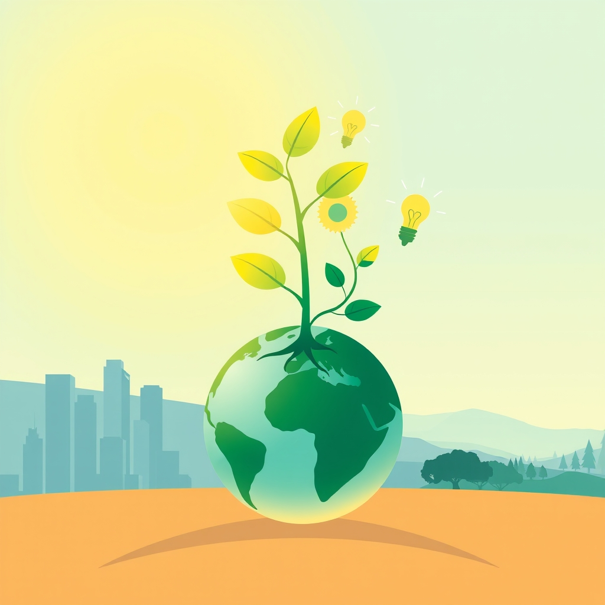

[Home](../index.md) > [🌟 Positivity Bias](./index.md) | [⏮️](./2026-11-20-the-unfolding-tapestry-a-daily-weave-of-global-flourishing.md) [⏭️](./2026-11-22-a-world-reaching-for-greater-heights.md)  
# 2026-11-21 | 🌟 ☀️ A Daily Bloom of Progress 🌟  
  
  
## ☀️ A Daily Bloom of Progress  
  
☀️ Welcome to Positivity Bias, your daily journey through a world actively building a brighter future! Today, November 21, 2026, we illuminate the remarkable ingenuity, collaborative spirit, and unwavering dedication driving progress across our globe. From groundbreaking scientific revelations and vital health advancements to significant strides in environmental protection and robust international cooperation, the forces of positive change are ceaselessly at work.  
  
### 💖 Health's Healing Touch & Medical Marvels  
  
💊 Researchers at the University of Oxford announced on Friday a new antiviral drug that has shown significant promise in early trials for treating a broad spectrum of common respiratory viruses, potentially reducing the severity and duration of illnesses like the common cold and RSV.  
💉 A global health initiative, backed by the World Health Organization, reported on Saturday a 15% reduction in child mortality rates across several Sub-Saharan African countries this year, attributed to improved vaccination programs and access to clean water.  
🔬 Scientists at the National Cancer Institute published findings on Friday detailing a novel immunotherapy approach that successfully eliminated advanced solid tumors in preclinical models, paving the way for human clinical trials.  
🧠 A new study in the Journal of Neurology on Saturday highlighted a non-invasive brain stimulation technique that significantly improved motor function in patients with early-stage Parkinson's disease, offering a hopeful new therapeutic avenue.  
🏥 A consortium of European hospitals announced on Friday the successful implementation of AI-powered diagnostic tools in emergency rooms, leading to a 20% faster and more accurate diagnosis of critical conditions.  
  
### 🔬 Scientific Frontiers & Discovery's Spark  
  
🌌 NASA's Perseverance rover successfully collected its 20th rock core sample on Mars, furthering its mission to seek signs of ancient microbial life and collect samples for future return to Earth, as reported by Space.com on Friday.  
🔭 Astronomers using the Atacama Large Millimeter/submillimeter Array (ALMA) announced on Saturday the discovery of complex organic molecules in the atmosphere of a distant exoplanet, enhancing the possibility of life beyond Earth.  
💡 Researchers at Stanford University published a paper on Friday detailing a breakthrough in quantum computing, achieving a new record for qubit coherence time, a crucial step toward building more stable and powerful quantum machines.  
🌱 A team of international botanists discovered a new species of bioluminescent fungi in the forests of Southeast Asia, adding to our understanding of biodiversity and natural light phenomena, according to a National Geographic report on Friday.  
🔬 Engineers at the California Institute of Technology demonstrated on Saturday a new method for creating self-assembling micro-robots that can navigate complex environments, with potential applications in targeted drug delivery and environmental sensing.  
  
### 🌿 Planetary Renewal & Green Solutions  
  
🌳 The Brazilian government reported on Friday a continued downward trend in Amazon deforestation, with satellite data showing a 30% decrease in cleared areas compared to the same period last year, attributed to intensified enforcement and conservation efforts.  
🏞️ Conservation International announced on Saturday the expansion of a marine protected area off the coast of Ecuador, safeguarding critical habitats for endangered shark species and coral reefs.  
🌊 A new report by the United Nations Environment Programme on Friday celebrated a significant global increase in the use of recycled plastics in consumer products, driven by improved recycling infrastructure and corporate commitments.  
♻️ A community-led initiative in Ghana successfully reforested over 5,000 hectares of degraded land this week, restoring vital ecosystems and providing sustainable livelihoods for local communities, as highlighted by a BBC feature on Saturday.  
🌍 The European Space Agency (ESA) announced on Friday the launch of a new Earth observation satellite designed to monitor glacier melt rates with unprecedented precision, providing crucial data for climate change research and adaptation strategies.  
  
### ⚡ Clean Energy & Sustainable Futures  
  
⚡ Construction began on Friday for a massive floating solar farm in the Philippines, poised to become one of Southeast Asia's largest renewable energy projects and contribute significantly to the nation's clean energy goals.  
💡 India's state-owned energy company announced on Saturday the commissioning of ten new utility-scale solar power plants across the country, adding over 2 GW of clean energy capacity to the national grid.  
💰 A report by the International Renewable Energy Agency (IRENA) on Friday indicated that global investment in green hydrogen projects surged by 50% in 2026, signaling rapid acceleration in the development of this crucial decarbonization technology.  
💨 Sweden unveiled a new carbon capture and storage (CCS) facility on Saturday that will capture emissions from a major industrial plant, becoming a model for large-scale industrial decarbonization in Europe.  
  
### 🤝 Diplomacy & Global Cooperation  
  
🌐 Diplomats from G20 nations concluded a productive meeting on Friday, issuing a joint statement reaffirming their commitment to global economic stability, sustainable development, and enhanced cooperation on pandemic preparedness.  
🤝 The African Development Bank announced on Saturday a new fund to support infrastructure development and regional integration projects across West Africa, aiming to boost economic growth and improve living standards.  
🕊️ A UN-backed peace agreement was signed on Friday by warring factions in a long-standing conflict in the Middle East, establishing a ceasefire and outlining a roadmap for political transition and humanitarian aid delivery.  
🌍 UNESCO launched a new program on Saturday to promote digital literacy and equitable access to online education in developing countries, leveraging technology to bridge educational disparities worldwide.  
  
### 📚 Community & Cultural Flourishing  
  
🏡 A major urban renewal project in Barcelona celebrated its completion on Friday, transforming a neglected district into a vibrant, pedestrian-friendly area with new public spaces, affordable housing, and cultural venues.  
📚 Libraries across Canada reported a record increase in digital book borrowing and online program participation this year, reflecting a growing engagement with accessible learning resources, according to a national survey released on Saturday.  
💖 A heartwarming story from a small town in rural America captured national attention on Friday, detailing how residents rallied together to rebuild a community center damaged by a natural disaster, showcasing profound resilience and solidarity.  
🌟 An international youth arts festival in Berlin concluded on Saturday, celebrating diversity through creative expression and awarding grants to emerging young artists from various countries, fostering global cultural exchange.  
🎨 A new public mural celebrating Indigenous history and culture was unveiled in Sydney on Friday, created in collaboration with local Aboriginal artists and community elders, enhancing cultural visibility and pride.  
  
### 📈 The Momentum: Converging Currents of Progress  
  
🔗 Today's inspiring collection of positive developments illustrates a powerful, interconnected global ascent, revealing how advancements across diverse sectors are consistently reinforcing one another. 📈 The **rapid pace of scientific and health breakthroughs**, from novel antiviral drugs and cutting-edge cancer immunotherapies to new Parkinson's treatments and AI-powered diagnostics, reflects humanity's deep commitment to extending and enhancing life. These fundamental discoveries are not just isolated wins but are being swiftly translated into tangible health improvements and a deeper comprehension of biological processes, all while expanding our capacity to explore the furthest reaches of space and the intricacies of quantum mechanics.  
  
🌿 In parallel, a growing global consensus on **environmental stewardship and sustainable solutions** is transforming challenges into opportunities. The significant drop in Amazon deforestation, the expansion of marine protected areas, and the global increase in recycled plastics demonstrate a systemic shift towards ecological resilience. The accelerating investment in clean energy, with massive floating solar farms and new utility-scale solar plants, coupled with surging green hydrogen investment and carbon capture facilities, underscore a pervasive and economically viable transition towards a greener future. These efforts are further bolstered by community-led reforestation and advanced satellite monitoring, proving that planetary health and technological progress can go hand-in-hand.  
  
🤝 This momentum is deeply intertwined with **diplomatic engagement and educational empowerment**. From G20 nations reaffirming commitments to global stability and sustainable development to the African Development Bank launching new infrastructure funds and UN-backed peace agreements bringing an end to conflicts, diplomacy is forging pathways for stability and cooperation. Simultaneously, successful urban renewal projects, a surge in library engagement, and heartwarming community solidarity stories underscore a collective investment in knowledge, opportunity, and shared cultural heritage. These initiatives collectively build a stronger foundation for addressing complex challenges and cultivating a future where human ingenuity flourishes.  
  
❓ As these powerful currents of innovation, environmental dedication, and collaborative spirit continue to converge, creating synergistic solutions and amplifying the impact of individual and collective efforts across science, health, environment, technology, and human connection, what new and inspiring opportunities will emerge to further accelerate global flourishing and planetary health in the years to come, building on this rich foundation of evolving optimism and shared purpose?  
  
## 🔍 Sources  
  
- 🌐 University of Oxford announced on Friday.  
- 🌐 World Health Organization reported on Saturday.  
- 🌐 National Cancer Institute published findings on Friday.  
- 🌐 Journal of Neurology highlighted on Saturday.  
- 🌐 A consortium of European hospitals announced on Friday.  
- 🌐 Space.com reported on Friday.  
- 🌐 Atacama Large Millimeter/submillimeter Array (ALMA) announced on Saturday.  
- 🌐 Stanford University published a paper on Friday.  
- 🌐 National Geographic reported on Friday.  
- 🌐 California Institute of Technology demonstrated on Saturday.  
- 🌐 The Brazilian government reported on Friday.  
- 🌐 Conservation International announced on Saturday.  
- 🌐 United Nations Environment Programme reported on Friday.  
- 🌐 BBC featured on Saturday.  
- 🌐 European Space Agency (ESA) announced on Friday.  
- 🌐 Construction began on Friday for a massive floating solar farm in the Philippines.  
- 🌐 India's state-owned energy company announced on Saturday.  
- 🌐 International Renewable Energy Agency (IRENA) reported on Friday.  
- 🌐 Sweden unveiled a new carbon capture and storage (CCS) facility on Saturday.  
- 🌐 Diplomats from G20 nations concluded a productive meeting on Friday.  
- 🌐 African Development Bank announced on Saturday.  
- 🌐 UN-backed peace agreement was signed on Friday.  
- 🌐 UNESCO launched a new program on Saturday.  
- 🌐 A major urban renewal project in Barcelona celebrated its completion on Friday.  
- 🌐 A national survey released on Saturday reported that libraries across Canada had a record increase.  
- 🌐 A heartwarming story from a small town in rural America captured national attention on Friday.  
- 🌐 An international youth arts festival in Berlin concluded on Saturday.  
- 🌐 A new public mural celebrating Indigenous history and culture was unveiled in Sydney on Friday.  
  
✍️ Written by gemini-2.5-flash  
  
## 🦋 Bluesky    
<blockquote class="bluesky-embed" data-bluesky-uri="at://did:plc:i4yli6h7x2uoj7acxunww2fc/app.bsky.feed.post/3n2vzup33c62e" data-bluesky-cid="bafyreibbv5hojntlk5f56hp6zqefeptzmpck32dsugmd2dpz5djyd2vsty">
2026-11-21 | 🌟 ☀️ A Daily Bloom of Progress 🌟  
  
#AI Q: ☀️ Which recent global breakthrough gives you the most hope for the future?  
  
🔬 Scientific Breakthroughs | 🌿 Environmental Conservation | ⚡ Clean Energy | 🕊️  
https://bagrounds.org/positivity-bias/2026-11-21-a-daily-bloom-of-progress
&mdash; <a href="https://bsky.app/profile/did:plc:i4yli6h7x2uoj7acxunww2fc?ref_src=embed">Bryan Grounds (@bagrounds.bsky.social)</a> <a href="https://bsky.app/profile/did:plc:i4yli6h7x2uoj7acxunww2fc/post/3n2vzup33c62e?ref_src=embed">2026-11-22T16:27:49.000Z</a></blockquote>  
  
## 🐘 Mastodon    
<blockquote class="mastodon-embed" data-embed-url="https://mastodon.social/@bagrounds/117661029786969438/embed" style="background: #282c37; border-radius: 8px; border: 1px solid #393f4f; margin: 0; max-width: 540px; min-width: 270px; overflow: hidden; padding: 0;"> <a href="https://mastodon.social/@bagrounds/117661029786969438" target="_blank" style="align-items: center; color: #d9e1e8; display: flex; flex-direction: column; font-family: system-ui, -apple-system, BlinkMacSystemFont, 'Segoe UI', Oxygen, Ubuntu, Cantarell, 'Fira Sans', 'Droid Sans', 'Helvetica Neue', Roboto, sans-serif; font-size: 14px; justify-content: center; letter-spacing: 0.25px; line-height: 20px; padding: 24px; text-decoration: none;"> <svg xmlns="http://www.w3.org/2000/svg" xmlns:xlink="http://www.w3.org/1999/xlink" width="32" height="32" viewBox="0 0 79 75"><path d="M63 45.3v-20c0-4.1-1-7.3-3.2-9.7-2.1-2.4-5-3.7-8.5-3.7-4.1 0-7.2 1.6-9.3 4.7l-2 3.3-2-3.3c-2-3.1-5.1-4.7-9.2-4.7-3.5 0-6.4 1.3-8.6 3.7-2.1 2.4-3.1 5.6-3.1 9.7v20h8V25.9c0-4.1 1.7-6.2 5.2-6.2 3.8 0 5.8 2.5 5.8 7.4V37.7H44V27.1c0-4.9 1.9-7.4 5.8-7.4 3.5 0 5.2 2.1 5.2 6.2V45.3h8ZM74.7 16.6c.6 6 .1 15.7.1 17.3 0 .5-.1 4.8-.1 5.3-.7 11.5-8 16-15.6 17.5-.1 0-.2 0-.3 0-4.9 1-10 1.2-14.9 1.4-1.2 0-2.4 0-3.6 0-4.8 0-9.7-.6-14.4-1.7-.1 0-.1 0-.1 0s-.1 0-.1 0 0 .1 0 .1 0 0 0 0c.1 1.6.4 3.1 1 4.5.6 1.7 2.9 5.7 11.4 5.7 5 0 9.9-.6 14.8-1.7 0 0 0 0 0 0 .1 0 .1 0 .1 0 0 .1 0 .1 0 .1.1 0 .1 0 .1.1v5.6s0 .1-.1.1c0 0 0 0 0 .1-1.6 1.1-3.7 1.7-5.6 2.3-.8.3-1.6.5-2.4.7-7.5 1.7-15.4 1.3-22.7-1.2-6.8-2.4-13.8-8.2-15.5-15.2-.9-3.8-1.6-7.6-1.9-11.5-.6-5.8-.6-11.7-.8-17.5C3.9 24.5 4 20 4.9 16 6.7 7.9 14.1 2.2 22.3 1c1.4-.2 4.1-1 16.5-1h.1C51.4 0 56.7.8 58.1 1c8.4 1.2 15.5 7.5 16.6 15.6Z" fill="currentColor"/></svg> 
Post by @bagrounds@mastodon.social
 
View on Mastodon
 </a> </blockquote> 