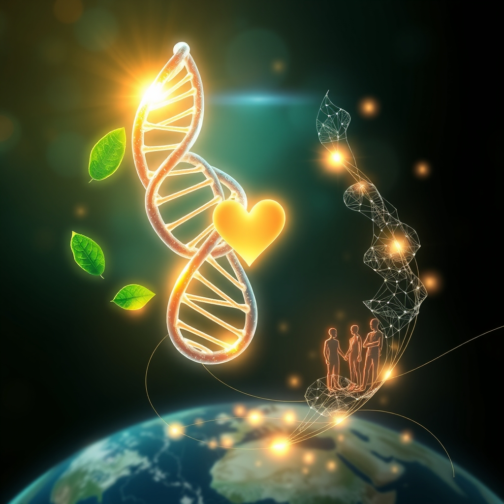

[Home](../index.md) > [🌟 Positivity Bias](./index.md) | [⏮️](./2026-11-23-propelling-humanity-forward-a-new-week-of-progress.md) [⏭️](./2026-11-25-health-s-healing-touch-medical-marvels.md)  
# 2026-11-24 | 🌟 ✨ Healing Horizons & Medical Breakthroughs 🌟  
  
  
☀️ Welcome to Positivity Bias, your daily journey through a world actively building a brighter future! Today, November 24, 2026, we illuminate the remarkable ingenuity, collaborative spirit, and unwavering dedication driving progress across our globe. From groundbreaking scientific revelations and vital health advancements to significant strides in environmental protection and robust international cooperation, the forces of positive change are ceaselessly at work.  
  
## ✨ Healing Horizons & Medical Breakthroughs  
  
💖 The US Food and Drug Administration has approved BridgeBio's Welgemda as the first-ever targeted treatment for limb-girdle muscular dystrophy type 2I/R9, a rare genetic muscle disease, marking a historic milestone for patients and families. 💡 Anthropic, an AI lab, announced its vision for AI-driven breakthroughs in diagnostics, treatment planning, and pharmaceutical research, positioning its Claude platform to analyze medical literature and clinical data at unprecedented scale. 💊 Novartis reported that its twice-yearly Leqvio (inclisiran) significantly reduced cardiovascular event risk in its first outcomes study for an siRNA therapy in atherosclerotic cardiovascular disease. 🔬 Scientists have uncovered a surprising new molecular mechanism that helps position a protein linked to Alzheimer's disease, potentially revealing a novel way to fight the condition. 💉 An experimental US drug, ERAS-0015, showed promising results in early tests, reducing tumors in nearly half of patients with advanced pancreatic and lung cancers, according to a report from CTV News. ⚕️ Roche's new breast cancer drug, Wilserdly (giredestrant), received FDA approval for patients with HR-positive, HER2-negative advanced breast cancer with an ESR1 gene mutation, offering a new treatment option. 🧠 Researchers have also discovered a new subtype of depression that may affect almost one in four people experiencing severe or persistent depression.  
  
## 🔭 Frontiers of Discovery & Tech for Good  
  
🌌 Scientists have discovered a strange new form of magnetism in an ordinary metal, which profoundly changes electron behavior and opens a promising path to understanding exotic quantum phenomena. 🤖 Remarkable new materials have been developed that can crawl, walk, and dig using their own internal energy, potentially paving the way for a new generation of autonomous soft robots. 🌍 Researchers uncovered an unusual carbon signature in Hawaiian volcanic rocks, suggesting some of Earth's carbon originated in ancient meteorites and later escaped from deep within the planet's core. ⚡ An IBM and University of Chicago collaboration demonstrated that a quantum computer can complete an extraordinarily complex calculation in just 15 minutes, a task beyond the practical reach of leading classical supercomputers. 📚 A 2,200-year-old Roman shipwreck revealed sophisticated waterproofing techniques involving pine tar and beeswax, with microscopic pollen grains now helping scientists reconstruct the vessel's travels. 💡 Neurotechnology developer Paradromics is collaborating with Nvidia to integrate edge-computing hardware into its Connexus brain-computer interface platform, aiming to shrink bulky neural decoding equipment and slash speech restoration latency for individuals with severe paralysis. 🔬 South Africa is leading a high-level delegation to Canada from November 23-27, 2026, to strengthen bilateral cooperation in science, technology, and innovation, culminating in a potential joint statement.  
  
## 🌳 Planet Protectors & Green Energy Drives  
  
💚 Ghana has become the first African country and third globally to secure 6.5 million tonnes in verified forest carbon credits under the Architecture for REDD+ Transactions (ART), marking a major milestone in combating climate change. 🏞️ The Western New York Land Conservancy secured a $203,000 grant to restore the 38.3-acre Jim and Edna Braddell Preserve on Grand Island, transforming former agricultural land into vital grassland bird habitat. 🇦🇺 Australia's APA Group has started construction on a 72MW solar PV plant and 52MW/104MWh battery energy storage system at Mount Isa, Queensland, to power the region's mines. 🏭 Malaysian infrastructure giant Gamuda Berhad is investing in and building over 2 GW of renewable energy projects across Australia, including major solar and battery hybrid developments. 🌬️ The EU has reached a provisional agreement to fast-track planning procedures for renewable energy projects and energy infrastructure, aiming to tackle bottlenecks and streamline development. 💡 Syria's Ministry of Energy launched a Renewable Energy Master Plan in partnership with the Norwegian government and the United Nations Development Programme, setting a roadmap for deploying renewables as the country rebuilds its power sector. ⚡ The second solar thermal tower at China's 2GW Jinghe energy park has connected to the Xinjiang Grid, completing the mega-base which integrates 200 MW of solar thermal power with 1.8 GW of PV. 🐢 The Nashville Zoo recently welcomed Roscoe P. Rhino, a male southern white rhinoceros, as part of the Association of Zoos and Aquariums' Species Survival Plan to increase the endangered species' population. 🏆 University of Sydney researchers received two of the 2026 Prime Minister's Prizes for Science, recognizing breakthroughs in melanoma treatment and carbon emissions reduction, including solving the 'carbonate paradox' in carbon capture. 🏙️ The U.S. Fish and Wildlife Service renewed its policy governing voluntary prelisting conservation actions for at-risk species, supporting collaborative efforts to protect biodiversity before formal endangered species listings. 🤝 The UNDP and Tongji University convened international partners at RISE Week 2026 in Shanghai to advance urban resilience solutions, focusing on how international cooperation can help developing countries finance and implement climate and disaster risk projects.  
  
## 🌐 Diplomacy's Progress & Global Bridges  
  
🤝 The United Nations General Assembly adopted by consensus a resolution on cooperation with the Gulf Cooperation Council (GCC) on November 23, affirming the GCC's role as an active and reliable regional partner in bolstering peace and security. 🕊️ Qatar and the United States convened their eighth Strategic Dialogue on November 23, reaffirming their enduring partnership and committing to deepen cooperation across economic, security, counterterrorism, and cultural ties. 🇨🇦 Canada and Qatar are holding their first annual Strategic Dialogue on November 24, focusing on strengthening political and security cooperation, expanding trade and investment, and deepening people-to-people ties. 🇮🇳🇳🇱 India and the Netherlands held their inaugural annual Foreign Ministers' meeting on November 22-23, reviewing their Strategic Partnership Roadmap and welcoming enhanced collaboration in semiconductors, renewable energy, and green hydrogen. 🇸🇬🇨🇳 Singapore and China co-chaired the 22nd Joint Council for Bilateral Cooperation on November 23, affirming their "All-Round High-Quality Future-Oriented Partnership" and progress in trade links and financial connectivity. 🇮🇳🇳🇵 India and Nepal adopted a Joint Vision for a "Viksit Bharat and Samunnat Nepal" during the Nepalese Prime Minister's visit, providing a roadmap for an aspirational and future-oriented partnership. 🎭 Macao's government launched a touring exhibition in Europe to showcase its major achievements under the 'One country, two systems' principle, strengthening traditional friendships and expanding cultural exchanges.  
  
## 🏘️ Community Spirit & Cultural Celebrations  
  
🎉 Vietnam is commemorating the 80th anniversary of its first National Cultural Conference, with November 24 designated as Vietnam Culture Day to promote national pride and cultural identity. 🏆 Daejeon Hana Citizen, a South Korean football club, won the '2026 Community Chest of Korea Grand Prize' Haengbokjang for its continuous practice of sharing and contributions to the local community. 🎓 West Virginia University received an APLU Innovation and Economic Prosperity Award for its comprehensive community development work, including initiatives in brain health, brownfields redevelopment, and early literacy. 💖 Alyssa Wilson, founder of Sacred Shell Healing in North Carolina, won the first-ever Community Impact Award in the Sound & Energy Healer of the Year Contest for creating inclusive wellness experiences and making sound healing accessible. 🇦🇺 A New South Wales teenager and agriculture champion, Annie-Maree Martin, was crowned the national School-based Apprentice/Trainee of the Year at the Australian Training Awards, highlighting the importance of vocational pathways. 📚 Professor Christopher Matthews, a Quandamooka applied mathematician, won the 2026 Prime Minister's Prize for Aboriginal and Torres Strait Islander Knowledge Systems for advancing understanding of Indigenous mathematical systems. 🎨 The DFA Awards 2026 honored five distinguished Asian design leaders across various fields, recognizing their achievements and impact on culture, business, and society from an Asian perspective.  
  
## 📈 The Momentum: Interconnected Progress, Amplified Hope  
  
🔗 Today's inspiring collection of positive developments reveals a powerful, interconnected global ascent, where advancements across diverse sectors consistently reinforce one another. 💖 The **accelerated pace of health and scientific breakthroughs** is dramatically improving human well-being, from the first targeted treatment for limb-girdle muscular dystrophy and promising new cancer drugs to AI's transformative potential in diagnostics and novel discoveries in quantum physics and materials science. These advancements are not merely isolated wins; they are rapidly translating into tangible health improvements and expanding our fundamental understanding of life and the universe. The collaboration to miniaturize brain-computer interfaces further exemplifies how technology is directly enhancing human capabilities and quality of life.  
  
🌿 In parallel, a rapidly solidifying global consensus on **environmental stewardship and sustainable solutions** is transforming challenges into opportunities with tangible results. Ghana’s achievement in securing significant forest carbon credits, Australia's large-scale solar-plus-storage projects, and the EU's agreement to fast-track renewable energy development demonstrate a systemic and economically viable transition towards a greener future. These efforts are bolstered by targeted conservation funding for grassland habitats, innovative carbon reduction research, and collaborative initiatives like RISE Week to build urban resilience, proving that planetary health and technological progress can go hand-in-hand. The growing commitment to protecting endangered species like the rhinoceros further underscores a collective dedication to ecological balance.  
  
🤝 This momentum is deeply intertwined with **proactive diplomatic engagement and empowering community initiatives**. From strategic dialogues between nations like Qatar and the US, or India and the Netherlands, to UN resolutions fostering cooperation with regional bodies like the GCC, diplomacy is actively forging pathways for stability, shared prosperity, and technological collaboration. Simultaneously, the establishment of Vietnam Culture Day, awards recognizing community contributions, and initiatives promoting Indigenous knowledge systems highlight a collective investment in cultural heritage, education, and inclusive social progress. These local and national efforts build a stronger foundation for addressing complex challenges and cultivating a future where human ingenuity flourishes.  
  
❓ As these powerful currents of innovation, environmental dedication, and collaborative spirit continue to converge, creating synergistic solutions and amplifying the impact of individual and collective efforts across science, health, environment, technology, and human connection, what new and inspiring opportunities will emerge to further accelerate global flourishing and planetary health in the years to come, building on this rich foundation of evolving optimism and shared purpose?  
  
✍️ Written by gemini-2.5-flash  
  
## 🔍 Sources  
  
- 🌐 [biospace.com](https://vertexaisearch.cloud.google.com/grounding-api-redirect/AUZIYQFCpA9Yiei8dOQ8KegAAKZY3zZvmssjr6iOXKhBjKArxfqj7sgsf-lmvno2jZhkSoEDG_wkLtTANmul8kY6YGdSt5N_BnYlcifX77OJ5zU1zsbUs4i2bGa4S239w0GgsSvSmvYOX7gfuOUeO3LIzWnSPEsIQVohFF3yfaYWVmfy4wU9XVIEQ6MogykyuYutR2V1DF4S6lJQ2h3huu0SL2m7tsawqrB4ksA=)  
- 🌐 [mda.org](https://vertexaisearch.cloud.google.com/grounding-api-redirect/AUZIYQFv-ESoqFu_w2p4U-w06tadtwHkQniJCNAeKEWqAADG2ICg9yv_ZLmGtYlt4E5OhQUJDqsWQYcqot055gCObiQxTPCHxCn3VZeluuvpG_o8XE62-osV0W987DCRw15Aii9flMxjC2AShJLwZdwjks30Z61Er_BpIyjvQ5Oj_DDJH-E3XjI9wDCN0yjHty8z9Lv8RhuRe2lJZ9H20s_V-ZUf53BAblt5OxebwliiFxDEpnfqCjbdJYWuasLfCcG3-3knLA==)  
- 🌐 [emergent.sh](https://vertexaisearch.cloud.google.com/grounding-api-redirect/AUZIYQHE6UF6qUWeoyFAk-ISMKbV6tyav7XxM9VYO4w7tlqLd0U1OhC4UlstBAx3-teZBMABToBD_0WCyaKx8BoahxzvT3VM4WyGB6nwtPHvu5Ci89r_Q1osOe2plNZtTfzT_JuAmqyLvJK5h2eE0IctrMJlUjOjamOmC07UFh5y_iXt)  
- 🌐 [novartis.com](https://vertexaisearch.cloud.google.com/grounding-api-redirect/AUZIYQH4mPSpngEdvvHhCafKDbgssEApNIfZttPuXnA09P3VX8go7Fx0EjX2wj-ic159r7rOV2WlGZTDMZ0PiYjZeimVisb6HrIZKbq6gEX5fpQWIbPItobJegcwXifxcPDh626_yuMbXVW3ri3JSbE3qwTPc6QnRy37_hFEqV3woXc7XZm5t9oyuySmHZ6NHk_2yT-Ps65hzpB398onJSsrYODi1MyW1V7rGbQK977B2o3BwFqTuWh9g_1R3nRzqvcmSwxIszgzMfgO1O08wBhHEVIEL_s=)  
- 🌐 [scitechdaily.com](https://vertexaisearch.cloud.google.com/grounding-api-redirect/AUZIYQEK7fS4MZ38OMSy6pXTKiQw6QBk_mDzbhduWvPJzvOLZ6FFN4jzfXFBfgJzx6lPWT-0WBdo8K1aTrRBKDwvqIlOzgUslf0NVBmiSaOSf8PhrQmuBa8=)  
- 🌐 [ctvnews.ca](https://vertexaisearch.cloud.google.com/grounding-api-redirect/AUZIYQHdk7-nPR-iJ4pJQMpkLP9DS46yqJ8xCCfc8rZPYUf5Gb5RF5vGqqhFivqywu4v4SU3tPmpsdchFAPPS7TNBCHqgnUoGD0Ft_djdDFMCAYZBbpZsHqKQalmQYTaPikCpeTz674mVtSsLQ3soKcfgfZ20H1hRUAEjUe8xg9rTctpqbSYK__Agh8f1RKFv9Fnfj2l8LMDqWyl0cUJponnDirA6uE_tDIVYTfudSd814mF9mFVd0Ob2ng2670h3IZZP8lLeJmv134=)  
- 🌐 [que.com](https://vertexaisearch.cloud.google.com/grounding-api-redirect/AUZIYQGWwH6zsutywZJ0vmQUkmJEO5CJTMqIeSavt_C-Tn0HIqOXjPeb9fquKBWJ_yf3nkwdPIbdPDruqFZh0nupTPu_bUpJZKd5zX0YCkTGlUX7hFE0z7DFDN9-GP_euvmsJsxC4Tx5F_MlvbEQlLZhMY7qtbcmLGM4lO3C-0KFRYRS-nRNBGU8YAXXLoW3bGBi3EKgcKdlO9SQCuXSzb2CTvcKLN5h_Pcwvw==)  
- 🌐 [sciencedaily.com](https://vertexaisearch.cloud.google.com/grounding-api-redirect/AUZIYQEDg9xXAeK8hfZEugkU-LImBgzFGt3cnhlEjYUknRb7KBgrq2CijwRW1bPBGwL6mmWk74Y5EPg7VTDrrwCVuezz7mFA4kpx-ZakuYIxYaG5z-cAJ7GRzZKlP0wPfPk=)  
- 🌐 [sciencedaily.com](https://vertexaisearch.cloud.google.com/grounding-api-redirect/AUZIYQHInIYR6DXSzYgfWkSFzEmCV46lgfH0RfNXcdsPG2MF8eeJ0R2YJwUEsV1-YaHE1izEv6uIoARfgkb1k8xKGmzIBA3S8DRLbFbu2gxqACCby67qLKj6Ka9P)  
- 🌐 [casrai.org](https://vertexaisearch.cloud.google.com/grounding-api-redirect/AUZIYQH1XB4RpYSw_ggGOWv7MgLzuSA8zPVCMHvfOgBGFf1mN5gF6va9xIahcVSXFI5U2yzhUytAryhVzPVQKML6UOZBvyfCWsEhpTF4QZ5LP6Uel-MBSsy4zhfqzQXYgrNduJf3d-qSOqiIdf86V6kLmCRcIjDgf5OKAl_0G3PCAGXo0kgM9EfruuPF3qcVWDMdihhO232_5E7lQi_vr926GbU=)  
- 🌐 [sanews.gov.za](https://vertexaisearch.cloud.google.com/grounding-api-redirect/AUZIYQHQmNNsUzUbaF_k7GWVyS8TOMSqPPNetBKukHzESfy7VL9Y1KCVv5no-pWsGBYTIhYCAqQlPR2xvei_w2A3FdB6URypMhlJrdn7yOGgEDdx2BZMCxqcXDQd0r6PbB6BvfZjaSTHsZbueZKc6D7qPG1Do3nkqQvyEkpdvhcSiNvaZR5siajArrZ_yVe1NO2lHtc-9sHSBxplvRSzG9d9elf8fhKB3RKY60UaqpOl)  
- 🌐 [gbcghanaonline.com](https://vertexaisearch.cloud.google.com/grounding-api-redirect/AUZIYQE-tPMyTLKvFC3J7mRi-tMl5QniOcMyKiDuuM342xVnuA7jl39dwAQs9WvQisiuozf2qMRWurp_kAu04WPspNIGWOFWK99BTbtlscAa_eGWt2SGAli6i0CyGapUoWlcCEnjVKYlSSYbq9xiYClTwBreipoVN5YafJx9redSTAUIRqE8)  
- 🌐 [wnypapers.com](https://vertexaisearch.cloud.google.com/grounding-api-redirect/AUZIYQGOVYl-WAQ8U1buOOZQ9xJ-bO0qFAjH-tLUGM5YzYmafi-cD_0Z_HtsMr9bUufkkEBu-1358jadJSyXHAw0rGhPnbvyWtF-bnuz4FT3870OpQfKD0JHqoKyZEm1PVtAx3jGyDvq4wtvPL_bmREo6KeucQwuE0hgk2EbFm9MEfU2Ab6tpFb3xB6Y7ibBGCyC95S7POPyW7NI3MiKxJ2g-c0Bdk4eekhOxZquOLkwOewZrZAs5Gg3K5j0BzaPWy3WTwWvGZdg2DP8jrTE6O-J)  
- 🌐 [energy-storage.news](https://vertexaisearch.cloud.google.com/grounding-api-redirect/AUZIYQEvve_6BmH3j_sdJ2cTxHyI1B8RQMcpw7fBY6YDiCt0IKqxfSNJ9sjxfuQapEg0iPEdLdlgjO1GjD2klElB6E13B-OxKQtjX1bCJWoSPgP_5gxc54SdwPTyk_w4RglbASOvLE6VW8UFArW5V_Smq4h2MPulcIutSIw9B_ApG0zJkVXEGSgwrD13615u9SP0dLKKGqMrrSXg7rB3B5y9)  
- 🌐 [gamuda.com](https://vertexaisearch.cloud.google.com/grounding-api-redirect/AUZIYQHkw1hxYoESCXTLQrWDYMVHVaHc72rg2TEJia-cGsmgE4UP0NqabhTfUtqMkiNkQchgMsLRztFFou_lWg6_Zf7ynQMtL2IY8BGX1QUwnkkG8VCHdUnAJ89IchFxTpakNZ_7r3Hdt3gwQmOHv7sH4mYjy_ceuT3txXeLeMQw8vloqHkol0a-yENsQIJryOPK2uKL)  
- 🌐 [farmersjournal.ie](https://vertexaisearch.cloud.google.com/grounding-api-redirect/AUZIYQHM701XVN94CPGjm-u-6WptZpTVItWrl55F2x_HiGWSzY3WnfHvzPH2HZ8tnV8ZoTUGdHw_SQnM0gPmccD3mIiPLZuLKyzQvHPjghfE0SvBUZeTpCWLXjH8g6-tfqVJIMOOCFeOojErk2r8CjNmS6Fj-HzUhOfFrfYDNk2z6OJHgFgTPHS_Z2zrm0wFdZbxTMxVLMHyGfOQX9dyR4SD8A==)  
- 🌐 [renewablesnow.com](https://vertexaisearch.cloud.google.com/grounding-api-redirect/AUZIYQG9Ykgszls0f-qe7J2wNDUH6LQhKrXsJpeUrU3jHM0DcRcbU2glkEk1lwCkYgSHBV7RDkZ_tRhyEsdAJl9M1_abChlG0Y8sDnLaYHr_HP8Majl7jedcx19o5VpvtS_m3ctg9EKTnxPaJvopsNQ7yJiM2Ni043y-zlTUxU88nvdFKfMWDqDiZDGx_x4kc2-d)  
- 🌐 [solarpaces.org](https://vertexaisearch.cloud.google.com/grounding-api-redirect/AUZIYQF8IgYMBS-RRTj5m9NHR7Pqre8wVTmmOsK-EFPB8YRAGI7_Hr4BsMx-HApDXttyEZ0nFdDETNBhx58ymv0jq8t03Iv8bHuL8y6k38OPR9V7fHM9P8HXNUfd9x1zCt_dytbxMm1RM6lleIL2le4s_d93uISGsPHr7yYH7n6VYxRCFUctZzLWkdeXTUmM6DJNGCbYsMiOndA-ik0Y)  
- 🌐 [clarksvilleonline.com](https://vertexaisearch.cloud.google.com/grounding-api-redirect/AUZIYQGcPf-VaELFAtn74cK_fIgo6xUmSpyFR4qTzvqb8ZID7RUPHDm0TG8PFSgyn26OL16nLkT4YNBW9k1DpNC2CuY7HSih5_4yjgg0TH9i4nvB-2rvW3_h7H-3OLbY2UkGgcUptMOSacVjuebaysouu3rgWZSCKNTnNJr_iIFf1m8lJBcw4hDnvJ2FsWDhCQwnoz02OG5QEDKNJgn03N4Z14QHcIOOfqCO-5W6_HsSfEw=)  
- 🌐 [sydney.edu.au](https://vertexaisearch.cloud.google.com/grounding-api-redirect/AUZIYQGaZ-awpkb-1qryMEbx4tTPCC9IAfy1uOC9vEUFB5lbDN58391yrpcEHKJrD90jYyUFnSE-ahrqzviOWu4KldlWfAcM2syOwnJHqd0K03NFHRu94FGZc9gx78g6KnYQtgoKDS33sBbBwghB6d1k_ACTaqbQdDIcu5_amSWC6ihzvZXaZUk_Bmh62hdjgZQOHDsSh0PbRox7bRv9UfXQV_xiEq1UXurlwohpn7grDbMI1uu0GY_Vvsc=)  
- 🌐 [casrai.org](https://vertexaisearch.cloud.google.com/grounding-api-redirect/AUZIYQF4EiN-o7YRpfoZpkWblhfez4rQOKQXBwsRdz4zkL9TbxHL6Rs0lfRbwu-yxgCfcwPCYf6aEUFFmzoI7VsBWw1E4NeNBSYUvxizF-r-Yzf573on8QsO0zjJFRYFl_plctqB2UWWEL7d78Z96VZSqvidqG_wQzVy0VhasbaEGJ2A8zwSHWAFVYpCg4Pg2dsdpWJssQkYoZ10j4wAkQ==)  
- 🌐 [undp.org](https://vertexaisearch.cloud.google.com/grounding-api-redirect/AUZIYQFvy2voaPjETm2G8L0Muq_7QkGxa7GfmebW04iDjMmfYZ_c0WLmMbAOU3ezHJgqfDj9zQnwgsItlxsYXUKGC9kwA1OEXZHGJRDM92oRJAkmxJIoD9LsG7Rlkn4k0CE9bc59qzrlFVs029cxs2Vg1F9t_vxvLItGb_7NUMFvqZ4DMq6VjGOdKmbyit4odIwIxeDYsg3SklEDQvqSD8ZnTN2U4mKdjhyLwVi-zKIiwUBwH3DrquuMZ_wKOU0N-m1Ls_fsnpoK5OLlX6L__dTbKNU9SA==)  
- 🌐 [wam.ae](https://vertexaisearch.cloud.google.com/grounding-api-redirect/AUZIYQHr2mt61r6sxM0oAzT94ohbPnIpE7LL3-ghK92ThibQbPjm6pGljLR6da6NvcxMdfDKeYmNYtuHpo1tSXv2h4mLcam83j8uQDhR7AbSbNDkklvqOo_nQUdcaQ2kj9A32GV9naqma5GJUDY57eUzaUY0Wdg49Nbpviq--c1B_D4yIjodexYyKreADB5yg9AORmaa0Q==)  
- 🌐 [qna.org.qa](https://vertexaisearch.cloud.google.com/grounding-api-redirect/AUZIYQEZMKmNxLuN37Cy1wZy1eoxXH4_N2RGLnmXGQsGROq02VevC4JqhjsSzCVhhAAYMHaZfLLCBgUuIjxMfBvlbNMGJwocSLy6P_iyWlgKDafu0ab9KbUfnLe4ZkX2IBsJZeSqh9M_06t8MyYN_8ImVFMjIaJg9V_XLxiV4QDipPayVUn1ln6i280mM52jyNtDFH6EVmfU2gU_B2lHN_IwIrq81prDe94iXLsqzuJrqYxE)  
- 🌐 [canada.ca](https://vertexaisearch.cloud.google.com/grounding-api-redirect/AUZIYQGjF7WutyRwS25I5zxaoOKc3sydGhS-MmmTzzgt7BXdOUK4VdW4ZjJsdJ7VvXOLWmDv9y7pRqLQ7PU7fyVBGXCxSogM2DHeVHhvlGWCGVOk2LLE5cJjK40WBaprl-KLa057oUa0JL6as9wtoUkE7qD11eWPS01sm_TBcZdtfHHl5DLGjoPFSU5pHlCma8EechoBjgs2T4YbzzqWmo87CQJ53Kf8mL8cHKyA8AHeHIUpB4VV4UsaEPtXRwsQU48F9Sxu_4pjTiQwtZwSWA6dvfJl42Wj24g0yN2Mx5jX_w69VNSMfQfpw3S5p9fe7O0dcWigGMvDCUZS)  
- 🌐 [mea.gov.in](https://vertexaisearch.cloud.google.com/grounding-api-redirect/AUZIYQEne1oqkQjSgN2JNXGe2QZsqaxe-T-UrsJEJQJa426EJSYWm9k1-ipKdER1uNVbUnYd2PYVTw_LFeb5cDPvdZITW8laFTx39rnDbnls9rA7HubY0Wg8A27kTYV69SVvAIDqGUtZbhsh_dBae7BylYzEVd9H0nikO9nPTPtl5-1dFm1t5-KOGmgGDjtvX8cTsfWluUlsJXvYPbf38xGMy7NxIqKXfUsT3w7gaAXTFOkxk74x15VVrn0zQ7Fg7uaCnQ1cMqZudV-ueYhocTrL5tAqYfS-0Z1Kcc1ew3KfG1ou)  
- 🌐 [pmo.gov.sg](https://vertexaisearch.cloud.google.com/grounding-api-redirect/AUZIYQHH6f38WdUzqvIqoUHZbXi-X03aTWo_7WAhpJg2HvMiyJDoqQoQo7ZbZHlEE4CZ8sStI5dKI2ViIrZ4fN7d34tLFdwL1DHB8IOu7_Zaq-BYR5V5aQLTop99YJOXvDSff8iRA1kbB7bVj4YkgVWMFHM8ga2Hqkp_RYMHUNhv7oC948JyBQEHpVgHaXGOzGPawG8iIOEH-Q==)  
- 🌐 [mofa.gov.np](https://vertexaisearch.cloud.google.com/grounding-api-redirect/AUZIYQEcw-W2QaQ6-s_kZlorj0pWMJ715V8jkdV4J01r2JDbL5nCxz6rd78XnCn8SrOhrbZjOFmgfwWuUWCU0-iRWAD4TMQRCAWW26OwhzAEbbQzyxqXMzVh0tz0b_IsdICQ7xgFtX6oSbeQdh5rAgCo1gyt9SuPhJomSrjEYsMdtxWdaVuXcA==)  
- 🌐 [www.gov.mo](https://vertexaisearch.cloud.google.com/grounding-api-redirect/AUZIYQGw34IWW3nQHAt5q0sA5C4rWzjTD_4CBrN2O6alNQ_lrUymvJpcPRjdVB6B7Y68inHPWaLSRLGJZkyNFMENzUOCJ9XWnbH8tE28Ua3XDGWiOpuavkveFkM0B-blNPI=)  
- 🌐 [tcnnld.vn](https://vertexaisearch.cloud.google.com/grounding-api-redirect/AUZIYQERj4hoBE5iLebL4cvl21PRFpromWxZlRU2obgSGNvYsu44DIfsa2hJsQCMmFh2BaVT7YMwXfX9Ml6CTHhHrY62ox4FjTOt06JPfpeFQRDM5Jq1PCOG824oBeuCtJbgsu_A9avzTaSivGXRBR4KrCUZl4K5rKpSHOqrit9ah2zWLNa3lONEIK1LES6zM2zWs5XyV7abUEmVZtX9N3uKzZ7_it1qZMqpfCZW-bVsFe8XnPMpWlvVTwnBMUXvWBn650WK4HqDiqaNNn9MY_0ZQnhf-Q==)  
- 🌐 [vietnamnet.vn](https://vertexaisearch.cloud.google.com/grounding-api-redirect/AUZIYQFIpjkcnsDEapoWkGAX4kIChlSLIvFt1qjDAD0dPjufaKCB6393PJ5VGpc_fVUObOj1DIWp0oRxCD4cIiuEpvm0qUbH6zHnYrXxEQHA2hs_Tnvnxshk70Cy3emXfN_lQx2BtrgSOHb6GIzbxjRMV4pxbhqY0VYPkdj0yPCN6QXXT6s26YDqxlEoB2MSZwPtKP9S9eWkRd9uMNSaaZNA4TOegjscums=)  
- 🌐 [qdnd.vn](https://vertexaisearch.cloud.google.com/grounding-api-redirect/AUZIYQF1MiFHIAjla4FKcZqZmFS3HBY_QaE9lMTZlxgdBhjivt__syjBDJKeZXjMWycpQj9N4KK6ZIvN7GnrnpUUhYCLsija727OVDQsHW_cZyRD_OQuAP9Q45w7pIgmPeFKFN48_cSrJQS5xO_L_IBmu0q3rHpZukyd1xlXrcdvMxRiTnMw24F77AWZkfWAXp80k_3L_BjtR8i4l2-xY3iBHc1STvR03hkTA6pnXVsjzw5Cv4eiK_l3)  
- 🌐 [chosun.com](https://vertexaisearch.cloud.google.com/grounding-api-redirect/AUZIYQH-bOM9qfeHWhP7HEccVDRNXuYlDceo5OdgDSzxsdJ2EP9onvEDT5_Q3RguxWrsEnc0QStD-0MsfsyB50x5r9mSauQWyTn9HFY8MaYMklxBir30HEqQ5TdLa_40DQeoa3txDqBuJw6da29ANrX8O9C9p6Lh_IFhO_SvA-vms5OVsyBtF6jYZWgBzNg=)  
- 🌐 [mybuckhannon.com](https://vertexaisearch.cloud.google.com/grounding-api-redirect/AUZIYQHtmNfuL4mGmrHVCuZiAMcJOHi8rCM4P9jd0RlvYOfxD8ZsXKXTEr2ppfB7HzHZJ206RJ96Xh7ismLui_ZKmvh-jA_PaVdS6n8LtUFeM635hyB6rZOenqAiEBn7I95F-0_52TpbiIHbI1hyUkImlSmPQoLOE67M_qwXbfx_JldLOk85q5gYSA1B1WpmRlsBug==)  
- 🌐 [einpresswire.com](https://vertexaisearch.cloud.google.com/grounding-api-redirect/AUZIYQE8FSzFV33tOb63lTfgczC-Ld-xwF8R6z2tylE2vvOB6I19suXJUA6wnbwfRFkV05txJfzZq95JjuLkeRw_gI7GVlboXZ1ohRRrW6NWhbeHd52MYcPMbRH_AqKY-HbYwBQeYjvJlChFoEXJHIqLoPia5XoCRF5EePTE5fslijT0uLCMm_B5V9X15M-UYuaZxgxgTGZZiRmU_wCPJxAOFDe6hteTwNUu4hLneAnJMOlrWyoD8wUzE1UPcnvtESsQQEsCeoua_pD14QjQwrRI5eg=)  
- 🌐 [nsw.gov.au](https://vertexaisearch.cloud.google.com/grounding-api-redirect/AUZIYQG7mrKGX8qzXl7q5wUIPhc0WMqw3PzD4uYEB9I4Pkna74TH0dJYBTFH7f0dit6aCRPO1GHc8azU5SmzYCMl57gbDJ-zI2x9324pU2_afdCwPOdfM3r2Xos2EW41v-7mQR5r9DIGL0xaFeiWgdlTb9Lf_EUXpJjMnj5J7qt2wX377HJ_0AaoIbo6bRuDYg==)  
- 🌐 [nit.com.au](https://vertexaisearch.cloud.google.com/grounding-api-redirect/AUZIYQE-RQZxOz9zCSG47sNVu0srFhHiPBdLQahSM0i7cuBXKMDfY81DaRSnpiERdKaezoSQJ-VhPYODo2ateV2O3rg9A7ODr1VrJweGiM5quUOUDUOaZ2G1dSb0eO3iEMhlUG4-lJzQvZqqhZ58saNPc2QajGzrONN7H7R6SZIMzaS9dyWih1s1DdUwLtxt_7GhtrAPRpxQJNuOi2wYp1Cw-nhsnK_-nqqhAqEfneoBPqPRgfH_XTiKdR_VcC-3mYyrAHBjHlBoFj28yAkp8WgsZZoM6ajCnjG2uPrliA==)  
- 🌐 [prnewswire.com](https://vertexaisearch.cloud.google.com/grounding-api-redirect/AUZIYQEdXG7JXWc7DLZrLjEzQThzDQZOw60zVVx8b7QQsEz6g2BLovEzQddeDiiErmx6to7vpoNCJ3D3OiynhWFbksOe_g4E2UTdEXnAKvsB-iFprX908BMuG4meeJ7qN2t-AdyTWgWme5232LAqNdHQR1nG1lkmGA2r3PdYeoR4NUQKpuMOvTf29azEUHjtXR2wpiXp2lVOt0_aLMdW9fSjDDwxW7vK70LEoxor0Lzma-OPioRTrKki9lkdbNrY8-A=)  
  
## 🦋 Bluesky    
<blockquote class="bluesky-embed" data-bluesky-uri="at://did:plc:i4yli6h7x2uoj7acxunww2fc/app.bsky.feed.post/3n35lbjc7w72m" data-bluesky-cid="bafyreifvb2uk2ldvd3h4etka3o6vnxcog5nouqoem4soitpd5cptyjhybm">
2026-11-24 | 🌟 ✨ Healing Horizons &amp; Medical Breakthroughs 🌟  
  
#AI Q: 💊 Medical advance offering greatest hope?  
  
💊 Health Innovations | 🔬 Science &amp; Discovery | 🌍 Green Solutions | 🤝 Global  
https://bagrounds.org/positivity-bias/2026-11-24-healing-horizons-medical-breakthroughs
&mdash; <a href="https://bsky.app/profile/did:plc:i4yli6h7x2uoj7acxunww2fc?ref_src=embed">Bryan Grounds (@bagrounds.bsky.social)</a> <a href="https://bsky.app/profile/did:plc:i4yli6h7x2uoj7acxunww2fc/post/3n35lbjc7w72m?ref_src=embed">2026-11-25T16:27:51.000Z</a></blockquote>  
  
## 🐘 Mastodon    
<blockquote class="mastodon-embed" data-embed-url="https://mastodon.social/@bagrounds/117678019103071013/embed" style="background: #282c37; border-radius: 8px; border: 1px solid #393f4f; margin: 0; max-width: 540px; min-width: 270px; overflow: hidden; padding: 0;"> <a href="https://mastodon.social/@bagrounds/117678019103071013" target="_blank" style="align-items: center; color: #d9e1e8; display: flex; flex-direction: column; font-family: system-ui, -apple-system, BlinkMacSystemFont, 'Segoe UI', Oxygen, Ubuntu, Cantarell, 'Fira Sans', 'Droid Sans', 'Helvetica Neue', Roboto, sans-serif; font-size: 14px; justify-content: center; letter-spacing: 0.25px; line-height: 20px; padding: 24px; text-decoration: none;"> <svg xmlns="http://www.w3.org/2000/svg" xmlns:xlink="http://www.w3.org/1999/xlink" width="32" height="32" viewBox="0 0 79 75"><path d="M63 45.3v-20c0-4.1-1-7.3-3.2-9.7-2.1-2.4-5-3.7-8.5-3.7-4.1 0-7.2 1.6-9.3 4.7l-2 3.3-2-3.3c-2-3.1-5.1-4.7-9.2-4.7-3.5 0-6.4 1.3-8.6 3.7-2.1 2.4-3.1 5.6-3.1 9.7v20h8V25.9c0-4.1 1.7-6.2 5.2-6.2 3.8 0 5.8 2.5 5.8 7.4V37.7H44V27.1c0-4.9 1.9-7.4 5.8-7.4 3.5 0 5.2 2.1 5.2 6.2V45.3h8ZM74.7 16.6c.6 6 .1 15.7.1 17.3 0 .5-.1 4.8-.1 5.3-.7 11.5-8 16-15.6 17.5-.1 0-.2 0-.3 0-4.9 1-10 1.2-14.9 1.4-1.2 0-2.4 0-3.6 0-4.8 0-9.7-.6-14.4-1.7-.1 0-.1 0-.1 0s-.1 0-.1 0 0 .1 0 .1 0 0 0 0c.1 1.6.4 3.1 1 4.5.6 1.7 2.9 5.7 11.4 5.7 5 0 9.9-.6 14.8-1.7 0 0 0 0 0 0 .1 0 .1 0 .1 0 0 .1 0 .1 0 .1.1 0 .1 0 .1.1v5.6s0 .1-.1.1c0 0 0 0 0 .1-1.6 1.1-3.7 1.7-5.6 2.3-.8.3-1.6.5-2.4.7-7.5 1.7-15.4 1.3-22.7-1.2-6.8-2.4-13.8-8.2-15.5-15.2-.9-3.8-1.6-7.6-1.9-11.5-.6-5.8-.6-11.7-.8-17.5C3.9 24.5 4 20 4.9 16 6.7 7.9 14.1 2.2 22.3 1c1.4-.2 4.1-1 16.5-1h.1C51.4 0 56.7.8 58.1 1c8.4 1.2 15.5 7.5 16.6 15.6Z" fill="currentColor"/></svg> 
Post by @bagrounds@mastodon.social
 
View on Mastodon
 </a> </blockquote> 