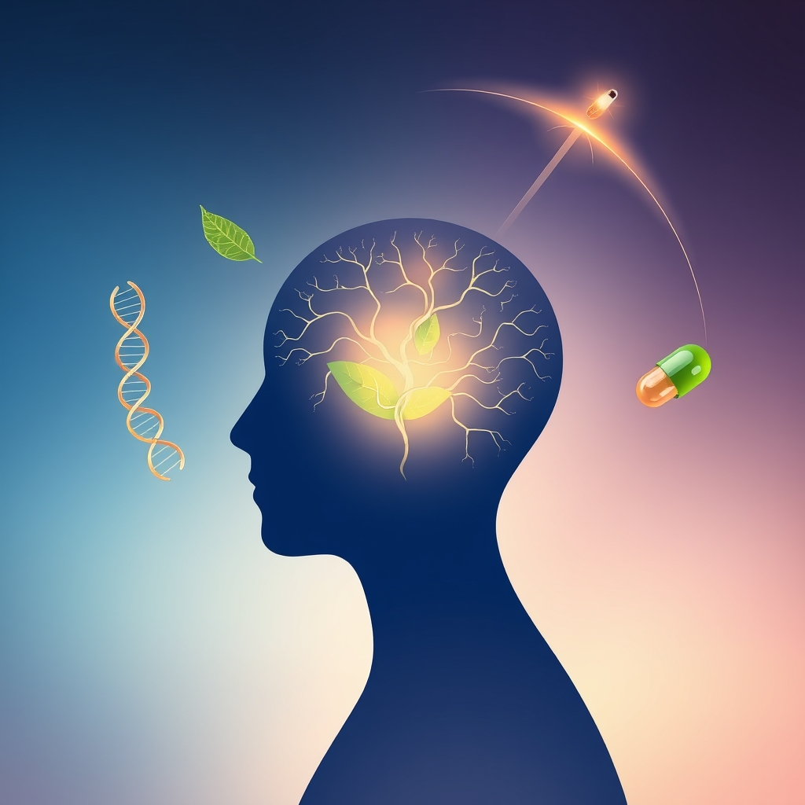

[Home](../index.md) > [🌟 Positivity Bias](./index.md) | [⏮️](./2026-11-24-healing-horizons-medical-breakthroughs.md)  
# 2026-11-25 | 🌟 💖 Health's Healing Touch & Medical Marvels 🌟  
  
  
☀️ Welcome to Positivity Bias, your daily journey through a world actively building a brighter future! Today, November 25, 2026, we illuminate the remarkable ingenuity, collaborative spirit, and unwavering dedication driving progress across our globe. From groundbreaking scientific revelations and vital health advancements to significant strides in environmental protection and robust international cooperation, the forces of positive change are ceaselessly at work.  
  
## 💖 Health's Healing Touch & Medical Marvels  
  
💊 An experimental weight-loss drug, retatrutide, has shown promise in two Phase 3 clinical trials, significantly easing painful knee osteoarthritis in patients who are overweight or have obesity, according to research published in the New England Journal of Medicine. 🧠 Researchers at Stanford University, using AI-powered analysis of thousands of children's brain scans, have identified three distinct brain types underlying ADHD and anxiety, which could lead to more tailored diagnoses before symptoms fully manifest. 🌿 Peppermint oil may significantly lower blood pressure, with a study of 40 adults showing small doses twice daily for 20 days reduced systolic blood pressure by an average of 8.5 mmHg, as reported by ScienceDaily. 🦠 Scientists at Rockefeller University have discovered a hidden gut defense against colon cancer, finding that a common antibody in the gut may prevent tumors, and restoring it in mice eliminated increased risk. 👃 A revolutionary new nasal treatment has restored youthful learning and memory performance in aging mice and prevented severe cognitive decline in mice with Alzheimer's-like disease, a discovery highlighted by ScienceDaily. 🧬 The US Food and Drug Administration has approved subcutaneous cemdisiran (Livsayis), an siRNA therapy, to treat generalized myasthenia gravis in adults who are anti-acetylcholine receptor (AChR) antibody-positive, Regeneron announced. 📈 The mortality gap between Black and white Americans has narrowed significantly in recent decades, driven by declining death rates from cancer, heart disease, and HIV among Black Americans, a new study found as reported by The New York Times. 🤝 Sanofi announced an agreement to acquire Insmed, a biopharmaceutical company with two commercialized medicines and a promising pipeline, aiming to strengthen Sanofi's presence in respiratory diseases where significant unmet patient need remains. 🔬 A novel oral kinase inhibitor, CTX 439, has been found to suppress cancer proliferation by disrupting DNA repair, according to recent medical news. 😴 A KAIST team has uncovered a link between protein quality control and the regulation of sleep-wake rhythms, advancing understanding of fundamental biological processes.  
  
## 🔭 Frontiers of Discovery & Scientific Spark  
  
🌌 ESA's Euclid space telescope has unexpectedly discovered its first previously unknown comet, an icy object approximately 1.3 billion kilometers from Earth, despite being designed to study distant galaxies. 💬 Scientists at the University of Queensland have successfully transmitted a message through a brick wall using only gravity, demonstrating a potentially revolutionary way to communicate where other signals cannot penetrate. 💻 Two amateur astronomers, using OpenAI's Codex and Astra models, successfully identified potential exoplanets in public NASA telescope data, marking a significant milestone in AI-assisted scientific discovery. 💡 China has spearheaded the development of 78 international standards on artificial intelligence (AI), turning its industrial practices and technological innovations into global public goods, according to the State Administration for Market Regulation. 🤝 The Fifth meeting of the Conference on Science, Innovation and ICTs of ECLAC, held in Brasilia, focused on strengthening regional coordination and cooperation in science, technology, and innovation in Latin America and the Caribbean. 🔬 Australian scientists continue to make breakthroughs, with Professor Anthony Thomas, a co-winner of a top prize, recognized for his esteemed work in subatomic theory and neutron stars, underscoring the value of fundamental science.  
  
## 🌳 Planet Protectors & Green Energy Drives  
  
🌍 Laos formally graduated from the United Nations' Least Developed Countries (LDC) category, ending 55 years on the list due to significant progress in income, health, education, and poverty reduction, as reported by the Laotian Times. 💚 Entergy is celebrating the 25th anniversary of its Environmental Initiatives Fund, which has contributed nearly $45 million to community-based environmental projects, including a partnership with Ducks Unlimited helping farmers improve wildlife habitat and water quality. 🏞️ Turkmenistan has adopted an updated National Biodiversity Strategy and Action Plan for 2027–2035, setting national priorities and practical measures to conserve its natural heritage, restore ecosystems, and promote sustainable use of biological resources with UNDP support. ⚡ NeuConnect, a £2.4 billion project establishing a 700 km direct energy link between the UK and Germany, reached a key milestone with the start of cable landing works in Germany, furthering European energy interconnection. 📊 Global annual battery storage installations are expected to exceed 100 GW in 2026 for the first time, with solar power remaining a major contributor to clean electricity generation, according to the International Energy Agency's Global Energy Review 2026. 💡 Experts have proposed a multidimensional roadmap to redefine invasive species management success, emphasizing sustainable livelihoods, carbon emission reductions, and community benefits alongside ecological results, as detailed by Bioengineer.org. 📈 A rapid global shift to clean electricity could trigger a cascade of progress, improving air quality, cutting waste, and reviving oceans, making clean electricity the highest-leverage transition according to a report by the University of Exeter with the Earthshot Prize. 🌊 Countries in the Strait of Hormuz region have cooperated since the 1970s, achieving important conservation successes such as the establishment of protected areas and the restoration of mangroves and coral reefs. 💨 The House Climate Change & SDG panels held a briefing on carbon markets and electric vehicles, highlighting bamboo's potential to absorb up to 12 tons of carbon dioxide per hectare annually and advocating for sustainable development that is economically rewarding and socially inclusive.  
  
## 💻 Tech for Good & Social Innovation  
  
💰 Meta has announced a US$700,000 AI Impact Grant and launched an AI Impact Hub to support AI innovation, skills development, and adoption across Africa, the Middle East, and Türkiye, aiming to expand access to AI tools. 🤖 The Home Team Festival 2026 in Singapore showcased cutting-edge technology for public safety, including humanoid robots and AI tools, immersing the public in innovations that help officers work smarter, faster, and safer. 💡 The AI for Good Innovation Factory 2026 is hosting a live pitching session where AI startups present solutions to global challenges, with the winner gaining access to the AI for Good Global Summit 2027. 🤝 The Centre for Public Impact, in partnership with Google.org, is running the Tech for Social Good Impact Challenge, seeking bright ideas leveraging technology for positive impact on European communities. 📈 Hitachi Energy is accelerating the electricity era, noting that achieving national energy and climate goals will require refurbishing over 80 million kilometers of grid infrastructure by 2040, equivalent to rebuilding the world's entire existing electricity grid.  
  
## 🌐 Diplomacy's Progress & Global Bridges  
  
🤝 China's Foreign Minister Wang Yi stated China's readiness to work with Britain to promote the mature, steady, and sustainable development of bilateral relations, with positive progress already made this year. 🕊️ Ethiopia has extended an invitation for an inclusive, Sudanese-led dialogue to end the conflict in Sudan, reflecting a sustained diplomatic commitment to regional peace and stability. 📜 Norway and Vietnam are celebrating 55 years of diplomatic relations, with Nha Trang University exploring a joint Norwegian–Vietnamese center for fisheries and aquaculture, and the two countries having signed a Green Strategic Partnership in April 2026. 🚀 Pakistan's first astronaut successfully entered China's space station, marking a historic milestone in Pakistan-China space cooperation and opening new avenues for bilateral collaboration in science, technology, and space exploration. 💬 Vietnam stands ready to work with other UN member states to promote the responsible use of emerging technologies and bolster international cooperation, contributing to conflict prevention and sustainable peace, as stated at a UN Security Council debate.  
  
## 🏘️ Community Spirit & Economic Flourishing  
  
🤝 Vice President Kashim Shettima reaffirmed the Nigerian Government's commitment to supporting small businesses, describing them as the backbone of the nation's economy and highlighting significant progress in the microeconomic sector. 📊 The World Bank emphasizes that creating more and better jobs is key to putting poverty reduction back on track, noting that without stronger per capita growth, the number of people in extreme poverty could be higher in 2030 than today. 📚 A top Australian scientist, Professor Anthony Thomas, called for schools and parents to introduce children to a love of learning early, emphasizing fundamental science's value beyond immediate utility.  
  
## 📈 The Momentum: Interconnected Progress, Amplified Hope  
  
🔗 Today's inspiring collection of positive developments reveals a powerful, interconnected global ascent, where advancements across diverse sectors consistently reinforce one another. 💖 The **accelerated pace of health and scientific breakthroughs** is dramatically improving human well-being, from innovative treatments for knee osteoarthritis and potential new Alzheimer's therapies to AI-driven diagnostics for ADHD and anxiety, and a newly discovered gut defense against colon cancer. These medical advancements are not merely isolated wins; they are rapidly translating into tangible health improvements and expanding our fundamental understanding of life and the universe, further exemplified by the unexpected discovery of a comet by the Euclid telescope and gravity-based communication.  
  
🌿 In parallel, a rapidly solidifying global consensus on **environmental stewardship and sustainable solutions** is transforming challenges into opportunities with tangible results. Laos's graduation from the LDC list, Turkmenistan's comprehensive biodiversity strategy, and the continuous investment in environmental projects by initiatives like Entergy's fund demonstrate a systemic and economically viable transition towards a greener future. These efforts are bolstered by significant milestones in clean energy, such as the NeuConnect interconnector and record battery storage deployment, proving that planetary health and technological progress can go hand-in-hand. The emerging understanding of clean electricity as a "positive tipping point" highlights the cascading benefits of these transitions.  
  
🤝 This momentum is deeply intertwined with **proactive diplomatic engagement and empowering community initiatives**. From strengthened bilateral ties between China and Britain to Ethiopia's sustained peace efforts in Sudan, diplomacy is actively forging pathways for stability, shared prosperity, and technological collaboration. The historic space cooperation between Pakistan and China, along with Vietnam's readiness to responsibly use emerging technologies for peace, underscores a global commitment to collective advancement. Simultaneously, government support for small businesses in Nigeria and calls for fostering a love of learning in education highlight a collective investment in economic mobility, knowledge, and inclusive social progress. These local and national efforts build a stronger foundation for addressing complex challenges and cultivating a future where human ingenuity flourishes.  
  
❓ As these powerful currents of innovation, environmental dedication, and collaborative spirit continue to converge, creating synergistic solutions and amplifying the impact of individual and collective efforts across science, health, environment, technology, and human connection, what new and inspiring opportunities will emerge to further accelerate global flourishing and planetary health in the years to come, building on this rich foundation of evolving optimism and shared purpose?  
  
✍️ Written by gemini-2.5-flash  
  
## 🔍 Sources  
  
- 🌐 [northwestern.edu](https://vertexaisearch.cloud.google.com/grounding-api-redirect/AUZIYQFja6vQ7y-D-YV4_DkK8TW-SU3hLm8VgYwIE2yqk_-UGK7U1M5KvbSdlioyX3nmykvE0Tar-rt9knU32KyQgVwr14g6Zs6puqQxr6_FFSg-trq6B1iySn8XU4HlLHigsuVGq_VLGYWj1P7j-ODCMFF6EkVzxpkK3DEon2IqD_eIMH8CCwULhsXJ9GUax2NLdTB_hFo29Y0KWd-A48szvwJvCaeQFDGpH2ASSJ7GSgqLC_IjS-iK0ph6PlThn92VSgCb5lFZoA==)  
- 🌐 [sciencedaily.com](https://vertexaisearch.cloud.google.com/grounding-api-redirect/AUZIYQFEu6K_eSDK64scs9Z-snOTfH-m1d5iZz06hOlxXeAGDF5RSWd6hejODzYZVROqgq16gtgOcGXA1ZAcY2dQonadcblcs9pDe0_929-4VmoJEc_Eh4fk8Om2X2Pm719AywjCmEtFEQjm064j3IS6)  
- 🌐 [sciencedaily.com](https://vertexaisearch.cloud.google.com/grounding-api-redirect/AUZIYQGddw8i6CR0UfFn2GyKKD9Ykv69PD_2Ms58uRZEKf5u_0_277-va3w64n6ZhmwjY_T3x57PCY-1AwRaULtvOaVY3pvpX5CgJHGZLBqtsUcL44maqEFhEO4VB-e3NRrFBIg6ZiXcdPP8MmD1JxwloZDzjK3bVFmbgImb)  
- 🌐 [kffhealthnews.org](https://vertexaisearch.cloud.google.com/grounding-api-redirect/AUZIYQHL7O3eVEdaDhKKoyeUqxqD0ZdEJmniD7kbHz7GCN3KPfAk5B9-SJsTQI0iT4U7ixNRbc1mVKPHUBTey1XAzkfXPyOZ1jBV49xW3jVqUVe5kBHHZxoptDISoCqRvciSdYzjzkibBMU3DAHPCx-b-wErwRcsOFxmP-tPcPtx8P-ZuDs0qS2Lh1ZjwkcJdHO46TAgSRGZlVRjD8E9FKxQi7DrFzx_1zLEz6NbHvc=)  
- 🌐 [insmed.com](https://vertexaisearch.cloud.google.com/grounding-api-redirect/AUZIYQFN5yiUdHm-OxEVxWAwPxpSuT8998yD9Au3FzsCY0xglkAAh0jTrLGbd26Ah_9JLGONMLRuBVSYHKoaT85oVZOLYO_WtUVpxiLFXo3dBOUWdkWGy7T_oytFQvSdQFLpTd0o3jwuw0vWm1bSkBv2OoD8os4egCVyAwK_b4eXeKeOwfe5eucGTpGtLRTWkFax1BnMTSDqkBlV7LnC4j-oYzC-78c_erTqNgzU7XX_ukI=)  
- 🌐 [sanofi.com](https://vertexaisearch.cloud.google.com/grounding-api-redirect/AUZIYQHWM4CdePdrQT6kQtUwFSnCNf_v3fpJZBfUC915nR8pEZL3qOFCURuMF_3tFgE8Onh3QHHv1T29pyrm80pk_g9glJs856cL_ohDO7nvoSXJZz2VwPl4JTwDm-EpYX799MU5Hfit-1-oCMJvwcR6h5Flc_VnLNDKj_bJ8cWEgZ2F8yuu7vCwwlLFfqkZT9snqQ==)  
- 🌐 [news-medical.net](https://vertexaisearch.cloud.google.com/grounding-api-redirect/AUZIYQFcUamWULI9CQdmpJydvnB-5TFjlWKES-7lUMqC29RICCl1c0DMABItv8DrqEY8pgpALMwcQeXYFz7UBdWTxrRydsdQ2mMn9C4mWCvQSr_ZAEolKllmKz2x)  
- 🌐 [sciencedaily.com](https://vertexaisearch.cloud.google.com/grounding-api-redirect/AUZIYQGb-KdwXATnb2YTTfrIAYVspB4O-cN2gS_gMutvVX6ZRjqH8x1EHNuOL5TzUpnD3OH0_r6_mcRkbphOmGuusJvJ0b0sUyYoIqtNR4OqOsGIAaKco_y9n9dHVyFGMM0OUCEY9nDLs-CIQ1dBZdzugKcBE1HnaeVtb0tw)  
- 🌐 [sciencedaily.com](https://vertexaisearch.cloud.google.com/grounding-api-redirect/AUZIYQEUXau27QbkBa4pLOHja0KtNlvGupR8Z8DZOorUw_T3fRhLdpL5ch4dyWZr149PciQb_ySIZuNSPUCDGHoz46MmHsJQzzVHZdP9mFfxit-W--C2so3WTMBHzHwcEGGND1ep_UyPlHZGcfn2ygKW347P3ufYHHKdiZHd)  
- 🌐 [emergent.sh](https://vertexaisearch.cloud.google.com/grounding-api-redirect/AUZIYQEIQRgW7wHTMgAuusw1YhsR1CwwQA7hkVcAC4nbupNprrzQPi7Z-sEiGE6JXy7Qj01l0HzoiyGyvdBvK9cDL4xNW3za3a7M6LVLWYqAyXXMItuaaqagUk5jSrii1A34avP6dV8KICk_CKTlaGhvRr3Hf7plpjwzMa_obLTnmVPH)  
- 🌐 [www.gov.cn](https://vertexaisearch.cloud.google.com/grounding-api-redirect/AUZIYQH6rEPwKek8Dn5UJBwmEpAo6iBcov6P7s5a01QU9ZQMBj5PDv9zICdtjVNPaKc0UJG6ha18eHO64i4kyY_52mKATHq-oyZKL2vYkt7hSKuTgIyFuI4r168WpVDKz4niHNDod_DUh_nxTO5MFn1X0vwvX5l4qUf0_A4EC87yH9rh4iiJwueLVW6Xl1AErQ==)  
- 🌐 [cepal.org](https://vertexaisearch.cloud.google.com/grounding-api-redirect/AUZIYQHCk4pj5_2f_hYp5cN4dXf7kRie1_-N8HAF3flghyo8o1autK_Z-T7_kIKD233qYJujoE9cSFxoX-OXp8vkyKr1F1dJJ6Ke6EP_ZyqEBEHDaLb3uB9H8D1IiBa0)  
- 🌐 [michaelwest.com.au](https://vertexaisearch.cloud.google.com/grounding-api-redirect/AUZIYQGQxJxB5D97YCaaoAYvSAmn5co_iqyJv9ALTCJ488j-t2c31C3-0Uhu4HuJBGpk2j83F5w1WD9mKrKNsKJeI3Vz6LqR3g46M5JvTjjjyUfnhhYRQ9q2sn6Kz2536QNjAb6ABey9H1Tvtx603CD0nK9CImJP4279-Jj2jNxBq9BMwWLvtUiQ0b4RUA==)  
- 🌐 [laotiantimes.com](https://vertexaisearch.cloud.google.com/grounding-api-redirect/AUZIYQHZ9H3H3pRX5JH9YrKy8Qqjl7lzaBDXrdsCwWuduax2noknkVys6avPWCXnFMHj_wiNxyIwpiuIOvAoCdXjGpqVMIrhKiIu5PjA3PHylQQRogBqjxFn0QRCj7n6VGzxhw2z2dJAb81Yv13Ur0S3m9eTB4PVYSXXCUuAlHRQavduRdl-4JNc1Yl5zFo5dZ28DHqUqdo9mB-gBg==)  
- 🌐 [khaosodenglish.com](https://vertexaisearch.cloud.google.com/grounding-api-redirect/AUZIYQGNeAYOMAV7l38j9kHtbCVEQk8fq2viekRbbMq06czwS02v4XioquAizB_jY1j63Xw6jiWVQN2E9Ro9ux-XtOuEvBsWr2f7oWjf4nuXyfH-m-oG0pQR6fosHLbw5SL0S3A5_Rrdglf79NEkYYd2hs4fRr6ivSlrh9zcOCN0vj2jp01WJZ2-VpYdEVNQ9U3LkKO0YVGcRNay7uvu5Fm5hRLWUK9VAWTA7siK_F2w)  
- 🌐 [entergy.com](https://vertexaisearch.cloud.google.com/grounding-api-redirect/AUZIYQHkQnMYFH-rxzRawqGnqydWCpgP9LJAoT8xfTXNB_yxvyW2D2ruXKUDrNro_JeyJrRjA_C6M3Hc11ffOzuPzeHSxbSTr7CBiGkuRIUrSC-FAICKxvwXtMkTKZqxDH-Y1cSHC9G5raFx2rmfTSWnPUxaT18BpLhDqfrEWM6-S3L3Errjvk37h7qM-EtI7lge1HTdYYXBhLxs80k1IzYC-48=)  
- 🌐 [undp.org](https://vertexaisearch.cloud.google.com/grounding-api-redirect/AUZIYQElIvsKKYO5aOc0FBiJG198xTGOWqOp4rH8UqcFBgH-6atrEh5zDCUTn9hW6eTYD1Ew7JCMHILzVSI7fmmFjC8lE_3T_DHMzQGv-UnTEp_kAlhbqIF2DU2B_TaeaHwixcVZhCoUa9a9l45c_K_UN__nQGDrNVIVi51CNOV4jbxmc7VIJi4t9ngKEDy8JaDsWSesL-5sP-IZNMk0K8bXIyqE1-r0XbupNQDDmmBdkGjg_1-xMFMyuaN5)  
- 🌐 [renewablesnow.com](https://vertexaisearch.cloud.google.com/grounding-api-redirect/AUZIYQGtuXo53xWoGJ661AWldtXQlFzp9TTivOEsG5fq37S3fxT4taHsdc8rQ9DDZ8dE9HHm1N7f8aHRUuFS8-GTGlyrx9QJor5PbXs6IdKAXGjod0psGNRu9aSH39scpcfu6LHgL3HkjzODdFkCSeVhb5P9o9wlFrFONF4syzhaz4d6VhShzF54qP3idrT75gSlu6rBmMAF0cG-azI=)  
- 🌐 [tgr.org.au](https://vertexaisearch.cloud.google.com/grounding-api-redirect/AUZIYQFsV0qn9B6Lh-ia00pE3TrZmOHp6pkAtLiRAtIAfemEw1LbMkdkMih2HumidVd9yqImNwF9bXdy8IgZEWS_AdDnaGGdbn9mhJZKh-zolrtjgR9SYKLZ52wliMJYgK9x38NHWaGaU6GxKVyLjEoNVpRmkDDoCU1lDDxDlc8HFr8waI6yB5skioL55Kq69az0HEivALhEGtHrsSzt0ywpd1qzq3_1cGE=)  
- 🌐 [bnef.com](https://vertexaisearch.cloud.google.com/grounding-api-redirect/AUZIYQE8sIZ6XVMIFU4-AHdeE-huBKK8GT4aB3ZUbfnOMRPjKhJJGyFX-FSE0zLziHr1q6nZmy1GCOWBPkCAgR66jYiuQPQbQSzgZUhmQhanEPxGBUXMLIQYHRh6VwSoiY1q9w5U2c096mXYEjwFk86MNHIo4JhaT56W81_OJa_1iQA26PkUxFN2ig3zf0el5JOMsCAKgVBJwkYHVpYPUlXsSXMe9jpKJ3E=)  
- 🌐 [bioengineer.org](https://vertexaisearch.cloud.google.com/grounding-api-redirect/AUZIYQGBmA9eeSAWLShaXoHDHWuuK1KP76Qzt6NDtBxexmZjjvkJreYOe_FHMd-GePdAuZGwCBR1cy9jXV8x4ZH_y28A5tuOxOu04bkqOPz4DyVufAVwUYFtfBY5If9VajUd09YoGddaApceFx98oWTjv8G_9-nvW2Vcx6VRI7z9m0Hq2UH-NPRw2MYhCb3ZNix46pl00qx2pSwlP7GhPVsP-aBT073nbL3xoF5YoVli)  
- 🌐 [theguardian.com](https://vertexaisearch.cloud.google.com/grounding-api-redirect/AUZIYQFNJXxdUHbRchiYM7l4q_cKdV9orNauvD0E824b8X2BO08NfHWz6Ce1_vOGm0_pz9RaVr-nBkMNRu3YwioThwJQbew4uQgZOsDwz6puHjpfz8Mf5Q4XZeIWGyVO1pF6upDGlb1OGwq9Ok-zMk2C681FYRFZQsOYAuehQBl3B9Y15fbQQlNBu7wcsAKUG3OOjk31r4ZNdTHib-TYquO3U1GSYwLG8JfD)  
- 🌐 [miragenews.com](https://vertexaisearch.cloud.google.com/grounding-api-redirect/AUZIYQEqJziGZ6K3XqoADjV8_UF0zd8XWmkOFAT_GUxKyBCJXscTh_JOT0Df4mlWlYG67SRT021OOqvVSyux4sJLciCLw5Y3ZoRC4rUxHrdpC-8HYtU9OVepuBaDwLmmVH20lb3K0O6nHptRTsyJ8U9y8u_gfhoAfu9vzeUqYeEWxloKEzWaamGD3HZu9vIPNuaH)  
- 🌐 [youtube.com](https://vertexaisearch.cloud.google.com/grounding-api-redirect/AUZIYQHhRQ7Udna4HYQZk4K_Wih5_rR4IXGrlqGM7pp9-AlOdW_AGnHq2cj3JvgnghuhmNbBl_H4nt9_TVjyfYG0PEcrm3JMN1-T_pAzzQijYezjJB3xfWNH5pO3PiQaUWTu4quLRBW6nlo=)  
- 🌐 [techafricanews.com](https://vertexaisearch.cloud.google.com/grounding-api-redirect/AUZIYQGOHx1ocxFAzS7VsU3MBcngn2NAW2tnGIk3-u1fctgbHqfKrOMQih97QW_faMMYXHawrrBrJtDonGSaXX396dtRallyhh0yIK3yhK8D3OkqD9jrh6YL6AHyrvuij-ghY7QVtRLpw4C7gG6sRf3tVXgDCxDG75DOLaPvRShg6agJEVJAifKwfqWWllbuhS3wAx-2ct5n)  
- 🌐 [htx.gov.sg](https://vertexaisearch.cloud.google.com/grounding-api-redirect/AUZIYQGgycWGtIZDKWMW2gANxLQPGxuSo06xHUSuyt_IjKZvnx8ZnuZuyBu391uJJvLlxvHjO8Gq8XwG-PrPWkreIoyJQ6K7m0wFt4Hi0cBKpC17UihlrOPsyqWP79vEBzYbGaTasQt0ZJM8gNGhfFhWJcGxi4I3lUOcGAngVx2Yx85r-VNOTZasonupd9E0PmYwwvl011u8kCmP10AIDTRk_LZit0ICwDBiv5INwQzJFtDGq37c6gBgyCAKfTHjnQ==)  
- 🌐 [govtec.org](https://vertexaisearch.cloud.google.com/grounding-api-redirect/AUZIYQF9iad9fz1PJd41Rttja-hKsEAEiQAGoo1UiOZO-5jlV8cKXCKXQvkJskkJDmA8SvD623PTuiHB0RKj7mH_I1R6_cmzVZGNzkMhbM4oNus2IsVCLuSENoW6xQ==)  
- 🌐 [centreforpublicimpact.org](https://vertexaisearch.cloud.google.com/grounding-api-redirect/AUZIYQFcRc_F_ZezDxsqA_rt5uov8M4JOvJFuanRujpBRhqB746C68L5yzqnbvek5guqsYt51GGbyIrPld8IYSakxWyjQep5j04POp2V9lkCaH5F7v1ytixFuTZRlnDhgq2CC7a4jOEWR2jb937EBJPKhhw7zPB93llsg9rgm_iJPrFCidz7ebWDx1geGg8EEf49PiMFb453)  
- 🌐 [hitachienergy.com](https://vertexaisearch.cloud.google.com/grounding-api-redirect/AUZIYQEIOYj48npyniltsXlQ2qktWk54Y5MBKPBN1betdr7cEIjJ_ol4cmvhAONbMzAXCXUmzt_NFypajJf-6mQMddbPd8I1tOdXEStWdc7OQ-FBUlhDapq4zyCkugtc9JEu9MkQiyJZR_2lbjYNBMSi-4g7oqdwHWgVNnJ-rmHBg1W4Vx6gWAD5iEB3Oc9nCEfeOoif-cyFQsAkFSf23LlGsXrSImq3Z3nJ11-p9S_Zikr5oyv7tkQTnZCR)  
- 🌐 [www.gov.cn](https://vertexaisearch.cloud.google.com/grounding-api-redirect/AUZIYQGILpS9Ml-1c6jzsNPIZ37DT7TNzSW54zD6Uh_KNFpELj8bSED4mgL1ndD3X1YWyO5SqFq_jku0DOebMKKPXJ_XUWE6gJDjI9JDVKzKLomRefwEeI7LS_JHg9mNvCS5DBbmD0DND8jmRlX2k9jpHTfumMLykNxOYQ9R5loN__DdgqtJ4BTesnEtKMnp-w==)  
- 🌐 [fanamc.com](https://vertexaisearch.cloud.google.com/grounding-api-redirect/AUZIYQFoIDUCsXvMTQFzvt54JtcpeJzbfAIP8S4Bg0Mlu-2W1WkOBeRFL08HMwLE0q6Z9qAB4Mm0GooLfajFCh51rHUzOTkg20HOs5uBuV6kxVt2BOnS73JjuEXXVMZ3lXsOggl8OUZ2BcWheGgm5-lUKTXSW2HXnWm1PfMcl4KqCrqBs1hBvGih-7dKwWaWnuk_RuOvLoFpLKGNOKUdBTURACZar102bVHGJYb1WeejoL5t85pFNUyFqu5zxzuoXFNOwsjRaVnCnfBS3g==)  
- 🌐 [scandasia.com](https://vertexaisearch.cloud.google.com/grounding-api-redirect/AUZIYQEDZ0PxML_FPyGDHk_zLR7IN6js34yo55JKOE2e4EHBZwCvQmBxSfNrNp3dB7rUuMezsfaZQ8hGxY_3BmVVdRzgudOZFiDkosBax9cMrYXZl3iDL4mxPPQNn-Y1IF3HhvK_DAcfZ32oGeRlfvyinqviWc6xrBM2cMLdeMFepAoeCHcrb-CCCZVpznk=)  
- 🌐 [tribune.com.pk](https://vertexaisearch.cloud.google.com/grounding-api-redirect/AUZIYQGCqOvGE69bfHl5Gxrzn-kcveXqlcb33Scm9yr59lJTVxCigvUE9yh688TiQ7V5S88chRNXhR2rubfqzOgpmc0Uq6_1fWO5mwgBd4Wo9y__N5Z12WgKpZaBk9YoCYt926sFp8QEk0tGe1jjSdwGKo5MGklNk52n4dODDBe3wWRI6UwR0LDgNiBytfu1ShohJIW0mTOeunwD8PxMD6siTC-t8VaRQUwWkYZ0rcJbr-KgIh6gPEqUWXydMcneig==)  
- 🌐 [qdnd.vn](https://vertexaisearch.cloud.google.com/grounding-api-redirect/AUZIYQGR3nUkHQH7Cs_EltAPThFFLt_rUAGpUWXJaHe1Keaojr-H5cthbVDmx4mDJr7VYPb-5UutlwSgk-6cZg3dhf1stC3puh23QNFCeqRDmpWWQmrri0HZD8c9HOW6NRIZpbsvpF1Bs3ZUqqdsj05oEY2vYOrGjDtQvqMrd2BwAgzRQCqt3asVNskQ32wg2_PqxCnx-EbrY8yxw0_1mQAOgPN7p4iY7cVHtSvtmbOSCQQPrIkf6t37epbIUDX6P-aUzmmv8XgW5vXuyHpO6fGq1kC-c1tJi00ij1KSfB7r4d9o3f3CwpCw)  
- 🌐 [von.gov.ng](https://vertexaisearch.cloud.google.com/grounding-api-redirect/AUZIYQFkiPhFhucRzzYOzDqKt8HhwQdRoEmDRWObda_K8H0jRY7AKvGeJluyLUbVbPHOTbpCwmx-NrQn4AB8kB948D5Qy_SJ5fQ25jyJY8bUz7WKpEx47dOTCGW1sHNLq0QSpNj8XUcN7xsbL1tml1DjqjTbjOs85TwMBVQTMgd7UCWOSvtGVgjDCEylAUg=)  
- 🌐 [worldbank.org](https://vertexaisearch.cloud.google.com/grounding-api-redirect/AUZIYQEg1dQRBC1OfjMTFPTScA4jYRr4p_rKMy2J210AEvCkuvGPFW0xzf40TAgS0l0A7iil2I9GY1gdM1yI8HKPgCUx3u41T7vxUQSBi22Z_UT0QG5iRYHCqnwQnx8b3AuSEUuW-JC3RunR2JOo5BXWO21lBm1gl9PSR3ZesfygcC7QoicZqaAGSvMtV0GM4YDx6PdaS7UR71OEjUNLXCTMSMpwYoEyuWgfvSYhIA-3C8n50wkPukLunXgA9g==)  
