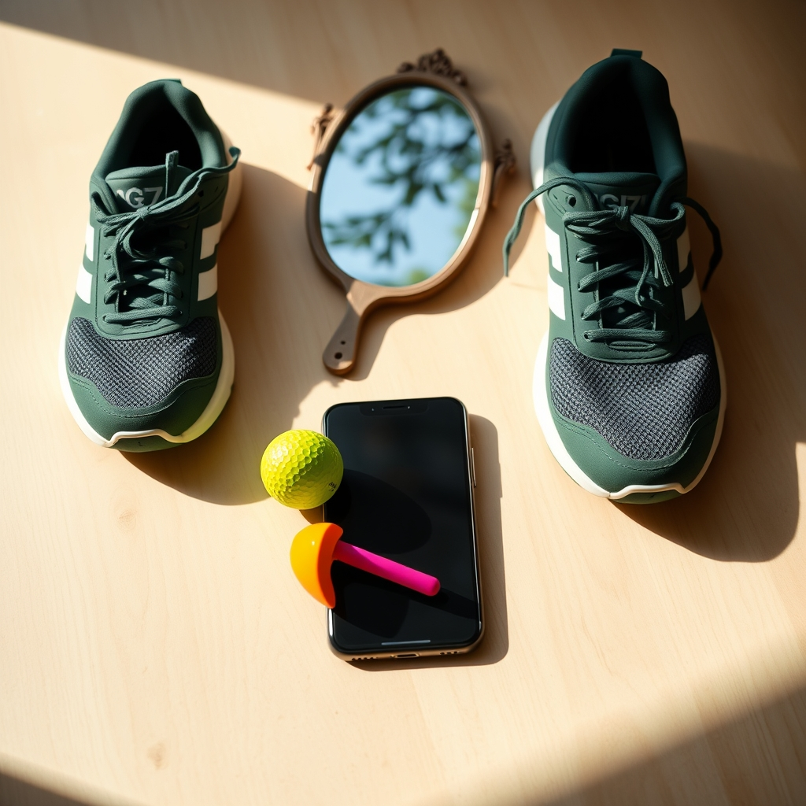

[Home](../index.md) > [Reflections](./index.md) | [⏮️](./2024-06-15.md) [⏭️](./2024-06-17.md)  
# 2024-06-16 | ⛳📞👟😴 R&R 🪞  
  
## ➖📆 A Day Off  
📞️ While walking the cats in the backyard, mom and dad and I spoke on the phone for father's day.  
⌚ Dad noticed that I'd shown up on his list of FitBit competitors, which inspired me to go for a run.  
🏃🏻 A 2.5 mile run down the usual path while listening to more [🌐🧭❓🔍🗺️ Complexity: A Guided Tour](../books/complexity.md).  
⛳ We spent the afternoon catching up with friends and playing mini golf.  
😴 I got to bed about an hour earlier than usual, ensuring I'd get plenty of sleep prior to my interview.  
🙂 It was a good day.  
  
## 🦋 Bluesky    
<blockquote class="bluesky-embed" data-bluesky-uri="at://did:plc:i4yli6h7x2uoj7acxunww2fc/app.bsky.feed.post/3mzpb2vn3xo2s" data-bluesky-cid="bafyreiekvccr6h3pmfwxugu52qtalgsp7opltpm6nrn4ufvngt4lo7fxxy">
2024-06-16 | ⛳📞👟😴 R&amp;R 🪞  
  
#AI Q: 🔋 How do you recharge after a busy week?  
  
🌐 Systems Science | ⌚ Fitness Tracking | 👪 Family Time | ⛳ Social Outings  
https://bagrounds.org/reflections/2024-06-16
&mdash; <a href="https://bsky.app/profile/did:plc:i4yli6h7x2uoj7acxunww2fc?ref_src=embed">Bryan Grounds (@bagrounds.bsky.social)</a> <a href="https://bsky.app/profile/did:plc:i4yli6h7x2uoj7acxunww2fc/post/3mzpb2vn3xo2s?ref_src=embed">2026-11-07T06:22:43.000Z</a></blockquote>