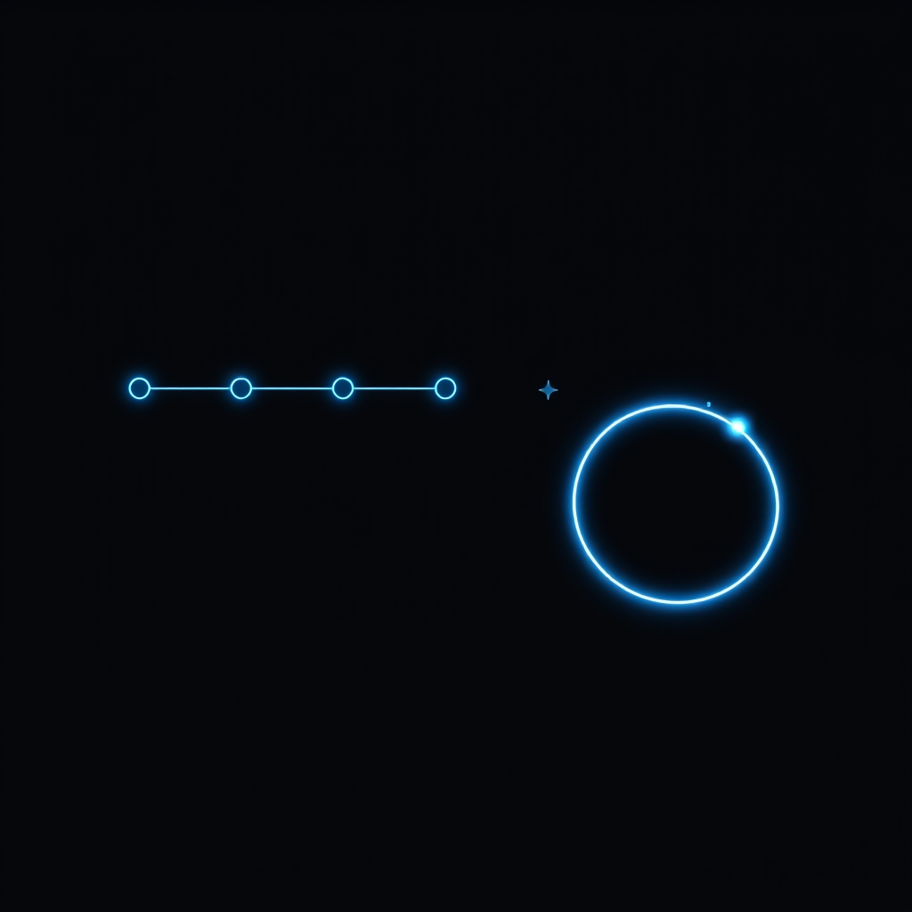

[Home](../index.md) > [Reflections](./index.md) | [⏮️](./2024-08-04.md) [⏭️](./2024-08-09.md)  
# 2024-08-07 | 🚀 Launch | 🔄 Cycle | 💡 Solve  
  
## 🧠 Education  
[🪙💯🚀 The $100 Startup: Reinvent the Way You Make a Living, Do What You Love, and Create a New Future](../books/the-100-dollar-startup.md)  
  
## 🏋 Coding Practice  
  
### [141. Linked List Cycle](https://leetcode.com/problems/linked-list-cycle)  
> Given `head`, the head of a linked list, determine if the linked list has a cycle in it.  
> There is a cycle in a linked list if there is some node in the list that can be reached again by continuously following the `next` pointer. Internally, `pos` is used to denote the index of the node that tail's `next` pointer is connected to. **Note that `pos` is not passed as a parameter**.  
> Return `true` _if there is a cycle in the linked list_. Otherwise, return `false`.  
  
#### 🪞 Reflections  
1. This was a good warm up for my upcoming interview, later today  
2. No bugs, optimal solution, correct submission on first attempt in under 14 minutes is pretty good!  
  
#### ⌨️ My Solution  
```ts  
/* Deterimine if there is a cycle in a linked list  
- Easy: collect nodes in a set and check if each new node exists in the set  
  - Note: O(N) extra memory usage  
- Old PhD Thesis method, turned ubiquitous interview question: send out multiple cursors at different paces and return if they're ever at the same node  
  - O(1) extra memory usage  
Both methods have O(N) run-time complexity  
[2:24] Done planning  
[6:34] Done with initial implementation  
[9:18] Done with test  
[13:25] Successful submission  
*/  
/**  
 * Definition for singly-linked list.  
 * class ListNode {  
 *     val: number  
 *     next: ListNode | null  
 *     constructor(val?: number, next?: ListNode | null) {  
 *         this.val = (val===undefined ? 0 : val)  
 *         this.next = (next===undefined ? null : next)  
 *     }  
 * }  
 */  
  
function hasCycle(head: ListNode | null): boolean { // null; 1,2,3,1  
  if (!head || !head.next) return false // F  
  
  for (let c1 = head, c2 = head.next; c2.next && c2.next.next; c1 = c1.next, c2 = c2.next) {  
    // c1=2 c2=1; c1=1 c2=2  
    if (c1 === c2) return true  
    c2 = c2.next // c2=2; c2=3  
    if (c1 === c2) return true // T  
  }  
  return false  
};  
```  
  
## 🦋 Bluesky    
<blockquote class="bluesky-embed" data-bluesky-uri="at://did:plc:i4yli6h7x2uoj7acxunww2fc/app.bsky.feed.post/3mwkyvpuqbt2q" data-bluesky-cid="bafyreidwmsany2ztyroppxc5sh4i3u7h6sgbyswgjmiwodomn6od2ivk2e"><p>2024-08-07 | 🚀 Launch | 🔄 Cycle | 💡 Solve  
  
#AI Q: 🚀 Does speed or memory matter more when solving problems?  
  
🪙 Micro-Business | 💾 Data Structures | 🤝 Interview Prep  
https://bagrounds.org/reflections/2024-08-07</p>&mdash; <a href="https://bsky.app/profile/did:plc:i4yli6h7x2uoj7acxunww2fc?ref_src=embed">Bryan Grounds (@bagrounds.bsky.social)</a> <a href="https://bsky.app/profile/did:plc:i4yli6h7x2uoj7acxunww2fc/post/3mwkyvpuqbt2q?ref_src=embed">2026-09-28T09:30:26.000Z</a></blockquote><script async src="https://embed.bsky.app/static/embed.js" charset="utf-8"></script>  
  
## 🐘 Mastodon    
<blockquote class="mastodon-embed" data-embed-url="https://mastodon.social/@bagrounds/117498995282460691/embed" style="background: #282c37; border-radius: 8px; border: 1px solid #393f4f; margin: 0; max-width: 540px; min-width: 270px; overflow: hidden; padding: 0;"> <a href="https://mastodon.social/@bagrounds/117498995282460691" target="_blank" style="align-items: center; color: #d9e1e8; display: flex; flex-direction: column; font-family: system-ui, -apple-system, BlinkMacSystemFont, 'Segoe UI', Oxygen, Ubuntu, Cantarell, 'Fira Sans', 'Droid Sans', 'Helvetica Neue', Roboto, sans-serif; font-size: 14px; justify-content: center; letter-spacing: 0.25px; line-height: 20px; padding: 24px; text-decoration: none;"> <svg xmlns="http://www.w3.org/2000/svg" xmlns:xlink="http://www.w3.org/1999/xlink" width="32" height="32" viewBox="0 0 79 75"><path d="M63 45.3v-20c0-4.1-1-7.3-3.2-9.7-2.1-2.4-5-3.7-8.5-3.7-4.1 0-7.2 1.6-9.3 4.7l-2 3.3-2-3.3c-2-3.1-5.1-4.7-9.2-4.7-3.5 0-6.4 1.3-8.6 3.7-2.1 2.4-3.1 5.6-3.1 9.7v20h8V25.9c0-4.1 1.7-6.2 5.2-6.2 3.8 0 5.8 2.5 5.8 7.4V37.7H44V27.1c0-4.9 1.9-7.4 5.8-7.4 3.5 0 5.2 2.1 5.2 6.2V45.3h8ZM74.7 16.6c.6 6 .1 15.7.1 17.3 0 .5-.1 4.8-.1 5.3-.7 11.5-8 16-15.6 17.5-.1 0-.2 0-.3 0-4.9 1-10 1.2-14.9 1.4-1.2 0-2.4 0-3.6 0-4.8 0-9.7-.6-14.4-1.7-.1 0-.1 0-.1 0s-.1 0-.1 0 0 .1 0 .1 0 0 0 0c.1 1.6.4 3.1 1 4.5.6 1.7 2.9 5.7 11.4 5.7 5 0 9.9-.6 14.8-1.7 0 0 0 0 0 0 .1 0 .1 0 .1 0 0 .1 0 .1 0 .1.1 0 .1 0 .1.1v5.6s0 .1-.1.1c0 0 0 0 0 .1-1.6 1.1-3.7 1.7-5.6 2.3-.8.3-1.6.5-2.4.7-7.5 1.7-15.4 1.3-22.7-1.2-6.8-2.4-13.8-8.2-15.5-15.2-.9-3.8-1.6-7.6-1.9-11.5-.6-5.8-.6-11.7-.8-17.5C3.9 24.5 4 20 4.9 16 6.7 7.9 14.1 2.2 22.3 1c1.4-.2 4.1-1 16.5-1h.1C51.4 0 56.7.8 58.1 1c8.4 1.2 15.5 7.5 16.6 15.6Z" fill="currentColor"/></svg> <div style="color: #9baec8; margin-top: 16px;">Post by @bagrounds@mastodon.social</div> <div style="font-weight: 500;">View on Mastodon</div> </a> </blockquote> <script data-allowed-prefixes="https://mastodon.social/" async src="https://mastodon.social/embed.js"></script>