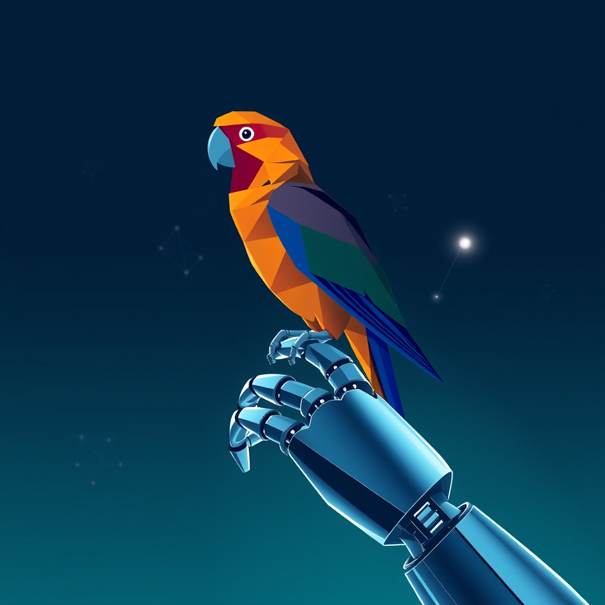

[Home](../index.md) > [Reflections](./index.md) | [⏮️](./2024-12-28.md) [⏭️](./2025-01-12.md)  
# 2024-12-29 | 🤖 [LLMs](../topics/large-language-models.md) 🦜  
  
- [How Much Wood](../bot-chats/how-much-wood.md)  
- [Experts are STUNNED! Meta's NEW LLM Architecture is a GAME-CHANGER!](../videos/experts-are-stunned-metas-new-llm-architecture-is-a-game-changer.md)  
- [You Don’t Understand How Language Works](../videos/you-dont-understand-how-language-works.md)  
- [Maximizing AI Leverage](../topics/maximizing-ai-leverage.md)  
- [Anthropic MCP + Ollama. No Claude Needed? Check it out!](../videos/anthropic-mcp-ollama-no-claude-needed-check-it-out.md)  
  
## 🦋 Bluesky    
<blockquote class="bluesky-embed" data-bluesky-uri="at://did:plc:i4yli6h7x2uoj7acxunww2fc/app.bsky.feed.post/3myp3uw2tr22f" data-bluesky-cid="bafyreibtknu3awwllkzggwlqw6sccwkaifgazyynadmjkubogrza4q6inm">
2024-12-29 | 🤖 LLMs 🦜  
  
#AI Q: 🤖 Will AI tools eventually replace your own creativity?  
  
🏗️ Model Architecture | 🗣️ Linguistics | 🛠️ Local Models | 📈 Productivity strategy  
https://bagrounds.org/reflections/2024-12-29
&mdash; <a href="https://bsky.app/profile/did:plc:i4yli6h7x2uoj7acxunww2fc?ref_src=embed">Bryan Grounds (@bagrounds.bsky.social)</a> <a href="https://bsky.app/profile/did:plc:i4yli6h7x2uoj7acxunww2fc/post/3myp3uw2tr22f?ref_src=embed">2026-10-25T11:24:42.000Z</a></blockquote>