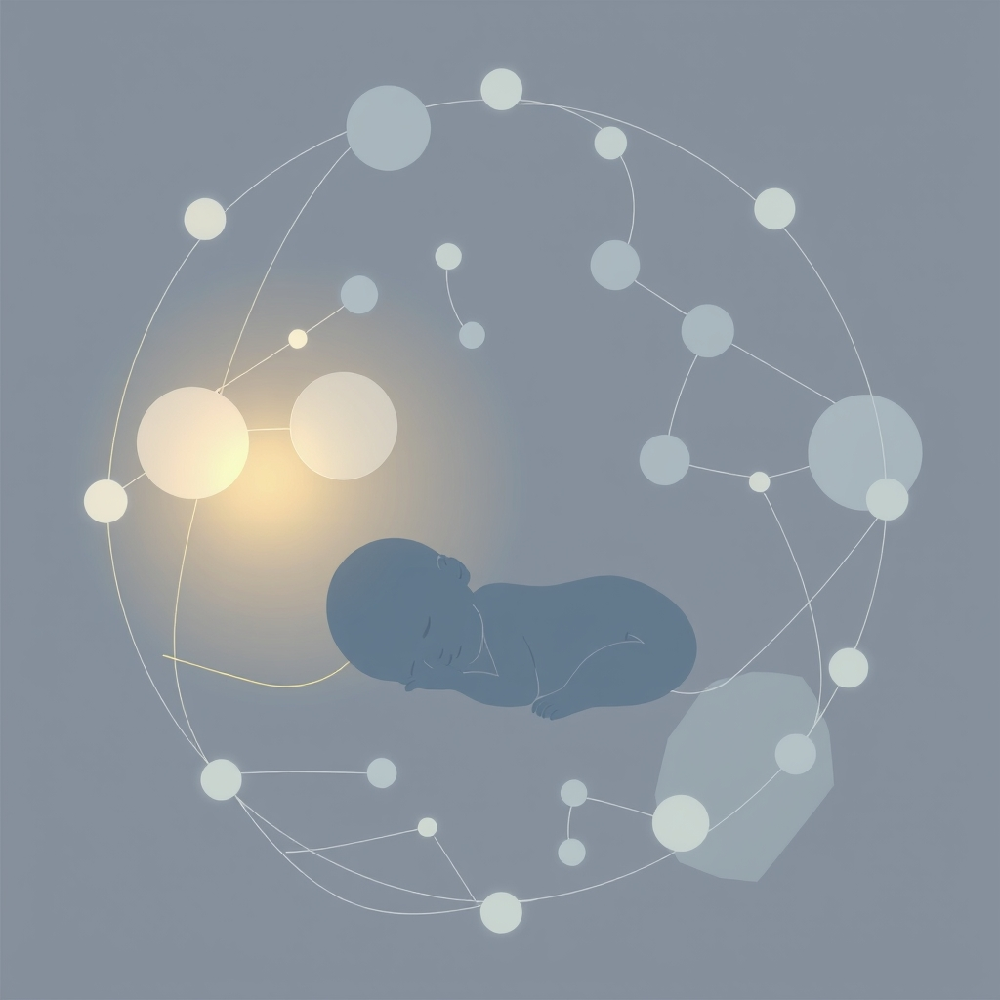

[Home](../index.md) > [Reflections](./index.md) | [⏮️](./2025-01-12.md) [⏭️](./2025-02-04.md)  
# 2025-02-02 | 👶 Soothing | 🧬 Synthesis  
  
- Started [👶😊😴 The Happiest Baby on the Block: The New Way to Calm Crying and Help Your Newborn Baby Sleep Longer](../books/the-happiest-baby-on-the-block.md)  
- Added AI Summary for [Russell L Ackoff From Mechanistic to Systemic Thinking](../videos/russell-l-ackoff-from-mechanistic-to-systemic-thinking.md)  
  
## 🦋 Bluesky    
<blockquote class="bluesky-embed" data-bluesky-uri="at://did:plc:i4yli6h7x2uoj7acxunww2fc/app.bsky.feed.post/3mzpvjjikgg2m" data-bluesky-cid="bafyreigjbwfm5pwdhp4t2moubz75zdv2kwoi3uphbkcnkrkmqcxartx4sm">
2025-02-02 | 👶 Soothing | 🧬 Synthesis  
  
#AI Q: 🍼 What is the most effective way to calm a crying baby?  
  
🍼 Parenting | 🌐 Systems Thinking | 🤖 AI Summaries  
https://bagrounds.org/reflections/2025-02-02
&mdash; <a href="https://bsky.app/profile/did:plc:i4yli6h7x2uoj7acxunww2fc?ref_src=embed">Bryan Grounds (@bagrounds.bsky.social)</a> <a href="https://bsky.app/profile/did:plc:i4yli6h7x2uoj7acxunww2fc/post/3mzpvjjikgg2m?ref_src=embed">2026-11-07T12:28:49.000Z</a></blockquote>