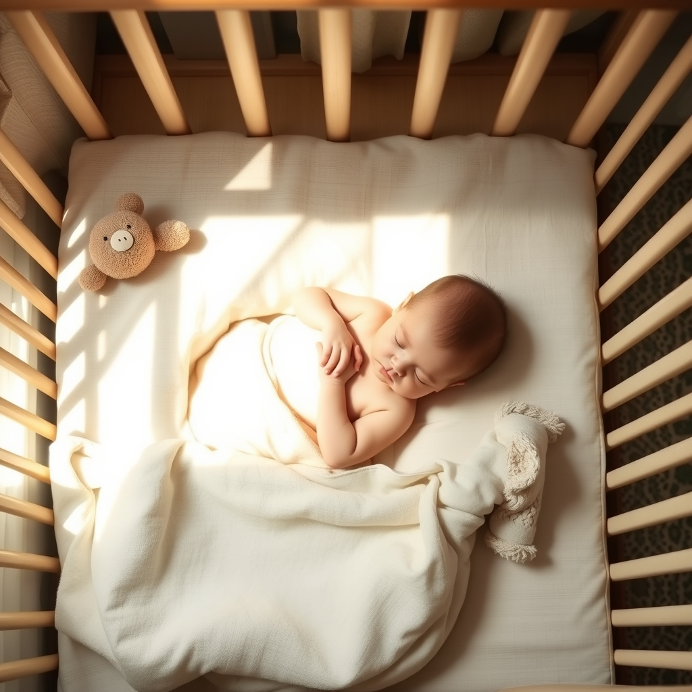

[Home](../index.md) > [Reflections](./index.md) | [⏮️](./2025-02-21.md) [⏭️](./2025-02-23.md)  
# 2025-02-22 | 😴 Sleeping 🛏️ Babies 👶  
  
- [Parenting Resources Recommendations](../bot-chats/parenting-resources-recommendations.md)  
- [Co-Sleeping With Infants: Science, Public Policy, and Parents Civil Rights, with James McKenna, PhD](../videos/co-sleeping-with-infants-science-public-policy-and-parents-civil-rights-with-james-mckenna-phd.md)  
- [Safe Sleep for Breastfeeding Babies](../articles/safe-sleep-for-breastfeeding-babies.md)  
- [Infant Cosleeping with James McKenna, PhD](../videos/infant-cosleeping-with-james-mckenna-phd.md)  
  
## 🦋 Bluesky    
<blockquote class="bluesky-embed" data-bluesky-uri="at://did:plc:i4yli6h7x2uoj7acxunww2fc/app.bsky.feed.post/3n26raqyd4o2x" data-bluesky-cid="bafyreie3umd443lonzcfea2h435wmdq2n2zmoee6j2odsb2jue7lsflioq">
2025-02-22 | 😴 Sleeping 🛏️ Babies 👶  
  
#AI Q: 😴 Should babies sleep in the same bed as parents?  
  
👨‍👩‍👦 Parenting Advice | 🤱 Breastfeeding Safety | 🔬 Pediatric Research |  
https://bagrounds.org/reflections/2025-02-22
&mdash; <a href="https://bsky.app/profile/did:plc:i4yli6h7x2uoj7acxunww2fc?ref_src=embed">Bryan Grounds (@bagrounds.bsky.social)</a> <a href="https://bsky.app/profile/did:plc:i4yli6h7x2uoj7acxunww2fc/post/3n26raqyd4o2x?ref_src=embed">2026-11-13T10:22:16.000Z</a></blockquote>