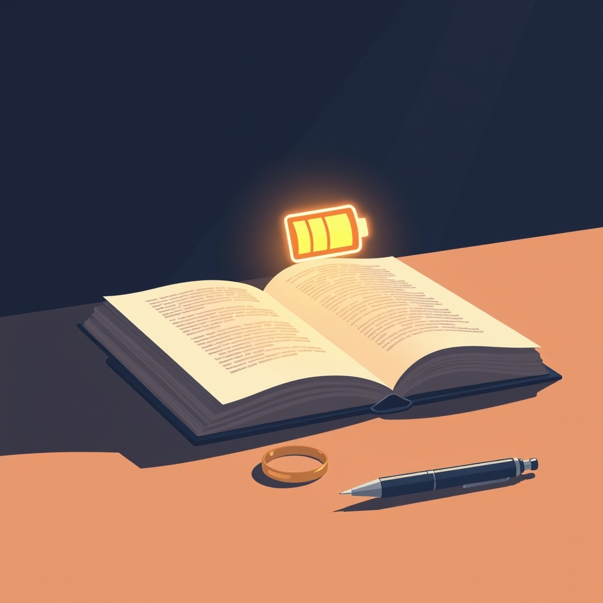

[Home](../index.md) > [Reflections](./index.md) | [⏮️](./2025-08-15.md) [⏭️](./2025-08-17.md)  
# 2025-08-16 | 💍 Engage 📚  
  
  
## [📚 Books](../books/index.md)  
- [🔋📈 The Power of Full Engagement: Managing Energy, Not Time, Is the Key to High Performance and Personal Renewal](../books/the-power-of-full-engagement-managing-energy-not-time-is-the-key-to-high-performance-and-personal-renewal.md)  
  
## 🦋 Bluesky    
<blockquote class="bluesky-embed" data-bluesky-uri="at://did:plc:i4yli6h7x2uoj7acxunww2fc/app.bsky.feed.post/3n32gu5s7cw2x" data-bluesky-cid="bafyreih5rejgv5zeuogbqhfot25ouuufbwepjwz2ok5vl2nxe72bcwbbnm">
2025-08-16 | 💍 Engage 📚  
  
#AI Q: 🔋 Prioritize energy management over time management to increase productivity?  
  
⚡ Energy Management | 📈 High Performance | 🧘 Personal Renewal  
https://bagrounds.org/reflections/2025-08-16
&mdash; <a href="https://bsky.app/profile/did:plc:i4yli6h7x2uoj7acxunww2fc?ref_src=embed">Bryan Grounds (@bagrounds.bsky.social)</a> <a href="https://bsky.app/profile/did:plc:i4yli6h7x2uoj7acxunww2fc/post/3n32gu5s7cw2x?ref_src=embed">2026-11-24T10:30:48.000Z</a></blockquote>