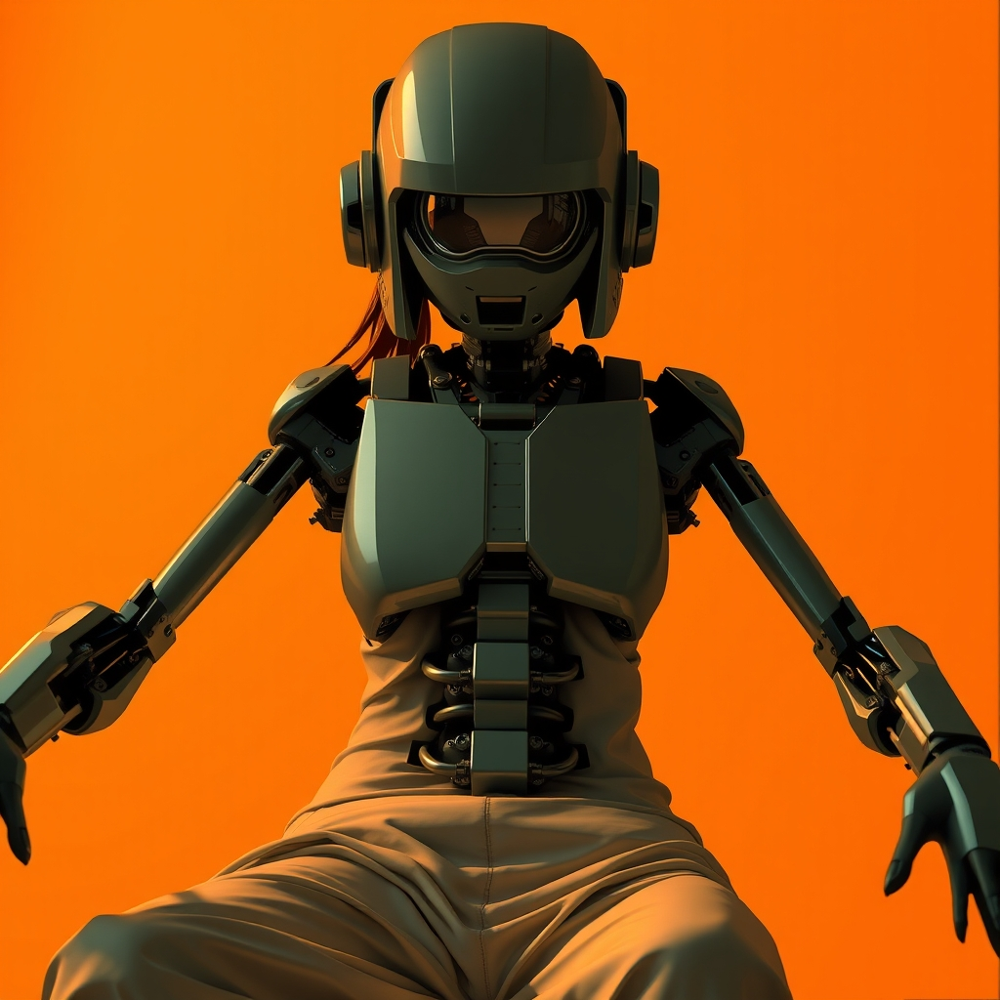

[Home](../index.md) > [Reflections](./index.md) | [⏮️](./2025-08-18.md) [⏭️](./2025-08-20.md)  
# 2025-08-19 | 🫀 Recovery | 🇺🇸 American | 🤖 Machines 📄📚📺  
  
## [📄 Articles](../articles/index.md)  
- [❤️📈🏋️ HRV Guided training](../articles/hrv-guided-training.md)  
- [🇷🇺🇺🇸👹🗳️💸 Letters from an American - August 18, 2025](../articles/letters-from-an-american-august-18-2025.md)  
  
## [📚 Books](../books/index.md)  
- [💪🧪 Good to Go: What the Athlete in All of Us Can Learn from the Strange Science of Recovery](../books/good-to-go-what-the-athlete-in-all-of-us-can-learn-from-the-strange-science-of-recovery.md)  
- [🤖📈 The Second Machine Age: Work, Progress, and Prosperity in a Time of Brilliant Technologies](../books/the-second-machine-age-work-progress-and-prosperity-in-a-time-of-brilliant-technologies.md)  
- [📢🛡️ On Disinformation: How to Fight for Truth and Protect Democracy](../books/on-disinformation-how-to-fight-for-truth-and-protect-democracy.md)  
  
## [📺 Videos](../videos/index.md)  
- [🤖📈🌟 The Only Trait for Success in the AI Era—How to Build It | Carnegie Mellon University Po-Shen Loh](../videos/the-only-trait-for-success-in-the-ai-era-how-to-build-it-carnegie-mellon-university-po-shen-loh.md)  
  
## 🦋 Bluesky    
<blockquote class="bluesky-embed" data-bluesky-uri="at://did:plc:i4yli6h7x2uoj7acxunww2fc/app.bsky.feed.post/3n2bijfibef2f" data-bluesky-cid="bafyreihngljxc5kbfjiolvcpb3umlzdlbzhw67i2droork4cwieskl3osq">
2025-08-19 | 🫀 Recovery | 🇺🇸 American | 🤖 Machines 📄📚📺  
  
#AI Q: 🤖 Can machines truly replace human intuition in the pursuit of personal success?  
  
🏋️ Sports Science | 🗳️ Democracy | 📈 Economic Progress | 🎓 Future  
https://bagrounds.org/reflections/2025-08-19
&mdash; <a href="https://bsky.app/profile/did:plc:i4yli6h7x2uoj7acxunww2fc?ref_src=embed">Bryan Grounds (@bagrounds.bsky.social)</a> <a href="https://bsky.app/profile/did:plc:i4yli6h7x2uoj7acxunww2fc/post/3n2bijfibef2f?ref_src=embed">2026-11-14T12:24:01.000Z</a></blockquote>