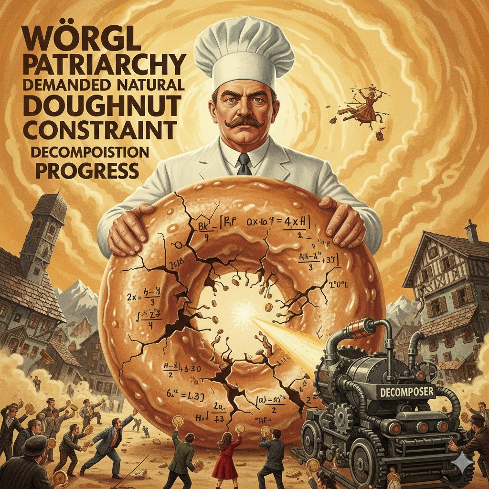

[Home](../index.md) > [Reflections](./index.md) | [⏮️](./2025-12-16.md) [⏭️](./2025-12-18.md)  
# 2025-12-17 | 🏔️ Wörgl 🏛️ Patriarchy 📢 Demanded 🌿 Natural 🍩 Doughnut ⛓️ Constraint 🔬 Decomposition 📈 Progress 📚📺📄  
  
  
## [📚 Books](../books/index.md)  
- ⏯️ Continuing [🍩🌍⚖️ Doughnut Economics: Seven Ways to Think Like a 21st-Century Economist](../books/doughnut-economics-seven-ways-to-think-like-a-21st-century-economist.md)  
- [♂️💰♀️🚩 Patriarchy of the Wage: Notes on Marx, Gender, and Feminism](../books/patriarchy-of-the-wage-notes-on-marx-gender-and-feminism.md)  
- [🌿⚙️ The Natural Economic Order](../books/the-natural-economic-order.md)  
- [📈📉 Progress and Poverty](../books/progress-and-poverty.md)  
- [🧩⚙️ Constraint Processing](../books/constraint-processing.md)  
  
## [📺 Videos](../videos/index.md)  
- [🏠👩‍👧‍👦💸💰 The women who demanded wages for housework - Witness History, BBC World Service](../videos/the-women-who-demanded-wages-for-housework-witness-history-bbc-world-service.md)  
- [💰📉🌍 Silvio Gesell's Forgotten Money: The Wörgl Experiment & Demurrage Currency](../videos/silvio-gesells-forgotten-money-the-worgl-experiment-demurrage-currency.md)  
  
## [📄 Articles](../articles/index.md)  
- [🧠🧩🎯⚙️ An Approach for Systematic Decomposition of Complex LLM Tasks](../articles/an-approach-for-systematic-decomposition-of-complex-llm-tasks.md)  
  
## 🐦 Tweet  
<blockquote class="twitter-tweet" data-theme="dark">
2025-12-17 | 🏔️ Wörgl 🏛️ Patriarchy 📢 Demanded 🌿 Natural 🍩 Doughnut ⛓️ Constraint 🔬 Decomposition 📈 Progress 📚📺📄  🏔️ Wörgl | 🏛️ Societal Structures | 📢 Advocacy | 🌿 Ecology | 🍩 Economic Models | ⛓️ Limitations | 🔬 Problem Solving<a href="https://t.co/Q3l8O5JIaC">https://t.co/Q3l8O5JIaC</a>
&mdash; Bryan Grounds (@bagrounds) <a href="https://twitter.com/bagrounds/status/2001631630402949561?ref_src=twsrc%5Etfw">December 18, 2025</a></blockquote>   
  
## 🦋 Bluesky    
<blockquote class="bluesky-embed" data-bluesky-uri="at://did:plc:i4yli6h7x2uoj7acxunww2fc/app.bsky.feed.post/3mvx3jz5zuq2m" data-bluesky-cid="bafyreicfga3dh7obum2koqcv5axykeygwvbf55vd6qczv74qu2f4dm3i6i">
2025-12-17 | 🏔️ Wörgl 🏛️ Patriarchy 📢 Demanded 🌿 Natural 🍩 Doughnut ⛓️ Constraint 🔬 Decomposition 📈 Progress 📚📺📄  
  
#AI Q: 🍩 Can economic growth coexist with a sustainable future?  
  
Sociology/Economics):* 📉 Wealth Inequality (covers Progress and Poverty)  
https://bagrounds.org/reflections/2025-12-17
&mdash; <a href="https://bsky.app/profile/did:plc:i4yli6h7x2uoj7acxunww2fc?ref_src=embed">Bryan Grounds (@bagrounds.bsky.social)</a> <a href="https://bsky.app/profile/did:plc:i4yli6h7x2uoj7acxunww2fc/post/3mvx3jz5zuq2m?ref_src=embed">2026-09-20T11:24:19.000Z</a></blockquote>  
  
## 🐘 Mastodon    
<blockquote class="mastodon-embed" data-embed-url="https://mastodon.social/@bagrounds/117433351104099898/embed" style="background: #282c37; border-radius: 8px; border: 1px solid #393f4f; margin: 0; max-width: 540px; min-width: 270px; overflow: hidden; padding: 0;"> <a href="https://mastodon.social/@bagrounds/117433351104099898" target="_blank" style="align-items: center; color: #d9e1e8; display: flex; flex-direction: column; font-family: system-ui, -apple-system, BlinkMacSystemFont, 'Segoe UI', Oxygen, Ubuntu, Cantarell, 'Fira Sans', 'Droid Sans', 'Helvetica Neue', Roboto, sans-serif; font-size: 14px; justify-content: center; letter-spacing: 0.25px; line-height: 20px; padding: 24px; text-decoration: none;"> <svg xmlns="http://www.w3.org/2000/svg" xmlns:xlink="http://www.w3.org/1999/xlink" width="32" height="32" viewBox="0 0 79 75"><path d="M63 45.3v-20c0-4.1-1-7.3-3.2-9.7-2.1-2.4-5-3.7-8.5-3.7-4.1 0-7.2 1.6-9.3 4.7l-2 3.3-2-3.3c-2-3.1-5.1-4.7-9.2-4.7-3.5 0-6.4 1.3-8.6 3.7-2.1 2.4-3.1 5.6-3.1 9.7v20h8V25.9c0-4.1 1.7-6.2 5.2-6.2 3.8 0 5.8 2.5 5.8 7.4V37.7H44V27.1c0-4.9 1.9-7.4 5.8-7.4 3.5 0 5.2 2.1 5.2 6.2V45.3h8ZM74.7 16.6c.6 6 .1 15.7.1 17.3 0 .5-.1 4.8-.1 5.3-.7 11.5-8 16-15.6 17.5-.1 0-.2 0-.3 0-4.9 1-10 1.2-14.9 1.4-1.2 0-2.4 0-3.6 0-4.8 0-9.7-.6-14.4-1.7-.1 0-.1 0-.1 0s-.1 0-.1 0 0 .1 0 .1 0 0 0 0c.1 1.6.4 3.1 1 4.5.6 1.7 2.9 5.7 11.4 5.7 5 0 9.9-.6 14.8-1.7 0 0 0 0 0 0 .1 0 .1 0 .1 0 0 .1 0 .1 0 .1.1 0 .1 0 .1.1v5.6s0 .1-.1.1c0 0 0 0 0 .1-1.6 1.1-3.7 1.7-5.6 2.3-.8.3-1.6.5-2.4.7-7.5 1.7-15.4 1.3-22.7-1.2-6.8-2.4-13.8-8.2-15.5-15.2-.9-3.8-1.6-7.6-1.9-11.5-.6-5.8-.6-11.7-.8-17.5C3.9 24.5 4 20 4.9 16 6.7 7.9 14.1 2.2 22.3 1c1.4-.2 4.1-1 16.5-1h.1C51.4 0 56.7.8 58.1 1c8.4 1.2 15.5 7.5 16.6 15.6Z" fill="currentColor"/></svg> 
Post by @bagrounds@mastodon.social
 
View on Mastodon
 </a> </blockquote> 