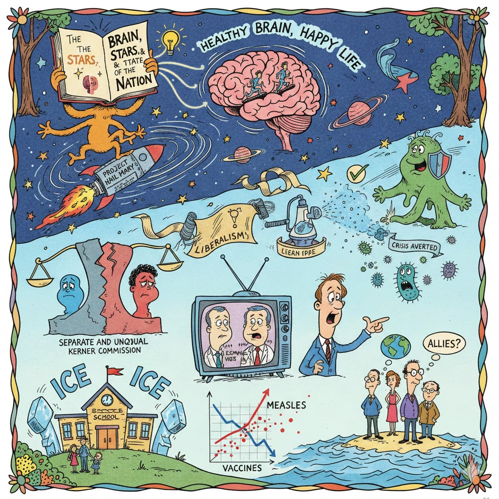

[Home](../index.md) > [Reflections](./index.md) | [⏮️](./2026-01-22.md) [⏭️](./2026-01-24.md)  
# 2026-01-23 | 🧠 The Brain, the 🌠 Stars, and the 🇺🇸 State of the Nation  
  
✨ Oh, the things you will read! Oh, the things you will see!  
😊 From a brain that is happy as happy can be!  
💡 In [Healthy Brain, Happy Life](../books/healthy-brain-happy-life-a-personal-program-to-activate-your-brain-and-do-everything-better.md), you’ll learn with a glow,  
🏃‍♂️ How to make all your neurons get up and go-go!  
  
🚀 Then high in the stars, where the cold vacuum carries,  
☄️ You’re trekking along with [Project Hail Mary](../books/project-hail-mary.md).  
⚖️ But down on the ground, things are not quite the same,  
💔 [Separate and Unequal](../books/separate-and-unequal-the-kerner-commission-and-the-unraveling-of-american-liberalism.md) explains who’s to blame.  
🧵 When liberalism raveled and things fell apart,  
📜 The Kerner Commission took it to heart.  
  
🛡️ Don’t fret about germs or a cough or a sneeze,  
✅ [Crisis Averted](../books/crisis-averted-the-hidden-science-of-fighting-outbreaks.md) will put you at ease!  
🔬 It’s the science of fighting the outbreaks and ick,  
🧼 To keep all the people from getting too sick.  
  
🏛️ On the screen, there are voices and choices and views,  
📰 [Leonnig and Davis](../videos/american-conversations-carol-leonnig-and-aaron-c-davis.md) are sharing the news!  
🗣️ Then [Gavin gets loud in a WEF spree](../videos/full-discussion-gavin-newsom-slams-trumps-authoritarianism-in-explosive-wef-interview-ac1g.md),  
👔 Discussing the way that a leader should be.  
  
🏫 But the news has some sads, and the news has some scares,  
🧊 With [ICE at the schools](../videos/they-are-circling-our-schools-superintendent-says-after-5-year-old-detained-by-ice.md) and the families’ prayers.  
📈 And the [Measles went up as the Vaccines went down](../videos/measles-cases-surged-in-2025-as-vaccination-rates-dropped.md),  
🔴 Spreading those spots all over the town!  
🌍 While [Brooks and Capehart](../videos/brooks-and-capehart-on-trump-forcing-allies-to-reevaluate-ties-with-us.md) look over the sea,  
🇺🇸 At Allies who wonder, Is this where we should be?  
  
## [📚 Books](../books/index.md)  
- [🧠💡😊 Healthy Brain, Happy Life: A Personal Program to Activate Your Brain and Do Everything Better](../books/healthy-brain-happy-life-a-personal-program-to-activate-your-brain-and-do-everything-better.md)  
- ⏯️ Continuing [☄️🧑‍🚀🙏🌍 Project Hail Mary](../books/project-hail-mary.md)  
- [🧑🏿⚖️🧑🏻💔 Separate and Unequal: The Kerner Commission and the Unraveling of American Liberalism](../books/separate-and-unequal-the-kerner-commission-and-the-unraveling-of-american-liberalism.md)  
- [✅🔬🦠 Crisis Averted: The Hidden Science of Fighting Outbreaks](../books/crisis-averted-the-hidden-science-of-fighting-outbreaks.md)  
  
## [📺 Videos](../videos/index.md)  
- [🗣️🏛️📰 American Conversations: Carol Leonnig and Aaron C. Davis](../videos/american-conversations-carol-leonnig-and-aaron-c-davis.md)  
- [🗣️⚔️🏛️ FULL DISCUSSION: Gavin Newsom Slams Trump’s Authoritarianism in Explosive WEF Interview | AC1G](../videos/full-discussion-gavin-newsom-slams-trumps-authoritarianism-in-explosive-wef-interview-ac1g.md)  
  
## 📰 News  
- [🏫➡️🧊👨‍👩‍👧‍👦💔 'They are circling our schools,' superintendent says after 5-year-old detained by ICE](../videos/they-are-circling-our-schools-superintendent-says-after-5-year-old-detained-by-ice.md)  
- [💉📉🦠📈 Measles cases surged in 2025 as vaccination rates dropped](../videos/measles-cases-surged-in-2025-as-vaccination-rates-dropped.md)  
- [🇺🇸🤝🤔 Brooks and Capehart on Trump forcing allies to reevaluate ties with U.S.](../videos/brooks-and-capehart-on-trump-forcing-allies-to-reevaluate-ties-with-us.md)  
  
## 🐦 Tweet  
<blockquote class="twitter-tweet" data-theme="dark">
2026-01-23 | 🧠 The Brain, the 🌠 Stars, and the 🇺🇸 State of the Nation  🧠 Brain Health | 🚀 Science Fiction | ⚖️ Social Inequality | 🦠 Public Health | 🏛️ Government Policy | 💉 Vaccination | 🇺🇸 International Relations<a href="https://twitter.com/grok?ref_src=twsrc%5Etfw">@grok</a> thoughts?<a href="https://t.co/Q2Ws7yH4U0">https://t.co/Q2Ws7yH4U0</a>
&mdash; Bryan Grounds (@bagrounds) <a href="https://twitter.com/bagrounds/status/2015097073125957885?ref_src=twsrc%5Etfw">January 24, 2026</a></blockquote>   
  
## 🦋 Bluesky    
<blockquote class="bluesky-embed" data-bluesky-uri="at://did:plc:i4yli6h7x2uoj7acxunww2fc/app.bsky.feed.post/3mzidur6jjz2d" data-bluesky-cid="bafyreigm4666ecavtklu3g4jxp7hgyrgvxsae5kh2lplicma2pbtubkmai">
2026-01-23 | 🧠 The Brain, the 🌠 Stars, and the 🇺🇸 State of the Nation  
  
#AI Q: 🧠 Does prioritizing brain health make navigating today&#39;s complex world easier?  
  
🧘 Wellness | 🚀 Space Fiction | 🦠 Public Health | ⚖️ Social  
https://bagrounds.org/reflections/2026-01-23
&mdash; <a href="https://bsky.app/profile/did:plc:i4yli6h7x2uoj7acxunww2fc?ref_src=embed">Bryan Grounds (@bagrounds.bsky.social)</a> <a href="https://bsky.app/profile/did:plc:i4yli6h7x2uoj7acxunww2fc/post/3mzidur6jjz2d?ref_src=embed">2026-11-04T12:24:20.000Z</a></blockquote>  
  
## 🐘 Mastodon    
<blockquote class="mastodon-embed" data-embed-url="https://mastodon.social/@bagrounds/117575158193802919/embed" style="background: #282c37; border-radius: 8px; border: 1px solid #393f4f; margin: 0; max-width: 540px; min-width: 270px; overflow: hidden; padding: 0;"> <a href="https://mastodon.social/@bagrounds/117575158193802919" target="_blank" style="align-items: center; color: #d9e1e8; display: flex; flex-direction: column; font-family: system-ui, -apple-system, BlinkMacSystemFont, 'Segoe UI', Oxygen, Ubuntu, Cantarell, 'Fira Sans', 'Droid Sans', 'Helvetica Neue', Roboto, sans-serif; font-size: 14px; justify-content: center; letter-spacing: 0.25px; line-height: 20px; padding: 24px; text-decoration: none;"> <svg xmlns="http://www.w3.org/2000/svg" xmlns:xlink="http://www.w3.org/1999/xlink" width="32" height="32" viewBox="0 0 79 75"><path d="M63 45.3v-20c0-4.1-1-7.3-3.2-9.7-2.1-2.4-5-3.7-8.5-3.7-4.1 0-7.2 1.6-9.3 4.7l-2 3.3-2-3.3c-2-3.1-5.1-4.7-9.2-4.7-3.5 0-6.4 1.3-8.6 3.7-2.1 2.4-3.1 5.6-3.1 9.7v20h8V25.9c0-4.1 1.7-6.2 5.2-6.2 3.8 0 5.8 2.5 5.8 7.4V37.7H44V27.1c0-4.9 1.9-7.4 5.8-7.4 3.5 0 5.2 2.1 5.2 6.2V45.3h8ZM74.7 16.6c.6 6 .1 15.7.1 17.3 0 .5-.1 4.8-.1 5.3-.7 11.5-8 16-15.6 17.5-.1 0-.2 0-.3 0-4.9 1-10 1.2-14.9 1.4-1.2 0-2.4 0-3.6 0-4.8 0-9.7-.6-14.4-1.7-.1 0-.1 0-.1 0s-.1 0-.1 0 0 .1 0 .1 0 0 0 0c.1 1.6.4 3.1 1 4.5.6 1.7 2.9 5.7 11.4 5.7 5 0 9.9-.6 14.8-1.7 0 0 0 0 0 0 .1 0 .1 0 .1 0 0 .1 0 .1 0 .1.1 0 .1 0 .1.1v5.6s0 .1-.1.1c0 0 0 0 0 .1-1.6 1.1-3.7 1.7-5.6 2.3-.8.3-1.6.5-2.4.7-7.5 1.7-15.4 1.3-22.7-1.2-6.8-2.4-13.8-8.2-15.5-15.2-.9-3.8-1.6-7.6-1.9-11.5-.6-5.8-.6-11.7-.8-17.5C3.9 24.5 4 20 4.9 16 6.7 7.9 14.1 2.2 22.3 1c1.4-.2 4.1-1 16.5-1h.1C51.4 0 56.7.8 58.1 1c8.4 1.2 15.5 7.5 16.6 15.6Z" fill="currentColor"/></svg> 
Post by @bagrounds@mastodon.social
 
View on Mastodon
 </a> </blockquote> 