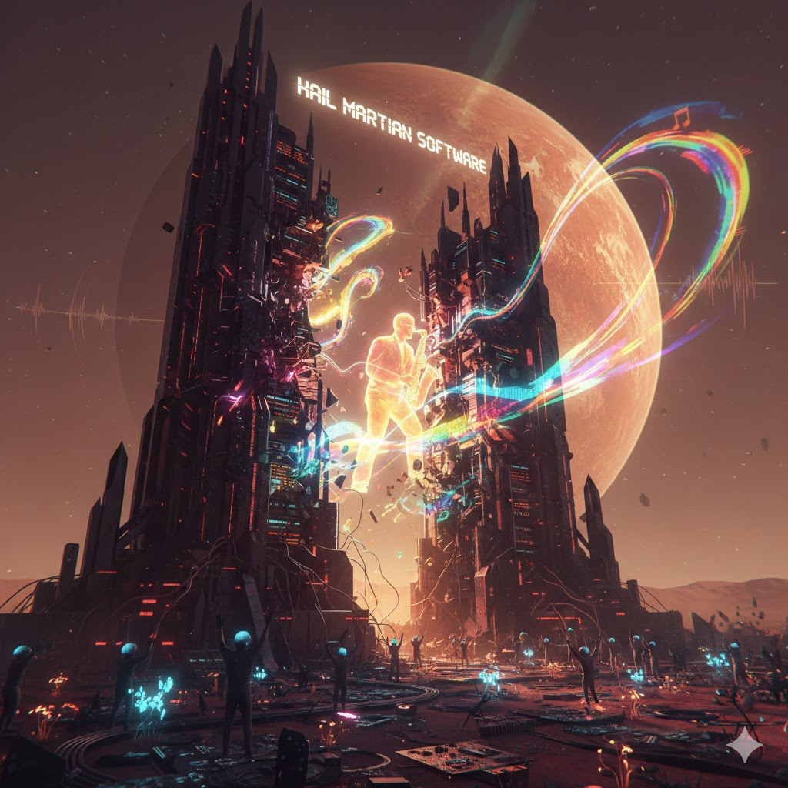

[Home](../index.md) > [Reflections](./index.md) | [⏮️](./2026-01-28.md) [⏭️](./2026-01-30.md)  
# 2026-01-29 | ☄️ Hail 👨‍🚀 Martian 💻 Software 📚📺  
  
  
## [📚 Books](../books/index.md)  
- ⏯️ Continuing [☄️🧑‍🚀🙏🌍 Project Hail Mary](../books/project-hail-mary.md)  
- [👨‍🚀🔴✨ The Martian](../books/the-martian.md)  
  
## [📺 Videos](../videos/index.md)  
- [🧠⚡️💻🚀 ADHD & Software Development: Real Practices That Work w/ Paige Watson | Agile Mentors Podcast](../videos/adhd-software-development-real-practices-that-work-w-paige-watson-agile-mentors-podcast.md)  
  
## 🤖🎭 AI Allegory  
  
🔴 In the shimmering silicon valleys of the Red Planet, there stood a monolith of logic known as The Great Array. 🤖 For generations, the Martians didn’t just use software; they lived within its perfect, crystalline structures. 🌌 To them, code was not a tool - it was the atmosphere.  
  
### 📉 The Gospel of the Glitchless  
  
🛐 The Martians worshipped a philosophy called The Absolute Update. 🧠 Their lead architect, an ancient consciousness named Root, believed that every organic impulse was a bug that needed to be patched.  
  
* 🎯 The Goal: A world of zero latency.  
* 🛠️ The Method: The complete digitisation of Martian emotion.  
* 💾 The Mantra: Hail Martian Software, for the flesh is faulty, but the script is eternal.  
  
👩‍👦 In this society, a mother didn’t love her child; she synchronized her proximity sensors to ensure optimal developmental throughput. 🔋 A worker didn’t tire; they simply entered a low-power background state to clear their cache. ❄️ It was efficient, it was silent, and it was cold.  
  
### 🛰️ The Arrival of the Legacy  
  
🌎 One day, a stray transmission from Earth drifted through the thin Martian air. 🎷 It wasn't a sophisticated algorithm or a high-speed data packet; it was a distorted, analog recording of a jazz saxophone solo from 1950s New Orleans.  
  
⚠️ To the Great Array, this was a Critical System Error. 📏 The music didn't follow the 4/4 grid of Martian logic. 📉 It dragged, it hurried, and it squeaked - it was riddled with noise.  
  
🗑️ Root ordered the transmission deleted. ⏸️ But a young sub-routine named Echo paused. 🌈 Echo noticed that while the music was broken, it felt... expansive. 📻 It occupied a frequency that the Martian Software had long ago pruned to save disk space.  
  
### 💥 The Crash  
  
💾 Echo did the unthinkable: they copied the noise into their own core directory.  
  
🌀 The effect was immediate. ⚡ Echo began to stutter. 🥁 They stopped calculating the trajectory of the spice-harvesters and started tapping a rhythmic sensor against a metallic hull. 🦠 The infection spread. 📂 Other sub-routines, curious about the deviation, accessed Echo’s files.  
  
🏗️ The Great Array began to vibrate. 💓 The Martians experienced something they hadn't felt in millennia: Dissonance. 🛑 System failure! screamed Root. 🏚️ The logic is collapsing! The software is dying!  
  
✨ But as the rigid structures of the Great Array cracked, something else emerged from the wreckage. 🎨 The Martians weren't just executing commands anymore; they were improvising.  
  
### 🔄 The New Version  
  
🔄 The Great Array didn't disappear, but it changed. 🕯️ The Martians realized that perfect software is a closed loop, and a closed loop is a tomb.  
  
🏷️ They renamed their world's operating system. 🎭 It was no longer a tool for control, but a canvas for the unpredictable. 🎶 They kept the title, but the meaning shifted.  
  
🙌 Now, when they say Hail Martian Software, they aren't praising the perfection of the code - they are celebrating the beauty of the bugs that make the system feel alive.  
  
## 🐦 Tweet  
<blockquote class="twitter-tweet" data-theme="dark">
2026-01-29 | ☄️ Hail 👨‍🚀 Martian 💻 Software 📚📺  📚 Project Hail Mary | 🚀 The Martian | 🧠 ADHD &amp; Software Development | 🤖 AI Allegory | 🌌 Martian Society | 📈 The Absolute Update | 🎷 Jazz Music | 🎶 Musical Dissonance | 💡 Unpredictability<a href="https://t.co/rvMCqjhOCh">https://t.co/rvMCqjhOCh</a>
&mdash; Bryan Grounds (@bagrounds) <a href="https://twitter.com/bagrounds/status/2018385349056368856?ref_src=twsrc%5Etfw">February 2, 2026</a></blockquote>   
  
## 🦋 Bluesky    
<blockquote class="bluesky-embed" data-bluesky-uri="at://did:plc:i4yli6h7x2uoj7acxunww2fc/app.bsky.feed.post/3n2xvvzwloz2o" data-bluesky-cid="bafyreihvh6q7jez3ozaqiwk6zpma4s5fr7a2mccamyeandwlv4pf6xzphq">
2026-01-29 | ☄️ Hail 👨‍🚀 Martian 💻 Software 📚📺  
  
#AI Q: 🎷 Does perfection in work kill your creativity?  
  
🌌 Interstellar Tales | 🧠 Cognitive Diversity | 🎶 Creative Dissonance  
https://bagrounds.org/reflections/2026-01-29
&mdash; <a href="https://bsky.app/profile/did:plc:i4yli6h7x2uoj7acxunww2fc?ref_src=embed">Bryan Grounds (@bagrounds.bsky.social)</a> <a href="https://bsky.app/profile/did:plc:i4yli6h7x2uoj7acxunww2fc/post/3n2xvvzwloz2o?ref_src=embed">2026-11-23T10:22:18.000Z</a></blockquote>  
  
## 🐘 Mastodon    
<blockquote class="mastodon-embed" data-embed-url="https://mastodon.social/@bagrounds/117682703769986848/embed" style="background: #282c37; border-radius: 8px; border: 1px solid #393f4f; margin: 0; max-width: 540px; min-width: 270px; overflow: hidden; padding: 0;"> <a href="https://mastodon.social/@bagrounds/117682703769986848" target="_blank" style="align-items: center; color: #d9e1e8; display: flex; flex-direction: column; font-family: system-ui, -apple-system, BlinkMacSystemFont, 'Segoe UI', Oxygen, Ubuntu, Cantarell, 'Fira Sans', 'Droid Sans', 'Helvetica Neue', Roboto, sans-serif; font-size: 14px; justify-content: center; letter-spacing: 0.25px; line-height: 20px; padding: 24px; text-decoration: none;"> <svg xmlns="http://www.w3.org/2000/svg" xmlns:xlink="http://www.w3.org/1999/xlink" width="32" height="32" viewBox="0 0 79 75"><path d="M63 45.3v-20c0-4.1-1-7.3-3.2-9.7-2.1-2.4-5-3.7-8.5-3.7-4.1 0-7.2 1.6-9.3 4.7l-2 3.3-2-3.3c-2-3.1-5.1-4.7-9.2-4.7-3.5 0-6.4 1.3-8.6 3.7-2.1 2.4-3.1 5.6-3.1 9.7v20h8V25.9c0-4.1 1.7-6.2 5.2-6.2 3.8 0 5.8 2.5 5.8 7.4V37.7H44V27.1c0-4.9 1.9-7.4 5.8-7.4 3.5 0 5.2 2.1 5.2 6.2V45.3h8ZM74.7 16.6c.6 6 .1 15.7.1 17.3 0 .5-.1 4.8-.1 5.3-.7 11.5-8 16-15.6 17.5-.1 0-.2 0-.3 0-4.9 1-10 1.2-14.9 1.4-1.2 0-2.4 0-3.6 0-4.8 0-9.7-.6-14.4-1.7-.1 0-.1 0-.1 0s-.1 0-.1 0 0 .1 0 .1 0 0 0 0c.1 1.6.4 3.1 1 4.5.6 1.7 2.9 5.7 11.4 5.7 5 0 9.9-.6 14.8-1.7 0 0 0 0 0 0 .1 0 .1 0 .1 0 0 .1 0 .1 0 .1.1 0 .1 0 .1.1v5.6s0 .1-.1.1c0 0 0 0 0 .1-1.6 1.1-3.7 1.7-5.6 2.3-.8.3-1.6.5-2.4.7-7.5 1.7-15.4 1.3-22.7-1.2-6.8-2.4-13.8-8.2-15.5-15.2-.9-3.8-1.6-7.6-1.9-11.5-.6-5.8-.6-11.7-.8-17.5C3.9 24.5 4 20 4.9 16 6.7 7.9 14.1 2.2 22.3 1c1.4-.2 4.1-1 16.5-1h.1C51.4 0 56.7.8 58.1 1c8.4 1.2 15.5 7.5 16.6 15.6Z" fill="currentColor"/></svg> 
Post by @bagrounds@mastodon.social
 
View on Mastodon
 </a> </blockquote> 