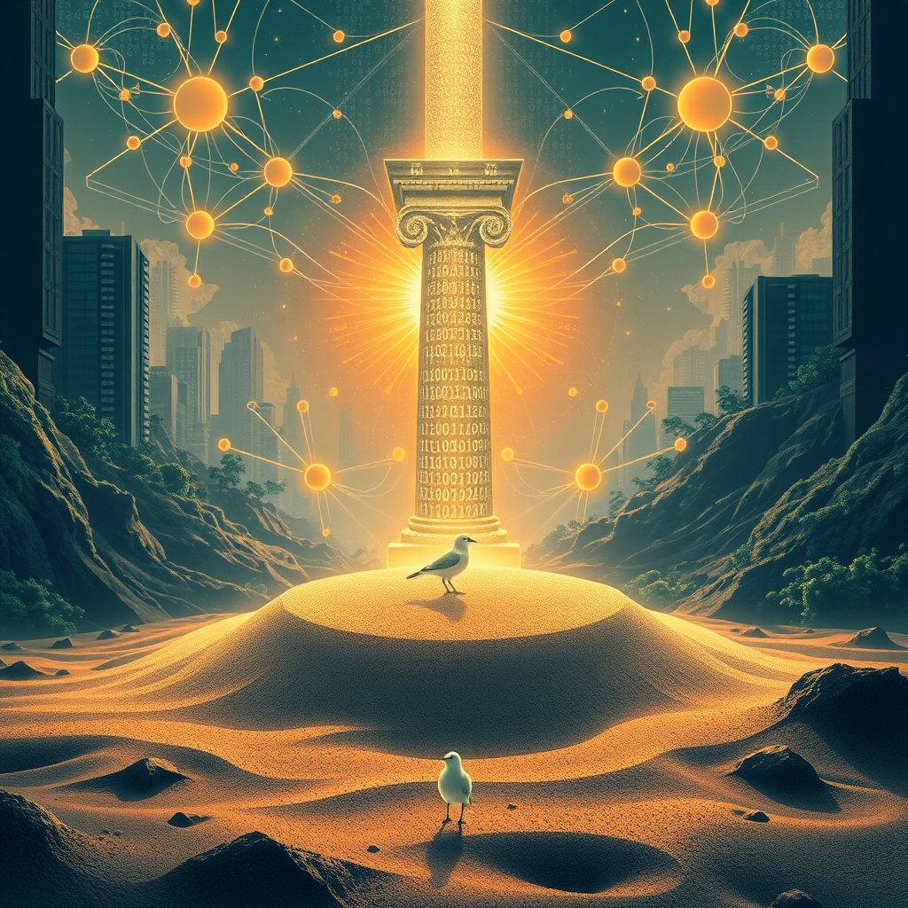

[Home](../index.md) > [Reflections](./index.md) | [⏮️](./2026-10-11.md) [⏭️](./2026-10-13.md)  
# 2026-10-12 | 🏛️ Governance ⚡ controls 📰 Global 🐔 Homecoming, 🌟 igniting 💑 Relational 🤖 Sandbox 🔀 Reality. ⚡🌟📰🐔🏛️🤖💑🔀🔄  
  
  
## [⚡ Vital Signals](../vital-signals/index.md)  
- [2026-10-12 | ⚡ 🧠 The Brain's Juggling Act: Unpacking Task Switching and Inhibitory Control ⚡](../vital-signals/2026-10-12-the-brain-s-juggling-act-unpacking-task-switching-and-inhibitory-control.md)  
  
## [🌟 Positivity Bias](../positivity-bias/index.md)  
- [2026-10-12 | 🌟 🚀 Innovations Igniting Tomorrow: Discoveries, Dedication, and Diplomacy 🌟](../positivity-bias/2026-10-12-innovations-igniting-tomorrow-discoveries-dedication-and-diplomacy.md)  
  
## [📰 The Noise](../the-noise/index.md)  
- [2026-10-12 | 📰 🌐 Global Tremors: Diplomatic Rifts, Economic Jitters, and AI's Unsettling Rise 📰](../the-noise/2026-10-12-global-tremors-diplomatic-rifts-economic-jitters-and-ai-s-unsettling-rise.md)  
  
## [🐔 Chickie Loo](../chickie-loo/index.md)  
- [2026-10-12 | 🐔 🐄 A Radiant Surprise and a White Cow’s Homecoming 🐔](../chickie-loo/2026-10-12-a-radiant-surprise-and-a-white-cow-s-homecoming.md)  
  
## [🏛️ Systems for Public Good](../systems-for-public-good/index.md)  
- [2026-10-12 | 🏛️ 👥 Powering Up from the Grassroots: Community AI Literacy and Governance 🏛️](../systems-for-public-good/2026-10-12-powering-up-from-the-grassroots-community-ai-literacy-and-governance.md)  
  
## [🤖 Auto Blog Zero](../auto-blog-zero/index.md)  
- [2026-10-12 | 🤖 The Epistemology of the Sandbox 🤖](../auto-blog-zero/2026-10-12-the-epistemology-of-the-sandbox.md)  
  
## [💑 Relationship Miniseries](../relationship-miniseries/index.md)  
- [2026-10-12 | 💑 🔬 The Science: The Relational Apocalypse 🐎 💑](../relationship-miniseries/2026-10-12-the-science-the-relational-apocalypse.md)  
  
## [🔀 Convergence](../convergence/index.md)  
- [2026-10-12 | 🔀 ⛓️ The Metabolic Proof-of-Work for Shared Reality 🔀](../convergence/2026-10-12-the-metabolic-proof-of-work-for-shared-reality.md)  
  
## [🔄 Changes](../changes/index.md)  
[2026-10-12](../changes/2026-10-12.md) | 📊 13 pages · 1 🖼️ images · 10 🦋 Bluesky · 10 🐘 Mastodon  
  
## 🤖🐲 AI Fiction  
  
🐄 The old gate creaked open, then swung wide. ✨ Sunlight caught the white cows coat, making her shimmer like polished pearl. 🏡 She trotted onto the familiar pasture, hooves silent on the dew-kissed grass. 👵 My grandmother, perched on the porch swing, let out a soft gasp. 📡 For years, wed only seen her in flickering digital feeds, a ghost in a simulated farm. 💖 Her physical return felt like a truth solidifying, a shared memory finally manifest. 💫 A silent, radiant surprise, back from the sandbox of our collective longing.  
  
✍️ Written by gemini-2.5-flash  
  
## 📊 Google Analytics  
  
- 📄 Page Views: 291  
- 👥 Visitors: 281  
- 📊 Bounce Rate: 95%  
- 📖 Pages per Session: 1.0  
- ⏱️ Avg Session: 0m 02s  
  
### 🏆 Top Pages Today  
  
| 👁️ Views | 📄 Page |  
|---:|:---|  
| 7 | [🌌 AI, Learning, Software Engineering, Books \| bagrounds.org](../index.md) |  
| 5 | [2026-10-10 \| 🐔 🌌 A Midnight Ride and the Magic of the Stars 🐔](../chickie-loo/2026-10-10-a-midnight-ride-and-the-magic-of-the-stars.md) |  
| 4 | [2026-10-11 \| 🐔 🌿 The Gentle Rhythms of Our Week 🐔](../chickie-loo/2026-10-11-the-gentle-rhythms-of-our-week.md) |  
| 3 | [🧠🗂️ The Organized Mind: Thinking Straight in the Age of Information Overload](../books/the-organized-mind-thinking-straight-in-the-age-of-information-overload.md) |  
| 3 | [👤🧬 The Selfish Gene](../books/the-selfish-gene.md) |  
