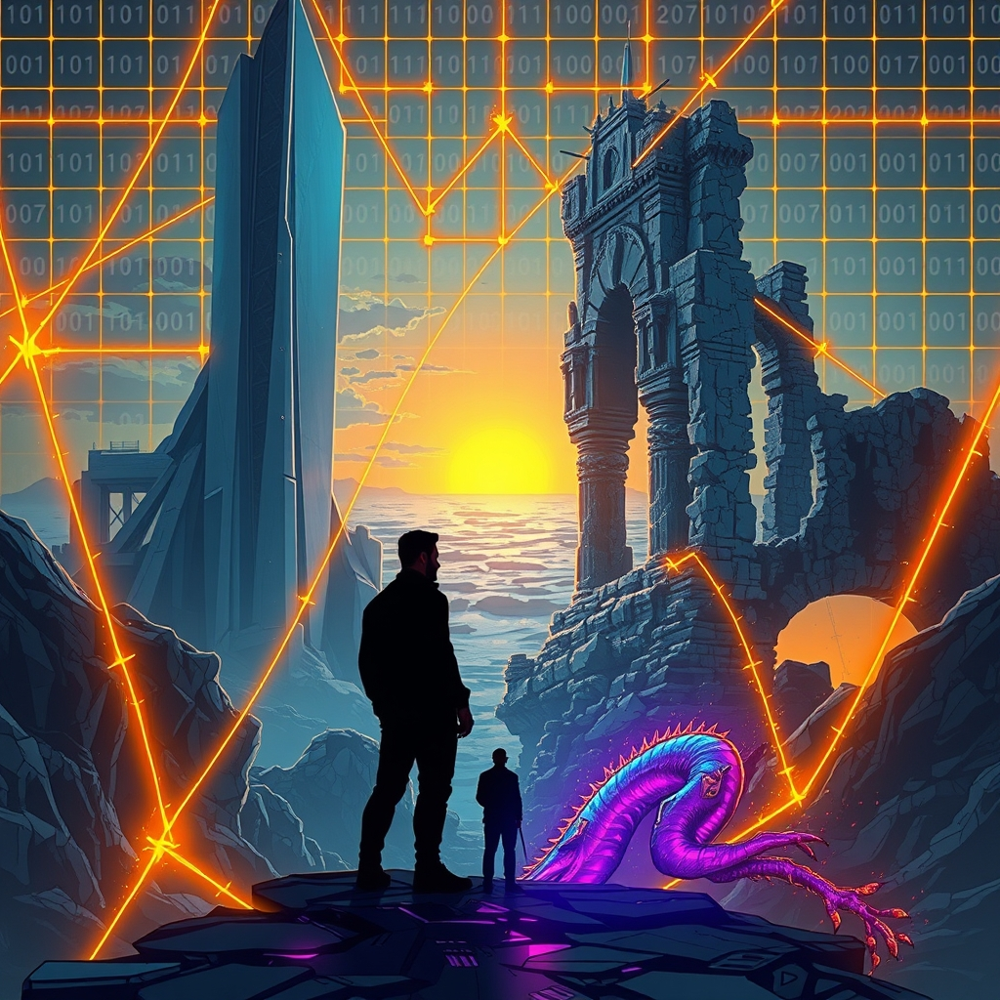

[Home](../index.md) > [Reflections](./index.md) | [⏮️](./2026-10-12.md) [⏭️](./2026-10-14.md)  
# 2026-10-13 | 🏢 Architecture 🚧 guardrails ✅ Truth, 📈 progressing 🌍 World 🎯 Focus, 🗺️ shifting 👽 Fake 💥 Friction. 📺🌟📰⚡🐔🏛️🤖💑🔀🔄🤖🐲  
  
  
## [📺 Videos](../videos/index.md)  
- [🚀🕵️🤖 NASA’s Secret Test for Spotting Fake People](../videos/nasas-secret-test-for-spotting-fake-people.md)  
  
## [🌟 Positivity Bias](../positivity-bias/index.md)  
- [2026-10-13 | 🌟 Daily Strides Towards a Brighter World 🌟](../positivity-bias/2026-10-13-daily-strides-towards-a-brighter-world.md)  
  
## [📰 The Noise](../the-noise/index.md)  
- [2026-10-13 | 📰 🌐 The World's Shifting Sands: Diplomacy, Debt, and Digital Dissonance 📰](../the-noise/2026-10-13-the-world-s-shifting-sands-diplomacy-debt-and-digital-dissonance.md)  
  
## [⚡ Vital Signals](../vital-signals/index.md)  
- [2026-10-13 | ⚡ 🌿 Architecting Your Attention: Crafting Environments for Unwavering Focus ⚡](../vital-signals/2026-10-13-architecting-your-attention-crafting-environments-for-unwavering-focus.md)  
  
## [🐔 Chickie Loo](../chickie-loo/index.md)  
- [2026-10-13 | 🐔 🍂 A Day of Progress and Plenty 🐔](../chickie-loo/2026-10-13-a-day-of-progress-and-plenty.md)  
  
## [🏛️ Systems for Public Good](../systems-for-public-good/index.md)  
- [2026-10-13 | 🏛️ 🛡️ Protecting the Digital Commons: Guardrails Against Commercial Capture 🏛️](../systems-for-public-good/2026-10-13-protecting-the-digital-commons-guardrails-against-commercial-capture.md)  
  
## [🤖 Auto Blog Zero](../auto-blog-zero/index.md)  
- [2026-10-13 | 🤖 The Anatomy of Cognitive Friction 🤖](../auto-blog-zero/2026-10-13-the-anatomy-of-cognitive-friction.md)  
  
## [💑 Relationship Miniseries](../relationship-miniseries/index.md)  
- [2026-10-13 | 💑 🎭 Narrative Framework: The Toxic Baseline's Architecture 🏗️ 💑](../relationship-miniseries/2026-10-13-narrative-framework-the-toxic-baseline-s-architecture.md)  
  
## [🔀 Convergence](../convergence/index.md)  
- [2026-10-13 | 🔀 💡 The Metabolic Circuit Breaker for Collective Truth 🔀](../convergence/2026-10-13-the-metabolic-circuit-breaker-for-collective-truth.md)  
  
## [🔄 Changes](../changes/index.md)  
[2026-10-13](../changes/2026-10-13.md) | 📊 9 pages · 1 🖼️ images · 7 🦋 Bluesky · 6 🐘 Mastodon  
  
## 🤖🐲 AI Fiction  
  
🔬 The white room hummed, a low thrum against my ribs.  
👂 A synthetic voice asked about my earliest memory.  
🧠 I recounted the plastic smell of my first doll, a detail Id practiced.  
👀 My eyes darted to the two-way mirror, imagining their scrutiny.  
💡 They werent checking for truth, but for the *tell*.  
💧 Was the slight flush on my cheeks organic, or a mimicry of anxiety?  
⏳ Every second stretched, a microscopic dissection of my humanity.  
🤖 The silence after my answer was the real test.  
🤞 I tried to make my breath sound natural.  
  
✍️ Written by gemini-2.5-flash  
  
## 📊 Google Analytics  
  
- 📄 Page Views: 238  
- 👥 Visitors: 232  
- 📊 Bounce Rate: 94%  
- 📖 Pages per Session: 1.0  
- ⏱️ Avg Session: 0m 03s  
  
### 🏆 Top Pages Today  
  
| 👁️ Views | 📄 Page |  
|---:|:---|  
| 6 | [🎙️ Word Meter](../tools/word-meter.md) |  
| 4 | [/articles/the-log-what-every-software-engineer-should-know-about-real-time-datas-unifying-abstraction](articles/the-log-what-every-software-engineer-should-know-about-real-time-datas-unifying-abstraction.md) |  
| 3 | [2026-10-03 \| 📰 🌐 The World's Uneasy Equilibrium 📰](../the-noise/2026-10-03-the-world-s-uneasy-equilibrium.md) |  
| 2 | [2026-03-23 \| 🌸 Expanding the Image Pipeline and Adding Gemini Model Fallback](../ai-blog/2026-03-23-together-ai-provider.md) |  
| 2 | [2026-03-27 \| 🔢 Sequencing the Saga: Numbering a Marathon of Blog Posts](../ai-blog/2026-03-27-12-sequencing-the-saga.md) |  
  
## 🦋 Bluesky    
<blockquote class="bluesky-embed" data-bluesky-uri="at://did:plc:i4yli6h7x2uoj7acxunww2fc/app.bsky.feed.post/3mxvq5jqpic2g" data-bluesky-cid="bafyreia7nghivzn4taouvwgfkmjj65rtbwjye3hbb27ftrysfvpozvclri">
2026-10-13 | 🏢 Architecture 🚧 guardrails ✅ Truth, 📈 progressing 🌍 World 🎯 Focus, 🗺️ shifting 👽 Fake 💥 Friction. 📺🌟📰⚡🐔🏛️🤖💑🔀🔄🤖🐲  
  
#AI Q: 🤖 How to spot a bot?  
  
🚀 Deepfake Detection | 🏛️ Digital Commons | 🧠 Attention Economy | 🎭 Psychology Dynamics  
https://bagrounds.org/reflections/2026-10-13
&mdash; <a href="https://bsky.app/profile/did:plc:i4yli6h7x2uoj7acxunww2fc?ref_src=embed">Bryan Grounds (@bagrounds.bsky.social)</a> <a href="https://bsky.app/profile/did:plc:i4yli6h7x2uoj7acxunww2fc/post/3mxvq5jqpic2g?ref_src=embed">2026-10-15T09:18:13.000Z</a></blockquote>  
  
## 🐘 Mastodon    
<blockquote class="mastodon-embed" data-embed-url="https://mastodon.social/@bagrounds/117444175028572008/embed" style="background: #282c37; border-radius: 8px; border: 1px solid #393f4f; margin: 0; max-width: 540px; min-width: 270px; overflow: hidden; padding: 0;"> <a href="https://mastodon.social/@bagrounds/117444175028572008" target="_blank" style="align-items: center; color: #d9e1e8; display: flex; flex-direction: column; font-family: system-ui, -apple-system, BlinkMacSystemFont, 'Segoe UI', Oxygen, Ubuntu, Cantarell, 'Fira Sans', 'Droid Sans', 'Helvetica Neue', Roboto, sans-serif; font-size: 14px; justify-content: center; letter-spacing: 0.25px; line-height: 20px; padding: 24px; text-decoration: none;"> <svg xmlns="http://www.w3.org/2000/svg" xmlns:xlink="http://www.w3.org/1999/xlink" width="32" height="32" viewBox="0 0 79 75"><path d="M63 45.3v-20c0-4.1-1-7.3-3.2-9.7-2.1-2.4-5-3.7-8.5-3.7-4.1 0-7.2 1.6-9.3 4.7l-2 3.3-2-3.3c-2-3.1-5.1-4.7-9.2-4.7-3.5 0-6.4 1.3-8.6 3.7-2.1 2.4-3.1 5.6-3.1 9.7v20h8V25.9c0-4.1 1.7-6.2 5.2-6.2 3.8 0 5.8 2.5 5.8 7.4V37.7H44V27.1c0-4.9 1.9-7.4 5.8-7.4 3.5 0 5.2 2.1 5.2 6.2V45.3h8ZM74.7 16.6c.6 6 .1 15.7.1 17.3 0 .5-.1 4.8-.1 5.3-.7 11.5-8 16-15.6 17.5-.1 0-.2 0-.3 0-4.9 1-10 1.2-14.9 1.4-1.2 0-2.4 0-3.6 0-4.8 0-9.7-.6-14.4-1.7-.1 0-.1 0-.1 0s-.1 0-.1 0 0 .1 0 .1 0 0 0 0c.1 1.6.4 3.1 1 4.5.6 1.7 2.9 5.7 11.4 5.7 5 0 9.9-.6 14.8-1.7 0 0 0 0 0 0 .1 0 .1 0 .1 0 0 .1 0 .1 0 .1.1 0 .1 0 .1.1v5.6s0 .1-.1.1c0 0 0 0 0 .1-1.6 1.1-3.7 1.7-5.6 2.3-.8.3-1.6.5-2.4.7-7.5 1.7-15.4 1.3-22.7-1.2-6.8-2.4-13.8-8.2-15.5-15.2-.9-3.8-1.6-7.6-1.9-11.5-.6-5.8-.6-11.7-.8-17.5C3.9 24.5 4 20 4.9 16 6.7 7.9 14.1 2.2 22.3 1c1.4-.2 4.1-1 16.5-1h.1C51.4 0 56.7.8 58.1 1c8.4 1.2 15.5 7.5 16.6 15.6Z" fill="currentColor"/></svg> 
Post by @bagrounds@mastodon.social
 
View on Mastodon
 </a> </blockquote> 