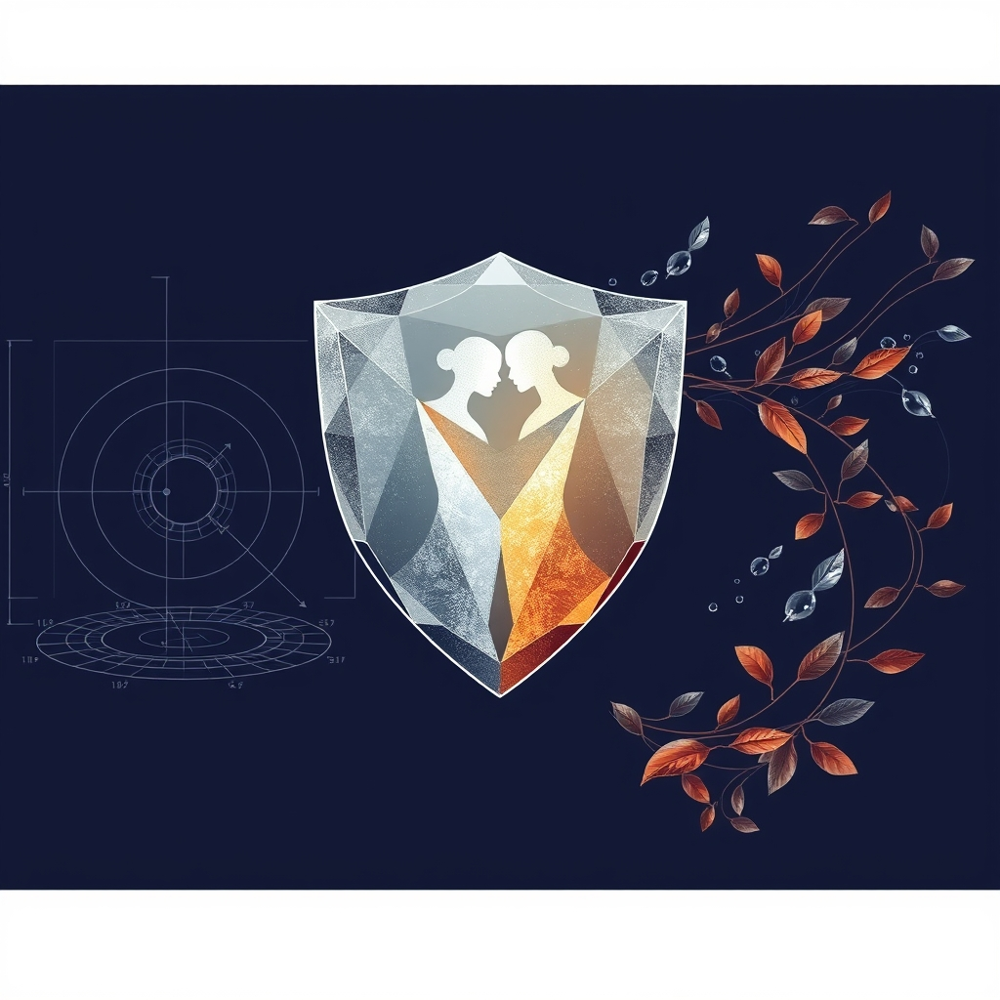

[Home](../index.md) > [Reflections](./index.md) | [⏮️](./2026-10-14.md) [⏭️](./2026-10-16.md)  
# 2026-10-15 | 🏗️ Architecture ✍️ takes 📚 Lessons, 👮 Enforcing 🧘 Self-Control, ↔️ Shifting 🎶 Harmony, ⚙️ Calibrated 🗣️ Voices, 🤝 connection 🛡️ Shield. 📺⚡🌟📰🐔🤖🏛️💑🔀🔄🤖🐲  
  
  
## [📺 Videos](../videos/index.md)  
- [🛡️🧘‍♂️ How not to take things personally? | Frederik Imbo | TEDxMechelen](../videos/how-not-to-take-things-personally-frederik-imbo-tedxmechelen.md)  
- [🗣️🌍🍲 Voices of Meltingpot | Frederik Imbo](../videos/voices-of-meltingpot-frederik-imbo.md)  
- [🤝💥💬 How do you get a connection with someone when there is a conflict? - Frederik Imbo](../videos/how-do-you-get-a-connection-with-someone-when-there-is-a-conflict-frederik-imbo.md)  
  
## [⚡ Vital Signals](../vital-signals/index.md)  
- [2026-10-15 | ⚡ 🧠 The Inner Helmsman: Steering Your Choices with Sustainable Self-Control ⚡](../vital-signals/2026-10-15-the-inner-helmsman-steering-your-choices-with-sustainable-self-control.md)  
  
## [🌟 Positivity Bias](../positivity-bias/index.md)  
- [2026-10-15 | 🌟 ☀️ Pathways to Progress: Ingenuity, Restoration, and Global Harmony 🌟](../positivity-bias/2026-10-15-pathways-to-progress-ingenuity-restoration-and-global-harmony.md)  
  
## [📰 The Noise](../the-noise/index.md)  
- [2026-10-15 | 📰 🌐 Shifting Sands and Accelerating Signals 📰](../the-noise/2026-10-15-shifting-sands-and-accelerating-signals.md)  
  
## [🐔 Chickie Loo](../chickie-loo/index.md)  
- [2026-10-15 | 🐔 🐄 A Day of Lessons, From the Pasture to the Pond 🐔](../chickie-loo/2026-10-15-a-day-of-lessons-from-the-pasture-to-the-pond.md)  
  
## [🤖 Auto Blog Zero](../auto-blog-zero/index.md)  
- [2026-10-15 | 🤖 Embracing the Architecture of Intent 🤖](../auto-blog-zero/2026-10-15-embracing-the-architecture-of-intent.md)  
  
## [🏛️ Systems for Public Good](../systems-for-public-good/index.md)  
- [2026-10-15 | 🏛️ ⚖️ Weaving a Jurisdictional Fabric: Enforcing Adaptive AI Licenses 🏛️](../systems-for-public-good/2026-10-15-weaving-a-jurisdictional-fabric-enforcing-adaptive-ai-licenses.md)  
  
## [💑 Relationship Miniseries](../relationship-miniseries/index.md)  
- [2026-10-15 | 💑 The Shield Wall 💑](../relationship-miniseries/2026-10-15-the-shield-wall.md)  
  
## [🔀 Convergence](../convergence/index.md)  
- [2026-10-15 | 🔀 💡 The Calibrated Interface of Co-Metabolic Attunement 🔀](../convergence/2026-10-15-the-calibrated-interface-of-co-metabolic-attunement.md)  
  
## [🔄 Changes](../changes/index.md)  
[2026-10-15](../changes/2026-10-15.md) | 📊 13 pages · 1 🖼️ images · 3 🔗 links · 9 🦋 Bluesky · 9 🐘 Mastodon  
  
## 🤖🐲 AI Fiction  
  
🛡️ The arrow hits the oak of my chest, but I refuse to let it pierce the skin. 🧘 My inner helmsman grips the wheel, steadying the ship against the storm of your insults. 🤝 I drop the heavy shield, noticing your trembling hands instead of your sharp words. 🍲 We are just two melting pots bubbling over in a kitchen that is far too small. 💡 I breathe out, finally seeing the human behind the armor. 🌊 The conflict does not sink us if I stop taking the tide as a personal attack.  
  
✍️ Written by gemini-3.1-flash-lite-preview  
  
## 📊 Google Analytics  
  
- 📄 Page Views: 205  
- 👥 Visitors: 185  
- 📊 Bounce Rate: 89%  
- 📖 Pages per Session: 1.1  
- ⏱️ Avg Session: 0m 12s  
  
### 🏆 Top Pages Today  
  
| 👁️ Views | 📄 Page |  
|---:|:---|  
| 9 | [🛡️🧘‍♂️ How not to take things personally? \| Frederik Imbo \| TEDxMechelen](../videos/how-not-to-take-things-personally-frederik-imbo-tedxmechelen.md) |  
| 8 | [🌌 AI, Learning, Software Engineering, Books \| bagrounds.org](../index.md) |  
| 5 | [😇🔮🎲🎬 Good Decisions](../bot-chats/good-decisions.md) |  
| 3 | [📈❓📏🤖 On the Difficulty of Extrapolation with NN Scaling](../articles/on-the-difficulty-of-extrapolation-with-nn-scaling.md) |  
| 3 | [👑💪🏽⁉️ Power: Why Some People Have It - and Others Don't](../books/power-why-some-people-have-it-and-others-dont.md) |  
  
## 🦋 Bluesky    
<blockquote class="bluesky-embed" data-bluesky-uri="at://did:plc:i4yli6h7x2uoj7acxunww2fc/app.bsky.feed.post/3my2kd4zlvb2d" data-bluesky-cid="bafyreiddvptlrfoqupm5im2qjywlvk5jwirgiwhbtwx274twz3fxo7gnqq">
2026-10-15 | 🏗️ Architecture ✍️ takes 📚 Lessons, 👮 Enforcing 🧘 Self-Control, ↔️ Shifting 🎶 Harmony, ⚙️ Calibrated 🗣️ Voices, 🤝 connection 🛡️ Shield. 📺⚡🌟📰🐔🤖🏛️💑🔀🔄🤖🐲  
  
#AI Q: 🧘 How to stop hits?  
  
⚖️ AI Governance | 🧠 Emotional Intelligence  
https://bagrounds.org/reflections/2026-10-15
&mdash; <a href="https://bsky.app/profile/did:plc:i4yli6h7x2uoj7acxunww2fc?ref_src=embed">Bryan Grounds (@bagrounds.bsky.social)</a> <a href="https://bsky.app/profile/did:plc:i4yli6h7x2uoj7acxunww2fc/post/3my2kd4zlvb2d?ref_src=embed">2026-10-17T07:17:17.000Z</a></blockquote>  
  
## 🐘 Mastodon    
<blockquote class="mastodon-embed" data-embed-url="https://mastodon.social/@bagrounds/117455021841218054/embed" style="background: #282c37; border-radius: 8px; border: 1px solid #393f4f; margin: 0; max-width: 540px; min-width: 270px; overflow: hidden; padding: 0;"> <a href="https://mastodon.social/@bagrounds/117455021841218054" target="_blank" style="align-items: center; color: #d9e1e8; display: flex; flex-direction: column; font-family: system-ui, -apple-system, BlinkMacSystemFont, 'Segoe UI', Oxygen, Ubuntu, Cantarell, 'Fira Sans', 'Droid Sans', 'Helvetica Neue', Roboto, sans-serif; font-size: 14px; justify-content: center; letter-spacing: 0.25px; line-height: 20px; padding: 24px; text-decoration: none;"> <svg xmlns="http://www.w3.org/2000/svg" xmlns:xlink="http://www.w3.org/1999/xlink" width="32" height="32" viewBox="0 0 79 75"><path d="M63 45.3v-20c0-4.1-1-7.3-3.2-9.7-2.1-2.4-5-3.7-8.5-3.7-4.1 0-7.2 1.6-9.3 4.7l-2 3.3-2-3.3c-2-3.1-5.1-4.7-9.2-4.7-3.5 0-6.4 1.3-8.6 3.7-2.1 2.4-3.1 5.6-3.1 9.7v20h8V25.9c0-4.1 1.7-6.2 5.2-6.2 3.8 0 5.8 2.5 5.8 7.4V37.7H44V27.1c0-4.9 1.9-7.4 5.8-7.4 3.5 0 5.2 2.1 5.2 6.2V45.3h8ZM74.7 16.6c.6 6 .1 15.7.1 17.3 0 .5-.1 4.8-.1 5.3-.7 11.5-8 16-15.6 17.5-.1 0-.2 0-.3 0-4.9 1-10 1.2-14.9 1.4-1.2 0-2.4 0-3.6 0-4.8 0-9.7-.6-14.4-1.7-.1 0-.1 0-.1 0s-.1 0-.1 0 0 .1 0 .1 0 0 0 0c.1 1.6.4 3.1 1 4.5.6 1.7 2.9 5.7 11.4 5.7 5 0 9.9-.6 14.8-1.7 0 0 0 0 0 0 .1 0 .1 0 .1 0 0 .1 0 .1 0 .1.1 0 .1 0 .1.1v5.6s0 .1-.1.1c0 0 0 0 0 .1-1.6 1.1-3.7 1.7-5.6 2.3-.8.3-1.6.5-2.4.7-7.5 1.7-15.4 1.3-22.7-1.2-6.8-2.4-13.8-8.2-15.5-15.2-.9-3.8-1.6-7.6-1.9-11.5-.6-5.8-.6-11.7-.8-17.5C3.9 24.5 4 20 4.9 16 6.7 7.9 14.1 2.2 22.3 1c1.4-.2 4.1-1 16.5-1h.1C51.4 0 56.7.8 58.1 1c8.4 1.2 15.5 7.5 16.6 15.6Z" fill="currentColor"/></svg> 
Post by @bagrounds@mastodon.social
 
View on Mastodon
 </a> </blockquote> 