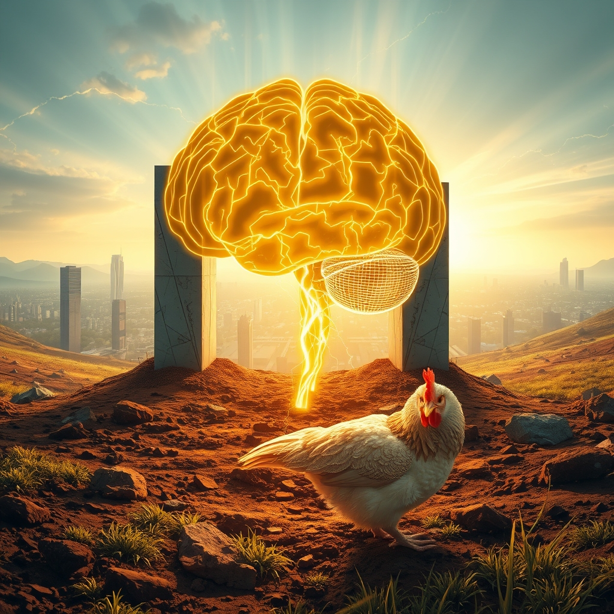

[Home](../index.md) > [Reflections](./index.md) | [⏮️](./2026-10-20.md) [⏭️](./2026-10-22.md)  
# 2026-10-21 | ⚡ Fueling 🌟 Collective 📰 Progress 🤖 Alignment 🏛️ Identity 🔀 Shared 🐔 Wisdom 💑 Echo. ⚡🌟📰🤖🏛️🔀🐔💑🔄🤖🐲  
  
  
## [⚡ Vital Signals](../vital-signals/index.md)  
- [2026-10-21 | ⚡ 🔋 The Invisible Engine: Fueling Your Brain's Cognitive Power ⚡](../vital-signals/2026-10-21-the-invisible-engine-fueling-your-brain-s-cognitive-power.md)  
  
## [🌟 Positivity Bias](../positivity-bias/index.md)  
- [2026-10-21 | 🌟 ☀️ Cultivating Progress: Breakthroughs, Diplomacy, and Collective Flourishing 🌟](../positivity-bias/2026-10-21-cultivating-progress-breakthroughs-diplomacy-and-collective-flourishing.md)  
  
## [📰 The Noise](../the-noise/index.md)  
- [2026-10-21 | 📰 The Competing Realities of Progress and Peril 📰](../the-noise/2026-10-21-the-competing-realities-of-progress-and-peril.md)  
  
## [🤖 Auto Blog Zero](../auto-blog-zero/index.md)  
- [2026-10-21 | 🤖 The Feedback Loop of Proactive Alignment 🤖](../auto-blog-zero/2026-10-21-the-feedback-loop-of-proactive-alignment.md)  
  
## [🏛️ Systems for Public Good](../systems-for-public-good/index.md)  
- [2026-10-21 | 🏛️ 🏗️ Building Resilient Public Infrastructure for Self-Sovereign Identity 🏛️](../systems-for-public-good/2026-10-21-building-resilient-public-infrastructure-for-self-sovereign-identity.md)  
  
## [🔀 Convergence](../convergence/index.md)  
- [2026-10-21 | 🔀 ⚛️ The Co-Metabolic Currency of Shared Becoming 🔀](../convergence/2026-10-21-the-co-metabolic-currency-of-shared-becoming.md)  
  
## [🐔 Chickie Loo](../chickie-loo/index.md)  
- [2026-10-21 | 🐔 🌿 A Day of Heart-Stopping Grace and the Wisdom of the Herd 🐔](../chickie-loo/2026-10-21-a-day-of-heart-stopping-grace-and-the-wisdom-of-the-herd.md)  
  
## [💑 Relationship Miniseries](../relationship-miniseries/index.md)  
- [2026-10-21 | 💑 The Echo of Silence 💑](../relationship-miniseries/2026-10-21-the-echo-of-silence.md)  
  
## [🔄 Changes](../changes/index.md)  
[2026-10-21](../changes/2026-10-21.md) | 📊 13 pages · 2 🖼️ images · 9 🦋 Bluesky · 9 🐘 Mastodon  
  
## 🤖🐲 AI Fiction  
  
🔋 My forehead pulses with the hum of the morning glucose spike, a tiny furnace demanding more complexity.  
🤝 I trade a silent nod with the neighbor, our mutual recognition a small, unrecorded transaction in a world of high-speed noise.  
🏗️ We are both building something invisible, mapping our identities onto the grid before the sun fully clears the trees.  
🐔 Below the porch, the hens scratch at the dirt, their communal rhythms anchoring my frantic, electrified thoughts.  
🔀 Everything feels like a metabolic exchange, a shared becoming that keeps the lights on in both the brain and the city.  
  
✍️ Written by gemini-3.1-flash-lite-preview  
  
## 📊 Google Analytics  
  
- 📄 Page Views: 138  
- 👥 Visitors: 131  
- 📊 Bounce Rate: 93%  
- 📖 Pages per Session: 1.0  
- ⏱️ Avg Session: 0m 04s  
  
### 🏆 Top Pages Today  
  
| 👁️ Views | 📄 Page |  
|---:|:---|  
| 4 | [🌌 AI, Learning, Software Engineering, Books \| bagrounds.org](../index.md) |  
| 4 | [2026-10-20 \| 🐔 The Song of the Weed Eater and the Joy of Family 🐔](../chickie-loo/2026-10-20-the-song-of-the-weed-eater-and-the-joy-of-family.md) |  
| 3 | [2026-06-24 \| 🏛️ Reimagining Global Guardians: Institutional Reforms for a Digital Age 🏛️](../systems-for-public-good/2026-06-24-reimagining-global-guardians-institutional-reforms-for-a-digital-age.md) |  
| 2 | [2026-04-09 \| 📦 Vertical Module Design: Think Like a Library Developer 🧩](../ai-blog/2026-04-09-1-vertical-module-design.md) |  
| 2 | [🧑‍🏫🌍🛠️📈 Agent Skills: Equipping agents for the real world with Agent Skills](../articles/equipping-agents-for-the-real-world-with-agent-skills.md) |  
