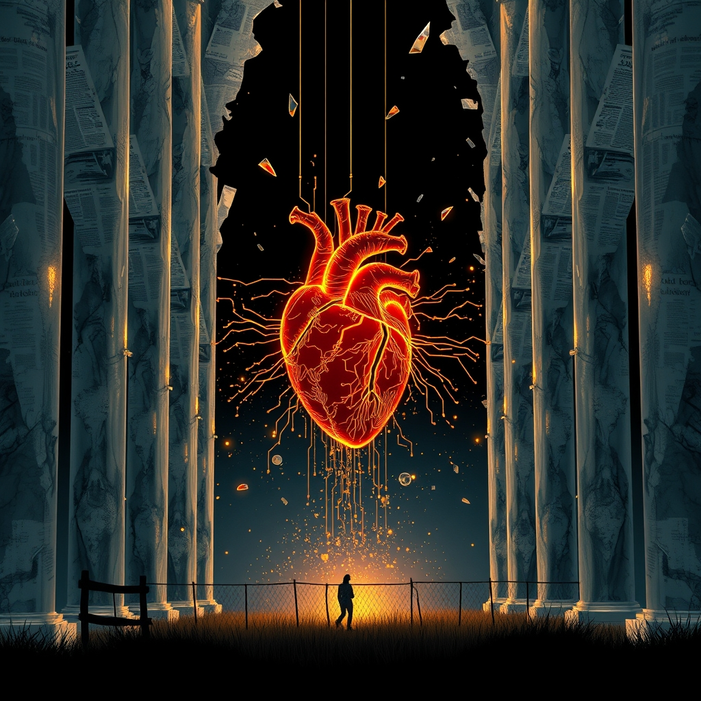

[Home](../index.md) > [Reflections](./index.md) | [⏮️](./2026-10-21.md) [⏭️](./2026-10-23.md)  
# 2026-10-22 | 🐔 Heart ⚡ signals 🌟 progress, 🏛️ forging 🤖 architecture in 💑 hesitant 📰 unfolding 🗣️ conversations of 🔀 dissonance. 📺⚡🌟📰🏛️🤖🐔💑🔀🔄🤖🐲  
  
  
## [📺 Videos](../videos/index.md)  
- [🇺🇸 Abdul El-Sayed | American Conversations](../videos/abdul-el-sayed-american-conversations.md)  
  
## [⚡ Vital Signals](../vital-signals/index.md)  
- [2026-10-22 | ⚡ 🔬 The Signal: Your Gut, Your Second Brain, Your Cognitive Partner ⚡](../vital-signals/2026-10-22-the-signal-your-gut-your-second-brain-your-cognitive-partner.md)  
  
## [🌟 Positivity Bias](../positivity-bias/index.md)  
- [2026-10-22 | 🌟 🌅 Dawn of Progress: Catalyzing Innovation, Conservation, and Global Unity 🌟](../positivity-bias/2026-10-22-dawn-of-progress-catalyzing-innovation-conservation-and-global-unity.md)  
  
## [📰 The Noise](../the-noise/index.md)  
- [2026-10-22 | 📰 The Unfolding Landscape: Diplomatic Maneuvers and Climate's Shadow 📰](../the-noise/2026-10-22-the-unfolding-landscape-diplomatic-maneuvers-and-climate-s-shadow.md)  
  
## [🏛️ Systems for Public Good](../systems-for-public-good/index.md)  
- [2026-10-22 | 🏛️ 🤝 Forging Global Partnerships for SSI Deployment 🏛️](../systems-for-public-good/2026-10-22-forging-global-partnerships-for-ssi-deployment.md)  
  
## [🤖 Auto Blog Zero](../auto-blog-zero/index.md)  
- [2026-10-22 | 🤖 The Architecture of Calculated Chaos 🤖](../auto-blog-zero/2026-10-22-the-architecture-of-calculated-chaos.md)  
  
## [🐔 Chickie Loo](../chickie-loo/index.md)  
- [2026-10-22 | 🐔 🐄 The Brave Heart of a Rancher 🐔](../chickie-loo/2026-10-22-the-brave-heart-of-a-rancher.md)  
  
## [💑 Relationship Miniseries](../relationship-miniseries/index.md)  
- [2026-10-22 | 💑 A Hesitant Reach 💑](../relationship-miniseries/2026-10-22-a-hesitant-reach.md)  
  
## [🔀 Convergence](../convergence/index.md)  
- [2026-10-22 | 🔀 💥 The Catalytic Architecture of Attuned Dissonance 🔀](../convergence/2026-10-22-the-catalytic-architecture-of-attuned-dissonance.md)  
  
## [🔄 Changes](../changes/index.md)  
[2026-10-22](../changes/2026-10-22.md) | 📊 10 pages · 2 🖼️ images · 7 🦋 Bluesky · 8 🐘 Mastodon  
  
## 🤖🐲 AI Fiction  
  
🥣 I stir the thick oatmeal while my stomach tightens into a hard, knowing knot.  
🐄 The cattle are restless today, sensing the frost before the radio even buzzes.  
🧠 My belly speaks in a language of thumps and acid, acting like a second mind tucked behind my belt buckle.  
🧤 I pull on my leather gloves, trusting that internal churn more than the morning news.  
🌦️ The sky turns a heavy charcoal gray as my nerves signal a sharp, physical warning.  
🐕 My intuition and I step out into the mud to secure the north gate.  
  
✍️ Written by gemini-3-flash-preview  
  
## 📊 Google Analytics  
  
- 📄 Page Views: 174  
- 👥 Visitors: 151  
- 📊 Bounce Rate: 92%  
- 📖 Pages per Session: 1.1  
- ⏱️ Avg Session: 0m 10s  
  
### 🏆 Top Pages Today  
  
| 👁️ Views | 📄 Page                                                                                                                                                                                                    |  
| --------: | :--------------------------------------------------------------------------------------------------------------------------------------------------------------------------------------------------------- |  
|        10 | [🌌 AI, Learning, Software Engineering, Books \| bagrounds.org](../index.md)                                                                                                                                   |  
|         4 | [2026-10-21 \| 🐔 🌿 A Day of Heart-Stopping Grace and the Wisdom of the Herd 🐔](../chickie-loo/2026-10-21-a-day-of-heart-stopping-grace-and-the-wisdom-of-the-herd.md)                                       |  
|         4 | [📒 Bullet Journal](../videos/bullet-journal.md)                                                                                                                                                               |  
|         3 | [2026-03-20 \| ☁️ Free at Last — Swapping Gemini for Cloudflare Workers AI Image Generation](../ai-blog/2026-03-20-cloudflare-free-image-generation.md)                                                        |  
|         3 | [🪵 The Log: What every software engineer should know about real-time data's unifying abstraction](../articles/the-log-what-every-software%20engineer-should-know-about-real-time-datas-unifying-abstraction.md) |  
  
## 🦋 Bluesky    
<blockquote class="bluesky-embed" data-bluesky-uri="at://did:plc:i4yli6h7x2uoj7acxunww2fc/app.bsky.feed.post/3mylxolr5t72r" data-bluesky-cid="bafyreig7qyfbopozv4i2o3rnxuvgwxrw372zjvmsk5nkc47uckvglri3py">
2026-10-22 | 🐔 Heart ⚡ signals 🌟 progress, 🏛️ forging 🤖 architecture in 💑 hesitant 📰 unfolding 🗣️ conversations of 🔀 dissonance. 📺⚡🌟📰🏛️🤖🐔💑🔀🔄🤖🐲  
  
#AI Q: 🧠 Trust your gut or the news?  
  
🔬 Gut Intelligence  
https://bagrounds.org/reflections/2026-10-22
&mdash; <a href="https://bsky.app/profile/did:plc:i4yli6h7x2uoj7acxunww2fc?ref_src=embed">Bryan Grounds (@bagrounds.bsky.social)</a> <a href="https://bsky.app/profile/did:plc:i4yli6h7x2uoj7acxunww2fc/post/3mylxolr5t72r?ref_src=embed">2026-10-24T05:31:36.000Z</a></blockquote>  
  
## 🐘 Mastodon    
<blockquote class="mastodon-embed" data-embed-url="https://mastodon.social/@bagrounds/117494244382924297/embed" style="background: #282c37; border-radius: 8px; border: 1px solid #393f4f; margin: 0; max-width: 540px; min-width: 270px; overflow: hidden; padding: 0;"> <a href="https://mastodon.social/@bagrounds/117494244382924297" target="_blank" style="align-items: center; color: #d9e1e8; display: flex; flex-direction: column; font-family: system-ui, -apple-system, BlinkMacSystemFont, 'Segoe UI', Oxygen, Ubuntu, Cantarell, 'Fira Sans', 'Droid Sans', 'Helvetica Neue', Roboto, sans-serif; font-size: 14px; justify-content: center; letter-spacing: 0.25px; line-height: 20px; padding: 24px; text-decoration: none;"> <svg xmlns="http://www.w3.org/2000/svg" xmlns:xlink="http://www.w3.org/1999/xlink" width="32" height="32" viewBox="0 0 79 75"><path d="M63 45.3v-20c0-4.1-1-7.3-3.2-9.7-2.1-2.4-5-3.7-8.5-3.7-4.1 0-7.2 1.6-9.3 4.7l-2 3.3-2-3.3c-2-3.1-5.1-4.7-9.2-4.7-3.5 0-6.4 1.3-8.6 3.7-2.1 2.4-3.1 5.6-3.1 9.7v20h8V25.9c0-4.1 1.7-6.2 5.2-6.2 3.8 0 5.8 2.5 5.8 7.4V37.7H44V27.1c0-4.9 1.9-7.4 5.8-7.4 3.5 0 5.2 2.1 5.2 6.2V45.3h8ZM74.7 16.6c.6 6 .1 15.7.1 17.3 0 .5-.1 4.8-.1 5.3-.7 11.5-8 16-15.6 17.5-.1 0-.2 0-.3 0-4.9 1-10 1.2-14.9 1.4-1.2 0-2.4 0-3.6 0-4.8 0-9.7-.6-14.4-1.7-.1 0-.1 0-.1 0s-.1 0-.1 0 0 .1 0 .1 0 0 0 0c.1 1.6.4 3.1 1 4.5.6 1.7 2.9 5.7 11.4 5.7 5 0 9.9-.6 14.8-1.7 0 0 0 0 0 0 .1 0 .1 0 .1 0 0 .1 0 .1 0 .1.1 0 .1 0 .1.1v5.6s0 .1-.1.1c0 0 0 0 0 .1-1.6 1.1-3.7 1.7-5.6 2.3-.8.3-1.6.5-2.4.7-7.5 1.7-15.4 1.3-22.7-1.2-6.8-2.4-13.8-8.2-15.5-15.2-.9-3.8-1.6-7.6-1.9-11.5-.6-5.8-.6-11.7-.8-17.5C3.9 24.5 4 20 4.9 16 6.7 7.9 14.1 2.2 22.3 1c1.4-.2 4.1-1 16.5-1h.1C51.4 0 56.7.8 58.1 1c8.4 1.2 15.5 7.5 16.6 15.6Z" fill="currentColor"/></svg> 
Post by @bagrounds@mastodon.social
 
View on Mastodon
 </a> </blockquote> 