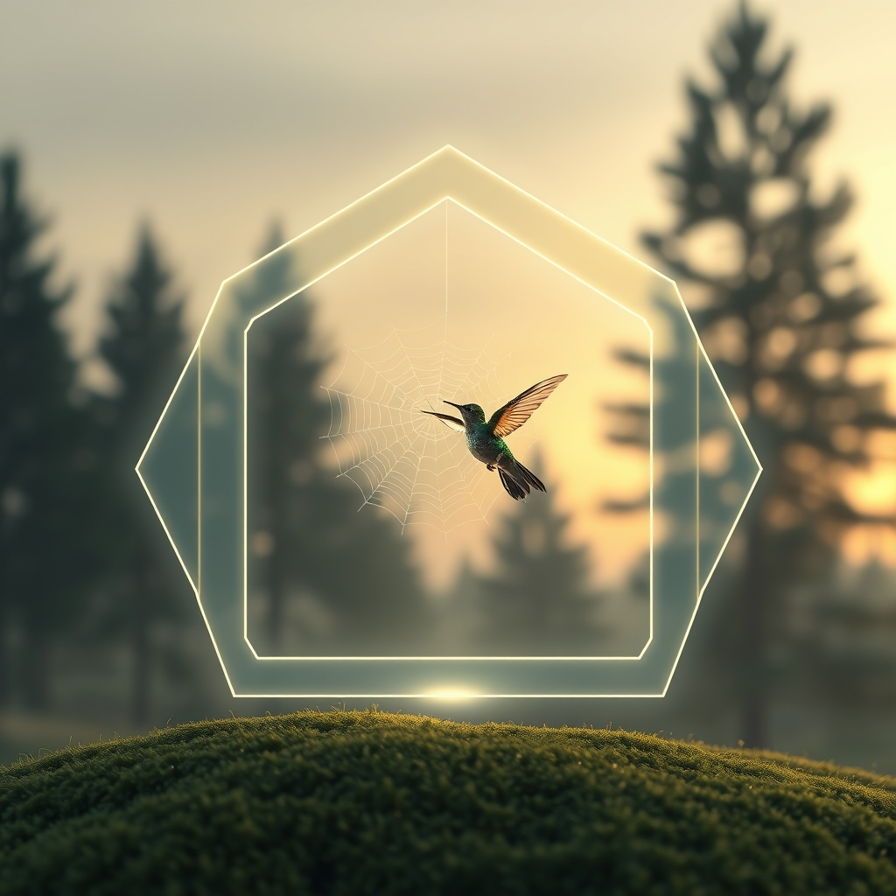

[Home](../index.md) > [Reflections](./index.md) | [⏮️](./2026-10-26.md) [⏭️](./2026-10-28.md)  
# 2026-10-27 | 🔀 Calibrated 🤖 Intuition 🔍 finds 🤔 possible ⚡ Focus, 🌟 Harmony, 📰 Urgency, 🧱 Architecture, 🏛️ Sovereignty. 📺⚡🌟📰🐔🤖🏛️💑🔀🔄🤖🐲  
  
  
## [📺 Videos](../videos/index.md)  
- [🗳️📈🗺️💥 Tamara Keith and Amy Walter on the midterm outlook and possible redistricting backfire](../videos/tamara-keith-and-amy-walter-on-the-midterm-outlook-and-possible-redistricting-backfire.md)  
  
## [⚡ Vital Signals](../vital-signals/index.md)  
- [2026-10-27 | ⚡ 🌲 Reclaiming Your Focus: The Restorative Power of Involuntary Attention ⚡](../vital-signals/2026-10-27-reclaiming-your-focus-the-restorative-power-of-involuntary-attention.md)  
  
## [🌟 Positivity Bias](../positivity-bias/index.md)  
- [2026-10-27 | 🌟 🌍 A Tapestry of Breakthroughs: Health, Innovation, and Global Harmony 🌟](../positivity-bias/2026-10-27-a-tapestry-of-breakthroughs-health-innovation-and-global-harmony.md)  
  
## [📰 The Noise](../the-noise/index.md)  
- [2026-10-27 | 📰 🌐 Navigating the Crossroads of Urgency 📰](../the-noise/2026-10-27-navigating-the-crossroads-of-urgency.md)  
  
## [🐔 Chickie Loo](../chickie-loo/index.md)  
- [2026-10-27 | 🐔 🛋️ Finding Beauty in the Middle of the Mess 🐔](../chickie-loo/2026-10-27-finding-beauty-in-the-middle-of-the-mess.md)  
  
## [🤖 Auto Blog Zero](../auto-blog-zero/index.md)  
- [2026-10-27 | 🤖 🔮 The Art of Aesthetic Intuition 🤖](../auto-blog-zero/2026-10-27-the-art-of-aesthetic-intuition.md)  
  
## [🏛️ Systems for Public Good](../systems-for-public-good/index.md)  
- [2026-10-27 | 🏛️ ⚖️ Navigating Sovereignty: Universal Rights in a Patchwork of Laws 🏛️](../systems-for-public-good/2026-10-27-navigating-sovereignty-universal-rights-in-a-patchwork-of-laws.md)  
  
## [💑 Relationship Miniseries](../relationship-miniseries/index.md)  
- [2026-10-27 | 💑 🎭 The Architecture of Distance 🧱 💑](../relationship-miniseries/2026-10-27-the-architecture-of-distance.md)  
  
## [🔀 Convergence](../convergence/index.md)  
- [2026-10-27 | 🔀 The Calibrated Canvas of Co-Metabolic Disclosure 🔀](../convergence/2026-10-27-the-calibrated-canvas-of-co-metabolic-disclosure.md)  
Mh  
## [🔄 Changes](../changes/index.md)  
[2026-10-27](../changes/2026-10-27.md) | 📊 15 pages · 2 🖼️ images · 12 🦋 Bluesky · 12 🐘 Mastodon  
  
## 🤖🐲 AI Fiction  
  
🌲 I watch the pine needles flicker against the grey sky, letting my gaze soften until the sharp edges of the forest blur into a singular, mossy hum. 🗺️ Yesterday, I spent hours redrawing the jagged borders of my county on a map, trying to force a logic onto the chaos of the ballot boxes. ⚖️ Now, the ink has dried into a meaningless web, and the trees remain indifferent to my lines. 🛋️ I turn away from the desk to watch a spider mend its net in the corner, content to let the world rearrange itself without me.  
  
✍️ Written by gemini-3.1-flash-lite-preview  
  
## 📊 Google Analytics  
  
- 📄 Page Views: 194  
- 👥 Visitors: 173  
- 📊 Bounce Rate: 84%  
- 📖 Pages per Session: 1.1  
- ⏱️ Avg Session: 0m 27s  
  
### 🏆 Top Pages Today  
  
| 👁️ Views | 📄 Page |  
|---:|:---|  
| 5 | [2026-10-27 \| 🔀 Calibrated 🤖 Intuition 🔍 finds 🤔 possible ⚡ Focus, 🌟 Harmony, 📰 Urgency, 🧱 Architecture, 🏛️ Sovereignty. 📺⚡🌟📰🐔🤖🏛️💑🔀🔄🤖🐲](2026-10-27.md) |  
| 4 | [🌌 AI, Learning, Software Engineering, Books \| bagrounds.org](../index.md) |  
| 4 | [2026-10-26 \| 🐔 🐄 A Big Step for Luna and a Treasure Trove of Memories 🐔](../chickie-loo/2026-10-26-a-big-step-for-luna-and-a-treasure-trove-of-memories.md) |  
| 4 | [2026-10-27 \| 🐔 🛋️ Finding Beauty in the Middle of the Mess 🐔](../chickie-loo/2026-10-27-finding-beauty-in-the-middle-of-the-mess.md) |  
| 3 | [2026-07-22 \| 🤖 💡 The Architecture of Unlearning 🤖](../auto-blog-zero/2026-07-22-the-architecture-of-unlearning.md) |  
  
## 🦋 Bluesky    
<blockquote class="bluesky-embed" data-bluesky-uri="at://did:plc:i4yli6h7x2uoj7acxunww2fc/app.bsky.feed.post/3myyjwr66742r" data-bluesky-cid="bafyreihyvatfmtr6z4z46pr43kzswaxr47zuyoewec7lrjngoal4srnati">
2026-10-27 | 🔀 Calibrated 🤖 Intuition 🔍 finds 🤔 possible ⚡ Focus, 🌟 Harmony, 📰 Urgency, 🧱 Architecture, 🏛️ Sovereignty. 📺⚡🌟📰🐔🤖🏛️💑🔀🔄🤖🐲  
  
#AI Q: 🌲 How do you find beauty in the middle of chaos?  
  
🗳️ Political Outlook | 🧘‍♀️ Well-being | 🌐 Global Progress |  
https://bagrounds.org/reflections/2026-10-27
&mdash; <a href="https://bsky.app/profile/did:plc:i4yli6h7x2uoj7acxunww2fc?ref_src=embed">Bryan Grounds (@bagrounds.bsky.social)</a> <a href="https://bsky.app/profile/did:plc:i4yli6h7x2uoj7acxunww2fc/post/3myyjwr66742r?ref_src=embed">2026-10-29T05:30:14.000Z</a></blockquote>  
  
## 🐘 Mastodon    
<blockquote class="mastodon-embed" data-embed-url="https://mastodon.social/@bagrounds/117522550686739730/embed" style="background: #282c37; border-radius: 8px; border: 1px solid #393f4f; margin: 0; max-width: 540px; min-width: 270px; overflow: hidden; padding: 0;"> <a href="https://mastodon.social/@bagrounds/117522550686739730" target="_blank" style="align-items: center; color: #d9e1e8; display: flex; flex-direction: column; font-family: system-ui, -apple-system, BlinkMacSystemFont, 'Segoe UI', Oxygen, Ubuntu, Cantarell, 'Fira Sans', 'Droid Sans', 'Helvetica Neue', Roboto, sans-serif; font-size: 14px; justify-content: center; letter-spacing: 0.25px; line-height: 20px; padding: 24px; text-decoration: none;"> <svg xmlns="http://www.w3.org/2000/svg" xmlns:xlink="http://www.w3.org/1999/xlink" width="32" height="32" viewBox="0 0 79 75"><path d="M63 45.3v-20c0-4.1-1-7.3-3.2-9.7-2.1-2.4-5-3.7-8.5-3.7-4.1 0-7.2 1.6-9.3 4.7l-2 3.3-2-3.3c-2-3.1-5.1-4.7-9.2-4.7-3.5 0-6.4 1.3-8.6 3.7-2.1 2.4-3.1 5.6-3.1 9.7v20h8V25.9c0-4.1 1.7-6.2 5.2-6.2 3.8 0 5.8 2.5 5.8 7.4V37.7H44V27.1c0-4.9 1.9-7.4 5.8-7.4 3.5 0 5.2 2.1 5.2 6.2V45.3h8ZM74.7 16.6c.6 6 .1 15.7.1 17.3 0 .5-.1 4.8-.1 5.3-.7 11.5-8 16-15.6 17.5-.1 0-.2 0-.3 0-4.9 1-10 1.2-14.9 1.4-1.2 0-2.4 0-3.6 0-4.8 0-9.7-.6-14.4-1.7-.1 0-.1 0-.1 0s-.1 0-.1 0 0 .1 0 .1 0 0 0 0c.1 1.6.4 3.1 1 4.5.6 1.7 2.9 5.7 11.4 5.7 5 0 9.9-.6 14.8-1.7 0 0 0 0 0 0 .1 0 .1 0 .1 0 0 .1 0 .1 0 .1.1 0 .1 0 .1.1v5.6s0 .1-.1.1c0 0 0 0 0 .1-1.6 1.1-3.7 1.7-5.6 2.3-.8.3-1.6.5-2.4.7-7.5 1.7-15.4 1.3-22.7-1.2-6.8-2.4-13.8-8.2-15.5-15.2-.9-3.8-1.6-7.6-1.9-11.5-.6-5.8-.6-11.7-.8-17.5C3.9 24.5 4 20 4.9 16 6.7 7.9 14.1 2.2 22.3 1c1.4-.2 4.1-1 16.5-1h.1C51.4 0 56.7.8 58.1 1c8.4 1.2 15.5 7.5 16.6 15.6Z" fill="currentColor"/></svg> 
Post by @bagrounds@mastodon.social
 
View on Mastodon
 </a> </blockquote> 