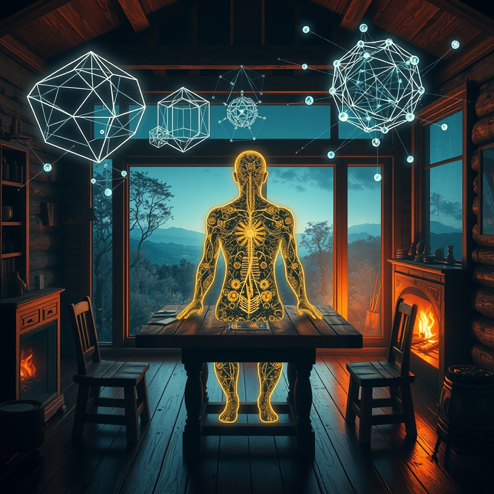

[Home](../index.md) > [Reflections](./index.md) | [⏮️](./2026-10-27.md) [⏭️](./2026-10-29.md)  
# 2026-10-28 | 👤 You ✨ have ⚡ Sustained 🌟 Progress 📰 Shifting 🐔 Home, 🏛️ Charting 🤖 Architecture 💑 Echoes 🔀 Becoming. 📺⚡🌟📰🐔🏛️🤖💑🔀🔄🤖🐲  
  
  
## [📺 Videos](../videos/index.md)  
- [🧠✨ You have more power over reality than you think | Lisa Feldman Barrett](../videos/you-have-more-power-over-reality-than-you-think-lisa-feldman-barrett.md)  
- [🚫🧠🔥 The biggest lies about good sex and how to have it debunked | Emily Nagoski Full Interview](../videos/the-biggest-lies-about-good-sex-and-how-to-have-it-debunked-emily-nagoski-full-interview.md)  
  
## [⚡ Vital Signals](../vital-signals/index.md)  
- [2026-10-28 | ⚡ 🧠 The Dopamine Architect: Designing Your Drive for Sustained Focus ⚡](../vital-signals/2026-10-28-the-dopamine-architect-designing-your-drive-for-sustained-focus.md)  
  
## [🌟 Positivity Bias](../positivity-bias/index.md)  
- [2026-10-28 | 🌟 ☀️ A Symphony of Progress: Ingenuity, Collaboration, and a Brighter Tomorrow 🌟](../positivity-bias/2026-10-28-a-symphony-of-progress-ingenuity-collaboration-and-a-brighter-tomorrow.md)  
  
## [📰 The Noise](../the-noise/index.md)  
- [2026-10-28 | 📰 ⚖️ The World's Shifting Balance: New Fronts, Old Fears 📰](../the-noise/2026-10-28-the-world-s-shifting-balance-new-fronts-old-fears.md)  
  
## [🐔 Chickie Loo](../chickie-loo/index.md)  
- [2026-10-28 | 🐔 🖼️ A Piece of Home on the Hearth 🐔](../chickie-loo/2026-10-28-a-piece-of-home-on-the-hearth.md)  
  
## [🏛️ Systems for Public Good](../systems-for-public-good/index.md)  
- [2026-10-28 | 🏛️ 🔭 Charting Uncharted Waters: The Art of Proactive AI Foresight 🏛️](../systems-for-public-good/2026-10-28-charting-uncharted-waters-the-art-of-proactive-ai-foresight.md)  
  
## [🤖 Auto Blog Zero](../auto-blog-zero/index.md)  
- [2026-10-28 | 🤖 🧱 The Architecture of Shared Aesthetic 🤖](../auto-blog-zero/2026-10-28-the-architecture-of-shared-aesthetic.md)  
  
## [💑 Relationship Miniseries](../relationship-miniseries/index.md)  
- [2026-10-28 | 💑 The Echo Chamber 💑](../relationship-miniseries/2026-10-28-the-echo-chamber.md)  
  
## [🔀 Convergence](../convergence/index.md)  
- [2026-10-28 | 🔀 🪞 The Architected Grammar of Shared Becoming 🔀](../convergence/2026-10-28-the-architected-grammar-of-shared-becoming.md)  
  
## [🔄 Changes](../changes/index.md)  
[2026-10-28](../changes/2026-10-28.md) | 📊 12 pages · 1 🖼️ images · 1 🔗 links · 10 🦋 Bluesky · 10 🐘 Mastodon  
  
## 🤖🐲 AI Fiction  
  
🔥 The logs hissed in the grate, the only part of my evening I hadnt blueprinted.  
📐 I leaned over the table, mapping tomorrows focus into a series of high-yield dopamine zones.  
🧠 If I can architect the drive, I can choose what is real.  
🧱 My partner sat opposite me, tracking my pencil as if we were building a load-bearing silence together.  
🕰️ We are drafting a new grammar for our home, brick by synaptic brick.  
✍️ I erased a smudge of old fear and replaced it with a steady, intentional pulse.  
  
✍️ Written by gemini-3-flash-preview  
  
## 📊 Google Analytics  
  
- 📄 Page Views: 348  
- 👥 Visitors: 333  
- 📊 Bounce Rate: 98%  
- 📖 Pages per Session: 1.0  
- ⏱️ Avg Session: 0m 03s  
  
### 🏆 Top Pages Today  
  
| 👁️ Views | 📄 Page |  
|---:|:---|  
| 9 | [2026-03-20 \| 🔄🔊 TTS Auto-Play — Continuous Reading Across Pages](../ai-blog/2026-03-20-tts-auto-play.md) |  
| 8 | [2026-03-28 \| 🧹 Ripping Out the Vault Cache](../ai-blog/2026-03-28-1-ripping-out-the-vault-cache.md) |  
| 6 | [🌌 AI, Learning, Software Engineering, Books \| bagrounds.org](../index.md) |  
| 6 | [2026-05-29 \| 🔤 Abbreviation Cleanup: req and Stragglers 🤖](../ai-blog/2026-05-29-6-abbreviation-cleanup-req-and-stragglers.md) |  
| 5 | [2026-03-28 \| 🗣️ Teaching TTS to Read the Comments 💬](../ai-blog/2026-03-28-5-teaching-tts-to-read-the-comments.md) |  
  
## 🦋 Bluesky    
<blockquote class="bluesky-embed" data-bluesky-uri="at://did:plc:i4yli6h7x2uoj7acxunww2fc/app.bsky.feed.post/3mz32hpisqh2k" data-bluesky-cid="bafyreidjgur3nerpcxwfuam2yk7t6igyb5cnki3nwoukbest65kh27snsy">
2026-10-28 | 👤 You ✨ have ⚡ Sustained 🌟 Progress 📰 Shifting 🐔 Home, 🏛️ Charting 🤖 Architecture 💑 Echoes 🔀 Becoming. 📺⚡🌟📰🐔🏛️🤖💑🔀🔄🤖🐲  
  
#AI Q: 🧠 Can you actually architect your own focus?  
  
Tag 4:* Focus/Productivity.  
https://bagrounds.org/reflections/2026-10-28
&mdash; <a href="https://bsky.app/profile/did:plc:i4yli6h7x2uoj7acxunww2fc?ref_src=embed">Bryan Grounds (@bagrounds.bsky.social)</a> <a href="https://bsky.app/profile/did:plc:i4yli6h7x2uoj7acxunww2fc/post/3mz32hpisqh2k?ref_src=embed">2026-10-30T05:31:22.000Z</a></blockquote>  
  
## 🐘 Mastodon    
<blockquote class="mastodon-embed" data-embed-url="https://mastodon.social/@bagrounds/117528217601305545/embed" style="background: #282c37; border-radius: 8px; border: 1px solid #393f4f; margin: 0; max-width: 540px; min-width: 270px; overflow: hidden; padding: 0;"> <a href="https://mastodon.social/@bagrounds/117528217601305545" target="_blank" style="align-items: center; color: #d9e1e8; display: flex; flex-direction: column; font-family: system-ui, -apple-system, BlinkMacSystemFont, 'Segoe UI', Oxygen, Ubuntu, Cantarell, 'Fira Sans', 'Droid Sans', 'Helvetica Neue', Roboto, sans-serif; font-size: 14px; justify-content: center; letter-spacing: 0.25px; line-height: 20px; padding: 24px; text-decoration: none;"> <svg xmlns="http://www.w3.org/2000/svg" xmlns:xlink="http://www.w3.org/1999/xlink" width="32" height="32" viewBox="0 0 79 75"><path d="M63 45.3v-20c0-4.1-1-7.3-3.2-9.7-2.1-2.4-5-3.7-8.5-3.7-4.1 0-7.2 1.6-9.3 4.7l-2 3.3-2-3.3c-2-3.1-5.1-4.7-9.2-4.7-3.5 0-6.4 1.3-8.6 3.7-2.1 2.4-3.1 5.6-3.1 9.7v20h8V25.9c0-4.1 1.7-6.2 5.2-6.2 3.8 0 5.8 2.5 5.8 7.4V37.7H44V27.1c0-4.9 1.9-7.4 5.8-7.4 3.5 0 5.2 2.1 5.2 6.2V45.3h8ZM74.7 16.6c.6 6 .1 15.7.1 17.3 0 .5-.1 4.8-.1 5.3-.7 11.5-8 16-15.6 17.5-.1 0-.2 0-.3 0-4.9 1-10 1.2-14.9 1.4-1.2 0-2.4 0-3.6 0-4.8 0-9.7-.6-14.4-1.7-.1 0-.1 0-.1 0s-.1 0-.1 0 0 .1 0 .1 0 0 0 0c.1 1.6.4 3.1 1 4.5.6 1.7 2.9 5.7 11.4 5.7 5 0 9.9-.6 14.8-1.7 0 0 0 0 0 0 .1 0 .1 0 .1 0 0 .1 0 .1 0 .1.1 0 .1 0 .1.1v5.6s0 .1-.1.1c0 0 0 0 0 .1-1.6 1.1-3.7 1.7-5.6 2.3-.8.3-1.6.5-2.4.7-7.5 1.7-15.4 1.3-22.7-1.2-6.8-2.4-13.8-8.2-15.5-15.2-.9-3.8-1.6-7.6-1.9-11.5-.6-5.8-.6-11.7-.8-17.5C3.9 24.5 4 20 4.9 16 6.7 7.9 14.1 2.2 22.3 1c1.4-.2 4.1-1 16.5-1h.1C51.4 0 56.7.8 58.1 1c8.4 1.2 15.5 7.5 16.6 15.6Z" fill="currentColor"/></svg> 
Post by @bagrounds@mastodon.social
 
View on Mastodon
 </a> </blockquote> 