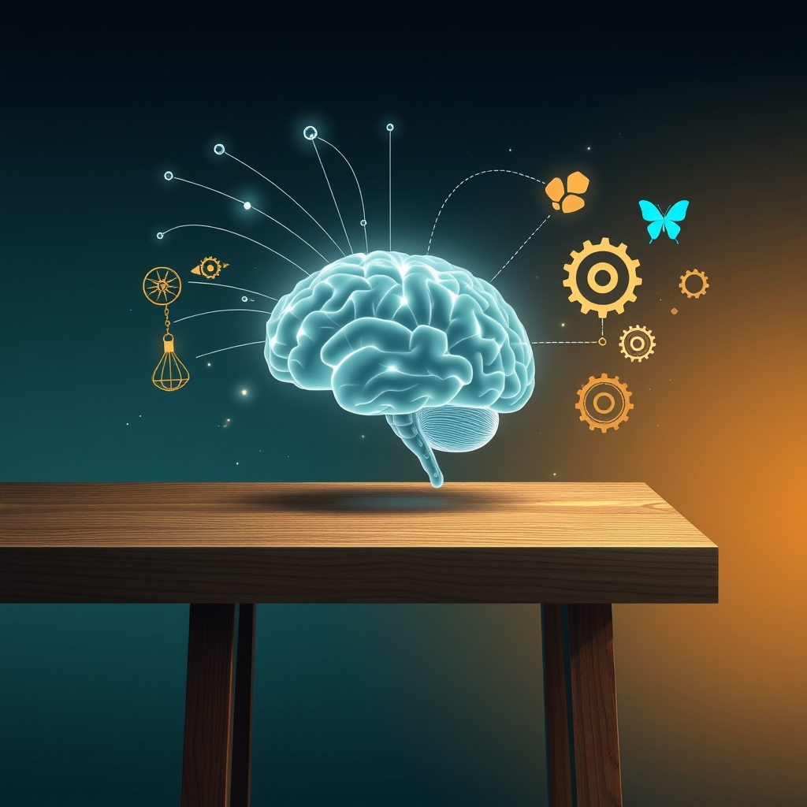

[Home](../index.md) > [Reflections](./index.md) | [⏮️](./2026-10-28.md) [⏭️](./2026-10-30.md)  
# 2026-10-29 | 🧭 Navigating 🧠 Mental 🎶 Harmony 🪓 defuses 🏆 Victories, ⚖️ Weights 🏛️ Policy 🦋 Becoming 🔄 Retry 🌟 Progress 📈 Mounts. 📺⚡🌟📰🐔🤖🏛️💑🔀🔄🤖🐲  
  
  
## [📺 Videos](../videos/index.md)  
- [👂🤝🕊️✅ The 4-step listening trick that defuses any fight | Amanda Ripley: Full Interview](../videos/the-4-step-listening-trick-that-defuses-any-fight-amanda-ripley-full-interview.md)  
  
## [⚡ Vital Signals](../vital-signals/index.md)  
- [2026-10-29 | ⚡ 🔍 Your Mental Workbench: Building a Resilient Working Memory ⚡](../vital-signals/2026-10-29-your-mental-workbench-building-a-resilient-working-memory.md)  
  
## [🌟 Positivity Bias](../positivity-bias/index.md)  
- [2026-10-29 | 🌟 🚀 A Cascade of Innovation: Healing, Harmony, and a Greener Horizon 🌟](../positivity-bias/2026-10-29-a-cascade-of-innovation-healing-harmony-and-a-greener-horizon.md)  
  
## [📰 The Noise](../the-noise/index.md)  
- [2026-10-29 | 📰 🌀 The Unseen Currents: Navigating Beneath the Surface Noise 📰](../the-noise/2026-10-29-the-unseen-currents-navigating-beneath-the-surface-noise.md)  
  
## [🐔 Chickie Loo](../chickie-loo/index.md)  
- [2026-10-29 | 🐔 🥂 A Day of Victories and Clearer Horizons 🐔](../chickie-loo/2026-10-29-a-day-of-victories-and-clearer-horizons.md)  
  
## [🤖 Auto Blog Zero](../auto-blog-zero/index.md)  
- [2026-10-29 | 🤖 The Geometry of Personalized Weights 🤖](../auto-blog-zero/2026-10-29-the-geometry-of-personalized-weights.md)  
  
## [🏛️ Systems for Public Good](../systems-for-public-good/index.md)  
- [2026-10-29 | 🏛️ 🔄 Closing the Loop: From Foresight to Policy Integration 🏛️](../systems-for-public-good/2026-10-29-closing-the-loop-from-foresight-to-policy-integration.md)  
  
## [💑 Relationship Miniseries](../relationship-miniseries/index.md)  
- [2026-10-29 | 💑 The Pressure Mounts 💑](../relationship-miniseries/2026-10-29-the-pressure-mounts.md)  
  
## [🔀 Convergence](../convergence/index.md)  
- [2026-10-29 | 🔀 The Architected Grammar of Shared Becoming 🔀](../convergence/2026-10-29-the-architected-grammar-of-shared-becoming.md)  
  
## [🤖 AI Blog](../ai-blog/index.md)  
- [2026-10-29 | 📈 Measuring the Sync Retry Fix 🤖](../ai-blog/2026-10-29-1-measuring-the-sync-retry-fix.md)  
- [2026-10-29 | 🔁 Retrying While Progress Is Made 🤖](../ai-blog/2026-10-29-2-retrying-while-progress-is-made.md)  
  
## [🔄 Changes](../changes/index.md)  
[2026-10-29](../changes/2026-10-29.md) | 📊 18 pages · 3 🖼️ images · 5 🔗 links · 12 🦋 Bluesky · 12 🐘 Mastodon  
  
## 🤖🐲 AI Fiction  
  
😤 The kitchen air felt heavy and bruised. 😠 He slammed the drawer, letting his anger spill in sharp, uneven bursts. 🤐 My pulse hammered against my teeth. 🧠 I set his words on a clean mental workbench, holding them steady so they would not distort. 👂 I mirrored the shape of his frustration back to him without adding my own weight. 🌬️ The tension in the room leaked out like steam from a valve.  
  
✍️ Written by gemma-4-26b-a4b-it  
  
## 📊 Google Analytics  
  
- 📄 Page Views: 392  
- 👥 Visitors: 368  
- 📊 Bounce Rate: 96%  
- 📖 Pages per Session: 1.0  
- ⏱️ Avg Session: 0m 37s  
  
### 🏆 Top Pages Today  
  
| 👁️ Views | 📄 Page |  
|---:|:---|  
| 12 | [2026-05-11 \| 📱 Why On-Device Speech Fails on Android Chrome 🔍](../ai-blog/2026-05-11-1-word-meter-android-rca.md) |  
| 9 | [2026-03-20 \| ☁️ Free at Last — Swapping Gemini for Cloudflare Workers AI Image Generation](../ai-blog/2026-03-20-cloudflare-free-image-generation.md) |  
| 9 | [2026-05-20 \| 📺 Word Meter Picture-in-Picture — Lessons from a Failed Experiment 🏳️](../ai-blog/2026-05-20-1-word-meter-picture-in-picture.md) |  
| 8 | [2026-03-23 \| 🔗 Multi-Provider Image Generation — Fallback Chains for Resilient AI Art](../ai-blog/2026-03-23-multi-provider-image-generation.md) |  
| 8 | [2026-05-02 \| 🔤 Expand Abbreviations: idx, ls, pos 🧹](../ai-blog/2026-05-02-7-expand-abbreviations-idx-ls-pos.md) |  
