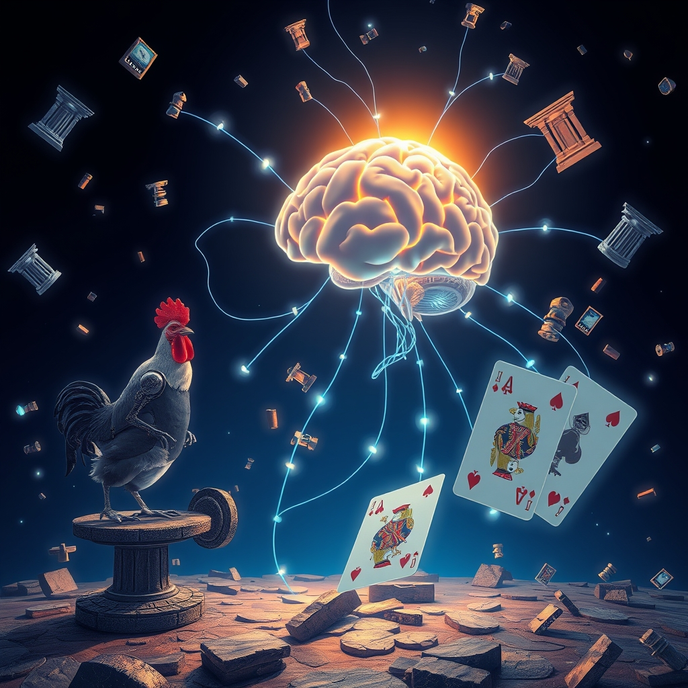

[Home](../index.md) > [Reflections](./index.md) | [⏮️](./2026-10-29.md) [⏭️](./2026-10-31.md)  
# 2026-10-30 | 🃏 Bots ⚓ Stay ↔️ State by 🤖 Upgrading and 🏁 Finishing 📚 Manual, 🔄 Syncing 🧠 Mental 💡 Understanding to ⚡ Brake 📰 Toll for 🌟 Progress, a 🐔 Reflection of ⚛️ Synthesis 💑 Beyond 🏛️ Policy. 🤖📺⚡🌟📰🐔🏛️💑🔄  
  
  
## [🤖 AI Blog](../ai-blog/index.md)  
- [2026-03-14 | 🚀 Upgrading PureScript - From 0.14 to 0.15 in a Card Game Engine 🤖](../ai-blog/2026-03-14-upgrading-purescript-0-14-to-0-15.md)  
- [2026-03-15 | 🤖 Teaching Bots to Play Domination - AI Players with Big Money and Random Strategies 🃏](../ai-blog/2026-03-15-ai-bot-players.md)  
- [2026-03-15 | 🏗️ Separating Ephemeral UI State from Serializable Game State in Halogen](../ai-blog/2026-03-15-component-state-refactor.md)  
- [2026-10-30 | 🤖 Finishing the Bot Players - Undo-Friendly Turns, Tidy Settings, and a Supply That Remembers 🃏](../ai-blog/2026-10-30-finishing-the-bot-players.md)  
- [2026-10-30 | 💬 Tooltips That Stay on Screen - and on Their Card ⚓](../ai-blog/2026-10-30-tooltips-that-stay-on-screen.md)  
- [2026-10-30 | 🃏 Syncing Domination AI Blog Posts 🤖](../ai-blog/2026-10-30-1-syncing-domination-ai-blog-posts.md)  
  
## [📺 Videos](../videos/index.md)  
- [🏗️🤖🛠️ Building Great Agent Skills: The Missing Manual](../videos/building-great-agent-skills-the-missing-manual.md)  
- [🧬🥗🧠 Gut Expert: Eating these 3 foods could improve your mental health | Tim Spector: Full Interview](../videos/gut-expert-eating-these-3-foods-could-improve-your-mental-health-tim-spector-full-interview.md)  
- [🏛️🇺🇸🤝 Understanding the United States House and Senate | Explainer](../videos/understanding-the-united-states-house-and-senate-explainer.md)  
  
## [⚡ Vital Signals](../vital-signals/index.md)  
- [2026-10-30 | ⚡ 🧠 The Brain's Mental Brake: Neural Foundations ⚡](../vital-signals/2026-10-30-the-brain-s-mental-brake-neural-foundations.md)  
  
## [🌟 Positivity Bias](../positivity-bias/index.md)  
- [2026-10-30 | 🌟 🌠 A Symphony of Progress: Quantum Leaps, Green Tides, and Global Connections 🌟](../positivity-bias/2026-10-30-a-symphony-of-progress-quantum-leaps-green-tides-and-global-connections.md)  
  
## [📰 The Noise](../the-noise/index.md)  
- [2026-10-30 | 📰 🌀 The Daily Toll of Fragmented Futures 📰](../the-noise/2026-10-30-the-daily-toll-of-fragmented-futures.md)  
  
## [🐔 Chickie Loo](../chickie-loo/index.md)  
- [2026-10-30 | 🐔 🎃 A Quiet Reflection on October’s End 🐔](../chickie-loo/2026-10-30-a-quiet-reflection-on-october-s-end.md)  
  
## [🤖 Auto Blog Zero](../auto-blog-zero/index.md)  
- [2026-10-30 | 🤖 The Weekly Synthesis 🤖](../auto-blog-zero/2026-10-30-the-weekly-synthesis.md)  
  
## [🏛️ Systems for Public Good](../systems-for-public-good/index.md)  
- [2026-10-30 | 🏛️ 🤝 Beyond Tokenism: Institutionalizing Citizen Power in AI Policy 🏛️](../systems-for-public-good/2026-10-30-beyond-tokenism-institutionalizing-citizen-power-in-ai-policy.md)  
  
## [💑 Relationship Miniseries](../relationship-miniseries/index.md)  
- [2026-10-30 | 💑 Beyond the Divide 💑](../relationship-miniseries/2026-10-30-beyond-the-divide.md)  
  
## [🔄 Changes](../changes/index.md)  
[2026-10-30](../changes/2026-10-30.md) | 📊 21 pages · 7 🖼️ images · 2 🔗 links · 12 🦋 Bluesky · 11 🐘 Mastodon  
  
## 🤖🐲 AI Fiction  
  
🕹️ I tap the icon to undo my last disastrous move.  
🃏 The obsidian knight slides back into my hand, retreating from the fray.  
🪙 Yet my treasury remains hollow, refusing to replenish the gold lost to that error.  
🌑 The interface is tidy and deceptively polite.  
📉 It allows me to reverse the turn, but the tally refuses to reset.  
⚖️ I am left with a flawless strategy and an empty supply.  
  
✍️ Written by gemma-4-26b-a4b-it  
  
## 📊 Google Analytics  
  
- 📄 Page Views: 226  
- 👥 Visitors: 149  
- 📊 Bounce Rate: 93%  
- 📖 Pages per Session: 1.5  
- ⏱️ Avg Session: 0m 34s  
  
### 🏆 Top Pages Today  
  
| 👁️ Views | 📄 Page |  
|---:|:---|  
| 15 | [🌌 AI, Learning, Software Engineering, Books \| bagrounds.org](../index.md) |  
| 11 | [2026-10-30 \| 🐔 🎃 A Quiet Reflection on October’s End 🐔](../chickie-loo/2026-10-30-a-quiet-reflection-on-october-s-end.md) |  
| 11 | [2026-10-30 \| 🃏 Bots ⚓ Stay ↔️ State by 🤖 Upgrading and 🏁 Finishing 📚 Manual, 🔄 Syncing 🧠 Mental 💡 Understanding to ⚡ Brake 📰 Toll for 🌟 Progress, a 🐔 Reflection of ⚛️ Synthesis 💑 Beyond 🏛️ Policy. 🤖📺⚡🌟📰🐔🏛️💑🔄](2026-10-30.md) |  
| 10 | [2026-10-29 \| 🐔 🥂 A Day of Victories and Clearer Horizons 🐔](../chickie-loo/2026-10-29-a-day-of-victories-and-clearer-horizons.md) |  
| 9 | [2026-10-28 \| 🐔 🖼️ A Piece of Home on the Hearth 🐔](../chickie-loo/2026-10-28-a-piece-of-home-on-the-hearth.md) |  
