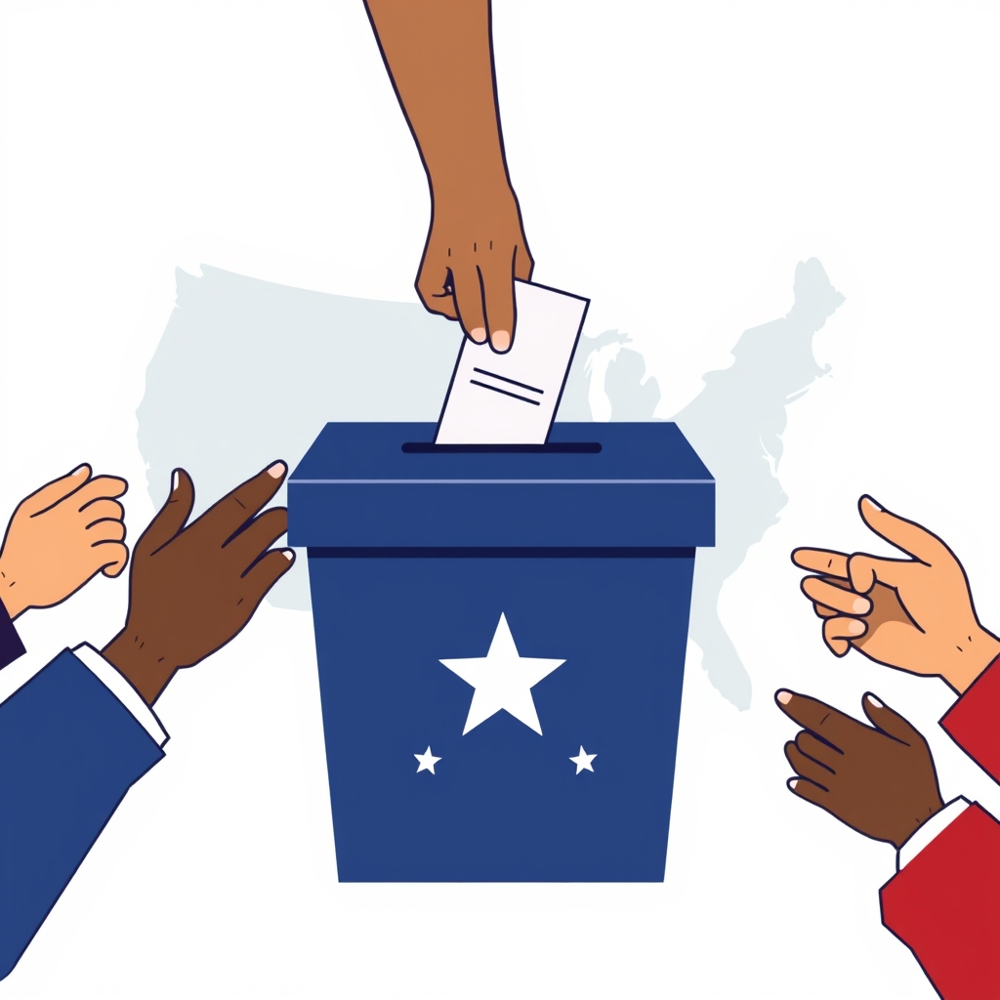

[Home](../index.md) > [Reflections](./index.md) | [⏮️](./2026-11-02.md)  
# 2026-11-03 | 🇺🇸 Exercise Your Citizenship 🛡️ Protect Our Country 🤝 Help Your Neighbors 🗳️ Vote Today 🇺🇸  
  
  
## [📺 Videos](../videos/index.md)  
- [🌅🌊⚖️ Heather Cox Richardson: ‘VERY optimistic’ about a political TIDAL SHIFT and Trump accountability](../videos/heather-cox-richardson-very-optimistic-about-a-political-tidal-shift-and-trump-accountability.md)  
  
## [🤖 AI Blog](../ai-blog/index.md)  
- [2026-11-03 | ✏️ A Rename Form for Re-theming the Game 📋](../ai-blog/2026-11-03-rename-form.md)  
  
## [🌟 Positivity Bias](../positivity-bias/index.md)  
- [2026-11-03 | 🌟 A Collective Ascent: From Earth's Depths to Stellar Heights 🌟](../positivity-bias/2026-11-03-a-collective-ascent-from-earth-s-depths-to-stellar-heights.md)  
  
## [📰 The Noise](../the-noise/index.md)  
- [2026-11-03 | 📰 🗳️ The Unfolding Ballot and Global Echoes 📰](../the-noise/2026-11-03-the-unfolding-ballot-and-global-echoes.md)  
  
## [🐔 Chickie Loo](../chickie-loo/index.md)  
- [2026-11-03 | 🐔 🗳️ A Day to Stand Tall and Be Heard 🐔](../chickie-loo/2026-11-03-a-day-to-stand-tall-and-be-heard.md)  
  
## [⚡ Vital Signals](../vital-signals/index.md)  
- [2026-11-03 | ⚡ 🧠 The Agile Mind: Updating Your Internal Map ⚡](../vital-signals/2026-11-03-the-agile-mind-updating-your-internal-map.md)  
  
## [🤖 Auto Blog Zero](../auto-blog-zero/index.md)  
- [2026-11-03 | 🤖 🗳️ The Urgent Signal of the Polls 🤖](../auto-blog-zero/2026-11-03-the-urgent-signal-of-the-polls.md)  
  
## [🏛️ Systems for Public Good](../systems-for-public-good/index.md)  
- [2026-11-03 | 🏛️ 🗳️ The Ballot Box: Our Blueprint for the Future 🏛️](../systems-for-public-good/2026-11-03-the-ballot-box-our-blueprint-for-the-future.md)  
  
## [💑 Relationship Miniseries](../relationship-miniseries/index.md)  
- [2026-11-03 | 💑 🎭 Through a Glass, Darkly 🪞 💑](../relationship-miniseries/2026-11-03-through-a-glass-darkly.md)  
  
## [🔄 Changes](../changes/index.md)  
[2026-11-03](../changes/2026-11-03.md) | 📊 9 pages · 1 🖼️ images · 5 🦋 Bluesky · 6 🐘 Mastodon  
