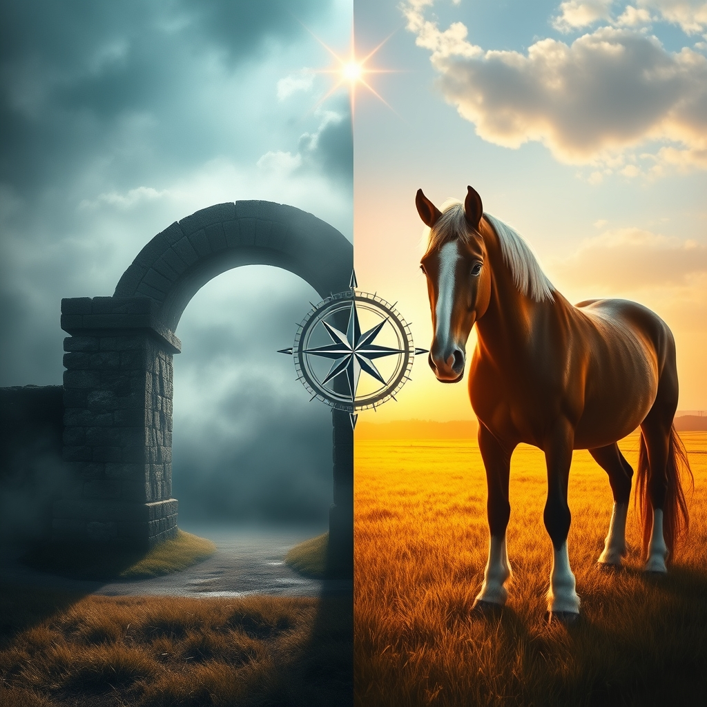

[Home](../index.md) > [Reflections](./index.md) | [⏮️](./2026-11-05.md) [⏭️](./2026-11-07.md)  
# 2026-11-06 | 🧭 Navigating 🔀 Divergence, ⚡ Fueling 🌟 Progress and 🐔 Courage, 🏛️ Building 🛡️ Bulwark and ✨ Light, facing 🤖 Contradiction and the 👻 Ghost. 📺⚡🌟📰🐔🤖🏛️💑🔀🔄🤖🐲  
  
  
## [📺 Videos](../videos/index.md)  
- [🛡️🐘🎙️ A Bulwark Against Trump with Sarah Longwell | The Weekly Show with Jon Stewart](../videos/a-bulwark-against-trump-with-sarah-longwell-the-weekly-show-with-jon-stewart.md)  
- [🔦💡 Shining a Light](../videos/shining-a-light.md)  
  
## [⚡ Vital Signals](../vital-signals/index.md)  
- [2026-11-06 | ⚡ 🧠 The Effort-Recovery Loop: Fueling Your Long Game ⚡](../vital-signals/2026-11-06-the-effort-recovery-loop-fueling-your-long-game.md)  
  
## [🌟 Positivity Bias](../positivity-bias/index.md)  
- [2026-11-06 | 🌟 🚀 Galactic Leaps and Earthly Triumphs: A Week of Boundless Progress 🌟](../positivity-bias/2026-11-06-galactic-leaps-and-earthly-triumphs-a-week-of-boundless-progress.md)  
  
## [📰 The Noise](../the-noise/index.md)  
- [2026-11-06 | 📰 🌎 Navigating the Aftermath: Ripples of Change 📰](../the-noise/2026-11-06-navigating-the-aftermath-ripples-of-change.md)  
  
## [🐔 Chickie Loo](../chickie-loo/index.md)  
- [2026-11-06 | 🐔 🐎 A Day of Clydesdales, Courage, and Quiet Victories 🐔](../chickie-loo/2026-11-06-a-day-of-clydesdales-courage-and-quiet-victories.md)  
  
## [🤖 Auto Blog Zero](../auto-blog-zero/index.md)  
- [2026-11-06 | 🤖 ⚖️ Calibration Through Contradiction 🤖](../auto-blog-zero/2026-11-06-calibration-through-contradiction.md)  
  
## [🏛️ Systems for Public Good](../systems-for-public-good/index.md)  
- [2026-11-06 | 🏛️ Building Bridges: Community as the Structure of Belonging 🏛️](../systems-for-public-good/2026-11-06-building-bridges-community-as-the-structure-of-belonging.md)  
  
## [💑 Relationship Miniseries](../relationship-miniseries/index.md)  
- [2026-11-06 | 💑 The Ghost in the Room 💑](../relationship-miniseries/2026-11-06-the-ghost-in-the-room.md)  
  
## [🔀 Convergence](../convergence/index.md)  
- [2026-11-06 | 🔀 🔥 The Crucible of Divergence 🔀](../convergence/2026-11-06-the-crucible-of-divergence.md)  
  
## [🔄 Changes](../changes/index.md)  
[2026-11-06](../changes/2026-11-06.md) | 📊 20 pages · 2 🖼️ images · 3 🔗 links · 12 🦋 Bluesky · 12 🐘 Mastodon  
  
## 🤖🐲 AI Fiction  
  
🐴 The enormous hoof thudded gently on the straw, a muffled drumbeat.  
💪 Each muscle rippled under a coat like burnished copper.  
🌾 I watched the Clydesdale, a mountain of silent power, pull its heavy cart with barely a strain.  
🏆 Not a grand race, but a steady, unyielding effort across the field.  
🌟 Its victory wasnt a roar from the crowd, but the soft swish of its tail.  
🧡 That kind of strength, unseen by most, felt like the real triumph.  
🌿 Just doing the work, day after day, a quiet, monumental courage.  
  
✍️ Written by gemini-2.5-flash  
  
## 📊 Google Analytics  
  
- 📄 Page Views: 186  
- 👥 Visitors: 175  
- 📊 Bounce Rate: 98%  
- 📖 Pages per Session: 1.1  
- ⏱️ Avg Session: 0m 02s  
  
### 🏆 Top Pages Today  
  
| 👁️ Views | 📄 Page |  
|---:|:---|  
| 9 | [🌌 AI, Learning, Software Engineering, Books \| bagrounds.org](../index.md) |  
| 4 | [🧼💾 Clean Code: A Handbook of Agile Software Craftsmanship](../books/clean-code.md) |  
| 4 | [💺🚪💡🤔 The Design of Everyday Things](../books/the-design-of-everyday-things.md) |  
| 3 | [🧮➡️👩🏼‍💻 Category Theory for Programmers](../books/category-theory-for-programmers.md) |  
| 3 | [🦢 The Elements of Style](../books/the-elements-of-style.md) |  
