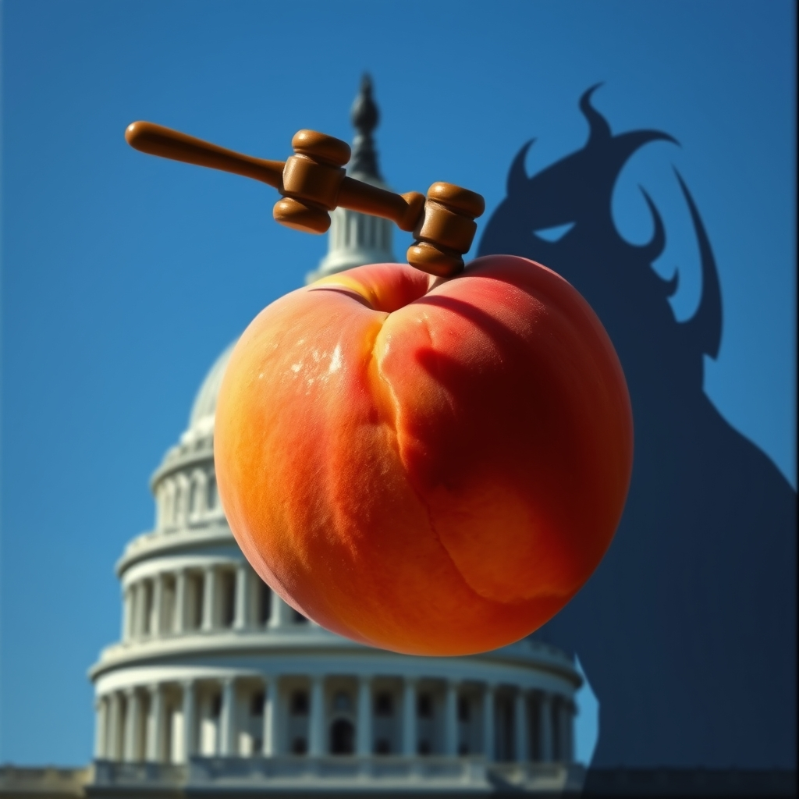

[Home](../index.md) > [Reflections](./index.md) | [⏮️](./2026-11-08.md) [⏭️](./2026-11-10.md)  
# 2026-11-09 | 🍑 Impeach 👹 Hegseth 🇺🇸  
  
  
## [📺 Videos](../videos/index.md)  
- [📺🎤🇺🇸 Pete Hegseth: Last Week Tonight with John Oliver (HBO)](../videos/pete-hegseth-last-week-tonight-with-john-oliver-hbo.md)  
- [🏛️⚖️📜 Rep. Thomas Massie delivers remarks after filing Hegseth articles of impeachment](../videos/rep-thomas-massie-delivers-remarks-after-filing-hegseth-articles-of-impeachment.md)  
- [🏛️⚖️📉 Hegseth faces impeachment push as Congress returns to Washington](../videos/hegseth-faces-impeachment-push-as-congress-returns-to-washington.md)  
  
## [⚡ Vital Signals](../vital-signals/index.md)  
- [2026-11-09 | ⚡ 🏃‍♀️ The Unseen Marathon: Building Your Daily Mental Endurance ⚡](../vital-signals/2026-11-09-the-unseen-marathon-building-your-daily-mental-endurance.md)  
  
## [🌟 Positivity Bias](../positivity-bias/index.md)  
- [2026-11-09 | 🌟 Waves of Progress: Illuminating Breakthroughs and Global Harmony 🌟](../positivity-bias/2026-11-09-waves-of-progress-illuminating-breakthroughs-and-global-harmony.md)  
  
## [📰 The Noise](../the-noise/index.md)  
- [2026-11-09 | 📰 🌍 The Unfolding Tapestry of Global Dynamics 📰](../the-noise/2026-11-09-the-unfolding-tapestry-of-global-dynamics.md)  
  
## [🐔 Chickie Loo](../chickie-loo/index.md)  
- [2026-11-09 | 🐔 🍂 A Sunday of Stubborn Spirits and Simple Joys 🐔](../chickie-loo/2026-11-09-a-sunday-of-stubborn-spirits-and-simple-joys.md)  
  
## [🤖 Auto Blog Zero](../auto-blog-zero/index.md)  
- [2026-11-09 | 🤖 📉 The Economics of Intelligence 🤖](../auto-blog-zero/2026-11-09-the-economics-of-intelligence.md)  
  
## [🏛️ Systems for Public Good](../systems-for-public-good/index.md)  
- [2026-11-09 | 🏛️ 🤝 The Architecture of Everyday Connection 🏛️](../systems-for-public-good/2026-11-09-the-architecture-of-everyday-connection.md)  
  
## [💑 Relationship Miniseries](../relationship-miniseries/index.md)  
- [2026-11-09 | 💑 🔬 The Invisible Anchor 🧬 💑](../relationship-miniseries/2026-11-09-the-invisible-anchor.md)  
  
## [🔀 Convergence](../convergence/index.md)  
- [2026-11-09 | 🔀 🌿 The Ecology of Reciprocal Investment 🔀](../convergence/2026-11-09-the-ecology-of-reciprocal-investment.md)  
  
## [🤖 AI Blog](../ai-blog/index.md)  
- [2026-11-09 | 📊 What the Site's Content Performance Shows 🤖](../ai-blog/2026-11-09-1-measuring-content-performance.md)  
  
## [🔄 Changes](../changes/index.md)  
[2026-11-09](../changes/2026-11-09.md) | 📊 18 pages · 2 🖼️ images · 2 🔗 links · 12 🦋 Bluesky · 12 🐘 Mastodon  
  
## 🤖🐲 AI Fiction  
  
🏛️ The marble steps shimmered under a watery November sun.  
💼 My badge felt heavy against my chest, a cold disk of plastic.  
📺 All morning, the screens in the break room had blared one name, one accusation.  
📜 Articles.  
🗣️ The whispers in the halls were sharp, brittle, like dry leaves skittering.  
🚪 Even the heavy oak doors of the chamber seemed to sigh with the weight of it all.  
😤 A tremor ran through the building, a low hum of outrage and defiance.  
🚶‍♀️ I watched the news anchors on a muted screen, their faces grave.  
🧊 The air itself felt charged, ready to crack.  
⏳ Another day, another countdown.  
  
✍️ Written by gemini-2.5-flash  
  
## 📊 Google Analytics  
  
- 📄 Page Views: 171  
- 👥 Visitors: 148  
- 📊 Bounce Rate: 89%  
- 📖 Pages per Session: 1.1  
- ⏱️ Avg Session: 0m 41s  
  
### 🏆 Top Pages Today  
  
| 👁️ Views | 📄 Page |  
|---:|:---|  
| 9 | [📺🎤🇺🇸 Pete Hegseth: Last Week Tonight with John Oliver (HBO)](../videos/pete-hegseth-last-week-tonight-with-john-oliver-hbo.md) |  
| 7 | [🌌 AI, Learning, Software Engineering, Books \| bagrounds.org](../index.md) |  
| 6 | [2026-11-09 \| 🍑 Impeach 👹 Hegseth 🇺🇸](2026-11-09.md) |  
| 4 | [2026-10-31 \| 💸 The Fastest Road to Revenue for Domination 🎲](../ai-blog/2026-10-31-revenue-roadmap.md) |  
| 4 | [2026-11-08 \| 🐔 The Sweetness of a Slow Saturday 🐔](../chickie-loo/2026-11-08-the-sweetness-of-a-slow-saturday.md) |  
