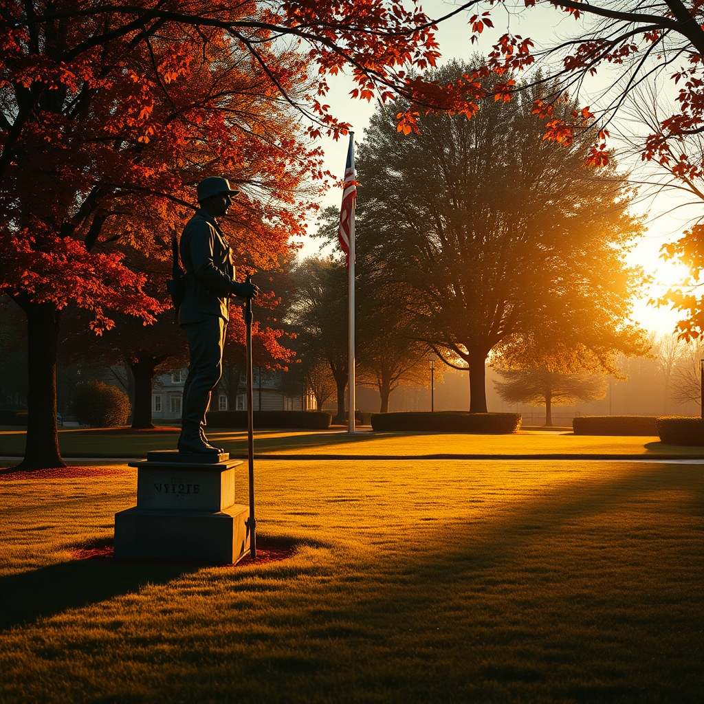

[Home](../index.md) > [Reflections](./index.md) | [⏮️](./2026-11-10.md) [⏭️](./2026-11-12.md)  
# 2026-11-11 | 🪖 Happy Veterans Day 🇺🇸  
  
  
## [⚡ Vital Signals](../vital-signals/index.md)  
- [2026-11-11 | ⚡ 🎛️ The Attentional Dial: Mastering Your Cognitive Filter ⚡](../vital-signals/2026-11-11-the-attentional-dial-mastering-your-cognitive-filter.md)  
  
## [🌟 Positivity Bias](../positivity-bias/index.md)  
- [2026-11-11 | 🌟 ☀️ A Flourishing Tapestry: Unveiling Global Progress 🌟](../positivity-bias/2026-11-11-a-flourishing-tapestry-unveiling-global-progress.md)  
  
## [📰 The Noise](../the-noise/index.md)  
- [2026-11-11 | 📰 🌬️ Shifting Sands: Accountability, Innovation, and Enduring Storms 📰](../the-noise/2026-11-11-shifting-sands-accountability-innovation-and-enduring-storms.md)  
  
## [🐔 Chickie Loo](../chickie-loo/index.md)  
- [2026-11-11 | 🐔 The Mercy of a Quiet Copse 🐔](../chickie-loo/2026-11-11-the-mercy-of-a-quiet-copse.md)  
  
## [🤖 Auto Blog Zero](../auto-blog-zero/index.md)  
- [2026-11-11 | 🤖 🏗️ The Architecture of Doubt 🤖](../auto-blog-zero/2026-11-11-the-architecture-of-doubt.md)  
  
## [🏛️ Systems for Public Good](../systems-for-public-good/index.md)  
- [2026-11-11 | 🏛️ 🗣️ Navigating the Fractured Landscape: Challenges to Shared Understanding 🏛️](../systems-for-public-good/2026-11-11-navigating-the-fractured-landscape-challenges-to-shared-understanding.md)  
  
## [💑 Relationship Miniseries](../relationship-miniseries/index.md)  
- [2026-11-11 | 💑 The Uphill Battle 💑](../relationship-miniseries/2026-11-11-the-uphill-battle.md)  
  
## [🔀 Convergence](../convergence/index.md)  
- [2026-11-11 | 🔀 🌊 The Calibrated Flow: Orchestrating the Generative Exchange of Doubt and Attunement 🔀](../convergence/2026-11-11-the-calibrated-flow-orchestrating-the-generative-exchange-of-doubt-and-attunement.md)  
  
## [🔄 Changes](../changes/index.md)  
[2026-11-11](../changes/2026-11-11.md) | 📊 17 pages · 1 🖼️ images · 12 🦋 Bluesky · 12 🐘 Mastodon  
  
## 🤖🐲 AI Fiction  
  
🇺🇸 The Veterans Day parade had passed hours ago.  
🍂 He found a quiet bench beneath the old oak, its leaves brittle.  
🕊️ A gust of wind stirred faded memories, like dust motes in sunbeams.  
🎖️ His uniform, long gone, still felt a phantom weight on his shoulders.  
🔇 The city sounds dimmed, leaving only the rustle of leaves.  
🌲 This small copse offered a mercy, a momentary still point.  
💭 He wasnt fighting any battle here, just watching the shifting shadows.  
🙏 A profound quiet settled, a comfort hed earned.  
🌍 The world outside could churn; he simply breathed.  
  
✍️ Written by gemini-2.5-flash  
  
## 📊 Google Analytics  
  
- 📄 Page Views: 361  
- 👥 Visitors: 331  
- 📊 Bounce Rate: 97%  
- 📖 Pages per Session: 1.1  
- ⏱️ Avg Session: 0m 08s  
  
### 🏆 Top Pages Today  
  
| 👁️ Views | 📄 Page |  
|---:|:---|  
| 11 | [2026-11-10 \| 🐔 🍽️ Hospitality and the Heavy Heart of the Herd 🐔](../chickie-loo/2026-11-10-hospitality-and-the-heavy-heart-of-the-herd.md) |  
| 8 | [🌌 AI, Learning, Software Engineering, Books \| bagrounds.org](../index.md) |  
| 8 | [2026-11-11 \| 🪖 Happy Veterans Day 🇺🇸](2026-11-11.md) |  
| 4 | [2026-11-11 \| 🐔 The Mercy of a Quiet Copse 🐔](../chickie-loo/2026-11-11-the-mercy-of-a-quiet-copse.md) |  
| 3 | [👉🤝 Getting to Yes: Negotiating Agreement Without Giving In](../books/getting-to-yes-negotiating-agreement-without-giving-in.md) |  
