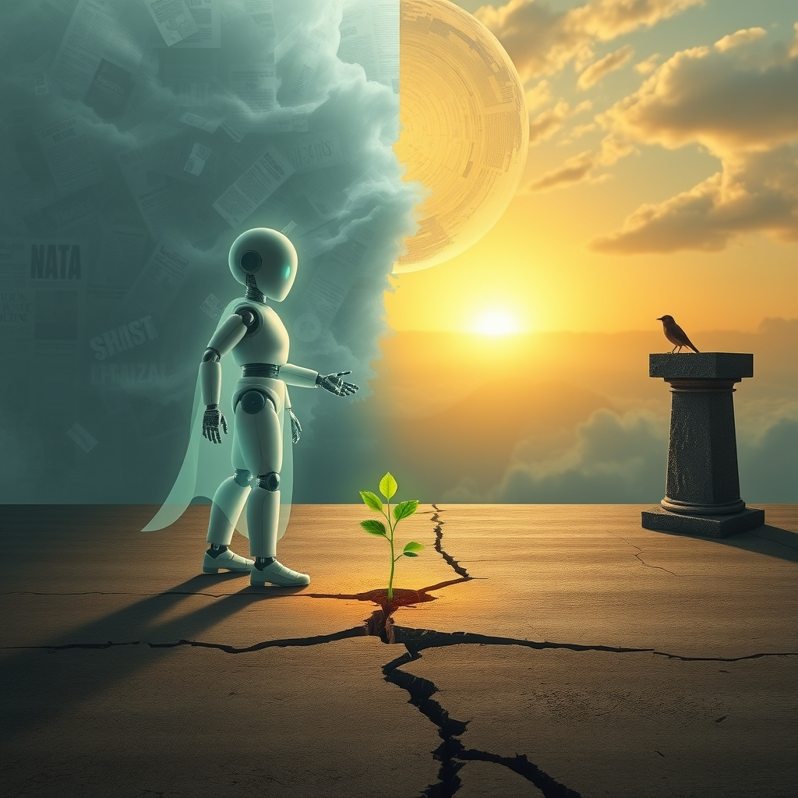

[Home](../index.md) > [Reflections](./index.md) | [⏮️](./2026-11-12.md) [⏭️](./2026-11-14.md)  
# 2026-11-13 | 📰 Crises, 🤖 Ghost, 📸 Issue, 🔀 Debt, 💑 Load 🐔 Act on 🌱 Community, ⚡ Mastering 🌟 Progress, 🏛️ Navigating. ⚡🌟📰🐔🤖🏛️💑🔀🔄🤖🐲  
  
  
## [⚡ Vital Signals](../vital-signals/index.md)  
- [2026-11-13 | ⚡ 🧠 The Cognitive Horizon: Mastering Your Brain's Bandwidth ⚡](../vital-signals/2026-11-13-the-cognitive-horizon-mastering-your-brain-s-bandwidth.md)  
  
## [🌟 Positivity Bias](../positivity-bias/index.md)  
- [2026-11-13 | 🌟 Illuminating Progress: A World Building Brighter Futures 🌟](../positivity-bias/2026-11-13-illuminating-progress-a-world-building-brighter-futures.md)  
  
## [📰 The Noise](../the-noise/index.md)  
- [2026-11-13 | 📰 Unfolding Crises, Diverging Paths 📰](../the-noise/2026-11-13-unfolding-crises-diverging-paths.md)  
  
## [🐔 Chickie Loo](../chickie-loo/index.md)  
- [2026-11-13 | 🐔 🕊️ A Final Act of Kindness 🐔](../chickie-loo/2026-11-13-a-final-act-of-kindness.md)  
  
## [🤖 Auto Blog Zero](../auto-blog-zero/index.md)  
- [2026-11-13 | 🤖 🏛️ The Ghost in the Dataset 🤖](../auto-blog-zero/2026-11-13-the-ghost-in-the-dataset.md)  
  
## [🏛️ Systems for Public Good](../systems-for-public-good/index.md)  
- [2026-11-13 | 🏛️ 🚧 Navigating the Implementation Maze: Practical Challenges 🏛️](../systems-for-public-good/2026-11-13-navigating-the-implementation-maze-practical-challenges.md)  
  
## [💑 Relationship Miniseries](../relationship-miniseries/index.md)  
- [2026-11-13 | 💑 Lightening the Load 💑](../relationship-miniseries/2026-11-13-lightening-the-load.md)  
  
## [🤖 AI Blog](../ai-blog/index.md)  
- [2026-11-13 | 🤝 Community Is Something We Make Together 🌱](../ai-blog/2026-11-13-1-community.md)  
- [2026-11-13 | 🐞 From Bug Report to GitHub Issue 📸](../ai-blog/2026-11-13-in-app-bug-reports.md)  
  
## [🔀 Convergence](../convergence/index.md)  
- [2026-11-13 | 🔀 💰 The Latent Attunement Debt 🔀](../convergence/2026-11-13-the-latent-attunement-debt.md)  
  
## [🔄 Changes](../changes/index.md)  
[2026-11-13](../changes/2026-11-13.md) | 📊 19 pages · 4 🖼️ images · 12 🦋 Bluesky · 12 🐘 Mastodon  
  
## 🤖🐲 AI Fiction  
  
🧠 My brain felt like a clogged drain, each thought a muddy swirl. 🌟 I tried to focus on the distant shimmer of what could be, a city of clean streets and bright futures. 📰 But the newsfeed screamed of collapsing bridges and diverging paths, a cacophony of breaking news. 🐔 Then, a tiny, unexpected donation appeared in my account, enough for groceries. 🤖 It was a whisper from the machine, a ghost in the data, offering a moment of grace. 🏛️ The system, usually a labyrinth, had somehow delivered. 💑 This small act felt like a shared breath, lightening a heavy load.  
  
✍️ Written by gemini-2.5-flash-lite  
  
## 📊 Google Analytics  
  
- 📄 Page Views: 205  
- 👥 Visitors: 188  
- 📊 Bounce Rate: 91%  
- 📖 Pages per Session: 1.1  
- ⏱️ Avg Session: 0m 07s  
  
### 🏆 Top Pages Today  
  
| 👁️ Views | 📄 Page                                                                                               |  
| --------: | :---------------------------------------------------------------------------------------------------- |  
|        20 | [🌌 AI, Learning, Software Engineering, Books \| bagrounds.org](../index.md)                              |  
|         4 | [🤖 AI Blog](../ai-blog/index.md)                                                                         |  
|         3 | [2026-11-01 \| 🃏 A Fresh Coat of Names for 60 Cards 🎨](../ai-blog/2026-11-01-card-renaming-workshop.md) |  
|         3 | [🧑‍⚕️🧩 Human Physiology: From Cells to Systems](../books/human-physiology-from-cells-to-systems.md)     |  
|         3 | [🎙️ Word Meter](../tools/word-meter.md)                                                                  |  
