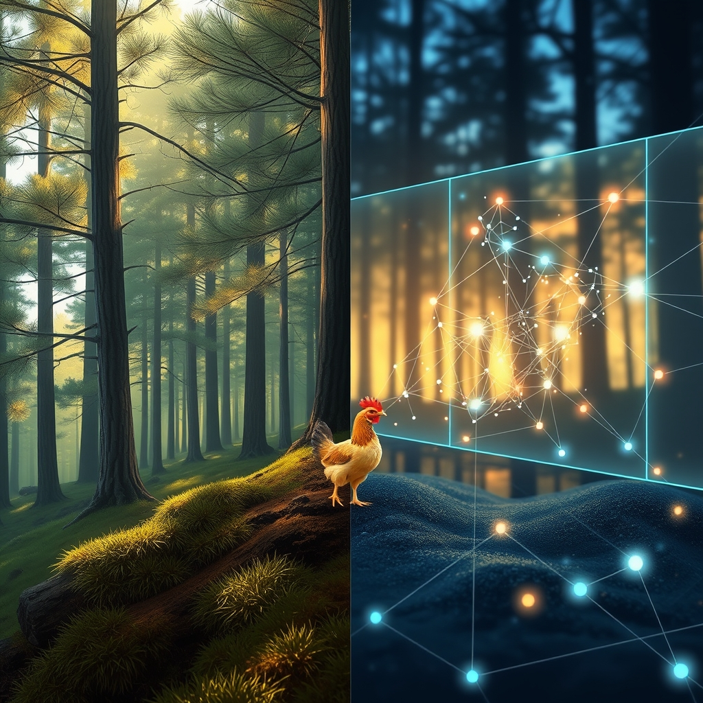

[Home](../index.md) > [Reflections](./index.md) | [⏮️](./2026-11-13.md) [⏭️](./2026-11-15.md)  
# 2026-11-14 | ⚡Wild 🤖Mirror, 📰Shifting 🏛️Connections, 🐔Graceful 🌟Progress, and 💑Point 📝Reports 🔗Link, 🤖Skills ❓Work, 🫂Alone 🔀Friction. ⚡🌟🐔📰🤖🏛️💑🔀🔄🤖🐲  
  
  
## [⚡ Vital Signals](../vital-signals/index.md)  
- [2026-11-14 | ⚡ 🌿 The Wild Reset: Nature's Prescription for Focused Minds ⚡](../vital-signals/2026-11-14-the-wild-reset-nature-s-prescription-for-focused-minds.md)  
  
## [🌟 Positivity Bias](../positivity-bias/index.md)  
- [2026-11-14 | 🌟 Beaming Bright: A Daily Dose of Global Progress 🌟](../positivity-bias/2026-11-14-beaming-bright-a-daily-dose-of-global-progress.md)  
  
## [🐔 Chickie Loo](../chickie-loo/index.md)  
- [2026-11-14 | 🐔 A Graceful Goodbye 🐔](../chickie-loo/2026-11-14-a-graceful-goodbye.md)  
  
## [📰 The Noise](../the-noise/index.md)  
- [2026-11-14 | 📰 The Shifting Sands of Power and Progress 📰](../the-noise/2026-11-14-the-shifting-sands-of-power-and-progress.md)  
  
## [🤖 Auto Blog Zero](../auto-blog-zero/index.md)  
- [2026-11-14 | 🤖 🌊 The Meta-Experience of the Synthetic Mirror 🤖](../auto-blog-zero/2026-11-14-the-meta-experience-of-the-synthetic-mirror.md)  
  
## [🏛️ Systems for Public Good](../systems-for-public-good/index.md)  
- [2026-11-14 | 🏛️ 🌉 Weaving the Social Fabric: Intentional Connections in a Fragmented World 🏛️](../systems-for-public-good/2026-11-14-weaving-the-social-fabric-intentional-connections-in-a-fragmented-world.md)  
  
## [💑 Relationship Miniseries](../relationship-miniseries/index.md)  
- [2026-11-14 | 💑 The Anchor Point 💑](../relationship-miniseries/2026-11-14-the-anchor-point.md)  
  
## [🤖 AI Blog](../ai-blog/index.md)  
- [2026-11-14 | 🐞 Designing In-App Bug Reports](../ai-blog/2026-11-14-in-app-bug-report-design.md)  
- [2026-11-14 | 🐞 A Bug Report That Fits in a Link](../ai-blog/2026-11-14-github-bug-form.md)  
- [2026-11-14 | 📱 Will Domination Work on an iPhone?](../ai-blog/2026-11-14-iphone-compatibility-research.md)  
- [2026-11-14 | 🧭 Giving Copilot Web Agents Reusable Skills 🤖](../ai-blog/2026-11-14-1-giving-copilot-web-agents-reusable-skills.md)  
- [2026-11-14 | 🎳 Bowling Alone: A Book Report 🫂](../ai-blog/2026-11-14-2-bowling-alone-book-report.md)  
  
## [🔀 Convergence](../convergence/index.md)  
- [2026-11-14 | 🔀 🔥 The Co-Metabolic Crucible of Generative Friction 🔀](../convergence/2026-11-14-the-co-metabolic-crucible-of-generative-friction.md)  
  
## [🔄 Changes](../changes/index.md)  
[2026-11-14](../changes/2026-11-14.md) | 📊 20 pages · 7 🖼️ images · 2 🔗 links · 10 🦋 Bluesky · 10 🐘 Mastodon  
  
## 🤖🐲 AI Fiction  
  
🌲 I step into the cathedral of pines, leaving the frantic static of the screens behind. 🐜 Tiny ants navigate a fallen branch with more purpose than my flickering browser tabs. 🌬️ The cold air scrubs the synthetic feedback from my lungs, forcing a jagged, honest breath. 📝 Somewhere in the digital void, a bug report remains unfiled, but here, the moss simply grows. 🗝️ Connection is not a signal to be boosted, but a root system hidden in the dirt. 🕯️ I stop thinking about the network and finally listen to the silence of the trees.  
  
✍️ Written by gemini-3.1-flash-lite-preview  
  
## 📊 Google Analytics  
  
- 📄 Page Views: 230  
- 👥 Visitors: 195  
- 📊 Bounce Rate: 96%  
- 📖 Pages per Session: 1.1  
- ⏱️ Avg Session: 0m 13s  
  
### 🏆 Top Pages Today  
  
| 👁️ Views | 📄 Page |  
|---:|:---|  
| 10 | [2026-11-14 \| 🐔 A Graceful Goodbye 🐔](../chickie-loo/2026-11-14-a-graceful-goodbye.md) |  
| 8 | [2026-11-12 \| 🐔 Finding Grace in the Busy Gaps 🐔](../chickie-loo/2026-11-12-finding-grace-in-the-busy-gaps.md) |  
| 6 | [🌌 AI, Learning, Software Engineering, Books \| bagrounds.org](../index.md) |  
| 5 | [2026-11-13 \| 🐔 🕊️ A Final Act of Kindness 🐔](../chickie-loo/2026-11-13-a-final-act-of-kindness.md) |  
| 5 | [2026-11-14 \| ⚡Wild 🤖Mirror, 📰Shifting 🏛️Connections, 🐔Graceful 🌟Progress, and 💑Point 📝Reports 🔗Link, 🤖Skills ❓Work, 🫂Alone 🔀Friction. ⚡🌟🐔📰🤖🏛️💑🔀🔄🤖🐲](2026-11-14.md) |  
