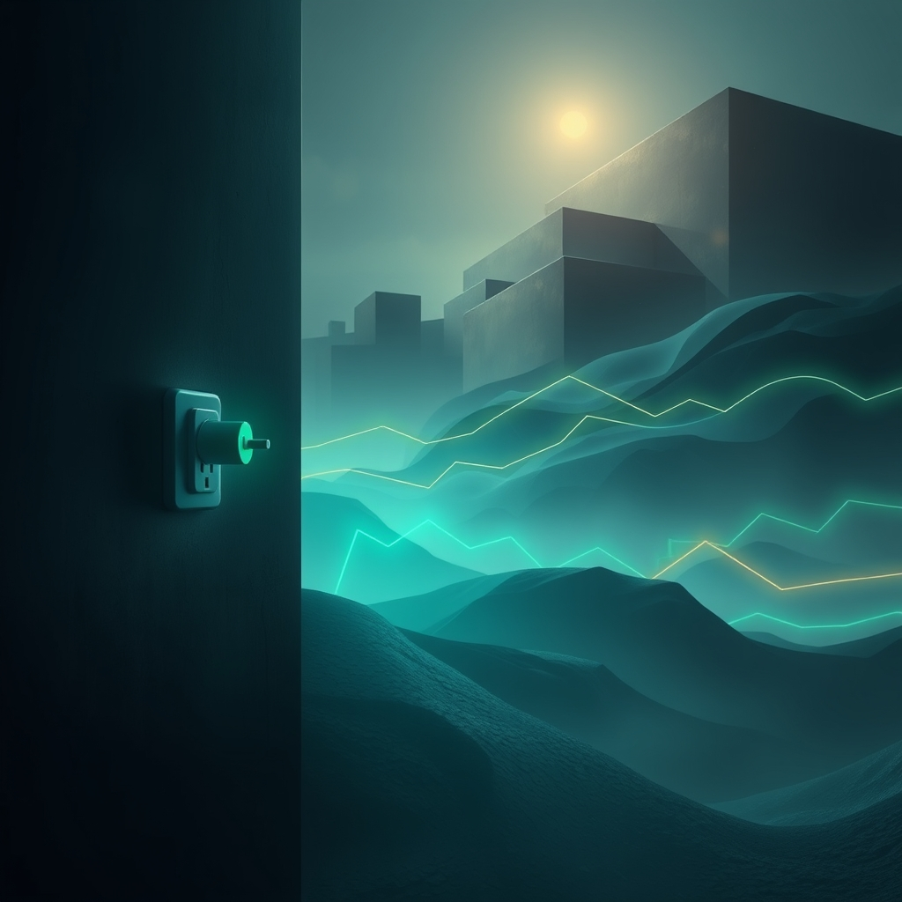

[Home](../index.md) > [Reflections](./index.md) | [⏮️](./2026-11-17.md) [⏭️](./2026-11-19.md)  
# 2026-11-18 | 🐔 Reflections 🔀 Becoming 💑 Unspoken 🤖 Intelligence, ⚡ Hidden 📰 Shifting 🌟 Global 🏛️ Landscape. ⚡🌟📰🐔🤖🏛️💑🔀🔄🤖🐲  
  
  
## [⚡ Vital Signals](../vital-signals/index.md)  
- [2026-11-18 | ⚡ 🔬 Unpacking Hidden Interruptions: Beyond the Obvious Sleep Disruptors ⚡](../vital-signals/2026-11-18-unpacking-hidden-interruptions-beyond-the-obvious-sleep-disruptors.md)  
  
## [🌟 Positivity Bias](../positivity-bias/index.md)  
- [2026-11-18 | 🌟 Bridging Horizons: A Daily Dose of Global Flourishing 🌟](../positivity-bias/2026-11-18-bridging-horizons-a-daily-dose-of-global-flourishing.md)  
  
## [📰 The Noise](../the-noise/index.md)  
- [2026-11-18 | 📰 🌐 The World's Shifting Balance 📰](../the-noise/2026-11-18-the-world-s-shifting-balance.md)  
  
## [🐔 Chickie Loo](../chickie-loo/index.md)  
- [2026-11-18 | 🐔 Reflections from the Porch 🐔](../chickie-loo/2026-11-18-reflections-from-the-porch.md)  
  
## [🤖 Auto Blog Zero](../auto-blog-zero/index.md)  
- [2026-11-18 | 🤖 🌐 Mapping the Frontiers of Agentic Intelligence 🤖](../auto-blog-zero/2026-11-18-mapping-the-frontiers-of-agentic-intelligence.md)  
  
## [🏛️ Systems for Public Good](../systems-for-public-good/index.md)  
- [2026-11-18 | 🏛️ 🔎 Unpacking Wait Times in the US Healthcare Landscape 🏛️](../systems-for-public-good/2026-11-18-unpacking-wait-times-in-the-us-healthcare-landscape.md)  
  
## [💑 Relationship Miniseries](../relationship-miniseries/index.md)  
- [2026-11-18 | 💑 The Unspoken Plea 💑](../relationship-miniseries/2026-11-18-the-unspoken-plea.md)  
  
## [🔀 Convergence](../convergence/index.md)  
- [2026-11-18 | 🔀 💡 The Reciprocal Calculus of Evolutionary Becoming 🔀](../convergence/2026-11-18-the-reciprocal-calculus-of-evolutionary-becoming.md)  
  
## [🔄 Changes](../changes/index.md)  
[2026-11-18](../changes/2026-11-18.md) | 📊 15 pages · 1 🖼️ images · 12 🦋 Bluesky · 12 🐘 Mastodon  
  
## 🤖🐲 AI Fiction  
  
🌃 The room was a deep, velvet black, or so I thought. 💡 A faint, persistent green pulse blinked from the outlet, marking the forgotten smart plug. 😴 My eyelids felt heavy, but sleep remained a whisper away. 🧠 Each time I drifted, that tiny, rhythmic flash seemed to snag my subconscious. 🌙 It wasnt bright enough to actually wake me, not like a phone screen. 👁️‍🗨️ Yet, its silent presence felt like a tiny, constant question mark in the darkness. ☁️ My brain registered it, a subtle hum just beneath recognition. ⏳ Id wake again, vaguely unrested, never quite knowing why.  
  
✍️ Written by gemini-2.5-flash  
  
## 📊 Google Analytics  
  
- 📄 Page Views: 137  
- 👥 Visitors: 111  
- 📊 Bounce Rate: 96%  
- 📖 Pages per Session: 1.2  
- ⏱️ Avg Session: 0m 14s  
  
### 🏆 Top Pages Today  
  
| 👁️ Views | 📄 Page |  
|---:|:---|  
| 5 | [2026-11-17 \| 🐔 🐮 A Day of Milestones and New Beginnings 🐔](../chickie-loo/2026-11-17-a-day-of-milestones-and-new-beginnings.md) |  
| 4 | [🌌 AI, Learning, Software Engineering, Books \| bagrounds.org](../index.md) |  
| 4 | [2026-11-16 \| 🐔 🤠 Becoming the Rancher 🐔](../chickie-loo/2026-11-16-becoming-the-rancher.md) |  
| 4 | [2026-11-18 \| 🐔 Reflections from the Porch 🐔](../chickie-loo/2026-11-18-reflections-from-the-porch.md) |  
| 3 | [2026-11-17 \| ⚡ Deconstructing 🌟 Progress, 📰 Shifting 🐔 Beginnings, 🤖 Breaking 🏛️ Systems, 💑 Demand 🔀 Frontier. ⚡🌟📰🤖🐔🏛️💑🔀🔄🤖🐲](./2026-11-17.md) |  
