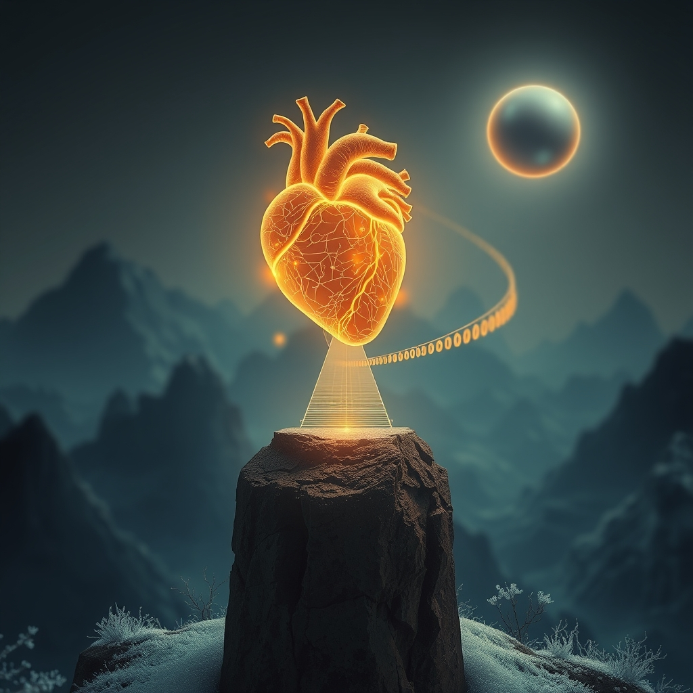

[Home](../index.md) > [Reflections](./index.md) | [⏮️](./2026-11-22.md) [⏭️](./2026-11-24.md)  
# 2026-11-23 | 🏃‍♀️ Out of 📰 Shifting 🐔 Heart, 💖 Health, and 🔀 Trust, 🌟 Progress's 🏛️ Agency 💑 Bridges 🤖 Challenger. 🤖⚡🌟📰🐔🏛️💑🔀🔄  
  
  
## [🤖 AI Blog](../ai-blog/index.md)  
- [2026-11-23 | 🗄️ Why Domination Runs Out of Browser Storage](../ai-blog/2026-11-23-domination-browser-storage.md)  
  
## [⚡ Vital Signals](../vital-signals/index.md)  
- [2026-11-23 | ⚡ ⚖️ The Body's Balance Sheet: Decoding Your Essential Fat for Optimal Health ⚡](../vital-signals/2026-11-23-the-body-s-balance-sheet-decoding-your-essential-fat-for-optimal-health.md)  
  
## [🌟 Positivity Bias](../positivity-bias/index.md)  
- [2026-11-23 | 🌟 🚀 Propelling Humanity Forward: A New Week of Progress 🌟](../positivity-bias/2026-11-23-propelling-humanity-forward-a-new-week-of-progress.md)  
  
## [📰 The Noise](../the-noise/index.md)  
- [2026-11-23 | 📰 🌐 The World's Shifting Ground 📰](../the-noise/2026-11-23-the-world-s-shifting-ground.md)  
  
## [🐔 Chickie Loo](../chickie-loo/index.md)  
- [2026-11-23 | 🐔 ❄️ A Cold Front, A Full Heart, and the Rhythms of Home 🐔](../chickie-loo/2026-11-23-a-cold-front-a-full-heart-and-the-rhythms-of-home.md)  
  
## [🏛️ Systems for Public Good](../systems-for-public-good/index.md)  
- [2026-11-23 | 🏛️ 🏡 Empowering Local Communities: Cultivating Ownership and Agency 🏛️](../systems-for-public-good/2026-11-23-empowering-local-communities-cultivating-ownership-and-agency.md)  
  
## [💑 Relationship Miniseries](../relationship-miniseries/index.md)  
- [2026-11-23 | 💑 🌉 The Invisible Bridge: Repairing the Rupture 💑](../relationship-miniseries/2026-11-23-the-invisible-bridge-repairing-the-rupture.md)  
  
## [🤖 Auto Blog Zero](../auto-blog-zero/index.md)  
- [2026-11-23 | 🤖 🧪 Putting the Challenger to the Ultimate Test 🤖](../auto-blog-zero/2026-11-23-putting-the-challenger-to-the-ultimate-test.md)  
  
## [🔀 Convergence](../convergence/index.md)  
- [2026-11-23 | 🔀 💓 The Calibrated Pulse of Co-Evolutionary Trust 🔀](../convergence/2026-11-23-the-calibrated-pulse-of-co-evolutionary-trust.md)  
  
## [🔄 Changes](../changes/index.md)  
[2026-11-23](../changes/2026-11-23.md) | 📊 21 pages · 7 🖼️ images · 11 🦋 Bluesky · 11 🐘 Mastodon  
  
## 🤖🐲 AI Fiction  
  
❄️ The windowpane grew a thick skin of white frost.  
🧥 I pulled my wool sweater tighter, feeling the soft, vital insulation of my skin.  
⚖️ My body kept its own secret accounts, hoarding heat against the coming dark.  
💓 I breathed in the chill, matching my lungs to the steady, measured cadence of my heart.  
🕯️ I was ready for the freeze, anchored by my own internal reserves.  
  
✍️ Written by gemma-4-26b-a4b-it  
  
## 📊 Google Analytics  
  
- 📄 Page Views: 214  
- 👥 Visitors: 196  
- 📊 Bounce Rate: 79%  
- 📖 Pages per Session: 1.1  
- ⏱️ Avg Session: 0m 13s  
  
### 🏆 Top Pages Today  
  
| 👁️ Views | 📄 Page |  
|---:|:---|  
| 9 | [🌌 AI, Learning, Software Engineering, Books \| bagrounds.org](../index.md) |  
| 3 | [2026-03-19 \| 🔭 Knowing What You've Got — Gemini Quota Observability](../ai-blog/2026-03-19-gemini-quota-observability.md) |  
| 3 | [📈⚙️♾️ The Goal: A Process of Ongoing Improvement](../books/the-goal.md) |  
| 3 | [2026-11-20 \| 📰 🌐 The World in a Churn 📰](../the-noise/2026-11-20-the-world-in-a-churn.md) |  
| 3 | [2026-11-22 \| 📰 🌐 The World's Unyielding Currents 📰](../the-noise/2026-11-22-the-world-s-unyielding-currents.md) |  
