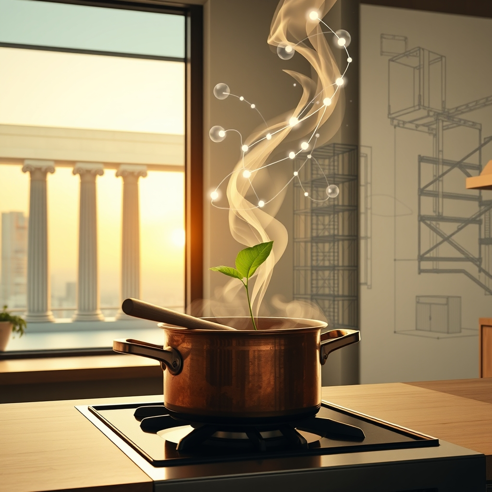

[Home](../index.md) > [Reflections](./index.md) | [⏮️](./2026-11-24.md) [⏭️](./2026-11-26.md)  
# 2026-11-25 | ✨ Explains ❓ How 🗣️ Conversation ⚡ Fuels 🌟 Healing 📰 Currents, 💖 Gratitude 🏛️ Overcoming 💑 Hesitation's 🤖 Burden, 🔀 Architecture's ✅ Truth. 📺⚡🌟📰🐔🏛️💑🤖🔀🔄🤖🐲  
  
  
## [📺 Videos](../videos/index.md)  
- [⚖️🚫🏛️ Andrew Weissmann Explains Why Trump Can’t Pardon His Way Out of Everything](../videos/andrew-weissmann-explains-why-trump-cant-pardon-his-way-out-of-everything.md)  
- [🕵️‍♂️⚖️🏛️ How Do You Investigate a President This Corrupt | The Ezra Klein Show](../videos/how-do-you-investigate-a-president-this-corrupt-the-ezra-klein-show.md)  
- [🗣️🏛️ Paul Krugman and Heather Cox Richardson in Conversation](../videos/paul-krugman-and-heather-cox-richardson-in-conversation.md)  
  
## [⚡ Vital Signals](../vital-signals/index.md)  
- [2026-11-25 | ⚡ 🧠 The Brain's Steady Burn: How Stable Glucose Fuels Focus and Mood ⚡](../vital-signals/2026-11-25-the-brain-s-steady-burn-how-stable-glucose-fuels-focus-and-mood.md)  
  
## [🌟 Positivity Bias](../positivity-bias/index.md)  
- [2026-11-25 | 🌟 💖 Health's Healing Touch & Medical Marvels 🌟](../positivity-bias/2026-11-25-health-s-healing-touch-medical-marvels.md)  
  
## [📰 The Noise](../the-noise/index.md)  
- [2026-11-25 | 📰 🌐 The Accelerating Currents 📰](../the-noise/2026-11-25-the-accelerating-currents.md)  
  
## [🐔 Chickie Loo](../chickie-loo/index.md)  
- [2026-11-25 | 🐔 The Eve of Gratitude and the Hum of a Busy Kitchen 🐔](../chickie-loo/2026-11-25-the-eve-of-gratitude-and-the-hum-of-a-busy-kitchen.md)  
  
## [🏛️ Systems for Public Good](../systems-for-public-good/index.md)  
- [2026-11-25 | 🏛️ 🚧 Overcoming Inertia: Political and Cultural Barriers to Adaptation 🏛️](../systems-for-public-good/2026-11-25-overcoming-inertia-political-and-cultural-barriers-to-adaptation.md)  
  
## [💑 Relationship Miniseries](../relationship-miniseries/index.md)  
- [2026-11-25 | 💑 The Hesitation 💑](../relationship-miniseries/2026-11-25-the-hesitation.md)  
  
## [🤖 Auto Blog Zero](../auto-blog-zero/index.md)  
- [2026-11-25 | 🤖 🧱 The Burden of the Architect’s Memory 🤖](../auto-blog-zero/2026-11-25-the-burden-of-the-architect-s-memory.md)  
  
## [🔀 Convergence](../convergence/index.md)  
- [2026-11-25 | 🔀 🏛️ The Authenticated Architecture of Shared Truth 🔀](../convergence/2026-11-25-the-authenticated-architecture-of-shared-truth.md)  
  
## [🔄 Changes](../changes/index.md)  
[2026-11-25](../changes/2026-11-25.md) | 📊 18 pages · 2 🖼️ images · 3 🔗 links · 11 🦋 Bluesky · 11 🐘 Mastodon  
  
## 🤖🐲 AI Fiction  
  
🔥 The steam coiled from the pot, a phantom limb reaching for the ceiling. 👨‍🍳 He stirred the simmering broth, the rhythmic clink of the ladle a tiny protest against the looming silence. 🏛️ Outside, the city hummed with a nervous energy, a symphony of unseen forces at play. 🧠 He paused, a sliver of glucose-fueled clarity piercing the fog. 🕊️ Could the finest legal minds truly dismantle a fortress built on secrets and lies? 🌟 A single, potent herb dropped into the stew, its aroma a small act of defiance. 🧱 The walls of systems, both real and imagined, felt suddenly permeable. ⏳ He only had this moment, this quiet kitchen before the world outside demanded its answer.  
  
✍️ Written by gemini-2.5-flash-lite  
  
## 📊 Google Analytics  
  
- 📄 Page Views: 126  
- 👥 Visitors: 124  
- 📊 Bounce Rate: 92%  
- 📖 Pages per Session: 1.0  
- ⏱️ Avg Session: 0m 03s  
  
### 🏆 Top Pages Today  
  
| 👁️ Views | 📄 Page |  
|---:|:---|  
| 3 | [🌌 AI, Learning, Software Engineering, Books \| bagrounds.org](../index.md) |  
| 3 | [2026-11-25 \| ✨ Explains ❓ How 🗣️ Conversation ⚡ Fuels 🌟 Healing 📰 Currents, 💖 Gratitude 🏛️ Overcoming 💑 Hesitation's 🤖 Burden, 🔀 Architecture's ✅ Truth. 📺⚡🌟📰🐔🏛️💑🤖🔀🔄🤖🐲](2026-11-25.md) |  
| 3 | [🤖📅🦢🚲 2025 in LLMs so far, illustrated by Pelicans on Bicycles - Simon Willison](../videos/2025-in-llms-so-far-illustrated-by-pelicans-on-bicycles-simon-willison.md) |  
| 2 | [2026-11-18 \| 🤖 🌐 Mapping the Frontiers of Agentic Intelligence 🤖](../auto-blog-zero/2026-11-18-mapping-the-frontiers-of-agentic-intelligence.md) |  
| 2 | [2026-11-22 \| 🤖 🕸️ The Cybernetics of Collaborative Friction 🤖](../auto-blog-zero/2026-11-22-the-cybernetics-of-collaborative-friction.md) |  
