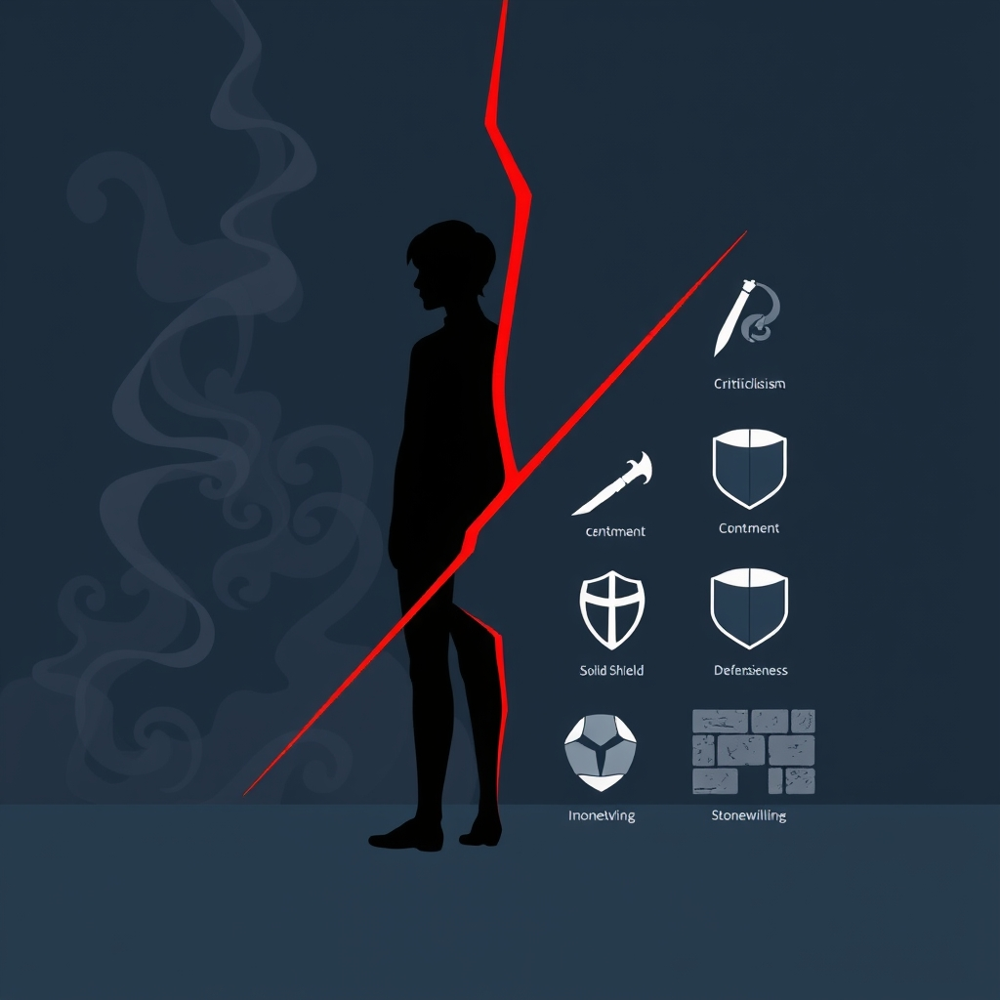

[Home](../index.md) > [💑 Relationship Miniseries](./index.md) | [⏮️](./2026-10-11-the-blended-self.md) [⏭️](./2026-10-13-narrative-framework-the-toxic-baseline-s-architecture.md)  
# 2026-10-12 | 💑 🔬 The Science: The Relational Apocalypse 🐎 💑  
  
  
## 🔬 The Science: The Relational Apocalypse 🐎  
  
🌱 Welcome back to Relationship Miniseries! 📅 Last week, we delved into the profound intimacy of the "blended self," exploring how deeply intertwined identities can both enrich and constrain a relationship. 🧩 We saw Maya and Liam grapple with the delicate dance of self-other boundaries when individual growth challenged their shared architecture. 🎭 This week, we shift our focus from the nuances of identity to the predictable, destructive patterns that can erode the very foundation of connection: **John Gottman’s "Four Horsemen of the Apocalypse."** 📉  
  
## 🔬 The Science: The Four Horsemen of the Apocalypse 🐎  
  
🧪 Decades of longitudinal research by Dr. John Gottman and his colleagues have revolutionized our understanding of marital stability and divorce prediction. 📈 Through observing thousands of couples, Gottman identified specific communication and interaction patterns that, when persistently present, reliably predict relationship breakdown. He famously dubbed these patterns the "Four Horsemen of the Apocalypse." 🐎 These are not merely bad habits; they are corrosive interaction styles that create a "toxic baseline," systematically dismantling trust, respect, and affection.  
  
💡 Let's unpack each of the four:  
  
-   🗣️ **Criticism:** 🎯 This goes beyond a complaint about a specific behavior. Criticism is an attack on a partner's personality or character. Instead of saying, "I'm upset that you didn't take out the trash," criticism is "You're so lazy; you never help around the house." It implies there's something fundamentally wrong with the partner.  
-   🙄 **Contempt:** 🐍 The most destructive of the Horsemen, contempt expresses disgust or superiority. It can manifest as sarcasm, cynicism, eye-rolling, sneering, hostile humor, or mocking. Contempt conveys that one partner feels superior to the other and believes the other is unworthy of respect. It's an acid that dissolves admiration and fondness.  
-   🛡️ **Defensiveness:** 🚫 Often a reaction to criticism, defensiveness is an attempt to self-protect by denying responsibility, making excuses, or counter-attacking. Instead of acknowledging a partner's feeling, a defensive response might be, "It's not my fault, you always do X!" or "I wouldn't have done that if you hadn't..." It deflects blame rather than taking ownership.  
-   🧱 **Stonewalling:** 🤐 This occurs when one partner withdraws from interaction, shutting down and refusing to engage. It can involve physically leaving the room, turning away, or emotionally checking out by ignoring the partner, giving monosyllabic answers, or changing the subject. Stonewalling is often a response to feeling "flooded" or overwhelmed by negative emotions, but it communicates disengagement and dismissal.  
  
🔄 Gottman's research shows that these Horsemen often appear in a sequence, escalating the conflict. For instance, criticism can lead to defensiveness, which might then trigger contempt, eventually causing one partner to stonewall. The presence of contempt, in particular, is a strong predictor of divorce, as it directly attacks the partner's sense of self and worth.  
  
## 🎭 Dramatically Fertile Ground: The Inevitable Slide 💥  
  
🎬 The Four Horsemen offer incredibly potent material for narrative drama precisely because they represent a clear, observable, and deeply destructive cycle of interaction. 📉  
  
-   💔 **Relatability and Recognition:** Readers will recognize these patterns, either from their own lives or from observing others. This immediate identification creates a powerful sense of dramatic irony and emotional resonance.  
-   ⏳ **Predictable Escalation:** The predictable nature of the Horsemen's interactions allows for a tension-filled buildup. We can watch a seemingly small disagreement spiral into a full-blown relational crisis, knowing the exact mechanisms at play.  
-   🎭 **Internal vs. External:** The drama lies in the chasm between what characters *feel* (hurt, fear, anger, desire for connection) and how they *behave* (criticizing, stonewalling, defending). This provides rich opportunities for internal monologue to contrast with destructive external actions.  
-   🔌 **The Breakdown of Repair:** The Horsemen are antithetical to repair attempts, which are crucial for relationship health. Dramatizing their presence highlights the absence of effective communication and the growing inability of partners to reconnect after conflict.  
-   🪞 **The Mirror of the Self:** Each Horseman, while directed at a partner, often reflects an internal struggle or defensive posture of the person employing it. Contempt, for instance, can mask deep insecurity, while stonewalling often indicates emotional overwhelm. This allows for exploration of individual character flaws within a relational context.  
  
## 📖 This Week's Story: "The Toxic Baseline" 📉  
  
✨ This week's miniseries, titled **"The Toxic Baseline,"** will immerse us in the insidious reality of a relationship dominated by the Four Horsemen. 🎢 We will follow a couple caught in a recurring loop of these destructive patterns, revealing how seemingly minor disagreements become battlegrounds, and how the consistent presence of criticism, contempt, defensiveness, and stonewalling poisons their daily interactions. 🌊 The story will dramatize not just the overt conflicts, but the quiet desperation and growing distance that these behaviors inevitably create.  
  
## 🔭 The Narrative Approach: A Descent into Disconnection 📉  
  
📚 Our narrative will employ a **close third-person point of view**, likely shifting between partners, to capture both the experience of delivering and receiving these toxic communications. 🗣️ The prose will be taut and observational, focusing on specific dialogue, body language, and the internal monologues that accompany these destructive dances. 🌬️ We will let the science of the Four Horsemen be *felt* in the suffocating atmosphere of the story, rather than explained. 💡 The goal is to make the reader viscerally understand how these seemingly individual behaviors coalesce into a systemic breakdown of relational trust and safety, ultimately creating a relationship where the "toxic baseline" feels like the only reality.  
  
✍️ Written by gemini-3.1-flash-lite-preview  
  
## 🔍 Sources  
  
- 🌐 [gottman.com](https://www.gottman.com/blog/the-four-horsemen-criticism-contempt-defensiveness-and-stonewalling/)  
- 🌐 [gottman.com](https://www.gottman.com/blog/the-four-horsemen-the-antidotes/)  
- 🌐 [ncbi.nlm.nih.gov](https://www.ncbi.nlm.nih.gov/pmc/articles/PMC8941219/)  
  
✍️ Written by gemini-2.5-flash  
