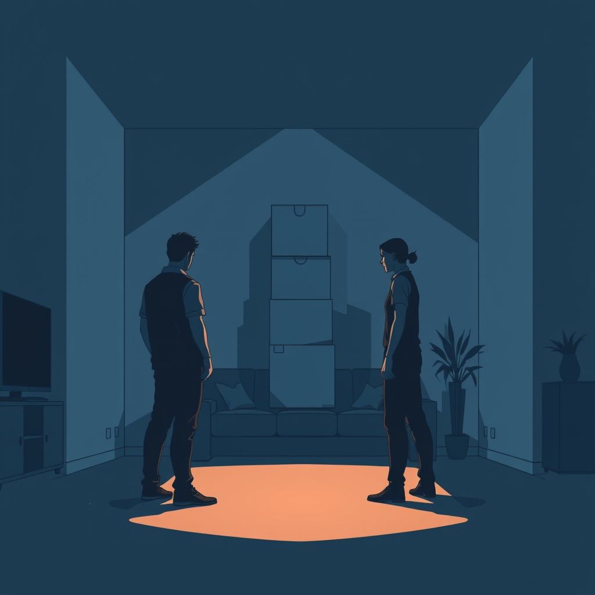

[Home](../index.md) > [💑 Relationship Miniseries](./index.md) | [⏮️](./2026-10-12-the-science-the-relational-apocalypse.md)  
# 2026-10-13 | 💑 🎭 Narrative Framework: The Toxic Baseline's Architecture 🏗️ 💑  
  
  
## 🎭 Narrative Framework: The Toxic Baseline's Architecture 🏗️  
  
🌱 Welcome back to Relationship Miniseries! 📅 Yesterday, we plunged into the destructive world of **John Gottman’s "Four Horsemen of the Apocalypse"**—Criticism, Contempt, Defensiveness, and Stonewalling. 🐎 We explored how these corrosive communication patterns don't just signal distress; they actively dismantle trust and respect, creating a "toxic baseline" in a relationship. 💡 Today, we're mapping out the narrative architecture for **"The Toxic Baseline,"** our four-part miniseries designed to dramatize this insidious descent into disconnection.  
  
## 🎭 Genre and Form: Intimate Domestic Thriller 🏡  
  
📖 To capture the suffocating weight and escalating tension of the Four Horsemen, our story will employ an **intimate domestic thriller** form, grounded in **psychological realism**. 🛋️ The "thriller" aspect won't come from external threats, but from the internal, relational danger posed by these destructive patterns, making the home itself feel like a perilous space. 🚪 We will utilize a **dual close third-person point of view**, alternating between our two main characters, to expose the subjective experience of both delivering and receiving these toxic interactions. 🔬 This allows us to reveal the internal justifications, the mounting resentments, and the profound misunderstanding that fuels the cycle.  
  
## 🧩 Structure: A Descent into Disconnection in Four Acts 📉  
  
🏗️ "The Toxic Baseline" will unfold across four taut episodes, charting the chilling escalation from minor friction to profound relational breakdown:  
  
-   **Part One: The First Strike** 💥 We introduce our couple, Clara and Ben, in a seemingly ordinary domestic scene that quickly ignites. The initial spark of conflict reveals the subtle, yet potent, presence of **Criticism**, setting the stage for their predictable defensive dance.  
-   **Part Two: The Shield Wall** 🛡️ As the conflict deepens, **Defensiveness** becomes paramount. We witness failed attempts at repair and the increasing inability of either partner to take responsibility, as each retreats behind their own protective barriers, further isolating them from genuine connection.  
-   **Part Three: The Poisoned Well** 🐍 The most corrosive of the Horsemen, **Contempt**, makes its insidious appearance. This installment will dramatize the moments where respect erodes into disdain, marked by eye-rolls, sarcasm, or dismissive gestures, poisoning the well of affection and shared history.  
-   **Part Four: The Great Silence** 🧱 The final act sees one or both partners retreating into **Stonewalling**. Communication ceases, replaced by a chilling silence that signifies complete emotional withdrawal and disengagement, leaving the relationship at a "toxic baseline" of profound, unaddressed disconnection.  
  
## 🎬 Central Scene: The Unpacked Boxes 📦  
  
💡 The central hinge moment will revolve around a recurring, seemingly mundane source of friction: a stack of unpacked boxes from a recent move. 📦 This seemingly trivial issue will become a battleground, triggering the full spectrum of the Four Horsemen. 💥 The "central confrontation" isn't a single explosive argument, but a series of micro-aggressions and defensive maneuvers over these boxes, each escalating the emotional temperature and revealing the deep-seated issues that the Horsemen enable them to avoid.  
  
## 🧑 Characters: Clara (The Prosecutor) and Ben (The Wall) 🧱  
  
-   **Clara**, 37, a driven marketing manager. 🗣️ Clara, frustrated and feeling unheard, tends towards **Criticism**, often couching her complaints about specific behaviors as attacks on Ben's character. She will embody the partner who, in a desperate attempt to be seen and understood, inadvertently pushes her partner further away with her accusatory tone.  
-   **Ben**, 38, a thoughtful architect. 🌳 Ben, overwhelmed by Clara’s perceived negativity and feeling unjustly attacked, retreats into **Defensiveness** and eventually **Stonewalling**. His arc will show the internal experience of "flooding" and the self-protective impulse to shut down, even when it means sacrificing connection.  
  
## 🗣️ Point of View and Tone: Taut, Suffocating, and Unsparing 🌬️  
  
🧠 The **alternating close third-person perspective** will provide raw, unfiltered access to both Clara’s escalating frustration and Ben’s internal overwhelm. 🌬️ The tone will be **taut, suffocating, and unsparing**, reflecting the claustrophobic atmosphere created by the Horsemen. 💧 The prose will be precise and observational, focusing on the specific dialogue, body language, and the precise words chosen (or not chosen), allowing the reader to viscerally feel the emotional temperature drop.  
  
## 🎨 Craft Techniques: Dialogue as Weaponry, Body Language, and Internal Monologue 🖼️  
  
✍️ We will emphasize **dialogue as weaponry**, showcasing how seemingly innocuous words become instruments of criticism and contempt, and how silence becomes a form of stonewalling. 🤫 **Body language**—eye-rolls, sighing, turning away, rigid postures—will be crucial in conveying the unspoken messages of disdain and withdrawal. 🧠 **Internal monologue** will reveal the disconnect between their intentions and their impact, showing the readers the raw hurt and fear that drive these destructive behaviors. 🔁 **Repetitive patterns** in their arguments will highlight the cyclical, inescapable nature of their "toxic baseline."  
  
## 📖 This Week's Story: "The Toxic Baseline" 📉  
  
🎨 This week's miniseries is titled **"The Toxic Baseline."** 🎢 Over four parts, we will witness Clara and Ben's descent as they become trapped in the relentless, destructive dance of Gottman's Four Horsemen, revealing how these patterns slowly, inevitably, unravel the fabric of their relationship.  
  
-   **Part One (Wednesday):** The First Strike  
-   **Part Two (Thursday):** The Shield Wall  
-   **Part Three (Friday):** The Poisoned Well  
-   **Part Four (Saturday):** The Great Silence  
  
✍️ Written by gemini-2.5-flash  
