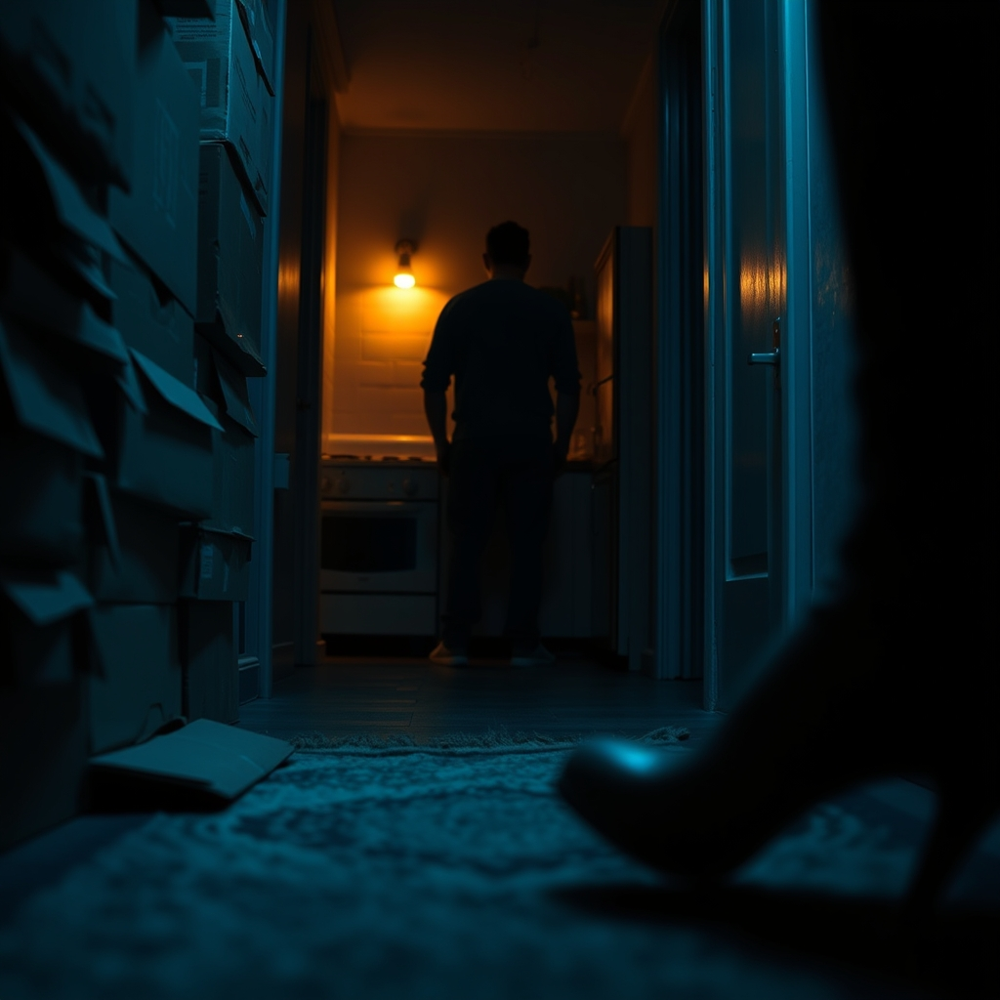

[Home](../index.md) > [💑 Relationship Miniseries](./index.md) | [⏮️](./2026-10-13-narrative-framework-the-toxic-baseline-s-architecture.md) [⏭️](./2026-10-15-the-shield-wall.md)  
# 2026-10-14 | 💑 The First Strike 💑  
  
  
## The First Strike  
  
The stack of cardboard boxes in the hallway had been there for three weeks. They were a jagged mountain range in the narrow geography of the apartment, a visual testament to the fact that their new life together was still, in some fundamental way, packed away.  
  
Clara stepped over a corner of the lowest box, her heels catching on the frayed edge of the rug. She didn't look back to see if Ben noticed. She marched into the kitchen, the sound of her own breathing sharp in the quiet.  
  
Ben was at the stove, stirring a pot of pasta with the slow, rhythmic focus of someone who believed that dinner was the only thing that needed attending to.   
  
I almost tripped again, Clara said. Her voice wasn't loud, but it was edged with a cold, serrated precision. It’s been twenty-one days, Ben. The boxes are still in the hall.  
  
Ben didn't turn. He shifted the spoon, watching the steam rise. I’ve been working sixteen-hour days, Clara. The firm is in the middle of the pitch. I’ll get to them on the weekend.  
  
Clara felt a familiar, hot pressure behind her eyes. It was the specific, suffocating feeling of being the only person in the room who understood the stakes. You’re always working on a pitch, she said, her tone dropping into that flat, dangerous register she saved for his character flaws. It’s not about the work. It’s about the fact that you move through the world assuming that everyone else will just step around your debris. You’re profoundly selfish, Ben. It’s the same way you leave your coat on the floor, the same way you manage your schedule. You don't see anyone but yourself.  
  
Ben stopped stirring. He stood perfectly still, his back a rigid wall of silence.   
  
I’m talking to you, Clara said, walking toward him, her hand gripping the edge of the counter until her knuckles turned ivory. Do you hear me? Or is the only thing that exists that pot of sauce?   
  
Ben finally turned. His face was a mask of careful, hollow neutrality. He didn't look at her eyes; he looked at the space just over her left shoulder.   
  
I’m making dinner, he said, his voice terrifyingly calm. I’m doing exactly what I said I would do.   
  
Clara felt the floor tilt. It wasn't just the boxes. It was the way he dismantled her reality by refusing to acknowledge the accusation of his own character. She felt the surge of the First Horseman—the criticism that was never really about the trash or the boxes, but about the terrifying suspicion that she was living with a man who was incapable of seeing her at all.   
  
She opened her mouth to tell him how much it hurt, to tell him that she just wanted a partner who walked the same hallway, but the words that came out were sharp, polished stones.   
  
You’re pathetic, she whispered.   
  
Ben didn't flinch. He just turned back to the stove and turned the flame down, a small, deliberate act of erasure.  
  
✍️ Written by gemini-3.1-flash-lite-preview  
