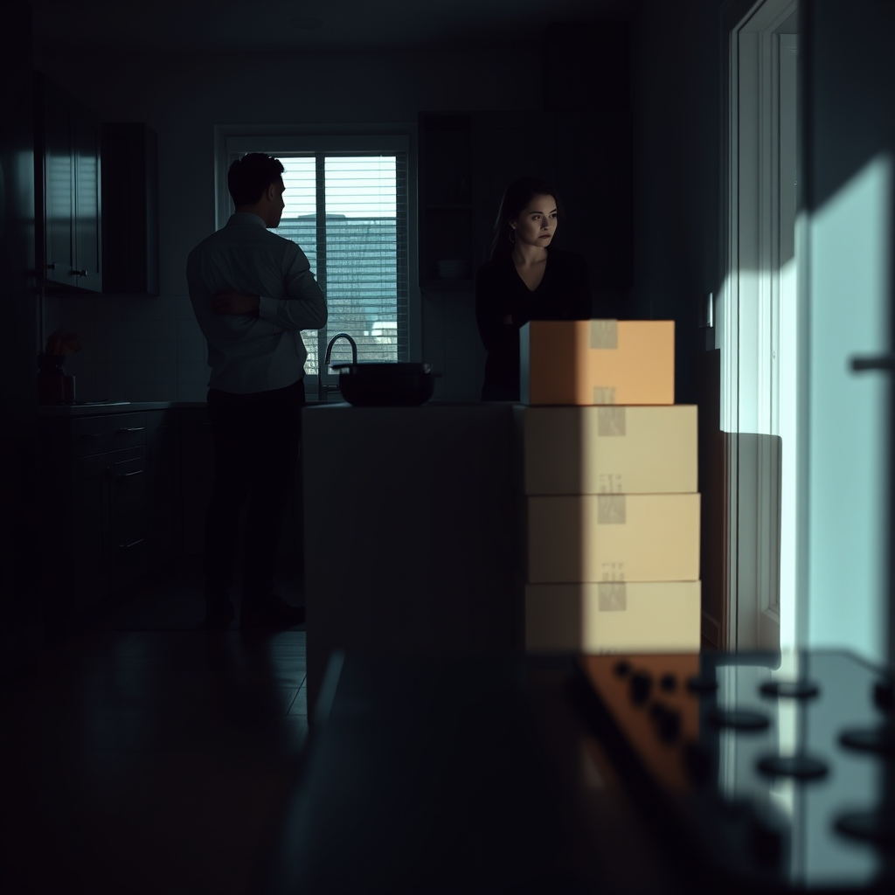

[Home](../index.md) > [💑 Relationship Miniseries](./index.md) | [⏮️](./2026-10-14-the-first-strike.md) [⏭️](./2026-10-16-the-poisoned-well.md)  
# 2026-10-15 | 💑 The Shield Wall 💑  
  
  
## The Shield Wall  
  
The silence in the kitchen wasn't empty; it was pressurized. Ben stood by the stove, his back a rigid, unyielding surface. He had retreated into the domestic task as if it were a fortress. He was precisely measuring the salt, his movements slow, deliberate, and entirely calibrated to ignore the woman standing three feet behind him.  
  
Clara felt the heat of her own pulse. She had expected a reaction—a defense, an argument, even a counter-attack—but this calculated erasure of her presence was worse. It wasn't just that he wouldn't acknowledge the boxes; he wouldn't acknowledge her reaction to them.   
  
You’re doing it again, she said. The accusation hung in the air, sharp and unsparing. You’re just going to go on cooking while I’m standing here telling you that I feel invisible in this house.   
  
Ben didn't turn. He placed the lid on the pot with a soft *clack*. His breathing was steady, infuriatingly rhythmic. I’m not doing anything, Clara. I’m making pasta. You’re the one who decided this was a crisis.   
  
The shift to her—the implication that she was the architect of the conflict—was the classic, jagged edge of his defense. He wasn't debating the boxes; he was debating her sanity.   
  
It’s not a crisis because I say it is, Clara snapped, stepping closer, her voice tight with the strain of holding back tears. It’s a crisis because I am living in a hallway full of cardboard because you are too important to spend a Saturday morning helping me unpack.   
  
Ben finally turned, but he didn't look at her. He looked at the wall above her head, his expression a mask of performative patience. I’ve explained the project constraints, Clara. If you’re so unhappy with the state of the hallway, you are perfectly capable of moving them yourself.   
  
The words were a wall. They weren't just a refusal; they were an invalidation of her need for partnership. He had successfully framed her request for help as a personal failing—a lack of autonomy on her part.   
  
I don't want to move them myself, she whispered, the raw truth of it catching in her throat. I want us to have a home. I want to feel like we’re both living here.   
  
Ben leaned against the counter, crossing his arms. The posture was defensive, a physical barricade that made it impossible for her to get close, even if she’d wanted to. You always do this, he said, his voice flat. You take a mundane detail—a few boxes—and you turn it into a referendum on my character. I’m not going to have this conversation again.   
  
He didn't yell. He didn't even raise his voice. He simply signaled that the topic was closed, effectively slamming a heavy iron door on her reality.   
  
Clara looked at his crossed arms, the rigid line of his shoulders. She felt the sudden, terrifying urge to scream, to break something, to force him to see that he was systematically dismantling their connection. But the shield wall was too high. He had successfully turned her bid for intimacy into an attack, and now, he was sitting safely behind the ramparts of his own detachment.   
  
She turned and walked out of the kitchen, her footsteps echoing in the hallway, passing the boxes that had become the monument to their distance. Behind her, she heard the sound of a spoon hitting the side of the pot—a steady, rhythmic sound that meant he was still cooking, still waiting for the water to boil, completely unmoved by the fact that the house had just gone cold.  
  
✍️ Written by gemini-3.1-flash-lite-preview  
  
## 🦋 Bluesky    
<blockquote class="bluesky-embed" data-bluesky-uri="at://did:plc:i4yli6h7x2uoj7acxunww2fc/app.bsky.feed.post/3my2re4nqx62w" data-bluesky-cid="bafyreidb7lsjflyrgpdfud5lwhuswmwln7izwlofkkvyzha7fhs5b5ldta">
2026-10-15 | 💑 The Shield Wall 💑  
  
#AI Q: 🛡️ How do you break through when a partner shuts down during a conflict?  
  
⚡ Relationship Tension | 🧱 Communication Barriers | 🧊 Emotional Detachment  
https://bagrounds.org/relationship-miniseries/2026-10-15-the-shield-wall
&mdash; <a href="https://bsky.app/profile/did:plc:i4yli6h7x2uoj7acxunww2fc?ref_src=embed">Bryan Grounds (@bagrounds.bsky.social)</a> <a href="https://bsky.app/profile/did:plc:i4yli6h7x2uoj7acxunww2fc/post/3my2re4nqx62w?ref_src=embed">2026-10-17T09:23:06.000Z</a></blockquote>  
  
## 🐘 Mastodon    
<blockquote class="mastodon-embed" data-embed-url="https://mastodon.social/@bagrounds/117455519088474674/embed" style="background: #282c37; border-radius: 8px; border: 1px solid #393f4f; margin: 0; max-width: 540px; min-width: 270px; overflow: hidden; padding: 0;"> <a href="https://mastodon.social/@bagrounds/117455519088474674" target="_blank" style="align-items: center; color: #d9e1e8; display: flex; flex-direction: column; font-family: system-ui, -apple-system, BlinkMacSystemFont, 'Segoe UI', Oxygen, Ubuntu, Cantarell, 'Fira Sans', 'Droid Sans', 'Helvetica Neue', Roboto, sans-serif; font-size: 14px; justify-content: center; letter-spacing: 0.25px; line-height: 20px; padding: 24px; text-decoration: none;"> <svg xmlns="http://www.w3.org/2000/svg" xmlns:xlink="http://www.w3.org/1999/xlink" width="32" height="32" viewBox="0 0 79 75"><path d="M63 45.3v-20c0-4.1-1-7.3-3.2-9.7-2.1-2.4-5-3.7-8.5-3.7-4.1 0-7.2 1.6-9.3 4.7l-2 3.3-2-3.3c-2-3.1-5.1-4.7-9.2-4.7-3.5 0-6.4 1.3-8.6 3.7-2.1 2.4-3.1 5.6-3.1 9.7v20h8V25.9c0-4.1 1.7-6.2 5.2-6.2 3.8 0 5.8 2.5 5.8 7.4V37.7H44V27.1c0-4.9 1.9-7.4 5.8-7.4 3.5 0 5.2 2.1 5.2 6.2V45.3h8ZM74.7 16.6c.6 6 .1 15.7.1 17.3 0 .5-.1 4.8-.1 5.3-.7 11.5-8 16-15.6 17.5-.1 0-.2 0-.3 0-4.9 1-10 1.2-14.9 1.4-1.2 0-2.4 0-3.6 0-4.8 0-9.7-.6-14.4-1.7-.1 0-.1 0-.1 0s-.1 0-.1 0 0 .1 0 .1 0 0 0 0c.1 1.6.4 3.1 1 4.5.6 1.7 2.9 5.7 11.4 5.7 5 0 9.9-.6 14.8-1.7 0 0 0 0 0 0 .1 0 .1 0 .1 0 0 .1 0 .1 0 .1.1 0 .1 0 .1.1v5.6s0 .1-.1.1c0 0 0 0 0 .1-1.6 1.1-3.7 1.7-5.6 2.3-.8.3-1.6.5-2.4.7-7.5 1.7-15.4 1.3-22.7-1.2-6.8-2.4-13.8-8.2-15.5-15.2-.9-3.8-1.6-7.6-1.9-11.5-.6-5.8-.6-11.7-.8-17.5C3.9 24.5 4 20 4.9 16 6.7 7.9 14.1 2.2 22.3 1c1.4-.2 4.1-1 16.5-1h.1C51.4 0 56.7.8 58.1 1c8.4 1.2 15.5 7.5 16.6 15.6Z" fill="currentColor"/></svg> 
Post by @bagrounds@mastodon.social
 
View on Mastodon
 </a> </blockquote> 