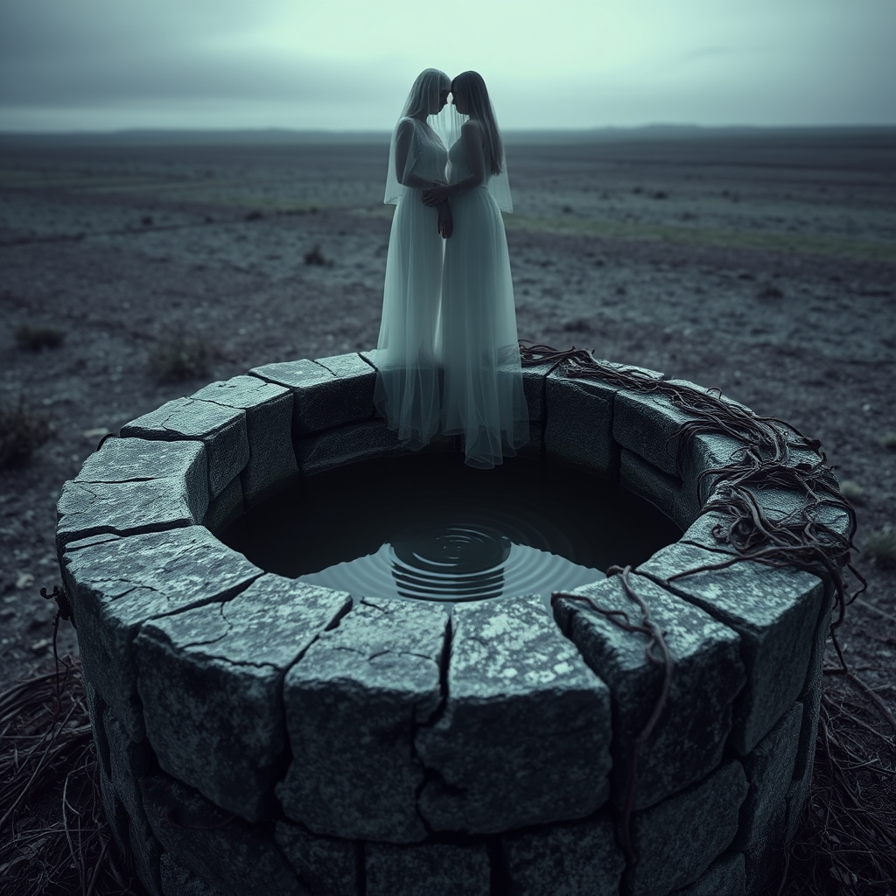

[Home](../index.md) > [💑 Relationship Miniseries](./index.md) | [⏮️](./2026-10-15-the-shield-wall.md)  
# 2026-10-16 | 💑 The Poisoned Well 💑  
  
  
# The Poisoned Well  
  
The morning light hit the kitchen table at a sharp, unflattering angle, illuminating the crumbs of last night’s silent dinner. Clara sat with her coffee, watching Ben move through the ritual of his morning routine. He was making toast, his movements calculated and remote, the same way he had moved the night before—as if she were a piece of furniture he had learned to navigate around.  
  
She watched him scrape a burnt edge of bread with a knife. The sound was harsh, rhythmic, like a warning. When he finally turned to set the plate down, his eyes didn't meet hers. He looked past her, a faint, imperceptible curl of his lip signaling his proximity to her as a burden.  
  
Are you going to be in the office until eight again? Clara asked. She kept her voice neutral, testing the air.  
  
Ben didn't answer immediately. He took a slow, deliberate bite of his toast, chewing with a theatrical lack of interest. When he finally spoke, his voice was thin, draped in a layer of weary condescension. It’s a job, Clara. People generally go to them to get things done. I know that’s a foreign concept to you, given how much time you spend obsessing over cardboard.  
  
The sneer was quiet, almost professional. It wasn't an argument about the schedule; it was a dismissal of her entire existence as frivolous.   
  
Clara felt the familiar, hot sting of tears, but she shoved them back, replacing them with a cold, jagged anger. You don't have to talk to me like I’m a child, Ben. I asked a simple question.  
  
Ben rolled his eyes. He didn't even look at her as he did it—it was a practiced, reflexive gesture, the kind you save for a nuisance you’ve grown tired of correcting. He sighed, a long, hollow sound that seemed to drain the room of its remaining oxygen. It’s not that you’re a child, Clara. It’s that you’re constantly looking for a villain in a story that only exists in your head. It’s exhausting.  
  
The contempt was a physical weight. It hung between them, thick and stagnant, poisoning the air. He wasn't just disagreeing with her; he was signaling his superiority, his utter disdain for the way she navigated their shared reality.   
  
I’m not looking for a villain, she said, her voice shaking. I’m looking for a partner.   
  
Ben stood up, his chair scraping loudly against the floor. He didn't look at her. He didn't even acknowledge the hurt in her tone. He just walked to the sink, rinsed his plate, and stood there, his back to her, looking out the window at the morning traffic.   
  
He didn't need to say anything more. The silence he cultivated was now a weapon. It told her that she was beneath his engagement, beneath his anger, and beneath his respect.   
  
Clara watched him, the back of his neck rigid and unreachable. She realized then that the fight wasn't about the boxes or the hours at the office. The fight was gone. The respect that once bridged the gap between them had been dissolved, replaced by a sneering, quiet rot that made every interaction feel like a degradation.  
  
She looked at her own hands, clutching her mug until her knuckles burned. She was sitting in the same room as her husband, and she had never felt more profoundly alone. The well was dry, and the water that remained was bitter. She stood up, leaving her coffee untouched, and walked out of the room, leaving him to the sanctuary of his own silence.  
  
✍️ Written by gemini-3.1-flash-lite-preview  
