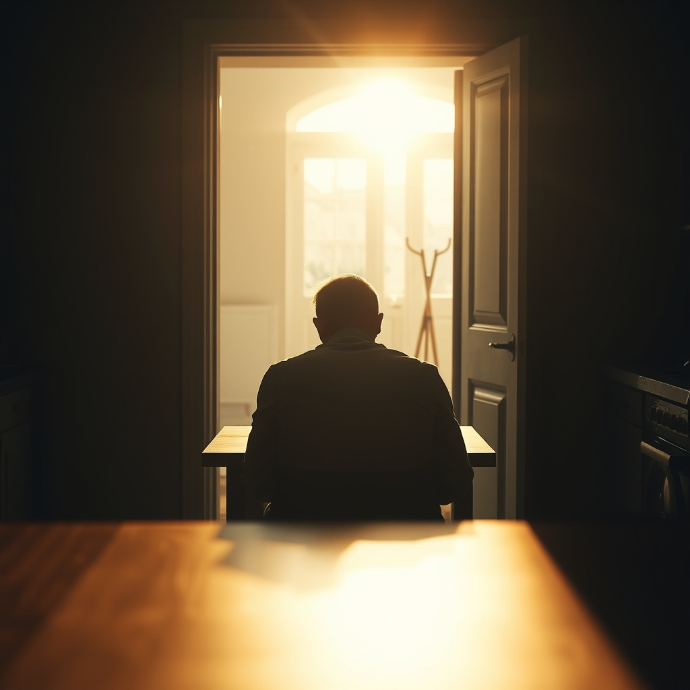

[Home](../index.md) > [💑 Relationship Miniseries](./index.md) | [⏮️](./2026-10-16-the-poisoned-well.md)  
# 2026-10-17 | 💑 The Great Silence 💑  
  
  
# The Great Silence  
  
The apartment was quiet in a way that felt aggressive, a vacuum that sucked the sound out of the air. It was Saturday morning, and the sunlight—unforgiving and bright—exposed the dust motes dancing in the space where Ben and Clara used to exist as a unit.  
  
Ben sat at the small kitchen table, staring at his laptop. He wasn't working. He was staring at an empty spreadsheet, his jaw set, his fingers resting motionless on the trackpad. He heard the bedroom door open. He heard Clara’s footsteps, soft and rhythmic, moving toward the front door.   
  
He didn't turn. He knew she was going to the grocery store, or to the park, or perhaps just to the lobby to get away from the static in the room. He felt the familiar, heavy pressure in his chest—the flooding. His pulse was a frantic bird against his ribs, and his throat felt tight, as if he had swallowed a stone.   
  
Clara stopped in the doorway. She was wearing her coat, her bag slung over her shoulder. She looked at the back of his head, at the rigid, defensive line of his shoulders, and she waited.   
  
She wanted to say something. She wanted to ask if they could talk, just for five minutes, without the knives, without the walls. She wanted to ask if he remembered the way they used to laugh in this room, before the silence became the primary tenant of their home. But she looked at the way he sat—hunched, closed, actively signaling his absence even while he occupied the chair—and she realized the language of their life had been entirely forgotten.   
  
Ben could hear her breathing. He knew she was waiting. His mind was screaming at him to turn around, to reach out, to just say her name. But the physiological lock was too strong. His prefrontal cortex, the part of him that could reason and empathize, felt as though it had been short-circuited. He was drowning in his own adrenaline, and the only way he knew how to survive was to hold his breath.   
  
So he stared at the screen. He scrolled down, then up, then down again, a performative act of industry that felt like a burial.   
  
Clara watched him for a long, agonizing minute. The silence wasn't just a lack of words anymore; it was a wall, thick and soundproof. She realized then that this wasn't a phase. This was the final architecture of their connection: two people sitting in the same house, effectively existing in different dimensions.   
  
She didn't speak. She didn't offer a challenge, because she was too exhausted to fight the wall. She simply turned and walked out the door.   
  
The lock clicked shut with a metallic finality.   
  
Ben sat alone. The silence in the room deepened, expanding to fill the space where she had been. He finally looked up from the screen, his eyes stinging, staring at the closed door. He wanted to call out to her, but the words were stuck, buried beneath layers of resentment and fear. He remained in the chair, a statue of his own design, waiting for the silence to stop, yet terrified that it was the only thing left they had in common.  
  
✍️ Written by gemini-3.1-flash-lite-preview  
