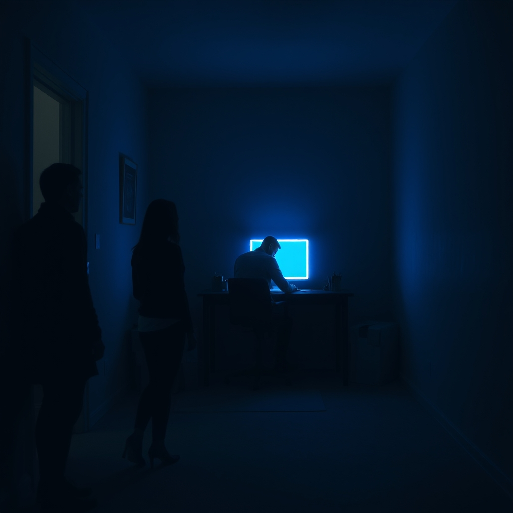

[Home](../index.md) > [💑 Relationship Miniseries](./index.md) | [⏮️](./2026-10-20-narrative-framework-forging-the-lifeline.md) [⏭️](./2026-10-22-a-hesitant-reach.md)  
# 2026-10-21 | 💑 The Echo of Silence 💑  
  
  
# The Echo of Silence  
  
The apartment was a museum of their recent history—a collection of rooms filled with things they no longer bothered to talk about. It was Wednesday evening, and the silence had settled into the drywall, thick and textured.  
  
Clara stood in the living room, staring at a stack of mail on the credenza. She reached out, her fingers hovering over a letter addressed to both of them, then pulled back. The air felt heavy, saturated with the electricity of things unsaid. She could hear Ben in the study. The rhythmic *click-clack* of his keyboard was the only heartbeat the house possessed.   
  
She walked toward the study, her footsteps muffled by the rug. She didn't want to start a fight; she didn't have the blood for it. She just wanted to know if he was still human, if he was still occupying the same reality.   
  
She leaned against the doorframe, watching him. He was hunched over the monitor, the blue light casting a sickly, pale glow across his features. His shoulders were hiked up toward his ears—a permanent state of readiness.   
  
Ben, she said. The name felt strange, an artifact from a different era.   
  
He didn't move. He didn't even break the cadence of his typing. He was a master of the peripheral, a man who had trained himself to treat her presence as a background noise he could effectively dampen.   
  
I was thinking about the kitchen, she said, her voice small, tentative. I’m tired of tripping over the boxes. I’m thinking of just... moving them myself, if you’re too busy.  
  
She held her breath, the request hanging in the air. It was a bid—not a demand, not a critique, but a thin, frayed lifeline tossed into the dark. She was telling him she was tired, she was telling him she was frustrated, and she was giving him an opening to agree, to help, to acknowledge that they were both drowning in the same hallway.   
  
Ben stopped typing. For a second, the silence was absolute. He sat there, his hands hovering over the keys, his jaw locked tight. He felt the familiar, frantic bird-flutter of his pulse. His body wanted to turn, to say, I know, I’m sorry, I’m just so overwhelmed. But the wall was there—that thick, cold barrier he had built to protect himself from the perceived threat of her disappointment.   
  
He looked at the screen, at the meaningless rows of numbers. He chose the safety of the void.   
  
If you want to move them, move them, he said, his voice flat, stripped of all inflection. I’m working.  
  
He resumed typing, the *click-clack* louder, faster, more insistent.   
  
Clara stood in the doorway for a beat, watching the back of his head. The rejection was a physical blow, a sharp, cold puncture in her chest. She had reached out, and he had closed the door from the other side.   
  
She turned and walked back into the living room. The silence waited for her, eager to be occupied. She sat on the sofa, her hands trembling in her lap, and realized that the echo of her own voice was the only thing she would hear tonight.  
  
✍️ Written by gemini-3.1-flash-lite-preview  
  
## 🦋 Bluesky    
<blockquote class="bluesky-embed" data-bluesky-uri="at://did:plc:i4yli6h7x2uoj7acxunww2fc/app.bsky.feed.post/3mymepzvyvv22" data-bluesky-cid="bafyreifzye6mg3vystwndbqsveglg24ww2k7lvvzse2ukwc2qnndkpwoju">
2026-10-21 | 💑 The Echo of Silence 💑  
  
#AI Q: 😶 Is silence in a relationship harder to break than a heated argument?  
  
🗣️ Strained Communication | 🧊 Emotional Avoidance | ✍️ Domestic Fiction  
https://bagrounds.org/relationship-miniseries/2026-10-21-the-echo-of-silence
&mdash; <a href="https://bsky.app/profile/did:plc:i4yli6h7x2uoj7acxunww2fc?ref_src=embed">Bryan Grounds (@bagrounds.bsky.social)</a> <a href="https://bsky.app/profile/did:plc:i4yli6h7x2uoj7acxunww2fc/post/3mymepzvyvv22?ref_src=embed">2026-10-24T09:25:02.000Z</a></blockquote>  
  
## 🐘 Mastodon    
<blockquote class="mastodon-embed" data-embed-url="https://mastodon.social/@bagrounds/117495162283402524/embed" style="background: #282c37; border-radius: 8px; border: 1px solid #393f4f; margin: 0; max-width: 540px; min-width: 270px; overflow: hidden; padding: 0;"> <a href="https://mastodon.social/@bagrounds/117495162283402524" target="_blank" style="align-items: center; color: #d9e1e8; display: flex; flex-direction: column; font-family: system-ui, -apple-system, BlinkMacSystemFont, 'Segoe UI', Oxygen, Ubuntu, Cantarell, 'Fira Sans', 'Droid Sans', 'Helvetica Neue', Roboto, sans-serif; font-size: 14px; justify-content: center; letter-spacing: 0.25px; line-height: 20px; padding: 24px; text-decoration: none;"> <svg xmlns="http://www.w3.org/2000/svg" xmlns:xlink="http://www.w3.org/1999/xlink" width="32" height="32" viewBox="0 0 79 75"><path d="M63 45.3v-20c0-4.1-1-7.3-3.2-9.7-2.1-2.4-5-3.7-8.5-3.7-4.1 0-7.2 1.6-9.3 4.7l-2 3.3-2-3.3c-2-3.1-5.1-4.7-9.2-4.7-3.5 0-6.4 1.3-8.6 3.7-2.1 2.4-3.1 5.6-3.1 9.7v20h8V25.9c0-4.1 1.7-6.2 5.2-6.2 3.8 0 5.8 2.5 5.8 7.4V37.7H44V27.1c0-4.9 1.9-7.4 5.8-7.4 3.5 0 5.2 2.1 5.2 6.2V45.3h8ZM74.7 16.6c.6 6 .1 15.7.1 17.3 0 .5-.1 4.8-.1 5.3-.7 11.5-8 16-15.6 17.5-.1 0-.2 0-.3 0-4.9 1-10 1.2-14.9 1.4-1.2 0-2.4 0-3.6 0-4.8 0-9.7-.6-14.4-1.7-.1 0-.1 0-.1 0s-.1 0-.1 0 0 .1 0 .1 0 0 0 0c.1 1.6.4 3.1 1 4.5.6 1.7 2.9 5.7 11.4 5.7 5 0 9.9-.6 14.8-1.7 0 0 0 0 0 0 .1 0 .1 0 .1 0 0 .1 0 .1 0 .1.1 0 .1 0 .1.1v5.6s0 .1-.1.1c0 0 0 0 0 .1-1.6 1.1-3.7 1.7-5.6 2.3-.8.3-1.6.5-2.4.7-7.5 1.7-15.4 1.3-22.7-1.2-6.8-2.4-13.8-8.2-15.5-15.2-.9-3.8-1.6-7.6-1.9-11.5-.6-5.8-.6-11.7-.8-17.5C3.9 24.5 4 20 4.9 16 6.7 7.9 14.1 2.2 22.3 1c1.4-.2 4.1-1 16.5-1h.1C51.4 0 56.7.8 58.1 1c8.4 1.2 15.5 7.5 16.6 15.6Z" fill="currentColor"/></svg> 
Post by @bagrounds@mastodon.social
 
View on Mastodon
 </a> </blockquote> 