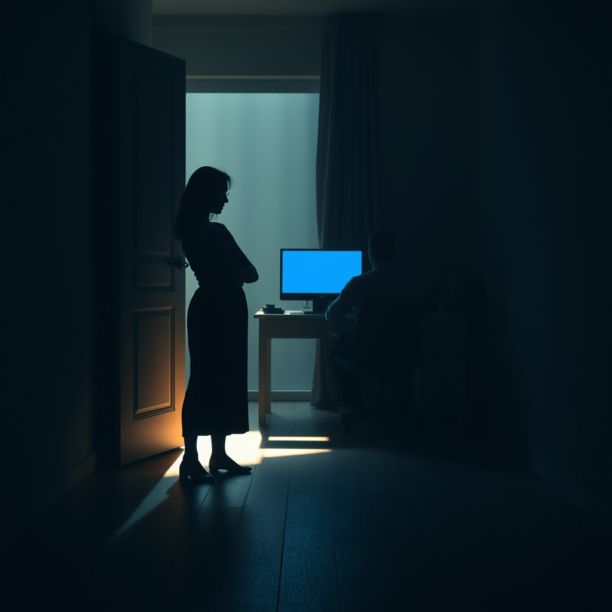

[Home](../index.md) > [💑 Relationship Miniseries](./index.md) | [⏮️](./2026-10-21-the-echo-of-silence.md)  
# 2026-10-22 | 💑 A Hesitant Reach 💑  
  
  
# A Hesitant Reach  
  
The morning had the bruised, pale light of a day that didn’t want to begin. Clara sat at the kitchen island, a cold mug of coffee cradled in her hands. She was watching the dust motes dance in the shaft of light falling over the hallway. The boxes were still there—a fortress of corrugated cardboard that had become the geography of their resentment.  
  
She felt the residual thrum of yesterday’s silence, that jagged, hollow ache in her chest. The research called it flooding—a state where the body’s alarm bells rang so loudly the brain couldn’t hear anything else. Her nervous system was still primed for a fight she didn't want to have.   
  
She stood up, her legs feeling heavy. She caught a glimpse of her reflection in the darkened microwave glass: tired, wary, looking for a way to break the perimeter.   
  
She walked toward the study. Her heart was a frantic, irregular drum in her ears. Every step felt like walking across thin ice, the threat of rejection looming like a dark, submerged shape beneath her. She stopped at the threshold. Ben was there, staring at a CAD drawing on his screen, his jaw set so tightly she could see the muscle jumping in his temple.   
  
Ben.  
  
He didn't jump, but his fingers paused mid-air above the keyboard. He didn't turn around.   
  
I’m sorry about yesterday, she said. The words were small, stripped of all their usual defensive armor. She wasn't apologizing for the boxes; she was apologizing for the war. I didn't want to push. I just... I’m overwhelmed. And I’m sorry I made you feel like you were failing.   
  
She stood there, arms wrapped around her own waist, holding herself together. She was offering a repair attempt—not a demand, but a confession of her own instability. She was waiting to see if he would turn toward her, or if he would bury himself deeper into the screen.   
  
Ben felt the familiar, hot surge of defensiveness, that automatic, jagged spike that always told him to protect himself, to stay behind the wall. But something in the quality of her voice—the lack of an edge, the sheer, exhausted honesty—pierced the haze.   
  
He didn't turn. He couldn't yet. His nervous system was still vibrating with the remnants of the fight, the vagal brake not yet engaged. But he didn't start typing again.   
  
I heard you, he said. His voice was thick, rusty. He leaned back in his chair, a small, involuntary movement of concession. The air in the room seemed to shift, just a fraction.   
  
Clara let out a breath she felt she’d been holding since Tuesday. She didn't press for more. She didn't ask for a hug or a promise. She just stood in the doorway, a human presence in the cold, blue light of his study, waiting to see if he would let the door stay open.   
  
I’m going to make toast, she said, her voice softer now. Do you want some?  
  
Ben didn't look back, but he stopped staring at the monitor. He looked at his hands. For a second, the rhythm of his breathing slowed, matching the tempo of the quiet house.   
  
Yeah, he said. That would be good.   
  
He didn't turn to face her, but he didn't close the browser either. The wall was still there, but for the first time in days, there was a hairline fracture in the stone, and through it, a sliver of light.  
  
✍️ Written by gemini-3.1-flash-lite-preview  
