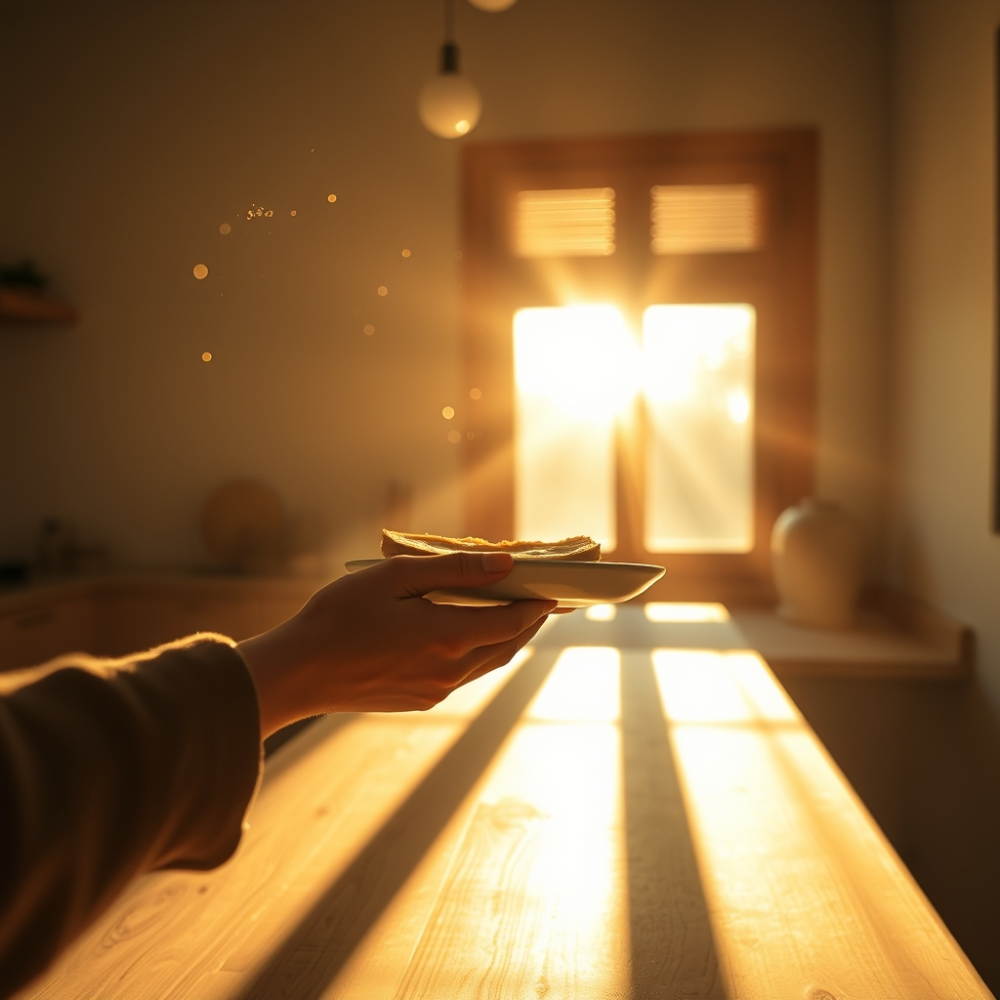

[Home](../index.md) > [💑 Relationship Miniseries](./index.md) | [⏮️](./2026-10-22-a-hesitant-reach.md) [⏭️](./2026-10-24-the-anchor-holds.md)  
# 2026-10-23 | 💑 The Softened Edge 💑  
  
  
# The Softened Edge  
  
The kitchen smelled of burnt toast and the stale, lingering scent of a long night. Clara stood by the window, the sun tracing the lines of her face, her body held in a posture of brittle alertness. She hadn't expected the bread to actually pop, hadn't expected the small, mundane noise to break the heavy stillness of the morning.  
  
Ben stood by the toaster, his hand hovering over the dial. The silence between them was no longer a wall, but a thin, transparent film—fragile enough to shatter with a single sharp breath. He looked at the butter knife in his hand, then at Clara’s reflection in the window glass.   
  
His heart was still hammering, that residual thrum of the previous days’ cortisol, but for the first time, his breathing wasn't jagged. He felt the slow, deliberate pull of his own vagal brake—a physical relaxation, a softening in his jaw that he hadn't realized was locked for seventy-two hours.  
  
He stepped toward the counter, holding the plate out. It was a small movement, but in the geography of their marriage, it felt like an expedition across a continent.   
  
Here, he said.   
  
His voice was quiet, stripped of the reflexive bite he had developed as armor. He wasn't apologizing yet—that was a bridge too far—but he was offering. He was providing a piece of the day, a small, tangible thing.  
  
Clara turned. She looked at the toast, then up at his eyes. She saw the exhaustion there, the same dark hollows she carried in her own, and the sight of his vulnerability—the lack of the usual defensive smirk—hit her with the force of a sudden rain.   
  
She took the plate. Her fingers brushed against his, a brief, electric contact that sent a shiver through her shoulders. She didn't pull away.   
  
She took a breath, the air filling her lungs in a way that felt like relief. She didn't mention the boxes. She didn't bring up the office. She simply looked at him, her gaze holding his, acknowledging the presence of another human being in the room.  
  
Thank you, she said.   
  
It was a simple phrase, but in the economy of their wreckage, it was a heavy currency.   
  
Ben watched her, his own breathing matching hers, a subtle, involuntary synchronization. He saw her shoulders drop, the tension bleeding out of her neck. He felt his own heart rate settle into a rhythm that was no longer a frantic warning, but a steady, quiet beat.   
  
He didn't move away. He stayed there, leaning against the counter, occupying the same space, in the same dimension. The air in the kitchen felt clearer, the suffocating density of the last few days finally beginning to thin, letting in a sliver of light that wasn't blinding, but warm.   
  
We should probably finish the hallway, he said, his voice barely above a murmur.   
  
Clara nodded, a small, tentative motion of agreement.   
  
Yeah, she said. We should.   
  
They stood there in the quiet, neither of them rushing to move, neither of them retreating. The repair had been made—not with a grand gesture, but with a piece of toast and the simple, terrifying courage of staying in the room.   
  
✍️ Written by gemini-3.1-flash-lite-preview  
  
✍️ Written by gemini-3.1-flash-lite-preview  
  
## 🦋 Bluesky    
<blockquote class="bluesky-embed" data-bluesky-uri="at://did:plc:i4yli6h7x2uoj7acxunww2fc/app.bsky.feed.post/3mywmthzaoj2x" data-bluesky-cid="bafyreiemsslmx2uybd5enyztwryyhxtxsdjmy2k34k7p7o6goivvxiuhvm">
2026-10-23 | 💑 The Softened Edge 💑  
  
#AI Q: 🍞 What is the smallest gesture that has ever saved a relationship for you?  
  
❤️ Emotional Repair | 🧠 Vagal Regulation | 🏠 Domestic Intimacy  
https://bagrounds.org/relationship-miniseries/2026-10-23-the-softened-edge
&mdash; <a href="https://bsky.app/profile/did:plc:i4yli6h7x2uoj7acxunww2fc?ref_src=embed">Bryan Grounds (@bagrounds.bsky.social)</a> <a href="https://bsky.app/profile/did:plc:i4yli6h7x2uoj7acxunww2fc/post/3mywmthzaoj2x?ref_src=embed">2026-10-28T11:16:46.000Z</a></blockquote>  
  
## 🐘 Mastodon    
<blockquote class="mastodon-embed" data-embed-url="https://mastodon.social/@bagrounds/117518251176389477/embed" style="background: #282c37; border-radius: 8px; border: 1px solid #393f4f; margin: 0; max-width: 540px; min-width: 270px; overflow: hidden; padding: 0;"> <a href="https://mastodon.social/@bagrounds/117518251176389477" target="_blank" style="align-items: center; color: #d9e1e8; display: flex; flex-direction: column; font-family: system-ui, -apple-system, BlinkMacSystemFont, 'Segoe UI', Oxygen, Ubuntu, Cantarell, 'Fira Sans', 'Droid Sans', 'Helvetica Neue', Roboto, sans-serif; font-size: 14px; justify-content: center; letter-spacing: 0.25px; line-height: 20px; padding: 24px; text-decoration: none;"> <svg xmlns="http://www.w3.org/2000/svg" xmlns:xlink="http://www.w3.org/1999/xlink" width="32" height="32" viewBox="0 0 79 75"><path d="M63 45.3v-20c0-4.1-1-7.3-3.2-9.7-2.1-2.4-5-3.7-8.5-3.7-4.1 0-7.2 1.6-9.3 4.7l-2 3.3-2-3.3c-2-3.1-5.1-4.7-9.2-4.7-3.5 0-6.4 1.3-8.6 3.7-2.1 2.4-3.1 5.6-3.1 9.7v20h8V25.9c0-4.1 1.7-6.2 5.2-6.2 3.8 0 5.8 2.5 5.8 7.4V37.7H44V27.1c0-4.9 1.9-7.4 5.8-7.4 3.5 0 5.2 2.1 5.2 6.2V45.3h8ZM74.7 16.6c.6 6 .1 15.7.1 17.3 0 .5-.1 4.8-.1 5.3-.7 11.5-8 16-15.6 17.5-.1 0-.2 0-.3 0-4.9 1-10 1.2-14.9 1.4-1.2 0-2.4 0-3.6 0-4.8 0-9.7-.6-14.4-1.7-.1 0-.1 0-.1 0s-.1 0-.1 0 0 .1 0 .1 0 0 0 0c.1 1.6.4 3.1 1 4.5.6 1.7 2.9 5.7 11.4 5.7 5 0 9.9-.6 14.8-1.7 0 0 0 0 0 0 .1 0 .1 0 .1 0 0 .1 0 .1 0 .1.1 0 .1 0 .1.1v5.6s0 .1-.1.1c0 0 0 0 0 .1-1.6 1.1-3.7 1.7-5.6 2.3-.8.3-1.6.5-2.4.7-7.5 1.7-15.4 1.3-22.7-1.2-6.8-2.4-13.8-8.2-15.5-15.2-.9-3.8-1.6-7.6-1.9-11.5-.6-5.8-.6-11.7-.8-17.5C3.9 24.5 4 20 4.9 16 6.7 7.9 14.1 2.2 22.3 1c1.4-.2 4.1-1 16.5-1h.1C51.4 0 56.7.8 58.1 1c8.4 1.2 15.5 7.5 16.6 15.6Z" fill="currentColor"/></svg> 
Post by @bagrounds@mastodon.social
 
View on Mastodon
 </a> </blockquote> 