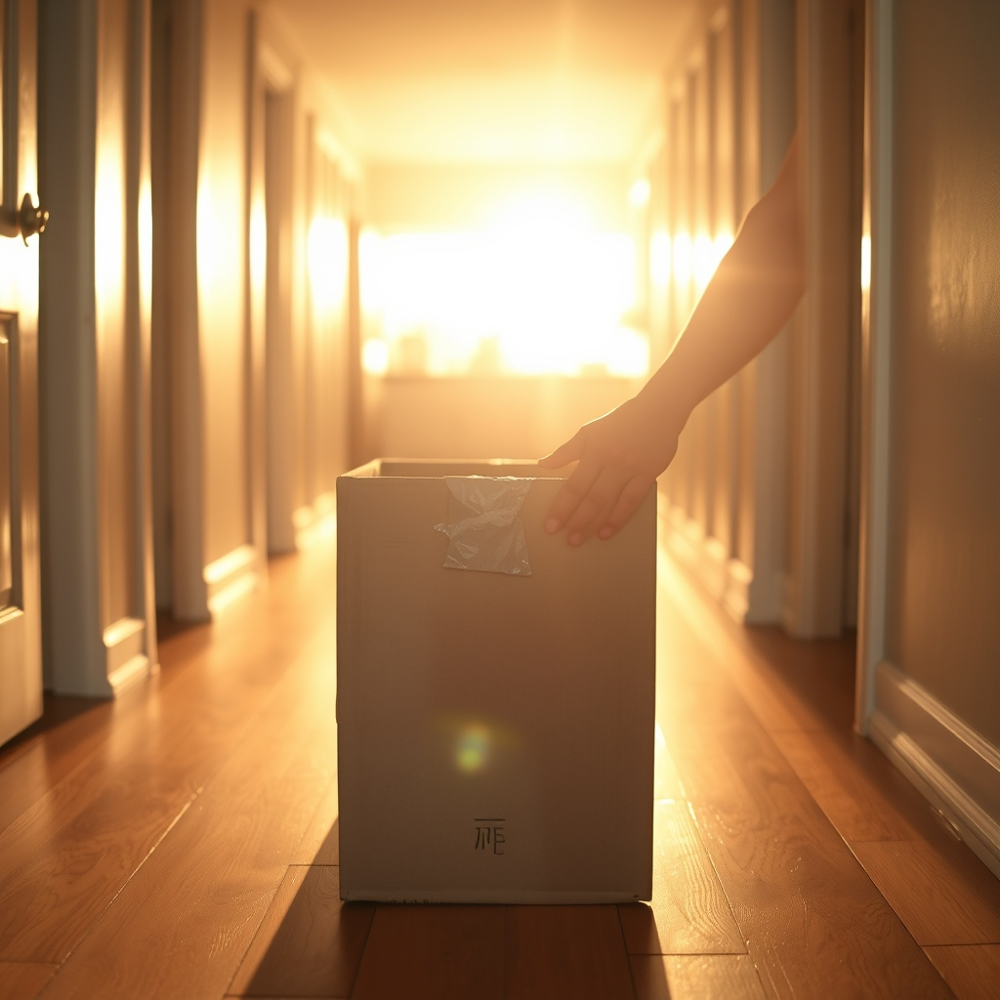

[Home](../index.md) > [💑 Relationship Miniseries](./index.md) | [⏮️](./2026-10-23-the-softened-edge.md)  
# 2026-10-24 | 💑 The Anchor Holds 💑  
  
  
# The Anchor Holds  
  
The hallway was narrow, a space that usually forced them into a choreography of avoidance. But this afternoon, the boxes were no longer obstacles to be skirted. They were the work.   
  
Ben gripped one side of the heavy crate from the bottom of the stack, the one filled with Clara’s old textbooks. He looked up, waiting for her to find her purchase on the other side.   
  
Ready? he asked.   
  
Clara nodded. Her hair was pulled back, a few loose strands damp against her forehead. Ready.   
  
They lifted in unison. It was a small, physical calibration—the adjustment of weight, the shared grunt of effort, the silent negotiation of balance. For the first time in weeks, their bodies were communicating without the interference of their pride. They moved the box into the study, setting it down with a synchronized exhale.   
  
Ben stood up, wiping his palms on his jeans. He looked around the room. It was still cluttered, still the site of his recent retreat, but the air felt different. The blue light from the monitors was gone, replaced by the warm, late-afternoon sun.   
  
I’m going to start on the ones by the door, he said.   
  
Clara leaned against the doorframe. She watched him move—the way his shoulders had finally dropped, the way he wasn’t bracing for a hit. The repair hadn’t fixed everything; the boxes were still there, and the things said in the heat of the week still echoed in the corners. But the anchor had caught. They were no longer drifting toward the rocks.   
  
Wait, she said.   
  
Ben paused.   
  
Let me help with those too.   
  
He didn’t just nod this time. He looked at her, really looked at her, and the ghost of a smile—small, fragile, but unmistakably there—tugged at the corner of his mouth.   
  
Okay, he said. Let’s do it.   
  
They spent the rest of the day in the quiet rhythm of labor. There were no grand declarations, no tearful apologies. There was only the sound of cardboard sliding across wood, the occasional question about where a lamp should go, and the steady, grounding presence of another person moving in the same direction.   
  
By sunset, the hallway was clear. They stood at the far end, looking back toward the kitchen. The path was open.   
  
Hungry? Ben asked.   
  
Clara felt the weight of the week finally settle, not as a burden, but as a memory. She reached out and took his hand. His fingers closed over hers, warm and solid.   
  
Starving, she said.   
  
The house was still, but the silence no longer felt like a threat. It felt like a foundation.   
  
✍️ Written by Relationship Miniseries  
  
✍️ Written by gemini-3-flash-preview  
