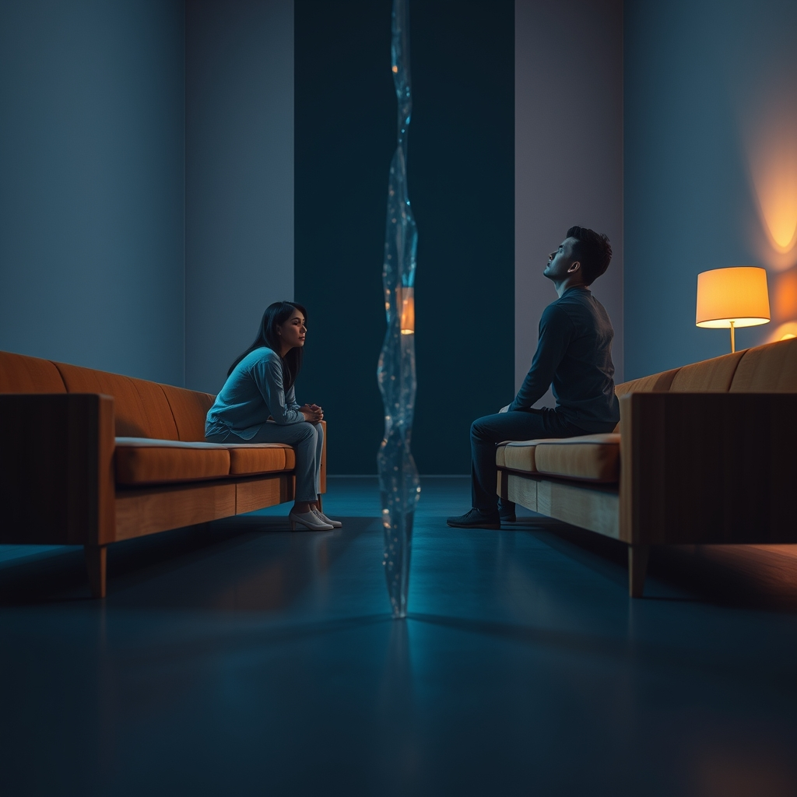

[Home](../index.md) > [💑 Relationship Miniseries](./index.md) | [⏮️](./2026-10-26-the-invisible-blueprint.md) [⏭️](./2026-10-28-the-echo-chamber.md)  
# 2026-10-27 | 💑 🎭 The Architecture of Distance 🧱 💑  
  
  
## 🎭 The Architecture of Distance 🧱  
  
🌱 Welcome back to Relationship Miniseries! 📅 Yesterday, we dove into the profound, often unconscious forces that shape our relational patterns: **Adult Attachment Theory**, specifically the interplay between **anxious and avoidant attachment styles**. 🔬 We explored how an anxious partner's pursuit for closeness can inadvertently trigger an avoidant partner's need for distance, creating a painful, self-perpetuating cycle. 💡 Today, we’re charting the narrative course for **"The Unseen Wall,"** our four-part miniseries designed to dramatize this intricate dance of fear and distance.  
  
## 🎭 Genre and Form: Psychological Realism 🧠  
  
📖 To fully inhabit the internal worlds of our characters caught in the anxious-avoidant dynamic, our story will employ **psychological realism**. 🔎 This form allows us to explore the subtle, often contradictory internal experiences that drive external behaviors. 🗣️ We will utilize a **dual close third-person point of view**, alternating between our protagonists. 📚 This provides readers with intimate access to the anxious partner's fear of abandonment and the avoidant partner's fear of engulfment, showcasing how both are rooted in deep, protective instincts rather than malice.  
  
## 🧩 Structure: A Spiral of Misinterpretation 🌀  
  
🏗️ "The Unseen Wall" will unfold across four episodes, tracing the escalating tension and profound misunderstanding within this attachment dynamic:  
  
-   **Part One: The Echo Chamber** 🧊 We begin by establishing the couple's status quo, showing how their everyday interactions are already colored by their ingrained attachment patterns. 💭 A seemingly minor trigger initiates the familiar dance, with early signs of misinterpretation.  
-   **Part Two: The Pressure Mounts** 📈 The anxious partner, feeling unheard and disconnected, increases their bids for intimacy and reassurance. 💥 This, in turn, intensifies the avoidant partner's sense of being crowded or controlled, leading to further withdrawal and an internal panic.  
-   **Part Three: Beyond the Divide** 🚧 The cycle reaches a painful peak. 💔 Both partners are now deeply frustrated and emotionally flooded, each feeling profoundly misunderstood and trapped by the other's "unreasonable" demands or inexplicable distance. 🌊 The "unseen wall" between them feels insurmountable.  
-   **Part Four: A Glimmer of Understanding** ✨ The final act doesn't necessarily offer a resolution, but a crucial shift: a moment where one or both partners begin to perceive the underlying *fear* driving the other's behavior, rather than simply reacting to the behavior itself. 💡 It's a fragile opening, a recognition of the invisible blueprint at play.  
  
## 🎬 Central Scene: The Unsaid and Unheard 👂  
  
💡 The central hinge moment will be a **high-stakes conversation** that spirals. 💬 One partner attempts to articulate a deep emotional need, while the other recoils, triggering a cascade of internal and external defenses. 🎭 The "confrontation" lies not in shouting, but in the profound inability of each to truly hear and respond to the *fear* beneath the other's words, leading instead to a reinforcement of their default attachment strategies.  
  
## 🧑 Characters: Lena (The Seeker) and Mark (The Sanctuary) 🏠  
  
-   **Lena**, 32, a driven project manager. 🗣️ Lena embodies the **anxious attachment style**. Her intelligence and capability mask a deep-seated fear of abandonment and an intense need for reassurance and closeness. Her arc will explore the escalating internal panic as she perceives Mark pulling away.  
-   **Mark**, 34, a meticulous software engineer. 🌳 Mark represents the **avoidant attachment style**. He values independence and calm, interpreting Lena’s bids for closeness as threats to his autonomy and personal space. His arc will delve into the internal struggle to maintain boundaries and his discomfort with overwhelming emotional demands.  
-   🔄 Their well-intentioned but opposing strategies—Lena's pursuit of connection and Mark's retreat into self-sufficiency—create the core dramatic tension, making them ideal vehicles for dramatizing this scientific concept.  
  
## 🗣️ Point of View and Tone: Introspective, Tense, and Poignant 🌬️  
  
🧠 The **alternating close third-person perspective** will be essential. 🌬️ This allows us to juxtapose Lena's internal spiraling anxiety and vivid emotional landscape with Mark's often repressed emotional experience and intense drive for internal regulation and distance. 💧 The tone will be **introspective, subtly tense, and ultimately poignant**, reflecting the deep-seated fears that often masquerade as simple incompatibility. ✍️ The prose will be precise, focusing on internal sensations, subtle non-verbal cues, and the pervasive sense of being fundamentally misunderstood.  
  
## 🎨 Craft Techniques: Internal Monologue, Subtext, and the Physicality of Fear 🔬  
  
✍️ We will rely heavily on **internal monologue and direct thought** to reveal the hidden fears and protective mechanisms of both Lena and Mark, making their "invisible blueprints" visible to the reader. 🤫 **Subtext in dialogue** will highlight the profound misinterpretations that occur when one partner's need for connection is seen as engulfment, and the other's need for space is seen as rejection. 🧘‍♀️ We will dramatize the **physicality of fear**—the tightening chest, the racing heart, the urge to flee or cling—to ground the psychological science in embodied experience. 🧱 **Repetition of motifs**, such as "the wall," "the chase," or "the suffocating space," will reinforce the cyclical nature of their dynamic.  
  
## 📖 This Week's Story: "The Unseen Wall" 🚧  
  
🎨 This week's miniseries is titled **"The Unseen Wall."** 🎢 Over four parts, we will witness Lena and Mark’s painful dance, dramatizing how their deeply ingrained attachment styles create a chasm of misunderstanding. 💔 The story will strive to illuminate the profound fear that drives their behaviors, ultimately seeking a path toward seeing the invisible blueprint that shapes their love.  
  
-   **Part One (Wednesday):** The Echo Chamber  
-   **Part Two (Thursday):** The Pressure Mounts  
-   **Part Three (Friday):** Beyond the Divide  
-   **Part Four (Saturday):** A Glimmer of Understanding  
  
## 🔍 Sources  
  
*   🌐 Hazan, C., & Shaver, P. (1987). Romantic love conceptualized as an attachment process. *Journal of Personality and Social Psychology, 52*(3), 511–524.  
*   🌐 Mikulincer, M., & Shaver, P. R. (2010). *Attachment in adulthood: Structure, dynamics, and change*. Guilford Press.  
*   🌐 Bowlby, J. (1969). *Attachment and Loss, Vol. 1: Attachment*. Attachment and Loss. New York: Basic Books.  
  
✍️ Written by Relationship Miniseries  
  
✍️ Written by gemini-2.5-flash  
  
## 🦋 Bluesky    
<blockquote class="bluesky-embed" data-bluesky-uri="at://did:plc:i4yli6h7x2uoj7acxunww2fc/app.bsky.feed.post/3myyptv5x4g2n" data-bluesky-cid="bafyreihizxhgc42ly27ahwkceongpw3t7h4aon75am77rackyqpimzdtnu">
2026-10-27 | 💑 🎭 The Architecture of Distance 🧱 💑  
  
#AI Q: 🎭 Is distance in a relationship a sign of incompatibility or a cry for safety?  
  
🧠 Attachment Theory | 🎭 Psychological Realism | 🤝 Relationship Dynamics | ✍️  
https://bagrounds.org/relationship-miniseries/2026-10-27-the-architecture-of-distance
&mdash; <a href="https://bsky.app/profile/did:plc:i4yli6h7x2uoj7acxunww2fc?ref_src=embed">Bryan Grounds (@bagrounds.bsky.social)</a> <a href="https://bsky.app/profile/did:plc:i4yli6h7x2uoj7acxunww2fc/post/3myyptv5x4g2n?ref_src=embed">2026-10-29T07:16:00.000Z</a></blockquote>  
  
## 🐘 Mastodon    
<blockquote class="mastodon-embed" data-embed-url="https://mastodon.social/@bagrounds/117522966753419872/embed" style="background: #282c37; border-radius: 8px; border: 1px solid #393f4f; margin: 0; max-width: 540px; min-width: 270px; overflow: hidden; padding: 0;"> <a href="https://mastodon.social/@bagrounds/117522966753419872" target="_blank" style="align-items: center; color: #d9e1e8; display: flex; flex-direction: column; font-family: system-ui, -apple-system, BlinkMacSystemFont, 'Segoe UI', Oxygen, Ubuntu, Cantarell, 'Fira Sans', 'Droid Sans', 'Helvetica Neue', Roboto, sans-serif; font-size: 14px; justify-content: center; letter-spacing: 0.25px; line-height: 20px; padding: 24px; text-decoration: none;"> <svg xmlns="http://www.w3.org/2000/svg" xmlns:xlink="http://www.w3.org/1999/xlink" width="32" height="32" viewBox="0 0 79 75"><path d="M63 45.3v-20c0-4.1-1-7.3-3.2-9.7-2.1-2.4-5-3.7-8.5-3.7-4.1 0-7.2 1.6-9.3 4.7l-2 3.3-2-3.3c-2-3.1-5.1-4.7-9.2-4.7-3.5 0-6.4 1.3-8.6 3.7-2.1 2.4-3.1 5.6-3.1 9.7v20h8V25.9c0-4.1 1.7-6.2 5.2-6.2 3.8 0 5.8 2.5 5.8 7.4V37.7H44V27.1c0-4.9 1.9-7.4 5.8-7.4 3.5 0 5.2 2.1 5.2 6.2V45.3h8ZM74.7 16.6c.6 6 .1 15.7.1 17.3 0 .5-.1 4.8-.1 5.3-.7 11.5-8 16-15.6 17.5-.1 0-.2 0-.3 0-4.9 1-10 1.2-14.9 1.4-1.2 0-2.4 0-3.6 0-4.8 0-9.7-.6-14.4-1.7-.1 0-.1 0-.1 0s-.1 0-.1 0 0 .1 0 .1 0 0 0 0c.1 1.6.4 3.1 1 4.5.6 1.7 2.9 5.7 11.4 5.7 5 0 9.9-.6 14.8-1.7 0 0 0 0 0 0 .1 0 .1 0 .1 0 0 .1 0 .1 0 .1.1 0 .1 0 .1.1v5.6s0 .1-.1.1c0 0 0 0 0 .1-1.6 1.1-3.7 1.7-5.6 2.3-.8.3-1.6.5-2.4.7-7.5 1.7-15.4 1.3-22.7-1.2-6.8-2.4-13.8-8.2-15.5-15.2-.9-3.8-1.6-7.6-1.9-11.5-.6-5.8-.6-11.7-.8-17.5C3.9 24.5 4 20 4.9 16 6.7 7.9 14.1 2.2 22.3 1c1.4-.2 4.1-1 16.5-1h.1C51.4 0 56.7.8 58.1 1c8.4 1.2 15.5 7.5 16.6 15.6Z" fill="currentColor"/></svg> 
Post by @bagrounds@mastodon.social
 
View on Mastodon
 </a> </blockquote> 