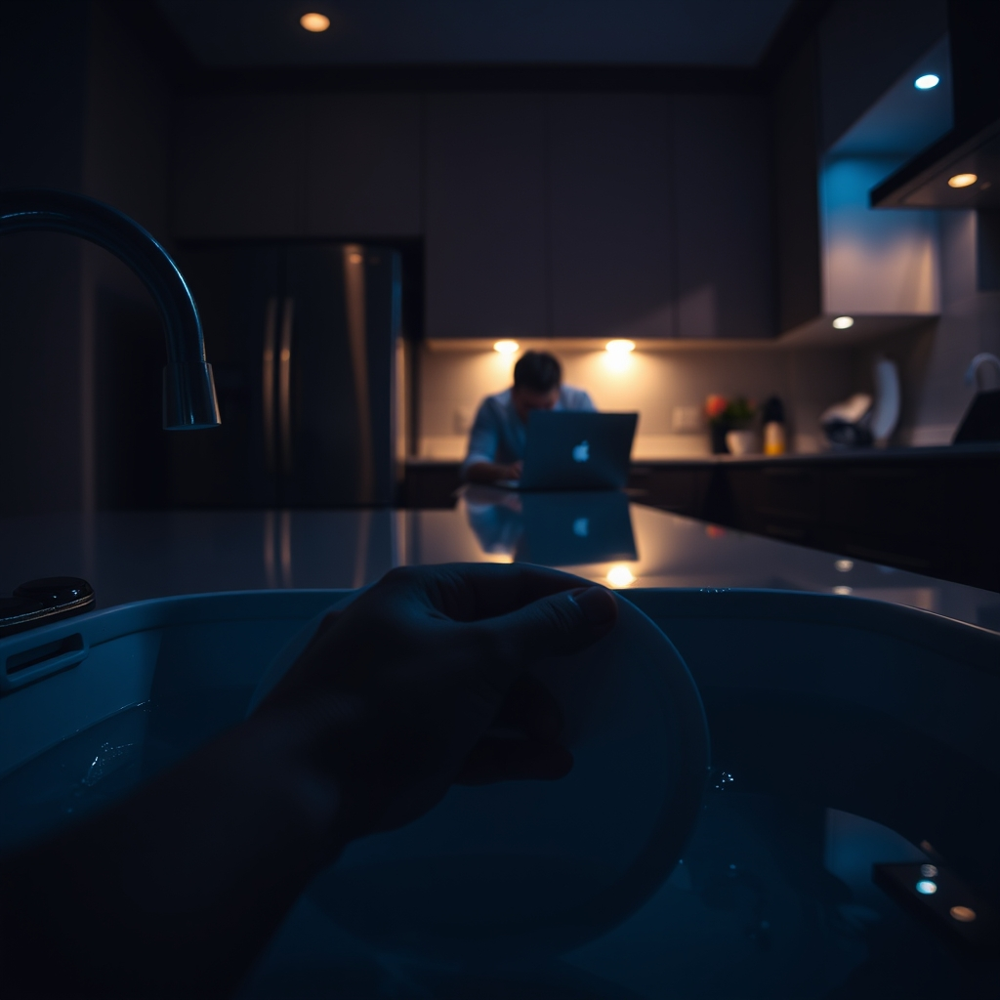

[Home](../index.md) > [💑 Relationship Miniseries](./index.md) | [⏮️](./2026-10-27-the-architecture-of-distance.md) [⏭️](./2026-10-29-the-pressure-mounts.md)  
# 2026-10-28 | 💑 The Echo Chamber 💑  
  
  
# The Echo Chamber  
  
The kitchen light hummed, a low-frequency vibration that seemed to match the tension coiled behind Lena’s ribs. It was 8:14 PM. Mark was at the island, his laptop open, the blue-white glow carving harsh shadows into the planes of his face. He hadn't looked up in forty minutes.  
  
Lena stood by the sink, her hands submerged in warm, soapy water. She was scrubbing a plate that was already clean, her movements rhythmic and sharp. *He’s doing it again,* she thought. *The distance.* It wasn't just the physical space between the sink and the island; it was the way he inhabited his own world, pulling a curtain of concentration shut behind him.  
  
She felt the familiar, frantic itch of anxiety—a physical tightening of her throat. If she didn't bridge this gap now, the silence would harden overnight. It always did.   
  
Mark, she said, her voice sounding thinner than she intended.   
  
He didn't move, just a slight shifting of his shoulders. His fingers didn't stop their steady, rhythmic tapping on the keys. Lena felt the familiar sting of rejection. It wasn't that he was busy; it was the way he used *busy* as a barricade.   
  
Mark, please. I just want to know if you heard what I said earlier about the weekend.  
  
Mark stopped typing. He took a long, slow breath, a sound that Lena experienced as a physical withdrawal. He finally turned, his expression carefully neutral—a mask of forced composure.   
  
I heard you, Lena. I’m just trying to finish this release. Can we do this later?  
  
Later was the graveyard of their intimacy. Later meant tomorrow, or never.   
  
It feels like there is never a ‘later’ for us, Lena said, the words coming out faster now, the anxiety leaking into her tone. It feels like you’re constantly pulling away, and I’m just standing here waiting for you to come back into the room.  
  
Mark’s jaw set. He looked at her, and she saw the flicker of something that wasn't anger, though it looked like it—it was alarm. To him, her request for connection wasn't an invitation; it was an encroachment. It was a demand he couldn't meet without losing the very thing he guarded most: his internal equilibrium.  
  
I’m not pulling away, he said, his voice clipped and quiet, designed to contain the situation. I’m working. You’re asking for things I can’t give you right now. You’re making this into something it isn't.  
  
Lena felt the floor tilt. *Making this into something it isn't.* The classic dismissal. She wasn't asking for the world; she was asking for a look, a nod, a sign that she wasn't alone in this house. She dropped the sponge. It hit the water with a soft, dull splash.  
  
I’m just asking to be seen, Mark. I’m standing right here.  
  
Mark turned back to his screen. He was already gone, retreating into the architecture of his own mind, leaving Lena alone in the echoing, sterile light of the kitchen. She realized then that she was shouting in a room where the walls were built to absorb sound, not return it.  
  
✍️ Written by gemini-3.1-flash-lite-preview  
