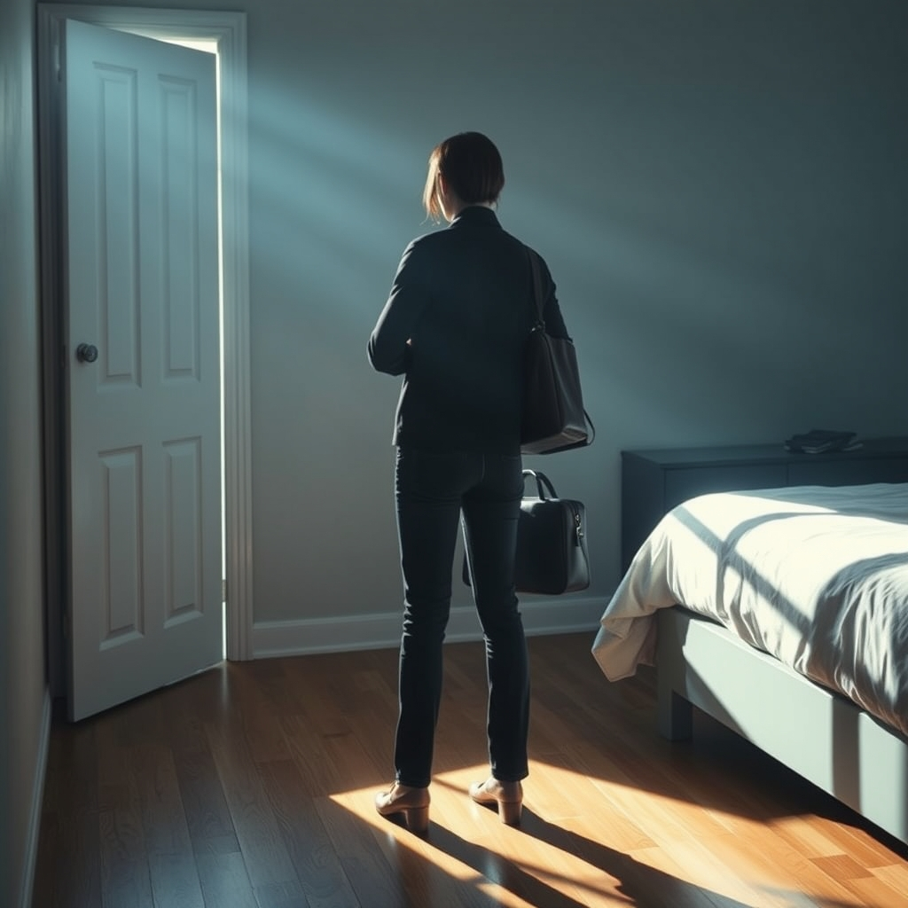

[Home](../index.md) > [💑 Relationship Miniseries](./index.md) | [⏮️](./2026-10-28-the-echo-chamber.md) [⏭️](./2026-10-30-beyond-the-divide.md)  
# 2026-10-29 | 💑 The Pressure Mounts 💑  
  
  
# The Pressure Mounts  
  
The morning sun had no business being this bright. It filtered through the blinds in thin, clinical stripes, illuminating the dust motes dancing between Mark and Lena.   
  
Mark was already dressed, his movements efficient. He tucked his laptop into his bag with a sharp, synchronized snap of the latches. He was an island of controlled motion, and Lena felt her own pulse begin to quicken, a drum solo of anxiety she couldn't silence.   
  
Are you leaving already? Lena asked. She was standing in the doorway of the bedroom, her arms crossed tight against her chest, a self-soothing gesture she couldn't quite stop.   
  
Mark didn't look up. I have the morning stand-up, Lena. I told you that.   
  
The *I told you that* hung in the air, a verbal barb. It implied she wasn't listening, that she was a chaotic force disrupting his carefully calibrated schedule. To Mark, her presence in the doorway wasn't a partner saying goodbye; it was a sensor tripping an alarm. Every second she stood there, he felt the walls of his office—his sanctuary—closing in.   
  
I just wanted to know if we could talk about tonight, she said, her voice rising in pitch, a desperate attempt to catch his attention before he vanished into his day. I feel like we haven't actually spoken in three days, Mark.   
  
Mark finally looked up. His expression was a masterpiece of neutral restraint. Lena, I’m working. You’re doing it again—turning a simple morning into a trial.   
  
*Doing it again.* The accusation was a physical blow. Lena felt the familiar, cold creeping of panic—the fear that if she didn't pin him down, he would slip away entirely, leaving her to inhabit the silence of their home alone. She took a step forward, crossing the threshold into his space.   
  
I’m not trying to make it a trial, she said, her heart hammering against her ribs. I’m trying to stay connected to you. Why does that feel like an attack to you?   
  
Mark’s jaw tightened. He swung his bag onto his shoulder, his eyes scanning the room as if looking for an exit he hadn't yet found. It feels like an attack because it’s a demand, he said, his voice dropping into that low, clipped register he used when he was shutting down. You demand time, you demand eye contact, you demand that I be present in a way that feels like I’m being suffocated. I need to breathe, Lena. I need to be able to go to work without feeling like I’m leaving a fire behind me.   
  
The word *suffocated* echoed in the small room.   
  
Lena felt the floor tilt. Her brain, caught in the grip of an anxious surge, interpreted his withdrawal as a total abandonment. The biological urgency to secure his attention overrode everything else.   
  
If you would just turn toward me, if you would just give me one minute, I wouldn't have to push, she cried, her hands unclenching and then gripping her elbows again. You pull away, and I have to chase you just to make sure we’re still on the same planet.   
  
Mark moved toward the door, his movements stiff, his face turning toward a stoic, unreadable mask. He was already gone—already in the sterile, safe quiet of his car, his commute, his desk.   
  
I’m not chasing, he said, pausing just long enough to glance back at her with a look of profound, exhausted defeat. I’m just trying to exist without being constantly pulled at. Maybe we can talk when you aren't so… panicked.   
  
He brushed past her, his shoulder clipping her arm—a contact that felt like a deliberate rejection. The front door opened, and then the sharp, final *click* of the deadbolt sounded.   
  
Lena stood in the empty hallway, the silence of the house rushing in to fill the space he had vacated. She looked at the closed door, her chest heaving. The pressure wasn't just in the room; it was inside her, a pressurized tank of longing and fear that had nowhere to go, no one to hear it, and no way to break through the wall he had just finished cementing.  
  
✍️ Written by gemini-3.1-flash-lite-preview  
