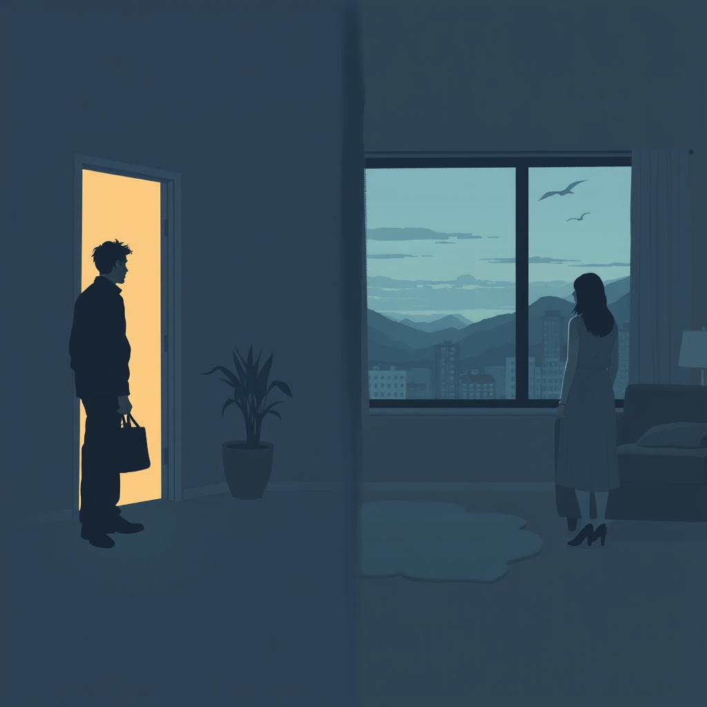

[Home](../index.md) > [💑 Relationship Miniseries](./index.md) | [⏮️](./2026-10-29-the-pressure-mounts.md) [⏭️](./2026-10-31-a-glimmer-of-understanding.md)  
# 2026-10-30 | 💑 Beyond the Divide 💑  
  
  
# Beyond the Divide  
  
The air in the living room was stale, recycled through the vents until it felt thin, insufficient for lungs that had been tight for hours. Mark sat on the edge of the sofa, his posture rigid, his eyes fixed on a meaningless spot on the hardwood floor. He felt the familiar, frantic urge to escape—the "flight" response that always surged when the silence grew this heavy.   
  
Lena stood by the window, her back to him. She was pulling at the skin around her thumbnail, a nervous habit that had returned in the last month. She was waiting for him to say something, to fix the tension, to be the person she remembered from the beginning. Every passing second of his silence felt like a vote for his departure.  
  
If you walk out that door, Mark, I don’t think I can do this anymore, Lena said. Her voice didn't waver, which made it all the more terrifying.   
  
Mark flinched. The threat of abandonment, the ultimate catastrophe. He didn't want to leave—he loved her—but he felt like a drowning man whose partner was holding his head under the water, convinced she was merely trying to keep him close. The pressure of her presence, her expectation of emotional labor he didn't have the capacity to perform, was a physical weight on his chest.  
  
I’m not trying to leave, Lena, he said, his voice straining to remain neutral, to keep the fear from leaking into his words. I’m just trying to think. You’re constantly measuring the distance between us, and every time you do, you make the distance wider.   
  
Lena turned, her eyes bright with a sharp, exhausted frustration. She had spent years trying to make him understand that she measured the distance only because she was terrified of the void.   
  
I measure it because I’m alone in this house with you! she cried. Can’t you see that? When you pull back, you leave me with nothing.   
  
Mark stood up, his movements jerky. He felt a surge of sensory overload. The sound of her voice, the intensity of her gaze, the sheer volume of her emotional need—it was all too much. He needed the silence of his office, the predictability of his code, the safety of a world where things made sense and no one asked him to feel more than he could handle.   
  
You call it being alone, but I call it being suffocated, Mark countered, his voice rising now, the cool mask finally slipping. I need space to be a person, Lena. Not a project. Not a boyfriend who has to be available every single second to validate your worth.  
  
The words hung in the air like jagged glass. He saw her face go pale, the hurt registering immediately, followed by the familiar, cold closing-off. She wasn't fighting for connection anymore; she was retreating into her own bunker, the mirror image of his own defensive maneuver.   
  
The wall between them, thick and invisible, was now complete. They were two people in the same room, yet they were on different planets, staring across an abyss of their own making. Neither of them could see the other's face through the thicket of their own protective instincts. They weren't looking at each other; they were looking at the demons they had projected onto one another.  
  
Mark turned toward the hallway, his bag in his hand. He wasn't leaving for good, but he was leaving for now. He had to.   
  
I need to go, Mark said, his voice flat, dead.   
  
Lena didn't follow him this time. She just stood there, her hands clasped tightly, her eyes fixed on the empty space where he had been standing. She didn't have any more to give. She was exhausted, flooded, and finally, devastatingly, quiet.   
  
The front door clicked shut. The house settled into a silence that was no longer a state of affairs, but a monument.  
  
✍️ Written by gemini-3.1-flash-lite-preview  
  
✍️ Written by gemini-3.1-flash-lite-preview  
