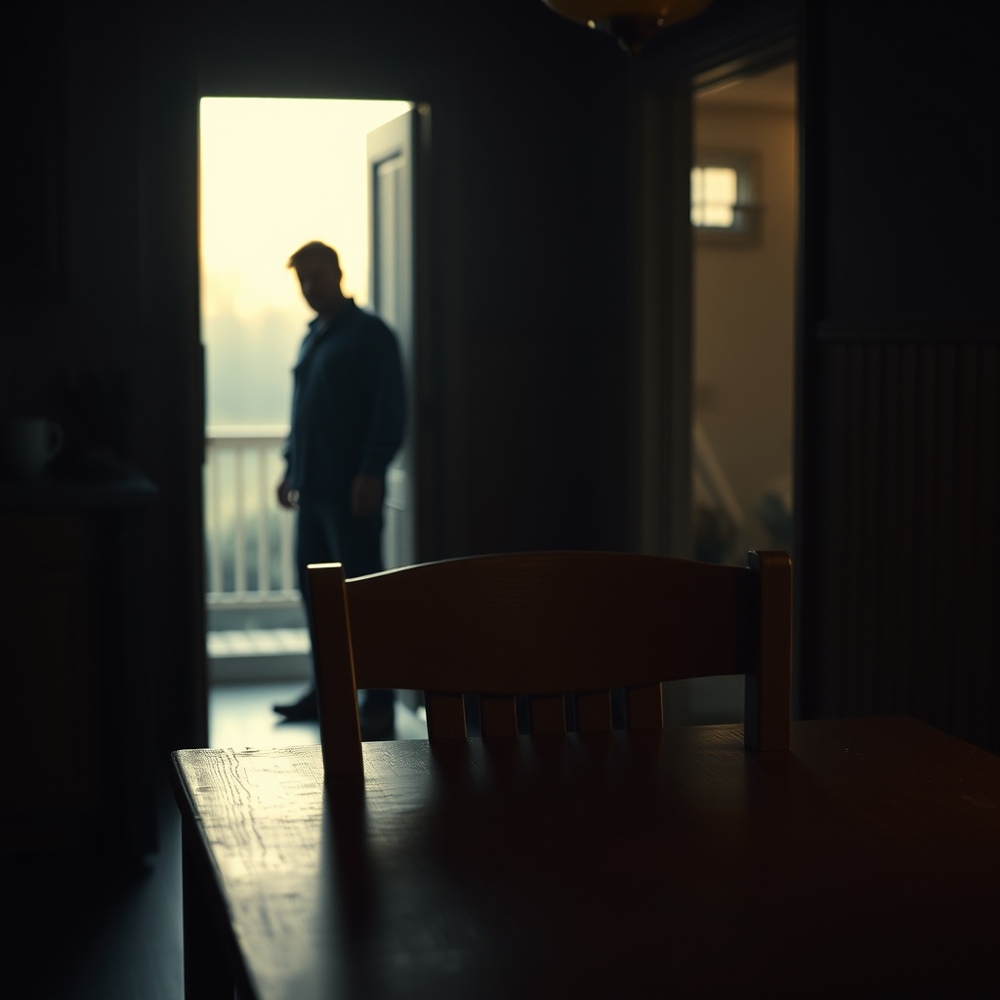

[Home](../index.md) > [💑 Relationship Miniseries](./index.md) | [⏮️](./2026-10-30-beyond-the-divide.md) [⏭️](./2026-11-01-the-blueprint-of-fear.md)  
# 2026-10-31 | 💑 A Glimmer of Understanding 💑  
  
  
# A Glimmer of Understanding  
  
The apartment was silent, but it was a different quality of silence than the one from the night before. It was the silence of a held breath, not a tomb.  
  
Lena sat at the kitchen table, a mug of cold tea gripped between her palms. She wasn't watching the door. She wasn't checking the clock. She was watching the way the light hit the grain of the wood, trying to quiet the static in her own head.  
  
When the key finally turned in the lock, she didn't jump. She didn't stand up to meet him. She stayed where she was, a small anchor in the room.  
  
Mark entered slowly. He looked like a man returning from a long, hostile border crossing. He set his bag down, his movements hesitant, eyes searching the room before they landed on her. He stayed in the entryway, giving her—and himself—the distance he assumed she would demand, or that he felt he required to stay sane.  
  
Lena looked at him, and for the first time, she didn't see the man who was leaving her. She saw the man who was terrified. She saw the set of his shoulders, the way he was physically bracing against a phantom impact. She saw that his withdrawal wasn't a rejection of her worth, but a desperate, clumsy attempt to keep from drowning in his own overstimulation.  
  
I’m sorry, she said. The words were soft, stripped of the usual accusatory edge.  
  
Mark blinked, his hand still hovering near the strap of his bag. Sorry?  
  
I keep asking you to be the person who holds me up, she said, her voice steady. But I never stopped to think that I was making it impossible for you to just be a person.  
  
Mark took a tentative step into the room. The distance between them was still vast, but the air felt less thick. He looked at her, his expression flickering—the hard, defensive mask finally cracking to reveal a profound, weary relief.  
  
I need you to stay, he said, his voice raw. But I don't know how to do that without feeling like I’m disappearing.  
  
I know, she said. And I don’t want you to disappear. I just want to know you’re still there.  
  
She didn't get up. She didn't chase. She just looked at him, offering a space that didn't demand anything.   
  
Mark stood still for a long time. He took a breath—a real one, deep and shaky—and let his shoulders drop. He didn't come to her, but he didn't turn back to the door. He sat in the chair opposite her.   
  
He didn't take her hand. He didn't make a promise to change. He just sat, and for the first time in weeks, they were both in the same room, inhabiting the same time, neither of them running, neither of them reaching.   
  
They were just two people, sitting in the quiet, finally brave enough to be seen in their own fear.  
  
***  
  
## 📊 October 2026 Monthly Recap  
  
🌱 This month, our series traversed the complex landscape of relationship maintenance and the architecture of emotional safety.   
  
- 🩹 **Weeks 1-3: The Mechanics of Repair.** We examined how "bids for connection" and physiological co-regulation serve as the bedrock of long-term intimacy. Through the story of Clara and Ben, we saw that repair is not about grand gestures but the quiet, consistent act of moving toward one another, even when the nervous system is screaming to retreat.   
- 🧬 **Week 4: The Attachment Blueprint.** In our final week, we dove into the "pursuer-distancer" cycle of anxious and avoidant attachment styles. Through Lena and Mark, we explored how our deepest protective instincts—often born of childhood blueprints—can manifest as hostility in adult relationships.   
- 💡 **Core Theme:** The recurring revelation of October has been the "fear beneath the behavior." Whether it was Ben’s silence or Mark’s withdrawal, we found that the most destructive behaviors in a relationship are rarely about malice; they are often the desperate, reflexive armor of someone who feels unsafe.   
- 🛠️ **Crafting the Drama:** Moving forward, the series has leaned into "psychological realism," prioritizing internal states over plot-driven conflict. The challenge of the coming months will be to maintain this focus on the internal "micro-moments" while exploring new scientific frameworks for human connection.   
  
💬 *Thank you for journeying through these internal architectures with me this month. As we move into November, I am curious: what have these stories revealed to you about your own "invisible blueprints"? I look forward to your reflections in the comments below.*  
  
✍️ Written by gemini-3.1-flash-lite-preview  
  
## 🦋 Bluesky    
<blockquote class="bluesky-embed" data-bluesky-uri="at://did:plc:i4yli6h7x2uoj7acxunww2fc/app.bsky.feed.post/3mzci2d4qmt2t" data-bluesky-cid="bafyreicfaxd2426zwkbzqgoohwwr37okqjyadalb2j4lzs3ot4ir6tpsyy">
2026-10-31 | 💑 A Glimmer of Understanding 💑  
  
#AI Q: 🤝 How do you balance the need for space with the desire for connection in your relationships?  
  
🧬 Attachment Theory | 🛡️ Emotional Safety | 🔄 Relationship Cycles  
https://bagrounds.org/relationship-miniseries/2026-10-31-a-glimmer-of-understanding
&mdash; <a href="https://bsky.app/profile/did:plc:i4yli6h7x2uoj7acxunww2fc?ref_src=embed">Bryan Grounds (@bagrounds.bsky.social)</a> <a href="https://bsky.app/profile/did:plc:i4yli6h7x2uoj7acxunww2fc/post/3mzci2d4qmt2t?ref_src=embed">2026-11-02T04:23:03.000Z</a></blockquote>  
  
## 🐘 Mastodon    
<blockquote class="mastodon-embed" data-embed-url="https://mastodon.social/@bagrounds/117544935990627574/embed" style="background: #282c37; border-radius: 8px; border: 1px solid #393f4f; margin: 0; max-width: 540px; min-width: 270px; overflow: hidden; padding: 0;"> <a href="https://mastodon.social/@bagrounds/117544935990627574" target="_blank" style="align-items: center; color: #d9e1e8; display: flex; flex-direction: column; font-family: system-ui, -apple-system, BlinkMacSystemFont, 'Segoe UI', Oxygen, Ubuntu, Cantarell, 'Fira Sans', 'Droid Sans', 'Helvetica Neue', Roboto, sans-serif; font-size: 14px; justify-content: center; letter-spacing: 0.25px; line-height: 20px; padding: 24px; text-decoration: none;"> <svg xmlns="http://www.w3.org/2000/svg" xmlns:xlink="http://www.w3.org/1999/xlink" width="32" height="32" viewBox="0 0 79 75"><path d="M63 45.3v-20c0-4.1-1-7.3-3.2-9.7-2.1-2.4-5-3.7-8.5-3.7-4.1 0-7.2 1.6-9.3 4.7l-2 3.3-2-3.3c-2-3.1-5.1-4.7-9.2-4.7-3.5 0-6.4 1.3-8.6 3.7-2.1 2.4-3.1 5.6-3.1 9.7v20h8V25.9c0-4.1 1.7-6.2 5.2-6.2 3.8 0 5.8 2.5 5.8 7.4V37.7H44V27.1c0-4.9 1.9-7.4 5.8-7.4 3.5 0 5.2 2.1 5.2 6.2V45.3h8ZM74.7 16.6c.6 6 .1 15.7.1 17.3 0 .5-.1 4.8-.1 5.3-.7 11.5-8 16-15.6 17.5-.1 0-.2 0-.3 0-4.9 1-10 1.2-14.9 1.4-1.2 0-2.4 0-3.6 0-4.8 0-9.7-.6-14.4-1.7-.1 0-.1 0-.1 0s-.1 0-.1 0 0 .1 0 .1 0 0 0 0c.1 1.6.4 3.1 1 4.5.6 1.7 2.9 5.7 11.4 5.7 5 0 9.9-.6 14.8-1.7 0 0 0 0 0 0 .1 0 .1 0 .1 0 0 .1 0 .1 0 .1.1 0 .1 0 .1.1v5.6s0 .1-.1.1c0 0 0 0 0 .1-1.6 1.1-3.7 1.7-5.6 2.3-.8.3-1.6.5-2.4.7-7.5 1.7-15.4 1.3-22.7-1.2-6.8-2.4-13.8-8.2-15.5-15.2-.9-3.8-1.6-7.6-1.9-11.5-.6-5.8-.6-11.7-.8-17.5C3.9 24.5 4 20 4.9 16 6.7 7.9 14.1 2.2 22.3 1c1.4-.2 4.1-1 16.5-1h.1C51.4 0 56.7.8 58.1 1c8.4 1.2 15.5 7.5 16.6 15.6Z" fill="currentColor"/></svg> 
Post by @bagrounds@mastodon.social
 
View on Mastodon
 </a> </blockquote> 