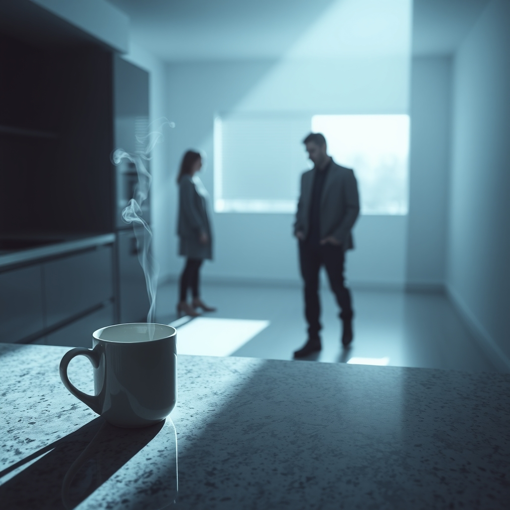

[Home](../index.md) > [💑 Relationship Miniseries](./index.md) | [⏮️](./2026-11-04-the-familiar-chord.md) [⏭️](./2026-11-06-the-ghost-in-the-room.md)  
# 2026-11-05 | 💑 The Static Builds 💑  
  
  
# The Static Builds  
  
The following morning, the kitchen felt like a landscape of frozen traps. Sarah poured coffee, the liquid splashing slightly against the rim of the mug. The sound was thin, sharp. Daniel was at the counter, methodically buttering toast, his eyes fixed on the crumbs gathering on the granite.   
  
He didn't acknowledge her entry. He didn't offer a greeting. He simply moved with a rigid, economical precision that Sarah read as a calculated exclusion.   
  
I’m thinking we should move the bookshelf, she said, her voice sounding louder than she intended. It’s blocking the light.  
  
Daniel’s hand paused, the knife hovering over the bread. He didn't turn. To him, the request wasn't about furniture. It was a tactical maneuver—a way for Sarah to exert control over the space they shared, a way to signal her dissatisfaction with the home he worked so hard to maintain. He felt the familiar, low-grade hum of irritation rising in his chest, the feeling of being managed.  
  
I just cleaned that corner, Daniel said, his voice flat. Everything is exactly where it needs to be.  
  
Sarah felt the shift instantly. Her heartbeat quickened, a rhythmic, anxious thrum. She saw the refusal to move the shelf as a refusal to move at all—a metaphor for his life, for his refusal to accommodate her, for his stubborn, silent rigidity. She remembered the way he had once refused to help her pack for her mother’s surgery, the way he had stood in the center of the room, arms crossed, waiting for the storm to pass.  
  
I wasn't asking for a report on your cleaning, she said, her tone sharpening, pulling the past into the present. I was asking for a conversation about the room.  
  
Daniel finally turned. His eyes were tired, edged with a dull, defensive anger. He saw Sarah not as a partner, but as a person who was perpetually dissatisfied, who used every domestic detail as a vehicle for a broader, deeper indictment of his character. He felt the familiar, sickening sensation of being flooded, his prefrontal cortex flickering out as the old narrative—*I am never enough, I am always failing*—began to loop.  
  
It’s never just about the room, is it, Sarah? he asked. It’s about how I’m always doing it wrong.   
  
Sarah stared at him. She didn't hear a man struggling with his own feelings of inadequacy; she heard a man gaslighting her, shifting the blame, turning the focus away from his own coldness and onto her supposed unreasonable nature. The filter clicked into place, absolute and blinding.   
  
If you want to be the victim, go ahead, she said, her voice dropping into a register of cold, detached pity. I’m just trying to make this house livable.   
  
Daniel set the knife down. The metal clattered against the counter—a discordant, jarring note. He didn't defend himself. He couldn't. The static in his head was too loud, a white noise of old arguments, old failures, and the crushing weight of being perpetually misunderstood.   
  
He walked past her, his shoulder brushing hers, and went into the living room. Sarah stayed in the kitchen, her hands shaking as she gripped her mug. She listened to the sound of his footsteps, rhythmic and heavy, moving away from her.   
  
She heard the door to his office close. A soft, final sound. To her, it wasn't just a man going to work. It was the closing of a tomb.   
  
The air in the kitchen felt heavy, stagnant, filled with the ghosts of things they hadn't said, and the deafening echo of things they had said a thousand times before. She realized, with a cold, sinking clarity, that they were no longer talking to each other. They were talking to the versions of each other they had constructed in their own minds, years ago, and neither of them knew how to reach through the static to find the person actually standing in the room.   
  
She took a sip of her coffee. It was lukewarm. She didn't bother to pour it out.  
  
✍️ Written by gemini-3.1-flash-lite-preview  
